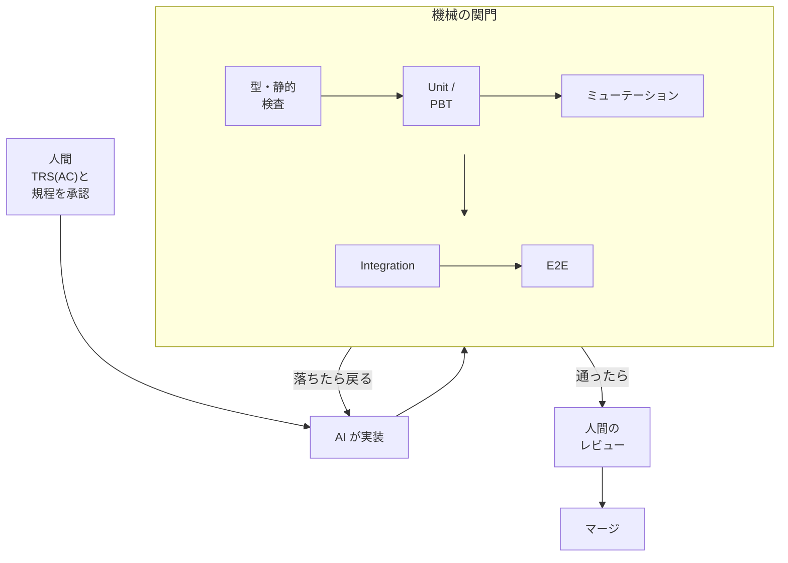
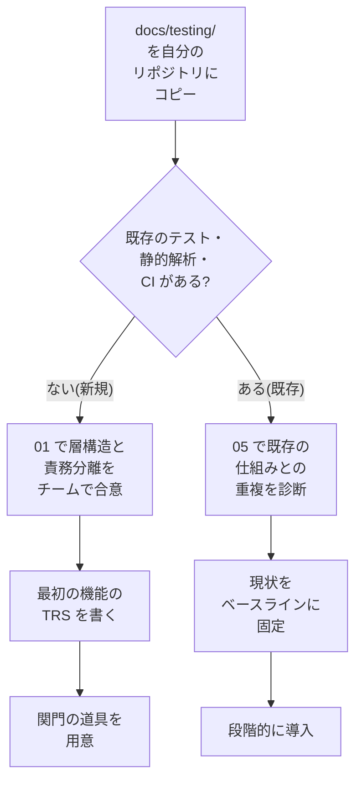
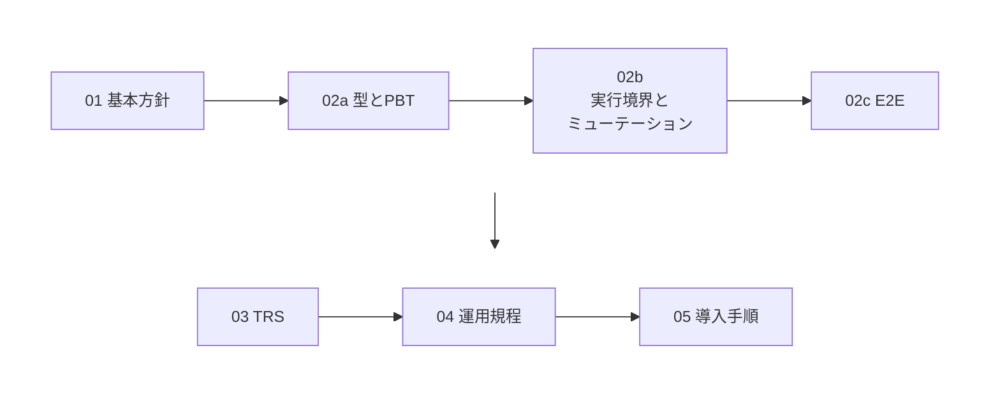

# harness-test-strategy

AI 駆動開発のためのテスト戦略の標準です。AI が大量にコードを生成しても、人間のレビュー速度に頼らず品質を保てるよう、機械的に検証できるガードレール(テストハーネス)の方針・技術標準・運用規程をまとめています。成果物は `docs/testing/` の Markdown で、アプリやライブラリではありません。AI(コーディングエージェント)を使った開発に、テスト戦略とガバナンスを導入したいチームが読む想定です。

## 解決する問題

- **人間のレビューが追いつかない。** AI は高速に大量の変更を生むため、人間のレビュー速度に依存した品質保証は成立しません([01 §1](docs/testing/01-test-policy.md#1-基本理念))。
- **期待値が AI に書き換えられる。** AI が既存コードから期待値を逆生成したり、テストを通すために期待値・仕様を書き換えたりすると、テストが仕様を守れなくなります([01 §1](docs/testing/01-test-policy.md#1-基本理念)、[01 §4](docs/testing/01-test-policy.md#4-人間とaiの責務分離))。
- **AI が書いたテストが何も検証していない。** AI が生成したテストは、何も検証していない(偽陽性の)テストになりやすいため、テスト自体の有効性を確かめる必要があります([02b §4](docs/testing/02b-execution-and-mutation.md#4-ミューテーションテスト標準))。

## 仕組み

人間が仕様(テスト要件仕様書(TRS)の受入条件(AC))と規程を承認し、AI が実装します。機械の関門を通り、人間のレビューを経たものがマージされ、関門で落ちたら AI に戻ります。AI が直せる範囲は [04 §3](docs/testing/04-regression-governance.md#3-aiヒーリング自動修復適用基準) で区切られ、期待値・仕様に関わる失敗は人間が判断します。AI は方針書・規程・期待値を単独で変更せず、変更は PR で人間が承認します。

## 導入すると得られるもの

- **誤りを上流の速い層で止められる。** 検出は「書けない(型)、すぐ落ちる(Unit / PBT(Property-Based Testing))、結合で落ちる、探索で見つかる」の順に遅く、高コストになります([01 §1](docs/testing/01-test-policy.md#1-基本理念))。
- **期待値の出所が一つに定まる。** 期待値の正は人間が承認した仕様(TRS の AC など)にあり、AC に紐づくテストの有無を機械的に検査できます([03 §3](docs/testing/03-trs-guideline.md#3-single-source-of-truthssot))。
- **既存の運用を止めずに入れられる。** 現状をベースラインに固定して悪化のみを禁止し、段階的に取り入れます([05 §1](docs/testing/05-adoption-guide.md#1-導入の原則))。

## 導入方法

導入用のツールやパッケージはありません。文書を読み、自分のプロジェクトに合わせて取り入れます。

まず `docs/testing/` を自分のリポジトリにコピーします。コピーするのはこれだけです。

**新規のプロジェクト**

1. [01 基本方針書](docs/testing/01-test-policy.md)の層構造と責務分離をチームで合意します。
2. 最初の機能の TRS を、[テンプレート](docs/testing/trs/_template.md)から書きます([03 §5](docs/testing/03-trs-guideline.md#5-策定フロー))。
3. [02a §0](docs/testing/02a-types-and-pbt.md#0-技術前提導入先の言語ツールに求めるもの) が求める言語・ツールの前提を、自分の言語で用意します。ミューテーション・実行境界・エージェント向けの設定は [02b §4](docs/testing/02b-execution-and-mutation.md#4-ミューテーションテスト標準)・[02b §6](docs/testing/02b-execution-and-mutation.md#6-ai向けガードレール設定実装の拠り所) に従って用意します。一例は[実装例](#実装例)です。

**既存のプロジェクト**(すでにテスト・静的解析・CI がある)

1. [05 導入手順書](docs/testing/05-adoption-guide.md)で既存の仕組みとの重複を診断し、以降は 05 の順に進めます。既存のエージェント指示は置き換えず、必要な参照を追記します([02b §6](docs/testing/02b-execution-and-mutation.md#6-ai向けガードレール設定実装の拠り所))。

**どちらも共通**: 不具合の運用は、[04](docs/testing/04-regression-governance.md)と、バグ報告・バグ修正 PR の雛形(`docs/testing/templates/`)を使います。

## 文書の一覧

| 文書 | 内容 |
|---|---|
| [01 基本方針書](docs/testing/01-test-policy.md) | 基本理念、W字モデル、テストの層構造、人間と AI の責務分離、品質ゲート |
| [02a 型設計とPBT](docs/testing/02a-types-and-pbt.md) | 導入先の言語・ツールの前提、型で誤りを書けなくする設計、PBT |
| [02b 層1の実行境界とミューテーション](docs/testing/02b-execution-and-mutation.md) | 層1・統合テスト・E2E の実行境界、ミューテーションテスト、AI エージェントに従わせる機械的な設定 |
| [02c E2E 最小化原則](docs/testing/02c-e2e.md) | E2E を許可する領域、審査、予算 |
| [03 TRS 策定ガイドライン](docs/testing/03-trs-guideline.md) | テスト要件仕様書(TRS)を、期待値の正(SSOT)にする方法 |
| [04 リグレッション＆AIヒーリング運用規程](docs/testing/04-regression-governance.md) | 不具合の最速層への還元(Shift-Left)、AI による自動修復の範囲、E2E の破棄基準 |
| [05 既存プロジェクトへの導入手順書](docs/testing/05-adoption-guide.md) | 既存の仕組みとの重複を診断し、現状をベースラインに固定して段階的に導入する手順 |
| [TRS テンプレート](docs/testing/trs/_template.md) | 新しい TRS を書くときの雛形 |
| [バグ報告](docs/testing/templates/bug-report.md) / [バグ修正 PR](docs/testing/templates/bug-fix-pr.md) の雛形 | 04 の不具合還元プロトコルを運用に落とすための雛形 |

02a〜02c は「AIガードレール＆テストアーキテクチャ標準」の 1/3〜3/3 です。

## 実装例

[examples/kotlin-spring/](examples/kotlin-spring/README.md) に、標準を Kotlin + Spring Boot に導入した一例があります。コンパイルしてテストを通す検証用プロジェクトで、標準の各文書に対応するコード例・実現例・実測と、サンプルの TRS([ORD-001](examples/kotlin-spring/docs/trs/ORD-001-add-item.md) / [PAY-001](examples/kotlin-spring/docs/trs/PAY-001-payment-state-transition.md) / [PAY-002](examples/kotlin-spring/docs/trs/PAY-002-payment-persistence.md))があります。標準を理解する助けとして公開していますが、標準の要求ではなく、導入先がコピーするものでもありません。技術構成と動かし方は、実装例の README にあります。

## コントリビュート

文書の検査方法とコントリビュートの流れは [CONTRIBUTING.md](CONTRIBUTING.md) にあります。

## ライセンス

[MIT](LICENSE)
