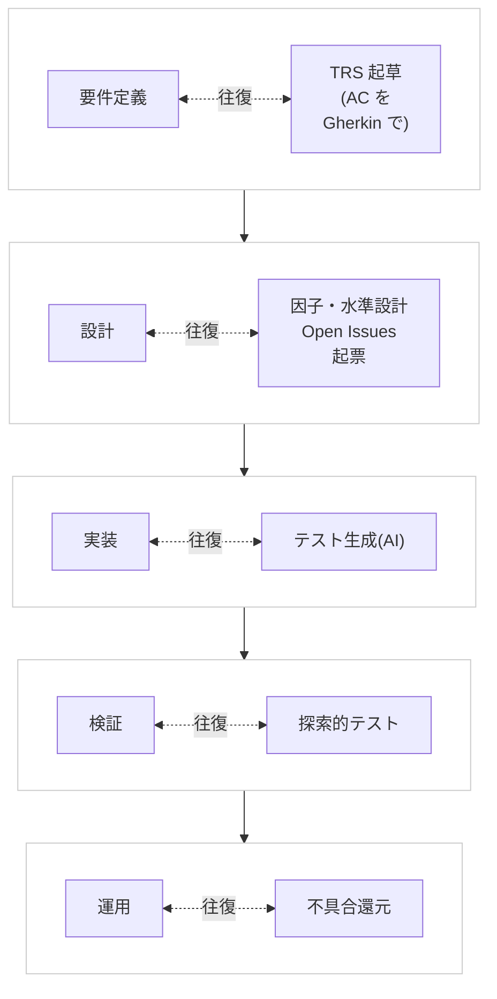
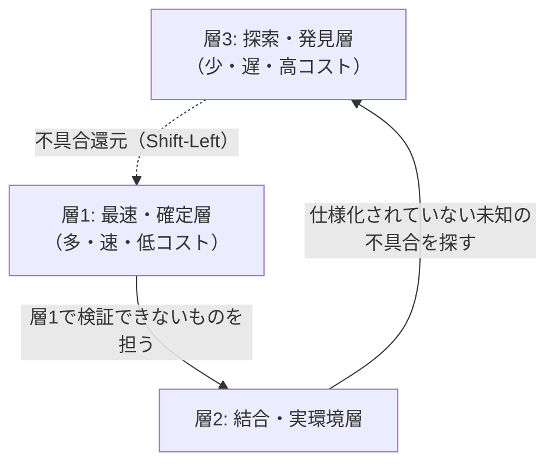

# 01. AI駆動テスト基本方針書

**この文書で決めること**

- テストを開発と並行で進める W字モデルと、3層の使い分け
- 人間と AI の責務分離と、AI が越えてはならない線
- 品質ゲート G0〜G5 の条件と、必須チェックとの対応

| 項目 | 内容 |
|---|---|
| 文書ID | TEST-01 |
| 目的 | AIと人間が共創して最高品質を維持するためのテストハーネスの基本方針を定める |
| 適用範囲 | AIが設計・実装・テストのいずれかに関与する全ての開発活動 |
| 関連文書 | [02a 型設計とPBT](./02a-types-and-pbt.md) / [02b 層1の実行境界とミューテーション](./02b-execution-and-mutation.md) / [02c E2E 最小化原則](./02c-e2e.md) / [03 TRSガイドライン](./03-trs-guideline.md) / [04 リグレッション運用規程](./04-regression-governance.md) / [05 導入手順書](./05-adoption-guide.md)（既存プロジェクトへの導入） |

---

## 1. 基本理念

1. **品質は「後から見つける」ものではなく「先に作り込む」もの**とする。誤りは、書けない（型）→ 即座に落ちる（Unit/PBT）→ 結合で落ちる → 探索で見つかる、の順に検出が遅くなりコストが増える。可能な限り上流・高速な層で止める。
2. **AIは高速に大量の変更を生む。** 人間のレビュー速度に依存した品質保証は成立しないため、機械的に検証可能なガードレール（テストハーネス）を品質の主軸とする。
3. **期待値の正は人間が合意した仕様にある。** AIが既存コードから期待値を逆生成してはならない（詳細は 03）。
4. **テストは資産であると同時に負債である。** 価値の低いテストは削除する。ただし削除は手順（04）に従う。

## 2. W字モデル（W-Model）の採用

開発ラインとテストラインを要件定義の段階から**並行**で進める。テストは実装後の工程ではない。

図は開発ラインとテストラインの並行関係を示す。左が開発ライン、右がテストラインで、各行が 1 つのフェーズ（全 5 フェーズ）に当たる。同じ行の左右は、「往復」と書いた双方向の点線でつなぐ。点線は、同じフェーズで 2 つのラインが互いに情報を返し合うことを表す（設計では Open Issues で仕様を往復する）。行の間の矢印がフェーズの進行を表す。表は同じ 5 フェーズごとのテストラインの成果物と主担当を示す。

| フェーズ（開発ライン） | テストライン（並行成果物） | 主担当 |
|---|---|---|
| 要件定義（US/UC の策定） | TRS 仕様レイヤーの起草（AC を Gherkin で記述） | 人間（合意）／AI（起草支援） |
| 設計（型・ドメインモデル設計） | 因子・水準・因子制約の設計、Open Issues の起票 | 人間（型設計）／AI（網羅案） |
| 実装 | Unit / PBT / Integration / E2E の生成 | AI（生成・修復）／人間（レビュー） |
| 検証（CI 実行・リリース判定） | 探索的テスト、AIブラウザ操作エージェント | 人間＋AI |
| 運用（不具合対応） | 不具合還元（04 の Shift-Left Protocol） | AI（分析）／人間（承認） |

**運用ルール**

- TRS が存在しない機能は実装に着手しない（軽微な修正は例外とし、PR に理由を記載する）。
- 仕様の曖昧さは実装時に AI が推測で埋めず、TRS の Open Issues に起票して人間が決定する。

## 3. 3層アーキテクチャ

テストを実行速度とフィードバックの性質で3層に分け、**下の層ほど厚く、上の層ほど薄く**する。

### 層1: 最速・確定層

- 構成: 型システム、Lint、Unit テスト、PBT（Property-Based Testing）
- フィードバック: ミリ秒〜数秒。エディタ保存時・コミット前フックで実行
- 判定: 決定的（flaky を許容しない）
- AIとの関係: **AIによるコード自動修正の主軸。** AI は失敗出力を入力にして自己修復ループを回す
- 方針: ビジネスロジック・検証ロジック・状態遷移の検証は原則ここで完結させる

### 層2: 結合・実環境層

- 構成: Integration テスト（DB・外部I/F・API 契約）、ハッピーパスに厳選した E2E
- 実行: CI で全 PR に対し自動実行
- 方針: 層1で検証できないもの（配線、通信、実ブラウザ依存）に限定する。E2E の許可領域は 02c §5 に従う

### 層3: 探索・発見層

- 構成: 人間の探索的テスト、AIブラウザ操作エージェントによる自律探訪
- 実行: バックグラウンドで自律実行（夜間・デプロイ後など）。PR のブロッキング条件にはしない
- 目的: **仕様化されていない未知の不具合**の発見
- 出口: 発見した不具合は 04 の不具合還元プロトコルで層1へ還元する。層3は「発見」で終わらせず「再発防止の下層化」まで行う

### 3層の使い分け基準

| 検証したいこと | 置く層 |
|---|---|
| 値の妥当性、計算、状態遷移、分岐網羅 | 層1（型 → Unit → PBT の順に検討） |
| モジュール間・外部システム間の契約 | 層2（Integration） |
| 主要ユーザーフローが端から端まで動くこと | 層2（E2E、厳選） |
| 想定外の操作・組合せでの破綻、UX の違和感 | 層3 |

> **原則**: 「より下の層で検証できるなら、下の層に置く」。上の層にテストを追加する場合は、下層で代替できない理由を PR に明記する。

## 4. 人間とAIの責務分離

設計・合意・承認は人間、生成・修復は AI が担う。

| 領域 | 人間 | AI |
|---|---|---|
| 型・ガードレール | **設計する**（ドメイン型、不変条件、禁止事項） | 設計案の提示、型に従った実装 |
| 受入条件 | **合意する**（AC の最終確定） | 起草、抜け漏れ・矛盾の指摘 |
| 仕様変更 | **承認する** | 影響範囲の分析、変更案の PR 提案 |
| テストケース | 重要境界・リスクの指定、レビュー | **大量生成**（因子・水準展開、PBT の Property 候補、境界値） |
| 不具合修正 | 原因分析の妥当性確認、仕様に関わる判断 | **コード即時修復**、層1への還元テスト作成 |
| 探索 | 経験に基づく探索的テスト | **自律探訪**（ブラウザ操作エージェント）、ログ・差分の一次分析 |

**越えてはならない線**

- AI は、テストを通すために**期待値・仕様・文言を書き換えてはならない**。
- AI は、失敗しているテストの**スキップ・削除・アサーション弱体化**を単独で行ってはならない。
- 仕様に影響する変更は常に人間の承認を経る（PR 提案として提示する）。

## 5. 品質ゲート（最低基準）

文書（G0）から TRS 整合（G5）までの6つのゲートを、最低基準とする。

| ゲート | 条件 | 実行タイミング |
|---|---|---|
| G0 Markdown 検査 | 文書（Markdown）の構文検査の指摘が 0 件、かつ全 Mermaid 図がレンダリング可能。対象は、本ドキュメント群を含む全 `.md`（ただし対象範囲は導入先が診断で決める）。ローカルも CI も同一のコマンドで実行する | PR／main |
| G1 静的検査 | 型チェック・Lint がエラー 0 | 保存時／pre-commit |
| G2 層1テスト | Unit・PBT 全件成功 | pre-commit／PR |
| G3 ミューテーション | 変更ファイルの Mutation Score が閾値以上（02b §4） | PR |
| G4 層2テスト | Integration・E2E 全件成功 | PR／マージ前 |
| G5 TRS 整合 | 対応する TRS の AC に紐づくテストが存在し、未解決の Blocking な Open Issue が指す AC が `@pending:<OI-ID>` で明示されている（`@pending` に書けるのは未解決の Blocking な OI-ID だけで、付けられるのはその OI の関連列にある AC だけ） | PR |

G0 の対象範囲は、導入先では [05 の適合度診断](./05-adoption-guide.md#3-手順と完了条件)で決める。対象から外す場合は、[05 §4](./05-adoption-guide.md#4-導入モード) の「適用外」の手順（理由と代替の担保の記録）による。

### 5.1 ゲートと必須チェックの対応

**結論: 各ゲートを何で検査し、何で失敗とするかを下表に示す。**

ゲートを CI の必須チェックにする場合、必須チェックは **パス条件で実行を絞らず、PR で常に実行する**（例: GitHub Actions の `paths:` フィルタを付けない。絞ると、対象外の変更で未実行のまま「待機中」となりマージできなくなるため）。

| ゲート | 何を検査するか | 何で失敗させるか | 実現例（ツール名は例示） |
|---|---|---|---|
| G0 | 文書の構文と図のレンダリング | 構文検査の指摘が 1 件でもある、または図が 1 つでもレンダリングできない | 例: markdownlint-cli2（構文）、mermaid-cli（図） |
| G1 | 型チェックと Lint | 型エラーまたは Lint のエラーが 1 件でもある | |
| G2 | 層1のテスト（Unit・PBT） | 1 件でもテストが失敗する | |
| G3 | 変更ファイルの Mutation Score | Mutation Score が閾値（02b §4.1）を下回る | 例: PIT（JVM）、Stryker（JS/TS） |
| G4 | 層2のテスト（Integration・E2E） | 1 件でもテストが失敗する | 例: Testcontainers（実 DB）、Playwright（実ブラウザ） |
| G5 | TRS の AC とテストの紐づけ | pending でない AC に対応するテストが無いとき、CI を**失敗**させる。除外は `@pending:<OI-ID>` だけである。`@pending` の要否・書ける ID・関連列に違反するときも失敗する | TRS の AC とテストを突き合わせるテストまたはスクリプト（[03 §3.4](./03-trs-guideline.md#34-トレーサビリティ)） |

- G4 は、層1と実行境界を分ける（02b §3.2）。
- G3 で導入期の例外（[02b §4.1](./02b-execution-and-mutation.md#41-適用タイミングと閾値)）を使う導入先は、補う手段（テストの無い新規・変更クラスを PR で落とす）を実装する。
- G5 の「未解決の Blocking な Open Issue」は、TRS の Open Issues 表で区分が `Blocking`、状態が `Open` または `In Discussion` のものである。`@pending` に書けない値は、`ISSUE-n`・表に無い ID・Resolved 等の OI-ID である（[03 §3.4](./03-trs-guideline.md#34-トレーサビリティ)）。

人間のレビューでは、対象ファイルの責任者を明示する（例: GitHub の CODEOWNERS）。

## 6. 用語

| 用語 | 定義 |
|---|---|
| TRS | Test Requirement Specification（テスト要件仕様書）。詳細は 03 |
| PBT | Property-Based Testing。ランダム生成した多数の入力に対し不変条件を検証する手法 |
| AC | Acceptance Criteria（受入条件）。Gherkin 形式で記述 |
| 不具合還元 | 上位層で見つかった不具合を、より速い下位層のテストへ移し替えること（04） |
| AIヒーリング | テスト失敗の原因をAIが分析し、許可された範囲で自動修復すること（04） |
| ミュータント | コードに加える人工的な故障（条件反転・戻り値置換など）。テストが検出できる（殺せる）かで、テスト自体の有効性を測る（02b §4） |
| Mutation Score | 殺せたミュータント ÷ 全ミュータント。カバーされていないミュータント（テストの無いクラスのものを含む）も分母に含む（02b §4、G3） |
| テストの強度 | 殺せたミュータント ÷ カバー済みのミュータント。Mutation Score とは分母が違い、カバーされていないミュータント（テストの無いクラスのものを含む）を含まない。導入期の例外で PR の評価に使う（02b §4.1） |
| ADR | Architecture Decision Record（設計決定記録）。設計上の決定とその理由を残す記録 |
| DoD | Definition of Done（完了の定義）。作業を完了とみなす条件。不具合還元 PR では完了条件の欄で示す（04 §2.5） |

## 7. 改訂

本方針の改訂は PR で行い、人間のレビュー承認を必須とする。AI が単独で本ドキュメントを変更してはならない。
