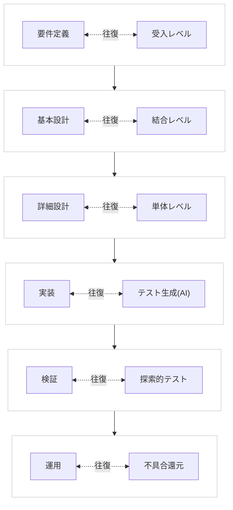
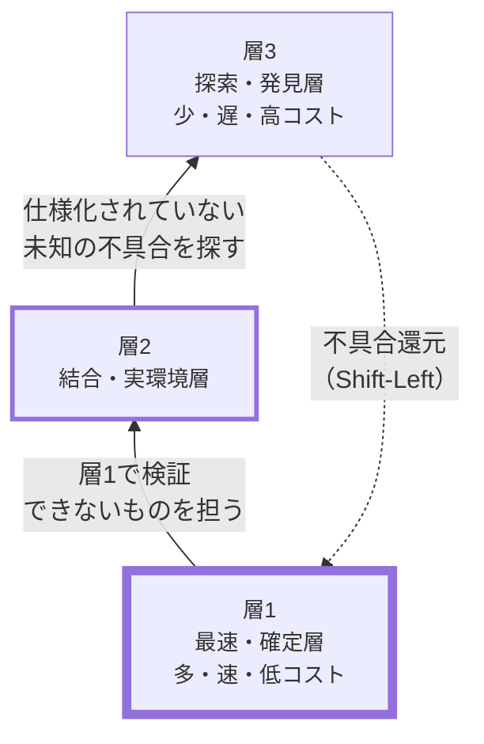

# 01. AI駆動テスト基本方針書

**この文書で決めること**

- テストを開発と並行で進める W字モデルと、文書とテストレベルの対応
- テストレベル（何を確かめるか）と、3層（何で実行するか）の使い分け（§2、§3）
- 人間と AI の責務分離と、AI が越えてはならない線
- 品質ゲート G0〜G5 の条件と、必須チェックとの対応
- 本書と 02〜05 で使う語の定義の場所（§6）

| 項目 | 内容 |
|---|---|
| 文書ID | TEST-01 |
| 目的 | AIと人間が共創して最高品質を維持するためのテストハーネスの基本方針を定める |
| 適用範囲 | AIが設計・実装・テストのいずれかに関与する全ての開発活動 |
| 関連文書 | [02-1 型設計とPBT](./02-1-types-and-pbt.md) / [02-2 実行境界とミューテーション](./02-2-execution-and-mutation.md) / [02-3 E2E 最小化原則](./02-3-e2e.md) / [03 TRSガイドライン](./03-trs-guideline.md) / [03-1 トレーサビリティ検査の詳細](./03-1-traceability-checks.md) / [03-2 TRS 生成フロー](./03-2-generation-flow.md) / [04 リグレッション運用規程](./04-regression-governance.md) / [05 導入手順書](./05-adoption-guide.md)（既存プロジェクトへの導入） |

本書と 02〜05 で使う語は、[§6 の用語表](#6-用語)で引ける。表は、語ごとに定義を書いた節を示す。

---

## 1. 基本理念

1. **品質は「後から見つける」ものではなく「先に作り込む」もの**とする。誤りは、書けない（型）→ 即座に落ちる（Unit/PBT）→ 実環境のテスト（Integration・E2E）で落ちる → 探索で見つかる、の順に検出が遅くなりコストが増える。可能な限り上流・高速な段階で止める。
2. **AIは高速に大量の変更を生む。** 人間のレビュー速度に依存した品質保証は成立しないため、機械的に検証可能なガードレール（テストハーネス）を品質の主軸とする。
3. **期待値の正は人間が合意した仕様にある。** AIが既存コードから期待値を逆生成してはならない（詳細は 03）。
4. **テストは資産であると同時に負債である。** 価値の低いテストは削除する。ただし削除は手順（04）に従う。

## 2. W字モデル（W-Model）の採用

開発ラインとテストラインを要件定義の段階から**並行**で進める。テストは実装後の工程ではない。

### 開発ラインとテストラインの対応

図は開発ラインとテストラインの並行関係を示す。左が開発ライン、右がテストラインで、各行が 1 つのフェーズ（全 6 フェーズ）に当たる。同じ行の左右は、「往復」と書いた双方向の点線でつなぐ。点線は、同じフェーズで 2 つのラインが互いに情報を返し合うことを表す（どのフェーズでも、Open Issues で仕様を往復する）。行の間の矢印がフェーズの進行を表す。図のテストラインは、上の 3 行がテストレベル、下の 3 行が活動を示す。表は同じ 6 フェーズごとのテストラインの成果物と主担当を示す。

| フェーズ（開発ライン） | テストライン（並行成果物） | 主担当 |
|---|---|---|
| 要件定義（要件定義書の作成、US/UC の策定） | 要件定義書を入力にした、TRS の生成（受入レベルの代表ケース） | 人間（要件定義書の合意）／AI（生成・起草支援） |
| 基本設計（基本設計書の作成） | 基本設計書を入力にした、TRS の生成（結合レベル） | 人間（基本設計書の合意）／AI（生成・起草支援） |
| 詳細設計（型・ドメインモデルの設計、TRS の因子・水準・因子制約の設計） | 単体レベルのテスト設計（因子・水準の展開）、Open Issues の起票 | 人間（型設計、03-2 §1 の合意）／AI（網羅案） |
| 実装 | Unit / PBT / Integration / E2E の生成 | AI（生成・修復）／人間（レビュー） |
| 検証（CI 実行・リリース判定） | 探索的テスト、AIブラウザ操作エージェント | 人間＋AI |
| 運用（不具合対応） | 不具合還元（04 の Shift-Left Protocol） | AI（分析）／人間（承認） |

**運用ルール**

- TRS が存在しない機能は実装に着手しない（軽微な修正は例外とし、PR に理由を記載する）。
- 仕様の曖昧さは実装時に AI が推測で埋めず、TRS の Open Issues に起票して人間が決定する。
- 詳細設計書は標準に足さない。型と TRS の因子・水準・因子制約を詳細設計に充てる。理由は、人が合意する文書を増やさないためである。

### テストレベルと文書の対応

テストレベルは、開発の文書ごとに「何を確かめるか」を分ける。

| テストレベル | 対応する文書 | 確かめること |
|---|---|---|
| 受入 | 要件定義書 | 要件ごとの代表ケース |
| 結合 | 基本設計書 | 画面、入力項目とデータ、状態と操作、外部インタフェース |
| 単体 | 型と TRS の因子・水準・因子制約（詳細設計に当たる） | 境界値と組合せの網羅 |

テストレベルは、何で実行するかとは別の軸である。実行手段との関係は、§3 の「テストレベルと層」で定める。

## 3. 3層アーキテクチャ

テストを実行速度とフィードバックの性質で3層に分け、**下の層ほど厚く、上の層ほど薄く**する。

下から層1・層2・層3の順に積み上がる。枠線の太さは層の厚さ（下の層ほど厚い）を表す。点線の不具合還元は主な向きを示す。還元先は層1 に限らず、04 §2.4 の順で選ぶ。

**下の層・上の層**は、この積み上がりの順序を指す。層1が最も下で、層3が最も上である。下の層ほど、速く確定的である。層2の中の Integration と E2E は同じ層で、Integration のほうが速い。

### 層1: 最速・確定層

- 構成: 型システム、Lint、Unit テスト、PBT（Property-Based Testing）
- フィードバック: ミリ秒〜数秒。エディタ保存時・コミット前フックで実行
- 判定: 決定的（flaky を許容しない）
- AIとの関係: **AIによるコード自動修正の主軸。** AI は失敗出力を入力にして自己修復ループを回す
- 方針: ビジネスロジック・検証ロジック・状態遷移の検証は原則ここで完結させる

### 層2: 結合・実環境層

- 構成: Integration テスト（DB・外部I/F・API 契約）、ハッピーパスに厳選した E2E
- 実行: CI で全 PR に対し自動実行
- 方針: 層1で検証できないもの（配線、通信、実ブラウザ依存）に限定する。E2E の許可領域は 02-3 §1 に従う

### 層3: 探索・発見層

- 構成: 人間の探索的テスト、AIブラウザ操作エージェントによる自律探訪
- 実行: バックグラウンドで自律実行（夜間・デプロイ後など）。PR のブロッキング条件にはしない
- 目的: **仕様化されていない未知の不具合**の発見
- 出口: 発見した不具合は 04 の不具合還元プロトコルで、より速いテストへ還元する。層3は「発見」で終わらせず、再発防止のテストを選定した還元先（04 §2.4）に置くところまで行う

### 3層の使い分け基準

テストレベル（§2）を決めたら、実行する層を次の基準で選ぶ。

| 検証したいこと | 置く層 |
|---|---|
| 値の妥当性、計算、状態遷移、分岐網羅 | 層1（型 → Unit → PBT の順に検討） |
| モジュール間・外部システム間の契約 | 層2（Integration） |
| 主要ユーザーフローが端から端まで動くこと | 層2（E2E、厳選） |
| 想定外の操作・組合せでの破綻、UX の違和感 | 層3 |

> **原則**: 「より下の層で検証できるなら、下の層に置く」。上の層にテストを追加する場合は、下の層で代替できない理由を PR に明記する。層2の E2E を追加する場合は、同じ層2の Integration も代替先になる。E2E の代替先は、層の順序ではなく「より速い手段（層1、または層2の Integration）」と呼ぶ（02-3 §1.3）。

### テストレベルと層

テストレベルと層は、別の軸である。

| 軸 | 表すこと | 決める基準 |
|---|---|---|
| テストレベル | 何を確かめるか | 対応する文書（§2 の「テストレベルと文書の対応」） |
| 層 | 何で実行するか | 上の「3層の使い分け基準」 |

レベルから層は一意に決まらない。層は上の基準と原則で選ぶ。層2の名称の「結合」は実行環境の性質を指し、結合レベルとは別である。

**受入レベルの実行手段**

受入レベルのテストは、要件ごとの代表ケースに限る。境界値と組合せは単体レベルで確かめる。

- 結果として多くは層2（E2E か Integration）になるが、目安であり決まりではない。
- 上の層に置く代表ケースごとに、上の原則のとおり、下の層で代替できない理由を PR に書く。E2E にするときは、02-3 §1.3 の審査に従う。
- 受入レベルをすべて E2E にはしない。

## 4. 人間とAIの責務分離

設計・合意・承認は人間、生成・修復は AI が担う。

**責務分離の核心**: 人が合意するのは入力だけで、AC は入力から AI が生成した展開なので、手で直さない（直し方は 03-2 §4）。

- 入力は、03 §1.1 で定める。
- 理由は、AI が大量の変更を生むためである。生成物を 1 行ずつ人が合意する方式では、品質が人のレビュー速度に依存する（§1 の 2）。

| 領域 | 人間 | AI |
|---|---|---|
| 型・ガードレール | **設計する**（ドメイン型、不変条件、禁止事項） | 設計案の提示、型に従った実装 |
| 要件定義書 | **決める**（内容と、不足への回答）。合意する | 起草支援、不足・矛盾の指摘（Open Issues への起票） |
| 基本設計書 | **決める**（内容と、不足への回答）。合意する | 起草支援、不足・矛盾の指摘（Open Issues への起票） |
| 受入条件 | AC は生成物。確定の方法と、人がレビューする例外は 03-2 §1 | 要件定義書と基本設計書からの生成、抜け漏れ・矛盾の指摘 |
| 仕様変更 | **承認する** | 影響範囲の分析、変更案の PR 提案 |
| テストケース | 重要境界・リスクの指定、レビュー | **大量生成**（因子・水準展開、PBT の Property 候補、境界値） |
| 不具合修正 | 原因分析の妥当性確認、仕様に関わる判断 | **コード即時修復**、還元先（04 §2.4）のテスト作成 |
| 探索 | 経験に基づく探索的テスト | **自律探訪**（ブラウザ操作エージェント）、ログ・差分の一次分析 |

**越えてはならない線**

- AI は、テストを通すために**期待値・仕様・文言を書き換えてはならない**。
- AI は、失敗しているテストの**スキップ・削除・アサーション弱体化**を単独で行ってはならない。
- 仕様に影響する変更は常に人間の承認を経る（PR 提案として提示する）。

## 5. 品質ゲート（最低基準）

文書（G0）から TRS 整合（G5）までの6つのゲートを、最低基準とする。

| ゲート | 条件 | 実行タイミング |
|---|---|---|
| G0 Markdown 検査 | 文書（Markdown）の構文検査の指摘が 0 件、かつ全 Mermaid 図がレンダリング可能。対象は、本ドキュメント群を含む全 `.md`（ただし対象範囲は導入先が診断で決める）。ローカルも CI も同一のコマンドで実行する | PR／main |
| G1 静的検査 | 型チェック・Lint がエラー 0 | 保存時／pre-commit |
| G2 層1テスト | Unit・PBT 全件成功 | pre-commit／PR |
| G3 ミューテーション | 変更ファイルの Mutation Score が閾値以上（02-2 §2） | PR |
| G4 層2テスト | Integration・E2E 全件成功 | PR／マージ前 |
| G5 TRS 整合 | 要件定義書・基本設計書・TRS・テストの対応が、[03 §3.4](./03-trs-guideline.md#34-トレーサビリティ)の検査を通る | PR |

G0 の対象範囲は、導入先では [05 の適合度診断](./05-adoption-guide.md#3-手順と完了条件)で決める。対象から外す場合は、[05 §4.1](./05-adoption-guide.md#41-導入モード) の「適用外」の手順（[§4.2](./05-adoption-guide.md#42-導入時の例外) の記録と代替の担保）による。

### 5.1 ゲートと必須チェックの対応

**結論: 各ゲートを何で検査し、何で失敗とするかを下表に示す。**

ゲートを CI の必須チェックにする場合、必須チェックは**パス条件で実行を絞らず、PR で常に実行する**。設定の例と理由は [02-2 §3.2](./02-2-execution-and-mutation.md#32-ci-の必須チェック)にある。

| ゲート | 何を検査するか | 何で失敗させるか | 実現例（ツール名は例示） |
|---|---|---|---|
| G0 | 文書の構文と図のレンダリング | 構文検査の指摘が 1 件でもある、または図が 1 つでもレンダリングできない | 例: markdownlint-cli2（構文）、mermaid-cli（図） |
| G1 | 型チェックと Lint | 型エラーまたは Lint のエラーが 1 件でもある | |
| G2 | 層1のテスト（Unit・PBT） | 1 件でもテストが失敗する | |
| G3 | 変更ファイルの Mutation Score | Mutation Score が閾値（02-2 §2.1。評価軸の猶予は [05 §4.4.1](./05-adoption-guide.md#441-ミューテーションの評価軸と頻度)）を下回る | 例: JVM の PIT、JS/TS の Stryker |
| G4 | 層2のテスト（Integration・E2E） | 1 件でもテストが失敗する | 例: Testcontainers（実 DB）、Playwright（実ブラウザ） |
| G5 | 要件定義書・基本設計書・TRS の AC・テストの紐づけ | 03 §3.4 のどれかの失敗条件に当てはまるとき、CI を**失敗**させる | 要件定義書・基本設計書・TRS の AC・テストを突き合わせるテストまたはスクリプト（[03 §3.4](./03-trs-guideline.md#34-トレーサビリティ)） |

- G4 は、層1と実行境界を分ける（02-2 §1.2）。

人間のレビューでは、対象ファイルの責任者を明示する（例: GitHub の CODEOWNERS）。

## 6. 用語

本書と 02〜05 で使う語を引く表である。「定義の場所」の列が、定義を書いた節へのリンクである。定義の場所が「本表」の語は、この表が定義である。TRS の語は、定義を 03 §1.1 などに書き、この表では一言の意味だけを書く。

### 6.1 テストと品質ゲートの語

| 用語 | 意味 | 定義の場所 |
|---|---|---|
| テストレベル | 何を確かめるか。受入・結合・単体の 3 つで、開発の文書に対応する | [§2](#2-w字モデルw-modelの採用) |
| 層 | 何で実行するか。層1・層2・層3の 3 つ | [§3](#3-3層アーキテクチャ) |
| 下の層・上の層 | 層の順序。層1が最も下で、層3が最も上。下の層ほど速く確定的 | [§3](#3-3層アーキテクチャ) |
| Integration | 層2のテストの 1 つ。モジュール間・外部システム間の配線と契約を、実環境で確かめる | [§3](#3-3層アーキテクチャ) |
| E2E | 層2のテストの 1 つ。実ブラウザで、画面を端から端まで操作する | [§3](#3-3層アーキテクチャ)、[02-3 §1](./02-3-e2e.md#1-e2e-最小化原則) |
| PBT | Property-Based Testing。ランダム生成した多数の入力に対し不変条件を検証する手法 | 本表、[02-1 §3](./02-1-types-and-pbt.md#3-pbtproperty-based-testing標準) |
| flaky | 同じコード・同じ入力でも、実行のたびに成功と失敗が変わるテスト | 本表、[02-3 §1.4](./02-3-e2e.md#14-e2e-予算) |
| ミュータント | コードに加える人工的な故障（条件反転・戻り値置換など）。テストが検出できる（殺せる）かで、テスト自体の有効性を測る | [02-2 §2](./02-2-execution-and-mutation.md#2-ミューテーションテスト標準) |
| Mutation Score | 殺せたミュータント ÷ 全ミュータント。カバーされていないミュータント（テストの無いクラスのものを含む）も分母に含む（G3） | [02-2 §2](./02-2-execution-and-mutation.md#2-ミューテーションテスト標準) |
| テストの強度 | 殺せたミュータント ÷ カバー済みのミュータント。Mutation Score とは分母が違い、カバーされていないミュータントを含まない。猶予（評価軸）で PR の評価に使う | [05 §4.4.1](./05-adoption-guide.md#441-ミューテーションの評価軸と頻度) |
| 品質ゲート（G0〜G5） | 変更を取り込む前に必ず通す、機械的な検査の最低基準 | [§5](#5-品質ゲート最低基準) |
| 不具合還元 | E2E・探索テスト・本番で見つかった不具合を、より速いテストへ移し替えること | [04 §2](./04-regression-governance.md#2-不具合還元プロトコルshift-left-protocol) |
| AIヒーリング | テスト失敗の原因をAIが分析し、許可された範囲で自動修復すること | [04 §3](./04-regression-governance.md#3-aiヒーリング自動修復適用基準) |
| 特性化テスト | 仕様書が無いレガシーコードの現状を把握するテスト | [03 §3.3](./03-trs-guideline.md#33-例外特性化テストcharacterization-test) |
| ADR | Architecture Decision Record（設計決定記録）。設計上の決定とその理由を残す記録 | 本表 |
| DoD | Definition of Done（完了の定義）。作業を完了とみなす条件。不具合還元 PR では完了条件の欄で示す | 本表、[04 §2.5](./04-regression-governance.md#25-完了条件definition-of-done) |
| 導入時の例外・適用外・保留・猶予 | 既存プロジェクトへの導入時に、標準の全部を初日から課さないと決めたものが導入時の例外。種類は 3 つ。適用外は標準の要素を外す、保留は展開の範囲を今回入れない、猶予は標準の要素は入れるが仕組み化・評価軸・頻度を一時的に緩める | [05 §4.2](./05-adoption-guide.md#42-導入時の例外) |
| 仮置きの値の維持・見直し | 初期値として置いた、実測で見直す値が仮置きの値。見直しの判断は、値を変えない維持と、値を変える見直しの 2 つ | [04 §5.2](./04-regression-governance.md#52-仮置きの値の見直し) |

### 6.2 TRS と仕様の語

| 用語 | 意味 | 定義の場所 |
|---|---|---|
| TRS | Test Requirement Specification（テスト要件仕様書） | [03 §1](./03-trs-guideline.md#1-trs-とは) |
| US・UC | US は誰が何のために何をしたいかを書いたユーザーストーリー。UC はアクターの操作の流れを書いたユースケース | [03 §2.1](./03-trs-guideline.md#21-仕様レイヤー) |
| AC | Acceptance Criteria（受入条件）。UC に紐づく、テストレベルを問わない合格条件 | [03 §2.1.2](./03-trs-guideline.md#212-ac-の形) |
| 因子・水準・因子制約 | テスト設計の入力。因子は結果に影響する軸、水準はその代表値、因子制約は成立しない組合せ（禁止組合せ）と組合せ別の期待結果 | [03 §2.2](./03-trs-guideline.md#22-テスト設計レイヤー) |
| Open Issue（OI） | 仕様の曖昧点・判断保留を、TRS の Open Issues 表に起票した 1 行 | [03 §1.1](./03-trs-guideline.md#11-用語)、[03 §4](./03-trs-guideline.md#4-open-issues-の履歴化) |
| 入力の文書・入力・人が合意する節 | 生成の元になる、人が合意するもの | [03 §1.1](./03-trs-guideline.md#11-用語)、[03-2 §1](./03-2-generation-flow.md#1-人の合意と生成物) |
| 生成物・生成の誤り | 入力から AI が生成するものと、生成物が入力や生成の規則に反していること | [03 §1.1](./03-trs-guideline.md#11-用語)、[03-2 §4](./03-2-generation-flow.md#4-生成物の置き場と編集)、[03-2 §5](./03-2-generation-flow.md#5-生成後の-ai-のレビュー) |
| 節の区分・生成物のファイル・定型文 | TRS のテンプレートの節の区分と、生成物を置く別ファイル、その冒頭の文面 | [03 §1.1](./03-trs-guideline.md#11-用語) |
| `Blocking`・未解決・`@pending` | Open Issue の区分と状態、期待値が未決の AC に付けるタグ | [03 §1.1](./03-trs-guideline.md#11-用語) |
| Approved | TRS のステータスの 1 つ。人が合意するものへの合意がそろったことを表す | [03-2 §1](./03-2-generation-flow.md#1-人の合意と生成物) |
| 機能ID・略号・スラッグ・機能名 | TRS と入力の文書の、ID と名前の関係 | [03 §1.1](./03-trs-guideline.md#11-用語) |

## 7. 改訂

本方針の改訂は PR で行い、人間のレビュー承認を必須とする。AI が単独で本ドキュメントを変更してはならない。
