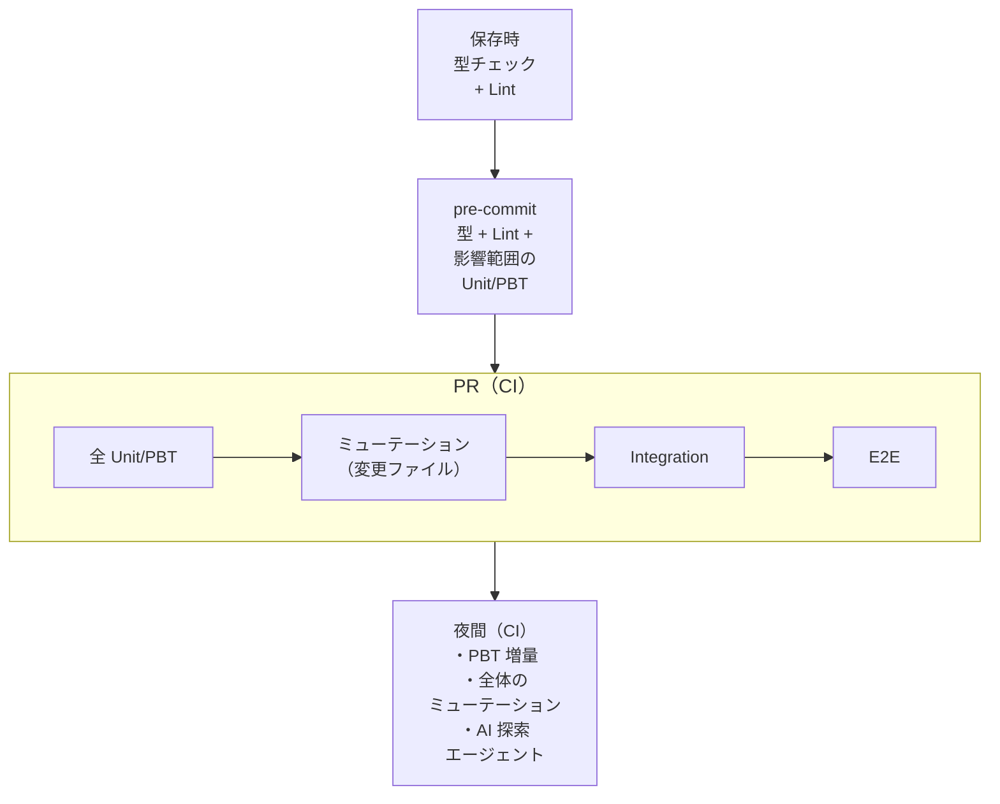
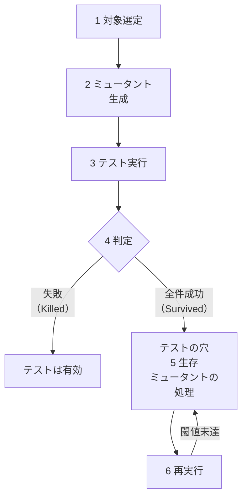

# 02-2. 実行境界とミューテーション（AIガードレール＆テストアーキテクチャ標準 2/3）

**この文書で決めること**

- 実行の順序と、層1・Integration（層2）・E2E（層2）の実行境界（§1）
- ミューテーションテストの実行時期と閾値（§2）
- AI エージェントに従わせる機械的な設定（§3）

| 項目 | 内容 |
|---|---|
| 文書ID | TEST-02-2 |
| 目的 | 層1・Integration・E2E の実行境界、ミューテーションテストの標準、AI エージェントに従わせる機械的なガードレール設定を定める |
| 前提 | [01 基本方針書](./01-test-policy.md) の層1（最速・確定層）を中心に規定する |
| 関連 | [05 導入手順書](./05-adoption-guide.md)（既存プロジェクトへ導入するときの診断と段階導入）。型設計・PBT は [02-1](./02-1-types-and-pbt.md)、E2E の最小化原則は [02-3](./02-3-e2e.md) |

02 系の 3 文書の分割と節の対応は、[02-1](./02-1-types-and-pbt.md) の冒頭の表にまとめている。

> この文書は特定の言語・ツールに依存しない。括弧内のツール名は例示で、導入先の言語・ツールに読み替えて適用する。

## 1. 実行順序と実行境界

### 1.1 実行順序

保存時・pre-commit・PR・夜間の各段階で回す検査を次に示す。

### 1.2 層1・Integration・E2E の実行境界

実 DB や実ブラウザのテストを足しても層1の速度要件（全体で数秒以内）を壊さないよう、実行コマンドとテストの置き場所（ディレクトリ。例: Gradle のソースセット）で境界を分ける。

| 項目 | 層1 | Integration（層2） | E2E（層2） |
|---|---|---|---|
| 置き場所 | 層1専用のディレクトリ | Integration 専用のディレクトリ | E2E専用のディレクトリ |
| 実行 | 層1専用のコマンド | Integration 専用のコマンド | E2E専用のコマンド（層1・Integration のコマンドや、一括実行には含めない） |
| 置くもの | 型・Unit・PBT・アーキテクチャ検査 | アプリケーションフレームワークのコンテキストを起動するテストと、コンテナで起動した実 DB を使うテスト | 実ブラウザで操作するテスト。02-3 §1.1 の許可領域のみ |
| 必要なもの | 言語のランタイムとテストランナーのみ（フレームワークの起動・コンテナ不要） | ランタイムとコンテナ実行環境 | ランタイム、コンテナ実行環境、ブラウザ |
| CI | 層1のジョブ | Integration のジョブ | E2E のジョブ（PR で実行。ジョブの時間上限が 02-3 §1.4 の予算） |

- 実行境界は、実行境界の検査で機械的に確認する。検査そのものが違反を検出できることも、違反例で確認する。
  - 層1のテストは、フレームワークのコンテキスト起動とコンテナ（実 DB）の起動を使わない。
  - これらを使うテストは、Integration と E2E の置き場所にだけ置く。
  - 層1のファイルに、コンテキスト起動やコンテナ起動を宣言する記述（アノテーションなど）があると違反になる。
  - この検査は、依存の参照と宣言の記述の 2 経路で行い、どちらかに当たれば違反とする。
  - コンテキストを起動しない型だけの利用は許可する。
  - ブラウザ操作は E2E の置き場所にだけ置き、層1と Integration には入れない。
- テスト保護の検査（無効化の検出）とトレーサビリティ検査（AC 紐づけ）は、層1・Integration・E2E のすべてを対象にする。Integration と E2E が検査から外れていないことは、それぞれのテストで確認する。
- AC に紐づく Integration・E2E のテスト名は、層1と同じく先頭に `AC-xx-yy` を置く（03-1 §1）。

### 1.3 DB を含む Integration

- DB を含む Integration は、コンテナで実 DB を起動して行う（例: Testcontainers）。置き場所と必要なものは §1.2 の表のとおり。

## 2. ミューテーションテスト標準

AI が生成したテストは、**何も検証していない（偽陽性）テスト**になりやすい。コードに意図的な欠陥（ミュータント）を注入し、テストが検出できるかで**テスト自体の有効性**を検証する。

### 2.1 適用タイミングと閾値

| タイミング | 対象 | 閾値（初期値） |
|---|---|---|
| PR | 変更ファイルのみ（差分ミューテーション） | Mutation Score ≥ 80% |
| 夜間 | 層1の全対象 | Mutation Score ≥ 70%（低下傾向を監視） |
| E2E 破棄判断時 | 04 §4 の手順に従う | 代替検証で生存ミュータント 0 |

PR の差分ミューテーションで、差分から対象を決められない変更（ビルド設定など）のときは全体を対象にする。

閾値はプロジェクトで調整してよいが、**引き下げは人間の承認**を要する。

閾値は対象全体の合算にかかる。対象を広げたことでドメイン層など重要なパッケージの実効の要求が下がる場合は、合算の閾値に加えて、そのパッケージを別に評価してよい。

閾値の初期値は仮置きの値である。見直しは [04 §5.2](./04-regression-governance.md#52-仮置きの値の見直し) による。

導入時の猶予は [05 §4.4.1](./05-adoption-guide.md#441-ミューテーションの評価軸と頻度) による。

### 2.2 コード破壊検証手順

各手順の内容は次のとおり。

1. 対象選定: 変更されたロジックを含むファイルを対象にする（ドメイン層・検証ロジックを優先）。
2. ミュータント生成: 下に示すミュータントを注入する。
3. テスト実行: ミュータントごとに関連テストを実行する。
4. 判定: テストが失敗（Killed）すればテストは有効である（タイムアウトも Killed 扱い）。全件成功（Survived）なら、テストの穴である。
5. 生存ミュータントの処理: 下表に従う。
6. 再実行: 閾値を満たすまで繰り返す。

注入するミュータントは、条件反転（`<` → `<=`）、算術演算子置換、戻り値置換、条件削除、ブロック削除、境界値の±1 などである。

| 生存の原因 | 対処 |
|---|---|
| アサーション不足・弱い | テストを強化（AI が修正可。ただし期待値は仕様に基づく） |
| 入力カバレッジ不足 | 境界値ケース／PBT のジェネレータを追加 |
| 等価ミュータント（挙動が変わらない） | 除外設定に理由付きで登録（人間が承認） |
| デッドコード | コード削除を PR で提案 |

### 2.3 禁止事項

- Mutation Score を上げるためにテストを実装の写し（モック過多・実装詳細の複製）にすること。
- 生存ミュータントを理由なく除外リストに追加すること。
- カバレッジ（行・分岐）の数値だけでテストの品質を主張すること。**カバレッジは「実行された」ことを、ミューテーションは「検証された」ことを示す。**

### 2.4 ミューテーションテストの実行方法

- ミューテーションテストは、言語ごとのツールで実行する（例: JVM の PIT、JS/TS の Stryker、Python の mutmut）。実行時期と閾値は §2.1 に従う。
- 等価ミュータントは §2.2 の手順で人間が承認して除外する。除外設定の追加・変更も同様に人間の承認を要する。
- ミューテーションツールやテストフレームワークの更新で壊れないかは、それらの依存更新の PR で検知する。ビルド設定の変更として、全体を対象にして実行する（§2.1）。
- ツールごとの設定は言語によって異なるため、この標準では定めない。確認できていない設定は書かず、ツールの公式ドキュメントで確認する。

## 3. AI向けガードレール設定（実装の拠り所）

AI エージェントが従うべき機械的ルールを、リポジトリ設定として固定する。

### 3.1 設定項目

| 領域 | 設定 |
|---|---|
| コンパイラ | 警告をエラーとして扱う。言語の null 安全を維持し、他言語との連携部は null 可否の注釈に従う |
| 静的解析 | Lint とフォーマッタ（例: Kotlin の detekt・ktlint、JS/TS の ESLint、Python の Ruff）。設定はリポジトリに置き、コマンドはローカルも CI も同一にする |
| アーキテクチャ検査 | 層の依存方向と禁止パターンを、テストとして実行する検査で強制する（例: JVM の ArchUnit、Kotlin の Konsist） |
| テスト保護 | テストの無効化（スキップ指定など）を検出して失敗させる。意図的な無効化の手順は 04 §3.4.1。アサーション削除・スナップショット一括更新は機械検出せずレビューで確認する |
| 変更制限 | TRS と期待値ファイルの変更は人間レビュー必須（例: CODEOWNERS） |
| エージェント指示 | リポジトリのエージェント指示ファイル（例: CLAUDE.md）に、本標準と 04 のヒーリング規程への参照を記載する |

- 静的解析
  - 型の迂回（null の強制解除、安全でない型変換）、実行時の初期化漏れを招く宣言、検査の抑制指定、標準出力への出力を禁止するルールを使う。
  - 型情報が必要なルールは、型解決を有効にして実行する。
  - テストで型変換を認める例外（[02-1 §3.3](./02-1-types-and-pbt.md#33-pbt-実装ルール)）のため、検査対象は本番ソースのみである。
  - 根拠のない型変換全般は標準ルールでは検出できないことがあるため、レビュー（[02-1 §2.4](./02-1-types-and-pbt.md#24-型ガードレールのチェックリストレビュー観点)）で補う。
- アーキテクチャ検査
  - ドメイン層でプリミティブ型のプロパティ・引数が露出していないことを検査する。
    - この検査の例外は2つで、いずれもテスト内にコメントで理由を残す。1つは値オブジェクトが内部に保持する値と定数、もう1つは外部入力を一度だけパースする境界のファクトリである。
  - ドメイン層がフレームワークに依存していないことを検査する。
  - 列挙型・直和型の分岐に既定分岐（`else` など）がないことを、本番コード全体で検査する。

### 3.2 CI の必須チェック

01 §5.1 の規則（パス条件で実行を絞らない）の例と理由を示す。

- 例: 必須チェックのワークフローに、パス条件のフィルタ（例: GitHub Actions の `paths:`）を付けない。
- 理由: 絞ると、対象外の変更で未実行のまま「待機中」となり、マージできなくなる。
