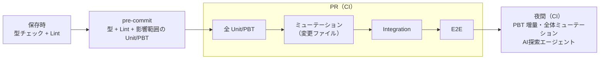

# 02. AIガードレール＆テストアーキテクチャ標準

| 項目 | 内容 |
|---|---|
| 文書ID | TEST-02 |
| 目的 | AIが生成するコードの誤りを「書けない」「すぐ落ちる」状態にするための技術標準を定める |
| 前提 | [01 基本方針書](./01-test-policy.md) の層1（最速・確定層）を中心に規定する |

> コード例は **Kotlin + Spring Boot 4.1.x** で示す。原則そのものは言語非依存である。

## 0. 技術前提（コード例のベースライン）

| 項目 | 前提 |
|---|---|
| Spring Boot | 4.1.x（Spring Framework 7.0.x、Jakarta EE 11） |
| Kotlin | 2.3 系（Spring Boot 4.1 の基準バージョン） |
| JDK | 17 以上（Spring Boot 4 の最低要件） |
| ビルド | Gradle 9（Kotlin DSL） |
| JSON | Jackson 3（パッケージは `tools.jackson.*`。ただし `jackson-annotations` は `com.fasterxml.jackson.annotation` のまま） |
| テスト | JUnit Platform + Kotest（Property / Assertions）、必要箇所のみ `@SpringBootTest` |
| モック | `@MockitoBean` / `@MockitoSpyBean`（`org.springframework.test.context.bean.override.mockito`。Spring Boot 3 の `@MockBean` / `@SpyBean` は廃止済み） |

> Spring Boot 4 では自動構成とテスト支援が機能別モジュールに分割された。テストスライス（`@WebMvcTest` 等）や `MockMvc` / `RestTestClient` 関連のアノテーションのパッケージ名・テスト用スターター名は、使用する 4.1.x の公式リファレンスで確認して指定すること。本書のコード例は、ドメイン層を Spring 非依存の純粋な Kotlin とすることで、フレームワークの変更に影響されない構成にしている。

```kotlin
// build.gradle.kts（抜粋。全体は検証用プロジェクトのルートにある build.gradle.kts）
plugins {
    kotlin("jvm") version "2.3.21"             // Spring Boot 4.1.1 の BOM が採用する Kotlin と同一
    kotlin("plugin.spring") version "2.3.21"
    id("org.springframework.boot") version "4.1.1"   // 4.1.x の最新パッチを使う
}

kotlin {
    jvmToolchain(21)
    compilerOptions {
        allWarningsAsErrors.set(true)          // 警告（冗長な else 等）をエラー化
    }
}

dependencies {
    implementation(platform(org.springframework.boot.gradle.plugin.SpringBootPlugin.BOM_COORDINATES))
    implementation("org.springframework.boot:spring-boot-starter-webmvc")
    implementation("tools.jackson.module:jackson-module-kotlin")
    testImplementation("org.springframework.boot:spring-boot-starter-test")
    testImplementation("io.kotest:kotest-runner-junit5:6.2.5")
    testImplementation("io.kotest:kotest-assertions-core:6.2.5")
    testImplementation("io.kotest:kotest-property:6.2.5")
}

tasks.withType<Test> { useJUnitPlatform() }
```

> 本書の §1〜§2 のコード例は、リポジトリ直下の検証用プロジェクト（`src/`）に同一内容で置いてあり、`./gradlew test` でコンパイルとテストを実行できる（CI: `.github/workflows/kotlin-samples.yml`）。コード例を変更するときは `src/` 側も同時に更新すること。

---

## 1. 「誤りを書けなくする」型設計

テストで誤りを検出するより、**誤りがコンパイルできない**状態を優先する。AI は型エラーを即座にフィードバックとして受け取り自己修復できるため、型は最も安価で強力なガードレールである。

### 1.1 プリミティブ型の排除（ドメイン型 / Value Object 化）

ドメインの意味を持つ値に `String` / `Int` / `Long` / `Boolean` を直接使わない。

| 禁止 | 推奨 |
|---|---|
| `userId: String` | `userId: UserId` |
| `amount: Long` | `amount: Yen`（単位・精度・上限を内包） |
| `email: String` | `email: EmailAddress` |
| `status: String` | `status: OrderStatus`（sealed interface） |

Kotlin では `@JvmInline value class` を使うと、実行時のオブジェクト生成コストを抑えつつ、コンパイル時に型を区別できる。

```kotlin
package com.example.order.domain

// 異なる意味の String を取り違えられなくする（ブランド型相当）
@JvmInline
value class UserId private constructor(val value: String) {
    companion object {
        fun of(raw: String): Validated<UserId, IdError> =
            if (raw.isBlank()) Validated.Invalid(IdError.BLANK) else Validated.Valid(UserId(raw))
    }
}

@JvmInline
value class OrderId private constructor(val value: String) {
    companion object {
        fun of(raw: String): Validated<OrderId, IdError> =
            if (raw.isBlank()) Validated.Invalid(IdError.BLANK) else Validated.Valid(OrderId(raw))
    }
}

enum class IdError { BLANK }

fun cancelOrder(orderId: OrderId, by: UserId) { /* ... */ }
// cancelOrder(userId, orderId)  // ← コンパイルエラー（引数の取り違えを排除）
```

**ルール**

- API 境界（外部入力）で一度だけパースし、以降は内部にドメイン型のみを流通させる（Parse, don't validate）。
- ドメイン型の生成は `private constructor` + ファクトリ経由に限定する。`as` による強制キャストで型を偽装してはならない。
- `!!`（非 null アサーション）、根拠のない `as`、`@Suppress`、`lateinit` の乱用は静的解析（detekt）で禁止する。
- Spring の `@RequestBody` 等で受ける DTO はプリミティブでよいが、**DTO はアダプタ層に閉じ込め**、ユースケースへ渡す前にドメイン型へ変換する（§1.2 の例を参照）。

### 1.2 コンストラクタ防御

不正な値でオブジェクトが**存在できない**ようにする。

```kotlin
package com.example.order.domain

/** 検証結果。失敗を例外ではなく値として返し、呼び出し側に分岐を強制する。 */
sealed interface Validated<out T, out E> {
    data class Valid<out T>(val value: T) : Validated<T, Nothing>
    data class Invalid<out E>(val error: E) : Validated<Nothing, E>
}

enum class QuantityError { OUT_OF_RANGE }

@JvmInline
value class Quantity private constructor(val value: Int) {
    companion object {
        const val MIN = 1
        const val MAX = 999

        fun of(value: Int): Validated<Quantity, QuantityError> =
            if (value in MIN..MAX) Validated.Valid(Quantity(value))
            else Validated.Invalid(QuantityError.OUT_OF_RANGE)
    }
}
```

アダプタ層（Spring MVC）では、DTO を境界で一度だけドメイン型へ変換し、失敗はそのまま HTTP 400 に写像する。

```kotlin
package com.example.order.adapter.web

import com.example.order.domain.Quantity
import com.example.order.domain.Validated
import org.springframework.http.HttpStatus
import org.springframework.http.ProblemDetail
import org.springframework.http.ResponseEntity
import org.springframework.web.bind.annotation.PostMapping
import org.springframework.web.bind.annotation.RequestBody
import org.springframework.web.bind.annotation.RequestMapping
import org.springframework.web.bind.annotation.RestController

/** 外部入力の形そのもの。ドメインの意味は持たず、アダプタ層から外へ出さない。 */
data class AddItemRequest(val sku: String, val quantity: Int)

@RestController
@RequestMapping("/orders")
class OrderController(private val addItem: AddItemUseCase) {

    @PostMapping("/items")
    fun add(@RequestBody request: AddItemRequest): ResponseEntity<*> =
        when (val quantity = Quantity.of(request.quantity)) {
            is Validated.Valid -> {
                addItem.execute(request.sku, quantity.value)
                ResponseEntity.noContent().build<Unit>()
            }
            is Validated.Invalid -> ResponseEntity.badRequest().body(
                ProblemDetail.forStatusAndDetail(
                    HttpStatus.BAD_REQUEST,
                    "quantity は ${Quantity.MIN}〜${Quantity.MAX} の範囲で指定してください (${quantity.error})",
                ),
            )
        }
}

fun interface AddItemUseCase {
    fun execute(sku: String, quantity: Quantity)
}
```

> 上記の `when` は式として使っており、`Validated` が sealed なので `else` は不要かつ書いてはならない（§1.3）。

**ルール**

- コンストラクタは `private` とし、検証付きファクトリ（`of` / `parse`）経由でのみ生成する。
- 検証は生成時の1箇所に集約し、利用側で再検証しない（二重管理の防止）。
- 不変（immutable）を基本とし、状態変更は新しい値の生成で表現する（`val` のみ、`var` を避ける）。
- 失敗は例外ではなく `Validated`（または `Result` 相当）で返し、呼び出し側に処理を強制する。Spring の `@Valid` / Bean Validation による検証は DTO の形式チェックに留め、**ドメインの不変条件はドメイン型のファクトリを正**とする。
- Jackson 3 で value class を DTO に直接デシリアライズする構成は避け、DTO はプリミティブで受けて境界で変換する（シリアライザ依存を排除するため）。

### 1.3 sealed 型と網羅的 `when`（網羅性チェック）

状態・種別・イベントは `sealed interface`（または `sealed class`）で表現し、分岐の網羅性をコンパイラに検査させる。Kotlin では **`when` を式として使い、`else` を書かない**ことが `never` チェックに相当する。

```kotlin
package com.example.payment.domain

import java.time.Instant

sealed interface PaymentState {
    data object Pending : PaymentState
    data class Authorized(val authorizedAt: Instant) : PaymentState
    data class Captured(val capturedAt: Instant) : PaymentState
    data class Failed(val reason: FailureReason) : PaymentState
}

enum class FailureReason { CARD_DECLINED, TIMEOUT }

// when を「式」として使い、else を置かない。
// PaymentState に状態を追加すると、この関数を含む全ての when がコンパイルエラーになる。
fun label(state: PaymentState): String =
    when (state) {
        PaymentState.Pending -> "保留"
        is PaymentState.Authorized -> "与信済"
        is PaymentState.Captured -> "確定"
        is PaymentState.Failed -> "失敗"
    }
```

**ルール**

- `status: String` と `Boolean` の組合せで状態を表現しない（`isPaid && isCancelled` のような**矛盾状態を表現可能にしない**）。
- 状態ごとに必要なデータを各バリアントに持たせ、不正な組合せを型で排除する（`Captured` だけが `capturedAt` を持つ）。
- `when` の `else` 分岐を禁止する（sealed / enum 対象）。`else` は将来の状態追加を黙って飲み込む。
- sealed / enum を対象にした `when` は、式でも文でも非網羅だとコンパイルエラーになる（Kotlin 1.7 以降）。加えて `allWarningsAsErrors` を有効にし、冗長な `else` 等の警告も必ずビルドエラーにする（§0）。
- 外部から来る文字列（DB・JSON）は、境界で enum / sealed 型へ変換する。未知の値は `Invalid` として扱い、`else` で握りつぶさない。

### 1.4 型ガードレールのチェックリスト（レビュー観点）

- [ ] ドメイン概念にプリミティブ型が露出していないか
- [ ] 不正な値・不正な状態の組合せが型として表現可能になっていないか
- [ ] sealed / enum の `when` が式で網羅され、`else` が置かれていないか
- [ ] `!!` / 無根拠な `as` / `@Suppress` / `lateinit` が増えていないか
- [ ] 外部入力の検証が境界の1箇所に集約されているか

---

## 2. PBT（Property-Based Testing）標準

単一値の例示テスト（Example-Based）だけに依存しない。システムが**常に満たすべき不変条件（Property）**を記述し、多数のランダム入力で検証する。

### 2.1 PBT を必須とする対象

| 対象 | 例 |
|---|---|
| 入力空間が広い純粋関数 | 金額計算、日付計算、文字列正規化 |
| 変換の往復 | シリアライズ/デシリアライズ、エンコード/デコード |
| 状態遷移 | 任意の操作列の後でも不変条件が保たれること |
| ドメイン型のファクトリ | 受理した値は常に不変条件を満たす |

### 2.2 Property の型（定義基準）

Property は次の分類のいずれかで記述し、テスト名またはコメントに分類を明示する。

| 分類 | 内容 | 例 |
|---|---|---|
| ラウンドトリップ | `decode(encode(x)) == x` | JSON 変換、URL エンコード |
| 冪等性 | `f(f(x)) == f(x)` | 正規化、重複排除 |
| 不変量 | 操作後も保たれる性質 | 「在庫数は負にならない」「合計 = 明細の和」 |
| 交換則・結合則 | 順序や括りに依存しない | 金額の加算 |
| オラクル | 単純で明らかに正しい実装と一致 | 最適化版と素朴版の結果一致 |
| 単調性・境界 | 入力増に対する出力の方向 | 割引後価格 ≤ 割引前価格 |

Kotest Property（`io.kotest:kotest-property`）での記述例。ドメイン型とジェネレータ（`Arb`）を対にして管理する。

```kotlin
package com.example.order.domain

@JvmInline
value class Yen private constructor(val amount: Long) {
    operator fun plus(other: Yen): Yen = Yen(Math.addExact(amount, other.amount))

    companion object {
        const val MAX = 1_000_000_000L

        fun of(amount: Long): Validated<Yen, YenError> =
            if (amount in 0..MAX) Validated.Valid(Yen(amount)) else Validated.Invalid(YenError.OUT_OF_RANGE)
    }
}

enum class YenError { OUT_OF_RANGE }
```

```kotlin
package com.example.order.domain

import io.kotest.core.spec.style.StringSpec
import io.kotest.matchers.shouldBe
import io.kotest.matchers.types.shouldBeInstanceOf
import io.kotest.property.Arb
import io.kotest.property.arbitrary.long
import io.kotest.property.arbitrary.map
import io.kotest.property.checkAll

// ドメイン型ごとに Arb を 1 つ用意し、ファクトリの検証と同じ制約を満たす値だけを生成する
val arbYen: Arb<Yen> = Arb.long(0L..Yen.MAX / 2).map { (Yen.of(it) as Validated.Valid).value }

class YenPropertyTest : StringSpec({

    // 分類: 交換則・結合則
    "金額の加算は交換則を満たす" {
        checkAll(arbYen, arbYen) { a, b -> (a + b) shouldBe (b + a) }
    }

    "金額の加算は結合則を満たす" {
        checkAll(arbYen, arbYen, arbYen) { a, b, c -> ((a + b) + c) shouldBe (a + (b + c)) }
    }

    // 分類: オラクル（常に 0 を返す実装でも交換則・結合則は成り立つため、和そのものを検証する）
    "金額の加算は金額の和になる" {
        checkAll(arbYen, arbYen) { a, b -> (a + b).amount shouldBe (a.amount + b.amount) }
    }

    // 分類: 境界（ランダム入力では境界ちょうどの値に当たりにくいため、明示的に固定する）
    "境界値 0 と MAX は受理、-1 と MAX+1 は拒否" {
        listOf(0L, Yen.MAX).forEach { (Yen.of(it) as Validated.Valid).value.amount shouldBe it }
        listOf(-1L, Yen.MAX + 1).forEach { Yen.of(it) shouldBe Validated.Invalid(YenError.OUT_OF_RANGE) }
    }

    // 分類: 不変量（範囲外は必ず拒否される）
    "範囲外の金額は必ず Invalid になる" {
        checkAll(Arb.long().map { if (it in 0..Yen.MAX) -1L else it }) { n ->
            Yen.of(n).shouldBeInstanceOf<Validated.Invalid<*>>()
        }
    }
})
```

> `(Yen.of(it) as Validated.Valid).value` は **テストコード内のジェネレータに限り**許可する `as` の例外である（本番コードでは §1.1 のとおり禁止）。この例外は detekt の対象をテストソースから除外して実現する。

### 2.3 PBT 実装ルール

1. **ジェネレータはドメイン型に対して一元管理する。** 各型に `arbXxx`（Kotest の `Arb`）を1つ用意し、ファクトリの検証と同じ制約を満たす値を生成する。
2. 不正値の拒否も Property にする（「範囲外の入力は必ず `Validated.Invalid` を返す」）。
3. シード値を失敗時に出力し、**再現可能**にする。失敗した反例は回帰用の Example テストとして固定する。
4. 実行回数は層1の速度要件（全体で数秒以内）を満たす範囲で設定し、CI の夜間ジョブでは回数を増やす。
5. Property が実装のコピーになっていないこと（実装と同じ計算式で期待値を作らない）。

### 2.4 PBT と Example テストの使い分け

| 用途 | 採用 |
|---|---|
| 仕様書に明記された代表例・AC の具体値 | Example テスト（仕様の証跡として残す） |
| 境界・組合せ・不変条件 | PBT |
| PBT の反例の固定 | Example テスト（回帰） |

---

## 3. 層1 の標準構成と実行順序



---

## 4. ミューテーションテスト標準

AI が生成したテストは「通ること」を目的化しやすく、**何も検証していない（偽陽性）テスト**を生みやすい。コードに意図的な欠陥（ミュータント）を注入し、テストがそれを検出できるかで**テスト自体の有効性**を検証する。

### 4.1 適用タイミングと閾値

| タイミング | 対象 | 閾値（初期値） |
|---|---|---|
| PR | 変更ファイルのみ（差分ミューテーション） | Mutation Score ≥ 80% |
| 夜間 | 層1の全対象 | Mutation Score ≥ 70%（低下傾向を監視） |
| E2E 破棄判断時 | 04 §4 の手順に従う | 代替検証で生存ミュータント 0 |

閾値はプロジェクトで調整してよいが、**引き下げは人間の承認**を要する。

### 4.2 コード破壊検証手順

1. **対象選定**: 変更されたロジックを含むファイル（ドメイン層・検証ロジックを優先）。
2. **ミュータント生成**: 条件反転（`<` → `<=`）、算術演算子置換、戻り値置換、条件削除、ブロック削除、境界値の±1 などを注入する。
3. **テスト実行**: ミュータントごとに関連テストを実行する。
4. **判定**:
   - 失敗（Killed）→ テストは有効。
   - 全件成功（Survived）→ **テストの穴**。
   - タイムアウト → Killed 扱い。
5. **生存ミュータントの処理**（下表）。
6. **再実行**: 閾値を満たすまで繰り返す。

| 生存の原因 | 対処 |
|---|---|
| アサーション不足・弱い | テストを強化（AI が修正可。ただし期待値は仕様に基づく） |
| 入力カバレッジ不足 | 境界値ケース／PBT のジェネレータを追加 |
| 等価ミュータント（挙動が変わらない） | 除外設定に理由付きで登録（人間が承認） |
| デッドコード | コード削除を PR で提案 |

### 4.3 禁止事項

- ミューテーションスコアを上げるためにテストを実装の写し（モック過多・実装詳細の複製）にすること。
- 生存ミュータントを理由なく除外リストに追加すること。
- カバレッジ（行・分岐）の数値だけでテストの品質を主張すること。**カバレッジは「実行された」ことを、ミューテーションは「検証された」ことを示す。**

### 4.4 Gradle での実行例（PIT）

JVM/Kotlin では PIT（Pitest）を用いる。本リポジトリの検証用プロジェクト（`src/`）で実際に動かして確認した構成を示す（Gradle 9.8 / Kotlin 2.3.21 / Kotest 6.2.5 / `info.solidsoft.pitest` 1.19.0 / `pitest-junit5-plugin` 1.2.3）。

```kotlin
// build.gradle.kts（抜粋）
plugins {
    id("info.solidsoft.pitest") version "1.19.0"
}

pitest {
    junit5PluginVersion.set("1.2.3")
    targetClasses.set(listOf("com.example.order.domain.*", "com.example.payment.domain.*")) // ドメイン層に限定
    // 未指定だと targetClasses と同じパターンが使われ、main 側のクラスをテストとして実行して失敗する
    targetTests.set(listOf("com.example.order.domain.*Test", "com.example.payment.domain.*Test"))
    // value class / data class のコンパイラ生成アクセサは、Kotlin からはフィールド直接参照になりテストから呼ばれない
    excludedMethods.set(listOf("getValue", "getAmount", "getError"))
    mutationThreshold.set(80)                                  // §4.1 の PR 閾値。下回るとビルド失敗
    outputFormats.set(listOf("HTML", "XML"))
    timestampedReports.set(false)
}
```

```bash
./gradlew pitest        # 結果: build/reports/pitest/index.html
```

**実際に踏んだ注意点**

| 事象 | 原因と対処 |
|---|---|
| `Coverage generation minion exited abnormally` | `targetTests` 未指定だと `targetClasses` と同じパターンが使われ、`main` 側のクラスがテストとして実行される。`*Test` で明示する |
| `NoSuchMethodError: SpecRef$Reference.<init>` | `kotest-extensions-pitest` 1.2.0 は Kotest 5.5.4 向けで、Kotest 6 と衝突する。**Kotest 6 では拡張なし**（`pitest-junit5-plugin` のみ）で動く |
| value class のゲッターが `NO_COVERAGE` | コンパイラ生成アクセサは呼ばれないため、`excludedMethods` で除外する（理由をコメントに残す） |
| `plus` が 0 を返すミュータントが生存 | 交換則・結合則は常に 0 を返す実装でも成立する。**和そのものを検証するオラクル Property** を追加して検出した（§2.2） |
| `0..MAX` の境界のミュータントが生存 | ランダム入力は境界ちょうどの値に当たりにくい。**境界値を Example で明示**して検出した（§2.4） |

**実測結果（ドメイン層）**

| 段階 | 検出率（Killed / Generated） | 備考 |
|---|---|---|
| 初回（Quantity・Yen・PaymentState のテストのみ） | 48%（15 / 31） | `Ids.kt` はテスト無し。`NO_COVERAGE` 14 件、生存 2 件 |
| テスト追加後 | 77%（24 / 31） | 閾値 80% を下回り `pitest` がビルド失敗（ゲートが機能することを確認） |
| 無意味な分岐の削除・アクセサ除外後 | 100%（18 / 18） | 閾値を満たす |

> Kotlin が生成するバイトコード（`when` の分岐、null チェック、インライン関数など）由来の**等価ミュータント**が出やすいため、対象はドメイン層に絞り、等価ミュータントは §4.2 の手順で人間が承認して除外する。`excludedMethods` の追加も同様に人間の承認を要する。PR では変更されたクラスのみを `targetClasses` に渡す（CI で差分から生成する）。

---

## 5. E2E 最小化原則

E2E は遅く、壊れやすく、原因の切り分けが難しい。**E2E でしか検証できないものだけ**を E2E にする。

### 5.1 E2E として許可する4領域

| # | 領域 | 内容 | 例 |
|---|---|---|---|
| 1 | **表示** | 実ブラウザでの描画・レイアウト・表示状態の確認（視覚回帰を含む） | 主要画面が崩れず描画される |
| 2 | **通信** | フロント〜バックエンド〜DB 間の実配線の疎通 | ログイン API が実環境で往復できる |
| 3 | **主要ハッピーパス** | 事業上クリティカルなユーザーフローの正常系（1機能につき原則1〜数本） | 商品選択 → 購入完了 |
| 4 | **実ブラウザ操作** | 実ブラウザでなければ再現できない挙動 | ドラッグ&ドロップ、ファイル選択、フォーカス/IME、ブラウザ履歴 |

### 5.2 E2E に置いてはならないもの

| 禁止対象 | 置くべき層 |
|---|---|
| 入力バリデーションの網羅（境界値・異常系） | 層1（Unit / PBT） |
| ビジネスロジックの分岐・計算の検証 | 層1 |
| エラーメッセージ文言の網羅 | 層1／コンポーネントテスト |
| 権限・状態遷移の組合せ網羅 | 層1（sealed 型＋PBT）／層2 Integration |
| 異常系・例外系の網羅 | 層1／層2 Integration |

### 5.3 E2E 追加時の審査

E2E を新規追加する PR には次を記載し、レビューで確認する。

- [ ] 上記4領域のどれに該当するか
- [ ] 下層（層1・Integration）で代替できない理由
- [ ] 対応する TRS の AC 番号
- [ ] 想定実行時間と、不安定要因（待機・外部依存）への対策

### 5.4 E2E 予算

- E2E の総実行時間に上限（例: PR パイプライン内で 10 分以内）を設け、超過時は 04 §4 の破棄基準で見直す。
- flaky なE2E は検出後 **即座に隔離（quarantine）** し、期限内に修復か破棄を決める。リトライで隠蔽しない。

---

## 6. AI向けガードレール設定（実装の拠り所）

AI エージェント（コーディング支援ツール）が従うべき機械的ルールを、リポジトリ設定として固定する。

| 領域 | 設定 |
|---|---|
| コンパイラ | `allWarningsAsErrors = true`。Kotlin の null 安全を維持し、Java 連携部は JSpecify の null 注解（Spring Boot 4 の標準）に従う |
| 静的解析 | detekt（`UnsafeCallOnNullableType`〔`!!`〕、`UnsafeCast`、`ForbiddenAnnotation`〔`@Suppress` 等〕、`ForbiddenMethodCall`）と ktlint |
| アーキテクチャ検査 | Konsist または ArchUnit で、ドメイン層にプリミティブ型のプロパティ・引数が露出していないこと、ドメイン層が Spring に依存しないこと、`when` に `else` がないことを検査する |
| テスト保護 | テストの無効化（JUnit の `@Disabled`、Kotest の `xdescribe` / `!` 接頭辞・`enabled = false`）、アサーション削除、スナップショット一括更新を CI で検出して失敗させる |
| 変更制限 | `docs/testing/trs/` と期待値ファイルの変更は人間レビュー必須（CODEOWNERS） |
| エージェント指示 | リポジトリの `CLAUDE.md` 等に、本標準と 04 のヒーリング規程への参照を記載する |
