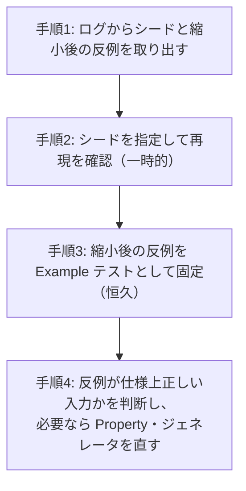

# 02a. 型設計とPBT（AIガードレール＆テストアーキテクチャ標準 1/3）

**この文書で決めること**

- 導入先の言語・ツールに求める前提（§0）と、誤りを書けなくする型設計（§1）
- PBT を必須とする対象、Property の型、実装ルール、失敗したときの手順（§2）

| 項目 | 内容 |
|---|---|
| 文書ID | TEST-02a |
| 目的 | AIが生成するコードの誤りを「書けない」「すぐ落ちる」状態にするための技術標準のうち、型設計と PBT を定める |
| 前提 | [01 基本方針書](./01-test-policy.md) の層1（最速・確定層）を中心に規定する |
| 関連 | [05 導入手順書](./05-adoption-guide.md)（既存プロジェクトへ導入するときの診断と段階導入） |

| ファイル | 扱う節 | 内容 | 分けた理由 |
|---|---|---|---|
| [02a 型設計とPBT](./02a-types-and-pbt.md)（本書） | §0 技術前提、§1 型設計、§2 PBT | 誤りを書けなくする型設計と、不変条件を検査する PBT の標準 | 型と PBT を続けて読む |
| [02b 層1の実行境界とミューテーション](./02b-execution-and-mutation.md) | §3 層1の構成と実行境界、§4 ミューテーション、§6 AI向けガードレール設定 | テストをいつ・どこで・どの強度で回すか、それを機械的に強制する設定 | ビルド・CI の設定を変えるときに参照する。§6 は、ビルド・CI で機械的に強制する設定（コンパイラ・静的解析・フォーマッタ・アーキテクチャ検査）を扱うため、§3・§4 と同じくここに置く |
| [02c E2E 最小化原則](./02c-e2e.md) | §5 E2E 最小化原則 | E2E の許可領域・審査・予算 | 独立した運用規則で、他の節と別に編集できるようにする |

節番号は分割前の `02` の番号をそのまま使う（02b は第5節が欠番で、02c は第5節のみ）。参照は `02a §2.3` のように書く。

> この文書は言語・ライブラリに依存しない。ツール名は括弧の例示にとどめ、プログラミング言語のコード例は置かない。

## 0. 技術前提（導入先の言語・ツールに求めるもの）

導入先の言語・ツールが次を満たせば、この標準をそのまま適用できる。版や依存関係は導入先が定める。

| 前提 | 使う節 |
|---|---|
| 生成時に検証する値の型（ドメイン型）を作れる、静的型付けの言語 | §1.1、§1.2 |
| 状態を閉じた型で表し、分岐の網羅性をコンパイラが検査できること | §1.3 |
| 警告をエラーとして扱う設定（非網羅の分岐や冗長な既定分岐をビルドエラーにする） | §1.3 規則4 |
| 型・null 安全・警告の検査を迂回する構文を検出する静的解析（例: detekt(Kotlin)、ESLint(TypeScript)） | §1.1 規則4 |
| ジェネレータ、入力の縮小、失敗時のシード出力と再現ができる PBT ライブラリ（例: Kotest property(Kotlin)、fast-check(TypeScript)） | §2 |

---

## 1. 「誤りを書けなくする」型設計

テストで誤りを検出するより、**誤りがコンパイルできない**状態を優先する。AI は型エラーを即座にフィードバックとして受け取り自己修復できるため、型は最も安価で強力なガードレールである。

### 1.1 プリミティブ型の排除（ドメイン型 / Value Object 化）

ドメインの意味を持つ値は、生成時に検証する専用の型（ドメイン型）で持つ。意味の違う値の取り違えが、コンパイルエラーになる。

| 禁止 | 推奨 |
|---|---|
| ユーザー ID を文字列のまま持つ | ユーザー ID 専用の型 |
| 金額を整数のまま持つ | 金額型（単位・精度・上限を内包） |
| メールアドレスを文字列のまま持つ | メールアドレス型 |
| 状態を文字列で持つ | 状態を表す閉じた型（§1.3） |
| 「支払い済みか」「キャンセル済みか」などの状態を、真偽値（の組合せ）で持つ | 状態を表す閉じた型（§1.3） |

言語に、実行時のコストを抑えながらコンパイル時に型だけを区別する仕組みがあれば、活用できる。たとえば注文 ID とユーザー ID を別の型にすると、引数の取り違えがコンパイルエラーになる。

**規則**

1. ドメインの意味を持つ値に、プリミティブ型（文字列・整数・真偽値など）を直接使わない。
2. API 境界（外部入力）で一度だけパースし、以降は内部にドメイン型のみを流通させる（Parse, don't validate）。
3. 生成は §1.2 のとおり、検証付きの生成手段に限る。強制型変換で型を偽装してはならない。
4. 型・null 安全・警告の検査を迂回する構文（次の構文: 非 null の断定、根拠のない強制型変換、警告の抑制、初期化の遅延の乱用）は、静的解析で禁止する。
5. 外部入力を受ける DTO はプリミティブでよい。**DTO はアダプタ層に閉じ込め**、ユースケースへ渡す前にドメイン型へ変換する（§1.2）。

### 1.2 コンストラクタ防御

不正な値でオブジェクトが**存在できない**ようにする。

検証の結果は、成功と失敗を値として持つ型で返し、失敗を例外にしない。呼び出し側に分岐を強制できる。アダプタ層では、DTO を境界で一度だけドメイン型へ変換し、失敗はエラー応答に写像する。

**規則**

1. 値の生成は、検証付きの生成手段（ファクトリ）経由に限る。検証を通らない直接生成は、型の外から呼べなくする。
2. 検証は生成時の1箇所に集約し、利用側で再検証しない（二重管理の防止）。
3. 不変（immutable）を基本とし、状態変更は新しい値の生成で表現する（再代入できない宣言のみを使う）。
4. 失敗は例外ではなく、成功と失敗を値として持つ型で返し、呼び出し側に処理を強制する。フレームワークの宣言的な検証機構（例: Bean Validation(Java/Kotlin)）による検証は DTO の形式チェックに留め、**ドメインの不変条件はドメイン型のファクトリを正**とする。
5. ドメイン型を DTO に直接デシリアライズしない。デシリアライザが検証付きの生成手段を経由せずに値を生成し、不変条件が破られる場合があるため、DTO にドメイン型を直接使ってはならない。

### 1.3 状態の型と網羅的な分岐（網羅性チェック）

状態・種別・イベントは閉じた型（取りうる値が列挙された型）で表現し、分岐の網羅性をコンパイラに検査させる。既定分岐（他のすべての場合）は書かない。

状態遷移も同じ作りで書く。遷移元の状態ごとに網羅的に分岐し、許可された遷移以外は拒否する。

**規則**

1. 文字列と真偽値の組合せで状態を表現しない（「支払い済み、かつキャンセル済み」のような**矛盾状態を表現可能にしない**）。
2. 状態ごとに必要なデータを各状態に持たせ、不正な組合せを型で排除する（たとえば「確定」状態だけが確定時刻を持つ）。
3. 閉じた型に対する分岐で、既定分岐を禁止する。既定分岐は将来の状態追加を黙って飲み込む。
4. 非網羅の分岐は、式でも文でもビルドエラーにする。加えて、警告をエラーとして扱う設定を有効にし、冗長な既定分岐などの警告も必ずビルドエラーにする（§0）。
5. 外部から来る文字列（DB・JSON）は、境界で閉じた型へ変換する。未知の値は検証失敗として扱い、既定分岐で握りつぶさない。

### 1.4 型ガードレールのチェックリスト（レビュー観点）

規則そのものは §1.1〜§1.3 を正とし、ここでは言い換えない。レビューでは、次の規則を満たしているかを確認する。

- [ ] §1.1 規則1 を満たす（自動検査: [02b §6](./02b-execution-and-mutation.md#6-ai向けガードレール設定実装の拠り所)）
- [ ] §1.2 規則1、§1.3 規則1・2 を満たす
- [ ] §1.3 規則3・4 を満たす（自動検査: [02b §6](./02b-execution-and-mutation.md#6-ai向けガードレール設定実装の拠り所)）
- [ ] §1.1 規則4 を満たす
- [ ] §1.1 規則2、§1.2 規則2 を満たす

---

## 2. PBT（Property-Based Testing）標準

単一値の例示テスト（Example-Based）だけに依存しない。システムが**常に満たすべき不変条件（Property）**を記述し、多数のランダム入力で検証する。

### 2.1 PBT を必須とする対象

次の対象は PBT を必須とする。

| 対象 | 例 |
|---|---|
| 入力空間が広い純粋関数 | 金額計算、日付計算、文字列正規化 |
| 変換の往復 | シリアライズ/デシリアライズ、エンコード/デコード |
| 状態遷移 | 任意の操作列の後でも不変条件が保たれること |
| ドメイン型のファクトリ | 受理した値は常に不変条件を満たす |

### 2.2 Property の型（定義基準）

Property は次の分類のいずれかで記述し、テスト名またはコメントに分類を明示する。

| 分類 | 内容 | 例 |
|---|---|---|
| ラウンドトリップ | `decode(encode(x)) == x` | JSON 変換、URL エンコード |
| 冪等性 | `f(f(x)) == f(x)` | 正規化、重複排除 |
| 不変量 | 操作後も保たれる性質 | 「在庫数は負にならない」「合計 = 明細の和」 |
| 交換則・結合則 | 順序や括りに依存しない | 金額の加算 |
| オラクル | 単純で明らかに正しい実装と一致 | 最適化版と素朴版の結果一致 |
| 単調性・境界 | 入力増に対する出力の方向 | 割引後価格 ≤ 割引前価格 |

分類ごとに、検出できる誤りが異なる。交換則・結合則は、常に 0 を返す実装でも成り立つため、和そのものをオラクルで検証する。ランダム入力は境界ちょうどの値に当たりにくいため、境界値を Example テストで明示的に固定する。

> 本番コードで禁止する根拠のない強制型変換（§1.1 規則4）は、**テストコード内のジェネレータに限り**許可する例外とする。ジェネレータが検証結果の型から値を取り出すために使う。この例外は、静的解析の対象からテストソースを除外して実現する。

#### 操作列の PBT（状態遷移）

状態遷移の抜け（04 §2.2）は、**操作列を生成して遷移表と照合する Property** で検出する。期待値は TRS の遷移表（独立したオラクル）から作り、実装と同じ分岐で作らない。照合する Property の例を次に示す。

- 任意の操作列で、許可された遷移だけが状態を変え、拒否された操作は状態を変えない（分類: 不変量）
- 終端状態に達した後は、以降どんな操作列でも状態が変わらない（分類: 不変量）

たとえば操作列のジェネレータは、操作の種類と操作の引数を独立に生成し、種類に応じて操作を組み立てる。時刻は生成せず、固定した時計を操作の実行に渡す。

### 2.3 PBT 実装ルール

ジェネレータ・不正値・シード・実行回数・期待値の作り方をそろえる。PBT が失敗したときの手順は [§2.3.1](#231-pbt-が失敗したときの-ai-の手順) のとおり。

**規則**

1. **ジェネレータはドメイン型に対して一元管理する。** 各型にジェネレータを1つ用意し、ファクトリの検証と同じ制約を満たす値を生成する。
2. 不正値の拒否も Property にする（「範囲外の入力は必ず検証失敗を返す」）。
3. シード値を失敗時に出力し、**再現可能**にする。失敗した Property のシード（乱数の種）がログに出力されるようにし、そのシードを指定して再実行すると同じ失敗を再現できる状態にする。
4. 実行回数は層1の速度要件（全体で数秒以内）を満たす範囲で設定し、CI の夜間ジョブでは回数を増やす。既定の回数はライブラリの既定に従う。
5. Property が実装のコピーになっていないこと（実装と同じ計算式で期待値を作らない）。

#### 2.3.1 PBT が失敗したときの AI の手順

恒久的に残すのは Example テストだけで、シード付きの Property はコミットしない。ジェネレータや Property を直すとシードの意味が変わり、同じ失敗を再現しなくなるためである。

1. ログからシードと縮小後の反例（失敗する最小の入力）を取り出す。縮小されたかどうかにかかわらず、ログに出た引数の値がそのまま反例である。
2. シードを指定して、同じ失敗が再現することを確認する（一時的。コミットしない）。
   - ライブラリが失敗したシードをローカルに自動で保存・再利用する場合、その機能は無効化せず、既定のままにする。保存されたシードは PBT の失敗を自動で再現する手がかりになり、上の手順と矛盾しない。
   - 確率的な失敗（実行ごとに出たり出なかったりする失敗）がローカルで再現するかを確かめるときは、保存済みシードが結果に影響しないよう、事前に保存先のファイルを消してから実行する。保存先を丸ごと消すと他のテストの保存シードも消えるため、先に手順1でログからシードを控える。対象テストのファイルだけを消す方法もある。消すのはローカルの保存先だけで、リポジトリの設定やコードは変えない。ライブラリを更新したときは、この挙動が変わっていないか確認する。
3. 縮小後の反例を Example テストとして固定する。AC に紐づく不具合の場合は、修正前に失敗することを確認し（`04` §2.5）、修正と同じ PR に含める。
4. 反例が仕様上の正しい入力だったのか、Property またはジェネレータの前提が誤っていたのかを判断し、必要なら Property・ジェネレータ側を直す。

### 2.4 PBT と Example テストの使い分け

| 用途 | 採用 |
|---|---|
| 仕様書に明記された代表例・AC の具体値 | Example テスト（仕様の証跡として残す） |
| 境界・組合せ・不変条件 | PBT |
| PBT の反例の固定 | Example テスト（回帰） |
