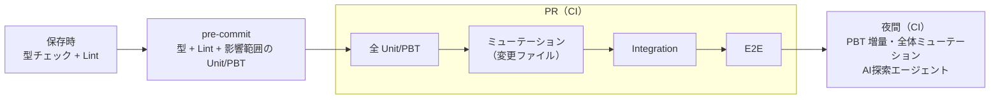

# 02b. 層1の実行境界とミューテーション（AIガードレール＆テストアーキテクチャ標準 2/3）

| 項目 | 内容 |
|---|---|
| 文書ID | TEST-02b |
| 目的 | 層1・統合テスト・E2E の実行境界、ミューテーションテストの標準、AI エージェントに従わせる機械的なガードレール設定を定める |
| 前提 | [01 基本方針書](./01-test-policy.md) の層1（最速・確定層）を中心に規定する |
| 関連 | [05 導入手順書](./05-adoption-guide.md)（既存プロジェクトへ導入するときの診断と段階導入）。型設計・PBT は [02a](./02a-types-and-pbt.md) |

| ファイル | 扱う節 | 内容 | 分けた理由 |
|---|---|---|---|
| [02a 型設計とPBT](./02a-types-and-pbt.md) | §0 技術前提、§1 型設計、§2 PBT | 誤りを書けなくする型設計と、不変条件を検査する PBT の標準 | ドメインのコード例が中心で、型と PBT を続けて読む |
| [02b 層1の実行境界とミューテーション](./02b-execution-and-mutation.md)（本書） | §3 層1の構成と実行境界、§4 ミューテーション、§6 AI向けガードレール設定 | テストをいつ・どこで・どの強度で回すか、それを機械的に強制する設定 | ビルド・CI の設定を変えるときに参照する。§6 は、ビルド・CI で機械的に強制する設定（コンパイラ・detekt・ktlint・Konsist）を扱うため、§3・§4 と同じくここに置く |
| [02c E2E 最小化原則](./02c-e2e.md) | §5 E2E 最小化原則 | E2E の許可領域・審査・予算 | 独立した運用規則で、他の節と別に編集できるようにする |

節番号は分割前の `02` の番号をそのまま使う（02b は第5節が欠番で、02c は第5節のみ）。参照は `02a §2.3` のように書く。

> コード例は **Kotlin + Spring Boot 4.1.x** で示す。原則そのものは言語非依存である。
>
> 本書の §3.3・§4.4 のコード例は、[02a §0 の技術前提](./02a-types-and-pbt.md#0-技術前提コード例のベースライン)に従い、検証用プロジェクト（`src/`・`build.gradle.kts`）に対応する。コード例を変更するときは `src/` 側も同時に更新すること（型設計・PBT のコード例の同期は [02a](./02a-types-and-pbt.md) に書いてある）。

## 3. 層1 の標準構成と実行順序

### 3.1 実行順序



### 3.2 層1・統合テスト・E2E の実行境界

実 DB を使うテストや実ブラウザを使うテストを足すと、層1の速度要件（全体で数秒以内）を壊すおそれがある。そこで Gradle の実行タスクとソースセットで境界を分ける。

| 項目 | 層1 | 統合テスト（Integration） | E2E |
|---|---|---|---|
| ソースセット | `src/test` | `src/integrationTest`（JVM Test Suite） | `src/e2eTest`（JVM Test Suite） |
| 実行 | `./gradlew test` | `./gradlew integrationTest` | `./gradlew e2eTest`（`test`・`integrationTest`・`check` には含まれない） |
| 置くもの | 型・Unit・PBT・Konsist 検査 | Spring コンテキストを起動するテスト（`@WebMvcTest`・`@SpringBootTest`）と、Testcontainers で実 DB を使うテスト | Spring を `RANDOM_PORT` で起動し、実ブラウザ（Playwright の Chromium）で操作するテスト。02c §5.1 の許可領域のみ |
| 必要なもの | JDK のみ（Spring・Docker 不要） | JDK と Docker（Testcontainers） | JDK、Docker（Testcontainers）、ブラウザ（`playwrightInstall` が取得する） |
| CI | `kotlin-samples.yml` の `test` ジョブ | 同 `integration` ジョブ | 同 `e2e` ジョブ（PR で実行。`timeout-minutes: 10` が 02c §5.4 の予算） |

- 層1のテストは Spring のコンテキスト起動（`org.springframework.boot.*`・`org.springframework.test.*`・`org.springframework.context.*`）と `org.testcontainers.*` を使わない。逆に、これらを使うテストは `src/integrationTest` と `src/e2eTest` にだけ置く。ブラウザ操作（`com.microsoft.playwright.*`）は `src/e2eTest` にだけ置き、層1と `src/integrationTest` には入れない。この配置は `ExecutionBoundaryTest`（Konsist）が検査する。違反例（層1に置いた Playwright を含む。`config/konsist-fixtures/boundary/`）で検出できることも確認している。
- `TestProtectionTest`（@Disabled 検出）と `TraceabilityTest`（AC 紐づけ）は、`src/test`・`src/integrationTest`・`src/e2eTest` の全てを対象にする。`src/integrationTest` と `src/e2eTest` が検査から外れていないことは、それぞれのテストで確認している。
- AC に紐づく統合テスト・E2E のテスト名は、層1と同じく先頭に `AC-xx-yy` を置く（03 §3.4）。
- ミューテーション（`pitest`）の対象は `*.domain.*` だけで、統合テストと E2E は混ざらない。

### 3.3 DB を含む Integration のサンプル（Testcontainers）

実例は TRS `PAY-002`（決済状態の保存・読み戻し）の `PaymentRepositoryIntegrationTest`。Adapter は `payment.adapter.persistence`（MyBatis のマッパー、`PaymentState` ↔ 行の変換、Flyway のマイグレーション）、ポートは `payment.domain.PaymentRepository` に置く。Spring Boot 4.1.1 で次を実測確認済み。

| 用途 | 内容 |
|---|---|
| MyBatis | `org.mybatis.spring.boot:mybatis-spring-boot-starter:4.1.0`（Spring Boot 4.1.0 でビルドされた版。BOM の管理外なのでバージョンを明示する） |
| Flyway | `org.springframework.boot:spring-boot-starter-flyway` + `org.flywaydb:flyway-mysql`（バージョンは BOM が管理） |
| MySQL ドライバ | `com.mysql:mysql-connector-j`（BOM 管理、`runtimeOnly`） |
| Spring Boot のテスト連携 | `org.springframework.boot:spring-boot-testcontainers`（`org.springframework.boot.testcontainers.service.connection.ServiceConnection`） |
| Testcontainers（2.x、BOM 管理） | `org.testcontainers:testcontainers-junit-jupiter`、`org.testcontainers:testcontainers-mysql`（`org.testcontainers.mysql.MySQLContainer`） |

```kotlin
@TestConfiguration(proxyBeanMethods = false)
class MySqlContainerConfiguration {
    @Bean
    @ServiceConnection // DataSource（Flyway・MyBatis が使う）をこのコンテナへ自動接続する
    fun mysql(): MySQLContainer = MySQLContainer("mysql:8.4")
}

@SpringBootTest
@Import(MySqlContainerConfiguration::class)
class PaymentRepositoryIntegrationTest {
    @Autowired
    lateinit var repository: PaymentRepository

    @Test
    fun `AC-03-02 Authorized を保存して読み戻すと、同じ時刻の Authorized である`() {
        val id = (PaymentId.of("p-1") as Validated.Valid).value
        val at = Instant.parse("2026-10-11T00:00:00.123456Z")

        repository.save(id, PaymentState.Authorized(at))

        repository.find(id) shouldBe PaymentState.Authorized(at)
    }
}
```

- DB の制約（CHECK）で守る不変条件は、アプリを経由しない書き込みも拒否できる。迂回した行が読み込み時にも拒否されることは、CHECK を外した DB で別に検証する（PAY-002 AC-03-08 / AC-03-09）。
- `@WebMvcTest` のスライスは DataSource を起動しないため、Docker は要らない。`@SpringBootTest` は DataSource・Flyway・MyBatis を含むので、コンテナ設定を `@Import` する。

---

## 4. ミューテーションテスト標準

AI が生成したテストは「通ること」を目的化しやすく、**何も検証していない（偽陽性）テスト**を生みやすい。コードに意図的な欠陥（ミュータント）を注入し、テストがそれを検出できるかで**テスト自体の有効性**を検証する。

### 4.1 適用タイミングと閾値

| タイミング | 対象 | 閾値（初期値） |
|---|---|---|
| PR | 変更ファイルのみ（差分ミューテーション） | Mutation Score ≥ 80% |
| 夜間 | 層1の全対象 | Mutation Score ≥ 70%（低下傾向を監視） |
| E2E 破棄判断時 | 04 §4 の手順に従う | 代替検証で生存ミュータント 0 |

閾値はプロジェクトで調整してよいが、**引き下げは人間の承認**を要する。

**導入期の例外（評価軸）**: 既存プロジェクトへの導入期に限り、上表の評価軸（PR は変更ファイルの Mutation Score ≥ 80%、夜間は全体で ≥ 70%）に代えて、PR では差分実行でテストの強度（カバー済みの変異のうち殺せた割合）、全体実行は週次で殺傷率を評価してよい。全体実行の頻度を夜間から週次に変えることも、この例外の範囲に含む。この例外が変えるのは評価軸と全体実行の頻度だけである。導入期の閾値の値は、05 §1 原則 2・3 と上記の「引き下げは人間の承認」による。この例外は、次の3条件をすべて満たす場合に限る。

1. **補う手段**: テストの無い新規・変更クラスを PR で落とす手段を置く。テストの無いクラスの変異は、強度の評価に含まれないため、差分実行を通り抜ける。実装は導入先に任せる。
2. **記録**: 例外にした理由と再評価のトリガーを、[05 の据置の記録](./05-adoption-guide.md#据置の記録)と同じ形式（対象・理由・再評価のトリガー）で残す。
3. **復帰の再評価**: 週次の殺傷率が安定したら、上表の評価軸に戻すかを再評価する。

本リポジトリはこの例外を使わない（上表のとおりに運用する）。評価軸を見直した実例（例外の条件をすべては満たしていない）が [05 §4](./05-adoption-guide.md#実例-導入モードの選択パイロット) にある。

**仮置きの値の見直し（2026-10-10 時点）**

| 値 | 実測 | 判断 |
|---|---|---|
| PR 80% / 夜間 70% | ドメイン層 20 ミュータントで 95%（§4.4）。1 件の生存で約 5 ポイント動く | 据え置き。規模が増えるまで統計的な意味が薄いため、夜間の推移（`nightly-mutation.yml`）が溜まってから再評価する |
| E2E 実行 10 分（[02c §5.4](./02c-e2e.md#54-e2e-予算)） | CI の `e2e` ジョブ全体は 2 分 1 秒。測定日は 2026-10-14、PR #93 の CI 初回実行で、ブラウザキャッシュなし。内訳は `./gradlew e2eTest` が 94 秒、setup-gradle が 12 秒、キャッシュ保存が 5 秒。ローカルのウォーム実行は 25〜26 秒で、テストクラスは約 8 秒（各テスト 0.1〜0.6 秒）。E2E は 3 本 | 10 分は据え置く。初回実行でも予算の約 20% で、固定費（コンテナ・ブラウザの起動と Chromium の取得）が大半を占める。E2E が 3 本の時点では、本数の増加による傾向を測れない。ブラウザキャッシュありの CI 実測は未測定のため、マージ後の最初の実行で再測定し、E2E が増えてから見直す |
| ヒーリング 1 PR あたり 10 件（04 §3.3） | 自動修復の実績が無い | 実測不能のため据え置き。運用開始後に実績で見直す |

### 4.2 コード破壊検証手順

1. **対象選定**: 変更されたロジックを含むファイル（ドメイン層・検証ロジックを優先）。
2. **ミュータント生成**: 条件反転（`<` → `<=`）、算術演算子置換、戻り値置換、条件削除、ブロック削除、境界値の±1 などを注入する。
3. **テスト実行**: ミュータントごとに関連テストを実行する。
4. **判定**:
   - 失敗（Killed）→ テストは有効。
   - 全件成功（Survived）→ **テストの穴**。
   - タイムアウト → Killed 扱い。
5. **生存ミュータントの処理**（下表）。
6. **再実行**: 閾値を満たすまで繰り返す。

| 生存の原因 | 対処 |
|---|---|
| アサーション不足・弱い | テストを強化（AI が修正可。ただし期待値は仕様に基づく） |
| 入力カバレッジ不足 | 境界値ケース／PBT のジェネレータを追加 |
| 等価ミュータント（挙動が変わらない） | 除外設定に理由付きで登録（人間が承認） |
| デッドコード | コード削除を PR で提案 |

### 4.3 禁止事項

- Mutation Score を上げるためにテストを実装の写し（モック過多・実装詳細の複製）にすること。
- 生存ミュータントを理由なく除外リストに追加すること。
- カバレッジ（行・分岐）の数値だけでテストの品質を主張すること。**カバレッジは「実行された」ことを、ミューテーションは「検証された」ことを示す。**

### 4.4 Gradle での実行例（PIT）

JVM/Kotlin では PIT（Pitest）を用いる。本リポジトリの検証用プロジェクト（`src/`）で実際に動かして確認した構成を示す（Gradle 9.8 / Kotlin 2.4.20 / Kotest 6.2.5 / `info.solidsoft.pitest` 1.19.0 / `pitest-junit5-plugin` 1.2.3）。

```kotlin
// build.gradle.kts（抜粋）
plugins {
    id("info.solidsoft.pitest") version "1.19.0"
}

pitest {
    junit5PluginVersion.set("1.2.3")
    // 既定はドメイン層全体。PR の差分実行では scripts/pitest-targets.sh の出力を -Ppitest.targetClasses=... で渡す
    targetClasses.set(
        providers.gradleProperty("pitest.targetClasses")
            .map { it.split(",") }
            .orElse(listOf("com.example.order.domain.*", "com.example.payment.domain.*")),
    )
    // 未指定だと targetClasses と同じパターンが使われ、main 側のクラスをテストとして実行して失敗する
    targetTests.set(listOf("com.example.order.domain.*Test", "com.example.payment.domain.*Test"))
    // アクセサ以外にメンバを持たない value class / data class だけをクラス単位で除外する（検証ロジックは companion 側）
    excludedClasses.set(listOf("com.example.order.domain.Quantity", /* ... */ "com.example.order.domain.Validated\$Invalid"))
    mutationThreshold.set(providers.gradleProperty("pitest.threshold").map { it.toInt() }.orElse(80)) // §4.1。夜間は 70
    outputFormats.set(listOf("HTML", "XML"))
    timestampedReports.set(false)
}
```

```bash
./gradlew pitest                                            # 全体。結果: build/reports/pitest/index.html
./gradlew pitest -Ppitest.targetClasses="$(scripts/pitest-targets.sh origin/main)"   # PR と同じ差分実行（ALL / NONE の扱いは下記）
```

**CI での実行**（`kotlin-samples.yml` / `nightly-mutation.yml`）

| 契機 | 対象 | 閾値 |
|---|---|---|
| PR | `scripts/pitest-targets.sh` が base との差分から変更クラスを決める。`build.gradle.kts` / `gradle/` / `config/` の変更（依存更新 PR を含む）と、テストのみの変更は `ALL`（全体）にする。対象外の変更は `NONE`（スキップ）にする | 80% |
| main への push | 全体 | 80% |
| 夜間（毎日 03:00 JST） | 全体。スコアを Step Summary に出力し、レポートを成果物として 90 日保管して推移を追う | 70% |

**実際に踏んだ注意点**

| 事象 | 原因と対処 |
|---|---|
| `Coverage generation minion exited abnormally` | `targetTests` 未指定だと `targetClasses` と同じパターンが使われ、`main` 側のクラスがテストとして実行される。`*Test` で明示する |
| `NoSuchMethodError: SpecRef$Reference.<init>` | `kotest-extensions-pitest` 1.2.0 は Kotest 5.5.4 向けで、Kotest 6 と衝突する。**Kotest 6 では拡張なし**（`pitest-junit5-plugin` のみ）で動く |
| value class のゲッターが `NO_COVERAGE` | コンパイラ生成アクセサは呼ばれない。名前ベースの `excludedMethods` は全クラスに効き、将来ロジックを持つゲッターを黙って見逃すため使わない。アクセサ以外にメンバを持たないクラスだけを `excludedClasses` で除外する。`Yen.getAmount` は `plus` を持つクラスのため除外せず、生存ミュータントとして残している |
| `plus` が 0 を返すミュータントが生存 | 交換則・結合則は常に 0 を返す実装でも成立する。**和そのものを検証するオラクル Property** を追加して検出した（[02a §2.2](./02a-types-and-pbt.md#22-property-の型定義基準)） |
| `0..MAX` の境界のミュータントが生存 | ランダム入力は境界ちょうどの値に当たりにくい。**境界値を Example で明示**して検出した（[02a §2.4](./02a-types-and-pbt.md#24-pbt-と-example-テストの使い分け)） |

**実測結果（ドメイン層）**

| 段階 | 検出率（Killed / Generated） | 備考 |
|---|---|---|
| 初回（Quantity・Yen・PaymentState のテストのみ） | 48%（15 / 31） | `Ids.kt` はテスト無し。`NO_COVERAGE` 14 件、生存 2 件 |
| テスト追加後 | 77%（24 / 31） | 閾値 80% を下回り `pitest` がビルド失敗（ゲートが機能することを確認） |
| 無意味な分岐の削除・アクセサ除外後 | 100%（18 / 18） | 閾値を満たす |
| `excludedMethods` を `excludedClasses` に置換（`Ids.kt` のテスト追加後） | 95%（19 / 20） | `Yen.getAmount` のみ生存。閾値を満たす |

> Kotlin が生成するバイトコード（`when` の分岐、null チェック、インライン関数など）由来の**等価ミュータント**が出やすいため、対象はドメイン層に絞り、等価ミュータントは §4.2 の手順で人間が承認して除外する。`excludedClasses` の追加・変更も同様に人間の承認を要する（`build.gradle.kts` は CODEOWNERS の対象）。
>
> 加えて `PitestExclusionTest`（Konsist、`./gradlew test` で実行）が `build.gradle.kts` の `excludedClasses` を読み、次を検査する。
>
> - 列挙されたクラスが実在する。
> - 列挙されたクラスが、コンパイラ生成アクセサ以外のメンバを持たない。ロジックを持つクラスを除外に加えると失敗する。違反例（メンバの検査）は `config/konsist-fixtures/pitest-exclusion/` で固定している。メンバの例は次のとおり。
>   - クラス自身: 関数、`init`、本体のプロパティ、副コンストラクタ、主コンストラクタ引数の既定値、スーパータイプ呼び出しの引数、ネストした型
>   - companion: `init` ブロック、`@JvmStatic` 関数、`const` でないプロパティ
>
> `excludedClasses` は 1 箇所の `listOf` に文字列リテラルで列挙する。それ以外の書き方は検査が失敗する。PR では変更されたクラスのみを `targetClasses` に渡す（CI で差分から生成する）。閾値 80% は 20 ミュータント規模では 1 件の生存で大きく動くため、対象が増えた時点で再評価する。Kotest / PIT の更新で壊れないかは、Dependabot の PR（`build.gradle.kts` を変更するため `ALL` で `pitest` が走る）で検知する。

---

## 6. AI向けガードレール設定（実装の拠り所）

AI エージェント（コーディング支援ツール）が従うべき機械的ルールを、リポジトリ設定として固定する。

| 領域 | 設定 |
|---|---|
| コンパイラ | `allWarningsAsErrors = true`。Kotlin の null 安全を維持し、Java 連携部は JSpecify の null 注解（Spring Boot 4 の標準）に従う |
| 静的解析 | detekt（`UnsafeCallOnNullableType`〔`!!`〕、`UnsafeCast`〔常に失敗するキャストのみ検出〕、`LateinitUsage`、`ForbiddenAnnotation`〔`@Suppress` 等〕、`ForbiddenMethodCall`〔`println` 等〕）と ktlint。設定は `config/detekt/detekt.yml` と `.editorconfig`。型解決が必要なルールがあるため `detektMain` で実行する。テストの `as` 例外（[02a §2.2](./02a-types-and-pbt.md#22-property-の型定義基準)）のため、検査対象は本番ソースのみである。コマンドは `./gradlew detekt ktlintCheck`（ローカルも CI も同一）。根拠のない `as` 全般は detekt の標準ルールでは検出できないため、レビュー（[02a §1.4](./02a-types-and-pbt.md#14-型ガードレールのチェックリストレビュー観点)）で補う |
| アーキテクチャ検査 | Konsist（`src/test/.../architecture/DomainArchitectureTest.kt`、`./gradlew test` で実行）。ドメイン層（`..domain..`）でプリミティブ型のプロパティ・引数が露出していないこと、Spring に依存しないこと、`when` に `else` がないこと（本番コード全体）を検査する。例外は2つで、いずれもテスト内にコメントで理由を残している。1つは value class が内部に保持する値と `const` 定数、もう1つは外部入力を一度だけパースする境界の `of` ファクトリである。Kotlin 固有の検査が多いため ArchUnit ではなく Konsist を採用した |
| テスト保護 | テストの無効化（JUnit の `@Disabled`、Kotest の `xdescribe` / `!` 接頭辞・`enabled = false`）を `TestProtectionTest`（Konsist、`./gradlew test`）で検出して失敗させる。意図的な無効化の手順は 04 §3.4.1。アサーション削除・スナップショット一括更新は機械検出せずレビューで確認する（スナップショットテストは現状未使用） |
| 変更制限 | `docs/testing/trs/` と期待値ファイルの変更は人間レビュー必須（CODEOWNERS） |
| エージェント指示 | リポジトリの `CLAUDE.md` 等に、本標準と 04 のヒーリング規程への参照を記載する |
