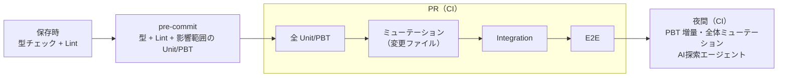
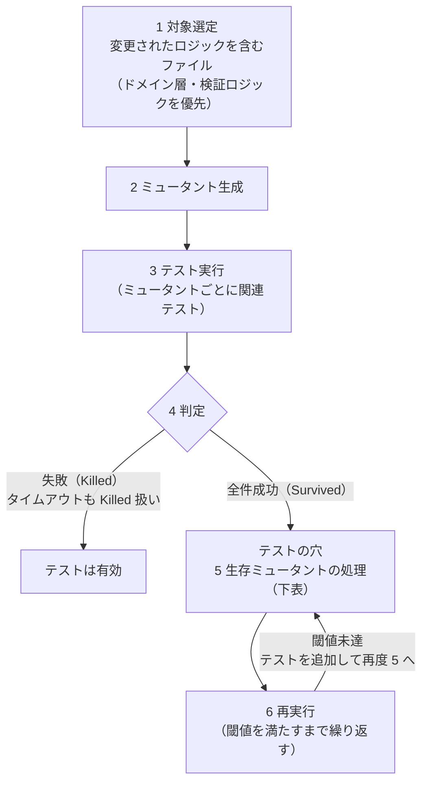

# 02b. 層1の実行境界とミューテーション（AIガードレール＆テストアーキテクチャ標準 2/3）

**この文書で決めること**

- 層1・統合テスト・E2E の実行境界（§3）
- ミューテーションテストの実行時期と閾値（§4）
- AI エージェントに従わせる機械的な設定（§6）

| 項目 | 内容 |
|---|---|
| 文書ID | TEST-02b |
| 目的 | 層1・統合テスト・E2E の実行境界、ミューテーションテストの標準、AI エージェントに従わせる機械的なガードレール設定を定める |
| 前提 | [01 基本方針書](./01-test-policy.md) の層1（最速・確定層）を中心に規定する |
| 関連 | [05 導入手順書](./05-adoption-guide.md)（既存プロジェクトへ導入するときの診断と段階導入）。型設計・PBT は [02a](./02a-types-and-pbt.md) |

| ファイル | 扱う節 | 内容 | 分けた理由 |
|---|---|---|---|
| [02a 型設計とPBT](./02a-types-and-pbt.md) | §0 技術前提、§1 型設計、§2 PBT | 誤りを書けなくする型設計と、不変条件を検査する PBT の標準 | ドメインのコード例が中心で、型と PBT を続けて読む |
| [02b 層1の実行境界とミューテーション](./02b-execution-and-mutation.md)（本書） | §3 層1 の標準構成と実行順序、§4 ミューテーションテスト標準、§6 AI向けガードレール設定（実装の拠り所） | テストをいつ・どこで・どの強度で回すか、それを機械的に強制する設定 | ビルド・CI の設定を変えるときに参照する。§6 は、ビルド・CI で機械的に強制する設定（コンパイラ・静的解析・アーキテクチャ検査）を扱うため、§3・§4 と同じくここに置く |
| [02c E2E 最小化原則](./02c-e2e.md) | §5 E2E 最小化原則 | E2E の許可領域・審査・予算 | 独立した運用規則で、他の節と別に編集できるようにする |

節番号は分割前の `02` の番号をそのまま使う（02b は第5節が欠番で、02c は第5節のみ）。参照は `02a §2.3` のように書く。

> この文書は特定の言語・ツールに依存しない。括弧内のツール名は例示で、導入先の言語・ツールに読み替えて適用する。

## 3. 層1 の標準構成と実行順序

### 3.1 実行順序

保存時・pre-commit・PR・夜間の各段階で回す検査を次に示す。

### 3.2 層1・統合テスト・E2E の実行境界

実 DB や実ブラウザのテストを足しても層1の速度要件（全体で数秒以内）を壊さないよう、実行コマンドとテストの置き場所（ディレクトリ。例: Gradle のソースセット）で境界を分ける。

| 項目 | 層1 | 統合テスト（Integration） | E2E |
|---|---|---|---|
| 置き場所 | 層1専用のディレクトリ | 統合テスト専用のディレクトリ | E2E専用のディレクトリ |
| 実行 | 層1専用のコマンド | 統合テスト専用のコマンド | E2E専用のコマンド（層1・統合テストのコマンドや、一括実行には含めない） |
| 置くもの | 型・Unit・PBT・アーキテクチャ検査 | アプリケーションフレームワークのコンテキストを起動するテストと、コンテナで起動した実 DB を使うテスト | 実ブラウザで操作するテスト。02c §5.1 の許可領域のみ |
| 必要なもの | 言語のランタイムとテストランナーのみ（フレームワークの起動・コンテナ不要） | ランタイムとコンテナ実行環境 | ランタイム、コンテナ実行環境、ブラウザ |
| CI | 層1のジョブ | 統合テストのジョブ | E2E のジョブ（PR で実行。ジョブの時間上限が 02c §5.4 の予算） |

- 実行境界は、実行境界の検査で機械的に確認する。検査そのものが違反を検出できることも、違反例で確認する。
  - 層1のテストは、フレームワークのコンテキスト起動とコンテナ（実 DB）の起動を使わない。
  - これらを使うテストは、統合テストと E2E の置き場所にだけ置く。
  - 層1のファイルに、コンテキスト起動やコンテナ起動を宣言する記述（アノテーションなど）があると違反になる。
  - この検査は、依存の参照と宣言の記述の 2 経路で行い、どちらかに当たれば違反とする。
  - コンテキストを起動しない型だけの利用は許可する。
  - ブラウザ操作は E2E の置き場所にだけ置き、層1と統合テストには入れない。
- テスト保護の検査（無効化の検出）とトレーサビリティ検査（AC 紐づけ）は、層1・統合テスト・E2E のすべてを対象にする。統合テストと E2E が検査から外れていないことは、それぞれのテストで確認する。
- AC に紐づく統合テスト・E2E のテスト名は、層1と同じく先頭に `AC-xx-yy` を置く（03 §3.4）。

### 3.3 DB を含む Integration

- DB を含む統合テストは、コンテナで実 DB を起動して行う（例: Testcontainers）。置き場所と必要なものは §3.2 の表のとおり。

## 4. ミューテーションテスト標準

AI が生成したテストは、**何も検証していない（偽陽性）テスト**になりやすい。コードに意図的な欠陥（ミュータント）を注入し、テストが検出できるかで**テスト自体の有効性**を検証する。

### 4.1 適用タイミングと閾値

| タイミング | 対象 | 閾値（初期値） |
|---|---|---|
| PR | 変更ファイルのみ（差分ミューテーション） | Mutation Score ≥ 80% |
| 夜間 | 層1の全対象 | Mutation Score ≥ 70%（低下傾向を監視） |
| E2E 破棄判断時 | 04 §4 の手順に従う | 代替検証で生存ミュータント 0 |

PR の差分ミューテーションで、差分から対象を決められない変更（ビルド設定など）のときは全体を対象にする。

閾値はプロジェクトで調整してよいが、**引き下げは人間の承認**を要する。

**導入期の例外（評価軸）**: 既存プロジェクトへの導入期に限り、上表の評価軸に代えて、PR では差分実行でテストの強度（カバー済みのミュータントのうち殺せた割合）、全体実行は週次で Mutation Score を評価してよい。全体実行の頻度を夜間から週次に変えることも、この例外の範囲に含む。この例外が変えるのは評価軸と全体実行の頻度だけである。導入期の閾値の値は、05 §1 原則 2・3 と上記の「引き下げは人間の承認」による。この例外は、次の3条件をすべて満たす場合に限る。

1. **補う手段**: テストの無い新規・変更クラスを PR で落とす手段を置く。テストの無いクラスのミュータントは、強度の評価に含まれないため、差分実行を通り抜ける。実装は導入先に任せる。
2. **記録**: 例外にした理由と再評価のトリガーを、[05 の据置の記録](./05-adoption-guide.md#据置の記録)と同じ形式（対象・理由・再評価のトリガー）で残す。
3. **復帰の再評価**: 週次の Mutation Score が安定したら、上表の評価軸に戻すかを再評価する。

**仮置きの値の見直し**

閾値・E2E の実行時間の予算（02c §5.4）・ヒーリングの上限（04 §3.3）などの初期値は、仮置きの値である。仮置きの値は実測で見直し、実測・判断（据え置き・見直し）・再評価のトリガーを記録する。

### 4.2 コード破壊検証手順

手順 6 で閾値を満たさないときは、手順 5 に戻り、テストを追加して再実行する。

注入するミュータントは、条件反転（`<` → `<=`）、算術演算子置換、戻り値置換、条件削除、ブロック削除、境界値の±1 などである。

| 生存の原因 | 対処 |
|---|---|
| アサーション不足・弱い | テストを強化（AI が修正可。ただし期待値は仕様に基づく） |
| 入力カバレッジ不足 | 境界値ケース／PBT のジェネレータを追加 |
| 等価ミュータント（挙動が変わらない） | 除外設定に理由付きで登録（人間が承認） |
| デッドコード | コード削除を PR で提案 |

### 4.3 禁止事項

- Mutation Score を上げるためにテストを実装の写し（モック過多・実装詳細の複製）にすること。
- 生存ミュータントを理由なく除外リストに追加すること。
- カバレッジ（行・分岐）の数値だけでテストの品質を主張すること。**カバレッジは「実行された」ことを、ミューテーションは「検証された」ことを示す。**

### 4.4 ミューテーションテストの実行方法

- ミューテーションテストは、言語ごとのツールで実行する（例: PIT（JVM）、Stryker（JS/TS）、mutmut（Python））。実行時期と閾値は §4.1 に従う。
- 等価ミュータントは §4.2 の手順で人間が承認して除外する。除外設定の追加・変更も同様に人間の承認を要する。
- ミューテーションツールやテストフレームワークの更新で壊れないかは、それらの依存更新の PR で検知する。ビルド設定の変更として、全体を対象にして実行する（§4.1）。
- ツールごとの設定は言語によって異なるため、この標準では定めない。確認できていない設定は書かず、ツールの公式ドキュメントで確認する。

## 6. AI向けガードレール設定（実装の拠り所）

AI エージェントが従うべき機械的ルールを、リポジトリ設定として固定する。

| 領域 | 設定 |
|---|---|
| コンパイラ | 警告をエラーとして扱う。言語の null 安全を維持し、他言語との連携部は null 可否の注釈に従う |
| 静的解析 | Lint とフォーマッタ（例: detekt・ktlint（Kotlin）、ESLint（JS/TS）、Ruff（Python））。設定はリポジトリに置き、コマンドはローカルも CI も同一にする |
| アーキテクチャ検査 | 層の依存方向と禁止パターンを、テストとして実行する検査で強制する（例: ArchUnit（JVM）、Konsist（Kotlin）） |
| テスト保護 | テストの無効化（スキップ指定など）を検出して失敗させる。意図的な無効化の手順は 04 §3.4.1。アサーション削除・スナップショット一括更新は機械検出せずレビューで確認する |
| 変更制限 | TRS と期待値ファイルの変更は人間レビュー必須（例: CODEOWNERS） |
| エージェント指示 | リポジトリのエージェント指示ファイル（例: CLAUDE.md）に、本標準と 04 のヒーリング規程への参照を記載する |

- 静的解析
  - 型の迂回（null の強制解除、安全でない型変換）、実行時の初期化漏れを招く宣言、検査の抑制指定、標準出力への出力を禁止するルールを使う。
  - 型情報が必要なルールは、型解決を有効にして実行する。
  - テストで型変換を認める例外（[02a §2.2](./02a-types-and-pbt.md#22-property-の型定義基準)）のため、検査対象は本番ソースのみである。
  - 根拠のない型変換全般は標準ルールでは検出できないことがあるため、レビュー（[02a §1.4](./02a-types-and-pbt.md#14-型ガードレールのチェックリストレビュー観点)）で補う。
- アーキテクチャ検査
  - ドメイン層でプリミティブ型のプロパティ・引数が露出していないことを検査する。
    - この検査の例外は2つで、いずれもテスト内にコメントで理由を残す。1つは値オブジェクトが内部に保持する値と定数、もう1つは外部入力を一度だけパースする境界のファクトリである。
  - ドメイン層がフレームワークに依存していないことを検査する。
  - 列挙型・直和型の分岐に既定分岐（`else` など）がないことを、本番コード全体で検査する。
