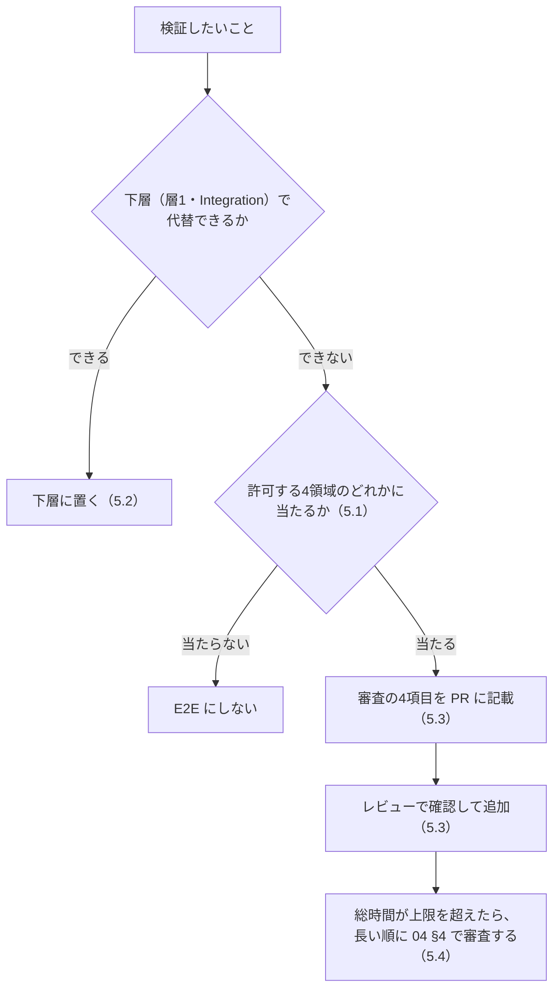

# 02c. E2E 最小化原則（AIガードレール＆テストアーキテクチャ標準 3/3）

**この文書で決めること**

- E2E にしてよい領域（4領域）と、E2E に置いてはならないもの
- E2E を新規に追加するときの審査
- E2E の時間の予算と、flaky の扱い

| 項目 | 内容 |
|---|---|
| 文書ID | TEST-02c |
| 目的 | E2E を「E2E でしか検証できないもの」に限定するための原則を定める |
| 前提 | [01 基本方針書](./01-test-policy.md) の層2（E2E の位置づけ） |
| 関連 | [05 導入手順書](./05-adoption-guide.md)（既存プロジェクトへ導入するときの診断と段階導入）。E2E の破棄基準は [04 リグレッション運用規程](./04-regression-governance.md) |

| ファイル | 扱う節 | 内容 | 分けた理由 |
|---|---|---|---|
| [02a 型設計とPBT](./02a-types-and-pbt.md) | §0 技術前提（導入先の言語・ツールに求めるもの）、§1 「誤りを書けなくする」型設計、§2 PBT（Property-Based Testing）標準 | 誤りを書けなくする型設計と、不変条件を検査する PBT の標準 | 型と PBT を続けて読む |
| [02b 層1の実行境界とミューテーション](./02b-execution-and-mutation.md) | §3 層1 の標準構成と実行順序、§4 ミューテーションテスト標準、§6 AI向けガードレール設定（実装の拠り所） | テストをいつ・どこで・どの強度で回すか、それを機械的に強制する設定 | ビルド・CI の設定を変えるときに参照する。§6 は、ビルド・CI で機械的に強制する設定（コンパイラ・静的解析・アーキテクチャ検査）を扱うため、§3・§4 と同じくここに置く |
| [02c E2E 最小化原則](./02c-e2e.md)（本書） | §5 E2E 最小化原則 | E2E の許可領域・審査・予算 | 独立した運用規則で、他の節と別に編集できるようにする |

節番号は分割前の `02` の番号をそのまま使う（02b は第5節が欠番で、02c は第5節のみ）。参照は `02a §2.3` のように書く。

## 5. E2E 最小化原則

E2E は遅く、壊れやすく、原因の切り分けが難しい。**E2E でしか検証できないものだけ**を E2E にする。

下層の Integration（HTTP/JSON の境界、ステータス・エラー形式、JSON ⇔ DTO 変換）は E2E にしない。

### 5.1 E2E として許可する4領域

E2E にしてよいのは、次の4領域だけである。

| # | 領域 | 識別子（`@e2e:<領域>`） | 内容 | 例 |
|---|---|---|---|---|
| 1 | **表示** | `display` | 実ブラウザでの描画・レイアウト・表示状態の確認（視覚回帰を含む） | 主要画面が崩れず描画される |
| 2 | **通信** | `communication` | 境界を越える実配線の疎通（フロントとバックエンドの間、およびその先の DB など） | ログイン API が実環境で往復できる |
| 3 | **主要ハッピーパス** | `happy-path` | 事業上クリティカルなユーザーフローの正常系（1機能につき原則1〜数本） | 商品選択 → 購入完了 |
| 4 | **実ブラウザ操作** | `browser-operation` | 実ブラウザでなければ再現できない挙動 | ドラッグ&ドロップ、ファイル選択、フォーカス/IME、ブラウザ履歴 |

### 5.2 E2E に置いてはならないもの

次のものは E2E に置かず、右列の層に置く。

| 禁止対象 | 置くべき層 |
|---|---|
| 入力バリデーションの網羅（境界値・異常系） | 層1（Unit / PBT） |
| ビジネスロジックの分岐・計算の検証 | 層1 |
| エラーメッセージ文言の網羅 | 層1／コンポーネントテスト |
| 権限・状態遷移の組合せ網羅 | 層1（状態を型で表す設計＋PBT）／層2 Integration |
| 異常系・例外系の網羅 | 層1／層2 Integration |

### 5.3 E2E 追加時の審査

E2E を新規追加する PR には、次の4項目を記載し、レビューで確認する。

- [ ] 上記4領域のどれに該当するか
- [ ] 下層（層1・Integration）で代替できない理由
- [ ] 対応する TRS の AC 番号
- [ ] 想定実行時間と、不安定要因（待機・外部依存）への対策

### 5.4 E2E 予算

総実行時間に上限を設け、flaky は隔離する。

| 対象 | ルール | 超えた・起きたとき |
|---|---|---|
| 総実行時間 | 上限（例: PR パイプライン内で 10 分以内）を設ける | 実行時間の長い E2E から順に 04 §4 で審査し、下層への移し替えか破棄で上限内に戻す。上限の引き上げは人間の承認を要する |
| flaky な E2E | リトライで隠蔽しない | 検出後 **即座に隔離（quarantine）** し、隔離から既定 14 日以内に修復か破棄を決める。延長は人間の承認を要する。期限を過ぎたら 04 §4 の破棄基準で判断する |
