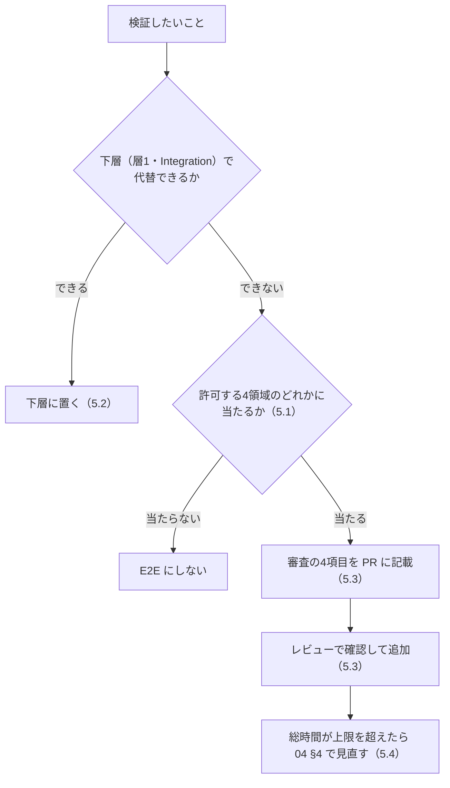
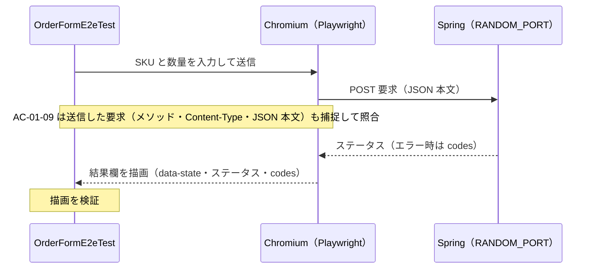

# 02c. E2E 最小化原則（AIガードレール＆テストアーキテクチャ標準 3/3）

**この文書で決めること**

- E2E にしてよい領域（4領域）と、E2E に置いてはならないもの
- E2E を新規に追加するときの審査
- E2E の時間の予算と、flaky の扱い

| 項目 | 内容 |
|---|---|
| 文書ID | TEST-02c |
| 目的 | E2E を「E2E でしか検証できないもの」に限定するための原則を定める |
| 前提 | [01 基本方針書](./01-test-policy.md) の層2（E2E の位置づけ） |
| 関連 | [05 導入手順書](./05-adoption-guide.md)（既存プロジェクトへ導入するときの診断と段階導入）。E2E の破棄基準は [04 リグレッション運用規程](./04-regression-governance.md) |

| ファイル | 扱う節 | 内容 | 分けた理由 |
|---|---|---|---|
| [02a 型設計とPBT](./02a-types-and-pbt.md) | §0 技術前提、§1 型設計、§2 PBT | 誤りを書けなくする型設計と、不変条件を検査する PBT の標準 | ドメインのコード例が中心で、型と PBT を続けて読む |
| [02b 層1の実行境界とミューテーション](./02b-execution-and-mutation.md) | §3 層1の構成と実行境界、§4 ミューテーション、§6 AI向けガードレール設定 | テストをいつ・どこで・どの強度で回すか、それを機械的に強制する設定 | ビルド・CI の設定を変えるときに参照する。§6 は、ビルド・CI で機械的に強制する設定（コンパイラ・detekt・ktlint・Konsist）を扱うため、§3・§4 と同じくここに置く |
| [02c E2E 最小化原則](./02c-e2e.md)（本書） | §5 E2E 最小化原則 | E2E の許可領域・審査・予算 | 独立した運用規則で、他の節と別に編集できるようにする |

節番号は分割前の `02` の番号をそのまま使う（02b は第5節が欠番で、02c は第5節のみ）。参照は `02a §2.3` のように書く。

## 5. E2E 最小化原則

E2E は遅く、壊れやすく、原因の切り分けが難しい。**E2E でしか検証できないものだけ**を E2E にする。

- 下層の Integration（HTTP/JSON の境界、ステータス・エラー形式、JSON ⇔ DTO 変換）の実例は `OrderControllerHttpTest`（`src/integrationTest`）を参照する。これらは E2E にしない。このテストは `@WebMvcTest` + `RestTestClient` を使い、Web スライスのみ起動する。
- E2E の実例は [5.5](#55-実例-注文追加フォームの-e2e) の `OrderFormE2eTest`（`src/e2eTest`）を参照する。

### 5.1 E2E として許可する4領域

E2E にしてよいのは、次の4領域だけである。

| # | 領域 | 識別子（`@e2e:<領域>`） | 内容 | 例 |
|---|---|---|---|---|
| 1 | **表示** | `display` | 実ブラウザでの描画・レイアウト・表示状態の確認（視覚回帰を含む） | 主要画面が崩れず描画される |
| 2 | **通信** | `communication` | フロント〜バックエンド〜DB 間の実配線の疎通 | ログイン API が実環境で往復できる |
| 3 | **主要ハッピーパス** | `happy-path` | 事業上クリティカルなユーザーフローの正常系（1機能につき原則1〜数本） | 商品選択 → 購入完了 |
| 4 | **実ブラウザ操作** | `browser-operation` | 実ブラウザでなければ再現できない挙動 | ドラッグ&ドロップ、ファイル選択、フォーカス/IME、ブラウザ履歴 |

### 5.2 E2E に置いてはならないもの

次のものは E2E に置かず、右列の層に置く。

| 禁止対象 | 置くべき層 |
|---|---|
| 入力バリデーションの網羅（境界値・異常系） | 層1（Unit / PBT） |
| ビジネスロジックの分岐・計算の検証 | 層1 |
| エラーメッセージ文言の網羅 | 層1／コンポーネントテスト |
| 権限・状態遷移の組合せ網羅 | 層1（sealed 型＋PBT）／層2 Integration |
| 異常系・例外系の網羅 | 層1／層2 Integration |

### 5.3 E2E 追加時の審査

E2E を新規追加する PR には、次の4項目を記載し、レビューで確認する。

- [ ] 上記4領域のどれに該当するか
- [ ] 下層（層1・Integration）で代替できない理由
- [ ] 対応する TRS の AC 番号
- [ ] 想定実行時間と、不安定要因（待機・外部依存）への対策

### 5.4 E2E 予算

総実行時間に上限を設け、flaky は隔離する。

| 対象 | ルール | 超えた・起きたとき |
|---|---|---|
| 総実行時間 | 上限（例: PR パイプライン内で 10 分以内）を設ける | 04 §4 の破棄基準で見直す |
| flaky な E2E | リトライで隠蔽しない | 検出後 **即座に隔離（quarantine）** し、期限内に修復か破棄を決める |

実測と予算の対比は [02b §4.1](./02b-execution-and-mutation.md#41-適用タイミングと閾値) の「仮置きの値の見直し」に記録している。CI の `e2e` ジョブは `timeout-minutes: 10` でこの予算を上限にしている。

### 5.5 実例: 注文追加フォームの E2E

実例は `OrderFormE2eTest`（`src/e2eTest`）で、5.1 の4領域のうち3領域に当たる3本がある。残る「実ブラウザ操作」に当たるテストはまだ無い。

| 項目 | 内容 |
|---|---|
| 対象 UI | `src/main/resources/static/index.html` の注文追加フォーム |
| 起動と操作 | Spring を `RANDOM_PORT` で起動し、Playwright の Chromium（ヘッドレス）で操作する |
| TRS | `ORD-001`。AC を決めるのは下層と同じ TRS である |
| 実行 | `./gradlew e2eTest`。CI は `kotlin-samples.yml` の `e2e` ジョブ |
| セットアップ | README の「E2E のセットアップ」 |

| テスト | 領域（TRS のタグ） | 対応する AC | 見ているもの |
|---|---|---|---|
| `AC-01-04 有効な SKU と数量を送信すると、…HTTP 204 が表示される` | 主要ハッピーパス（`@e2e:happy-path`） | AC-01-04 | 入力して送信すると、結果欄の `data-state` が `success` になり、ステータス 204 が表示される |
| `AC-01-09 範囲外の数量を送信すると、…OUT_OF_RANGE が表示される` | 通信（`@e2e:communication`） | AC-01-09 | ブラウザが組み立てた POST 要求（メソッド・`Content-Type`・JSON 本文）がサーバーに届き、応答の `codes` が画面に戻る |
| `AC-01-12 SKU が空白で数量が範囲外のとき、…codes が 2 件描画される` | 表示（`@e2e:display`） | AC-01-12 | 複数の `codes` が 1 件ずつ別の項目として描画され、`data-state` が `error` になる |

- 同じ AC を下層でも検証している（AC-01-04 は層1と Integration、AC-01-09 は Integration、AC-01-12 は層1と Integration）。E2E は、下層で確かめられない部分（ブラウザでの入力値の取得、要求の組み立て、応答の描画）だけを見る。範囲外の数量や空白の `sku` の網羅は、5.2 のとおり下層に任せている。
- 各テストの KDoc に 5.3 の4項目を書いており、審査記載の見本になる。新しい E2E を足す PR は、この書き方に倣って PR 本文に記載する。

期待値の出所について。HTTP ステータスと `codes` の値は ORD-001 の AC（OI-003・OI-005・OI-006 で人間が確定）による。一方、結果欄の状態（`data-state`）、`codes` の `<li>` 表示、ステータス表示は、TRS 上の出所が無い。現状は画面の設計を暫定の正とし、ORD-001 の OI-007 に起票している。画面の AC を足すかは人間が決める。
