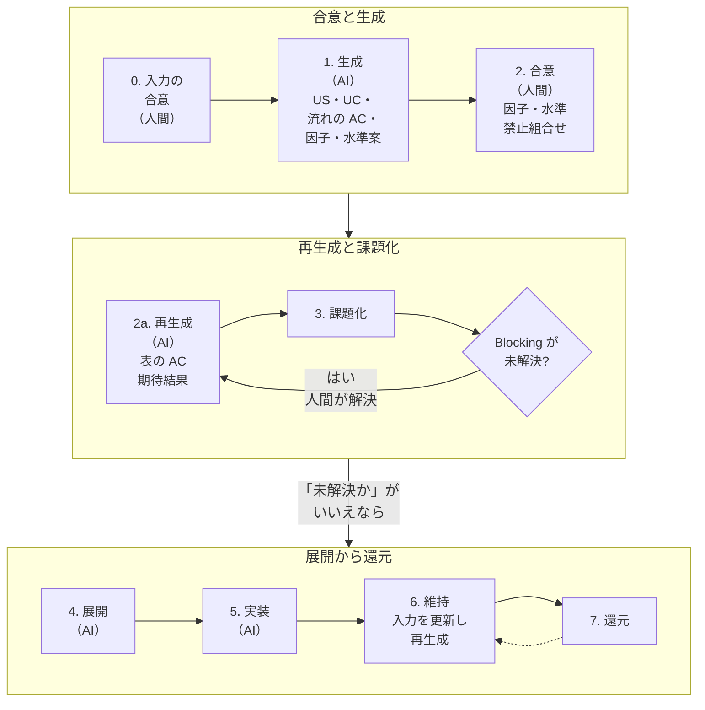

# 03-2. TRS 生成フロー

**この文書で決めること**

- TRS の策定フロー（入力の合意から、生成、課題化、展開、維持、還元まで）
- 人が合意するものと生成物の区分、人がレビューする範囲
- 入力の文書（要件定義書・基本設計書）の目次
- 生成物の生成元、生成の規則、生成物の置き場と編集の規則（AC の検証層から E2E を外すときの直し方を含む）
- 生成後の AI のレビュー

| 項目 | 内容 |
|---|---|
| 文書ID | TEST-03-2 |
| 目的 | [03 TRS 策定ガイドライン](./03-trs-guideline.md)が定める TRS の構造を前提に、TRS を入力の文書から生成して維持するフローと、生成物の扱いを定める |
| テンプレート | [trs/_template.md](./trs/_template.md) / 生成の入力にする[要件定義書](./templates/requirements.md)と[基本設計書](./templates/basic-design.md) |
| 関連 | [03 TRS 策定ガイドライン](./03-trs-guideline.md)（TRS の構造、期待値の正、Open Issues） / [03-1 トレーサビリティ検査の詳細](./03-1-traceability-checks.md)（生成物のファイルに置ける行の書式） / [01 基本方針書](./01-test-policy.md)（W字モデル） / [04 リグレッション運用規程](./04-regression-governance.md)（還元） |

**前提**: この文書は、次の定めを前提にする。

| 前提 | 定める場所 |
|---|---|
| 用語 | 03 §1.1 |
| テンプレートの節と、置くファイル | 03 §1.2 |
| 期待値の正と、禁止事項 | 03 §3.1、§3.2 |
| Open Issues の運用 | 03 §4 |
| 生成物のファイルに置ける行 | 03-1 §3.8.2 |
| 検査の単位（TRS ファイルと生成物のファイルの対） | 03-1 §2 |
| E2E を外す手順（手順 4 から 6） | 04 §4.2 |
| W字モデル | 01 §2 |

---

## 策定フロー

人が合意するのは、入力（要件定義書、基本設計書、因子・水準、禁止組合せ、Open Issues の決定）である。US・UC・AC・組合せ別の期待結果は、AI が入力から生成する（区分の詳細は本書 §1）。

**仕様変更の原則**: 変更は常に **入力（本書 §1 の「人が合意する」もの）→ TRS（生成）→ テスト → 実装** の順。実装先行で TRS を後付けしない。

各手順の内容は次のとおり。

| 手順 | 内容 |
|---|---|
| 0. 入力の合意（人間） | 要件定義書と基本設計書を決めて合意する（本書 §2） |
| 1. 生成（AI） | 要件定義書から US/UC と流れの AC を、基本設計書から因子・水準の案を作る。US/UC の出典に要件 ID を書く |
| 2. 合意（人間） | 因子・水準と禁止組合せの案を確認・修正し承認。AC と期待結果は個別に合意しない（本書 §1） |
| 2a. 再生成（AI） | 表の AC と組合せ別の期待結果を生成する（生成元は本書 §1）。生成の規則（本書 §3）に従い、AC の根拠に `C-xx`・要件 ID・設計 ID・OI を書く |
| 3. 課題化 | 曖昧点を Open Issues に起票。要件定義書・基本設計書の不足・矛盾と、要件定義や基本設計の段階で決まらなかった未決事項も起票する。生成後の AI のレビュー（本書 §5）で見つけた点も起票する |
| 判定: Blocking が未解決か | 未解決なら、人間が解決し、2a の再生成に戻る。未解決でなければ 4 へ進む |
| 4. 展開（AI） | 因子・水準・制約からテストケース生成 |
| 5. 実装（AI） | AC ID を紐づけてテスト実装 |
| 6. 維持 | 仕様変更は入力を先に更新（人間承認）し、TRS を再生成する（本書 §4） |
| 7. 還元 | 運用の不具合を、入力の文書か、人が合意する節（本書 §1）に反映して再生成し、下層テストへ反映する（04） |

## 1. 人の合意と生成物

人が合意するものを入力に絞り、残りを生成物にする。

| 区分 | 内容 |
|---|---|
| 人が合意する | 要件定義書、基本設計書、TRS の因子・水準と禁止組合せ（テンプレート §4、§5.1）、Open Issues の決定 |
| 生成物 | US、UC、AC、組合せ別の期待結果（テンプレート §5.2） |
| 運用情報 | トレーサビリティ、不具合還元履歴、変更履歴 |

節ごとの書く人は、03 §1.2 の表で定める。

### 生成物の生成元

生成物の生成元は、次の表のとおりである。

| 生成物 | 生成元 |
|---|---|
| US、UC、流れの AC | 要件定義書 |
| 組合せ別の期待結果（テンプレート §5.2） | 条件は、人が合意した因子・水準と禁止組合せ。期待結果の値は、要件定義書と基本設計書 |
| 表の AC | 5.2 の制約行と、人が合意した因子・水準 |

### 本則

- 生成物は、人が個別に合意する対象にしない。AC の最終確定は、「人が合意する」ものへの合意で行う（01 §4）。新しい ID の行を足す変化は、人がレビューしない。
- 理由は、AI は大量の変更を生み、人のレビュー速度に依存した品質保証は成立しないためである（01 §1）。代わりに、漏れと矛盾を、生成の規則（本書 §3）、機械検査（03 §3.4）、AI のレビュー（本書 §5）で止める。
- 生成物のファイルの全体では、ID に結び付く記述と ID に結び付かない Gherkin の変化を、人が確かめる。テンプレートの定型文の変化は、機械が確かめる（03-1 §3.8.2、本書 §4）。

### 例外

- 既存の ID に結び付く記述の変化は、意図した変化かどうかを、人がレビューする。期待値への合意は求めない。
  - 既存の ID は、一度でも使った ID である。削除した ID も含む。
  - 結び付く記述は、03-1 §3.8.2 の「ID に結び付く記述」である。UC の節は、03-1 §3.8.2 の範囲の表の「UC の節（検査の単位と人のレビュー）」とする。
  - 変化は、行が消える、中身が変わる、AC が `@pending` になる、のすべてを含む。
  - 03-1 §3.8.2 の「ID に結び付かない Gherkin」の変化も、同じくレビューする。
- 費用は、入力の文書を変えたときに、変わった行を人が見ることである。

人のレビューを、既存の ID に結び付く記述の変化に限れる理由は、次のとおりである。

| 理由 | 内容 | 定める場所 |
|---|---|---|
| ID を変えない | ID は再生成しても変えず、使い回しも禁じる | 本書 §4 の 2 |
| 古いテストで通らない | AC を消したときに古いテストが残るのは、⑦ が防ぐ。そのため、消した ID を後で別の内容に使っても、古いテストで ① を通ることはない | 03-1 §2 の ⑦ |
| 変化を列挙できる | 既存の ID の記述が変わったか消えたかは、機械で列挙できる。検査から外す変化は、既存の記述を変えるか消すことでしか起きない | 本書 §1 の「列挙と承認」 |

### 列挙と承認

- 導入先は、差分から、変わった、または消えた、既存の ID を、機械で列挙して人に示すとよい。base との差分だけでは、過去に消した ID は列挙できない。履歴か、削除の記録（03-1 §3.3 の反映先の `AC-xx-yy 削除`）から列挙する。列挙の実装は導入先が選ぶ。
- TRS のステータス `Approved` は、「人が合意する」ものへの合意がそろったことを表す。

## 2. 入力の文書

要件定義書と基本設計書の内容は、人間が決めて合意する（責務は 01 §4）。どちらも、作り方（聞き出し方など）は標準の範囲外である。

| 入力 | テストレベル |
|---|---|
| 要件定義書 | 受入 |
| 基本設計書 | 結合 |
| 因子・水準と制約（TRS） | 単体 |

入力から生成するものは、本書 §1 の「生成物の生成元」で定める。

目次は、次のとおり固定する。固定するのは第 1 階層の節（名前と順序）で、小見出しは任意である。

要件定義書（テンプレートは [templates/requirements.md](./templates/requirements.md)）の節は、すべて必須である。

1. 目的と範囲
2. 利用者と用語
3. 前提と制約
4. 業務フロー
5. 機能要件
6. 業務ルール
7. 非機能要件
8. 未決事項

基本設計書（テンプレートは [templates/basic-design.md](./templates/basic-design.md)）の節も、すべて必須である。

1. 全体構成
2. 画面
3. 帳票
4. 入力項目とデータ
5. 状態と操作
6. バッチ
7. 外部インタフェース
8. メッセージ
9. 非機能の実現方式
10. 未決事項

各節には、値か、未決事項の Q か、「該当なし」のどれかを書く。TRS で扱わない要求は書かない。不足は AI が推測で埋めない（手順 3）。

目次・設計 ID・用語は、書式を 03-1 §3.5・§3.6、検査を 03-1 §4・§5 で定める。

## 3. 生成の規則

AI が TRS を生成するとき、次の規則に従う。01 の品質ゲート G0〜G5 と区別するため、接頭辞を GR とする。

| 規則 | 内容 |
|---|---|
| GR1 往復 | 保存や取得を伴う振る舞いには、層1 の AC に加えて、通信や保存先（API の境界、DB など）を通した往復を確かめる AC を層2（Integration）に置く。取得の応答の中身も、この往復に含める |
| GR2 副作用 | 拒否と失敗の組合せでは、期待結果と AC に、状態が変わらないことを書く。状態を変える操作が成功する組合せでは、操作の対象外の属性と対象外のデータが変わらないことを書く |
| GR3 拒否の水準 | 拒否に至る水準ごとに、層2 の AC か、層2 で実行する制約行を最低 1 つ置く。例の値は因子・水準の表から取る |
| GR4 観測できる要素 | 期待結果と、流れの AC の Then には、観測できる要素をすべて書く。既定で決まる値、表示に現れる値、読み戻した状態を含める |
| GR5 E2E の選び方 | 層2（E2E）の AC は、02-3 §1 の規則に従って選ぶ。許可領域の書き方は、03 §2.1.3 の 7 に従う。許可領域に当たらないものは E2E にせず、下の層に置く |

- この規則は、限られた試行で見つけた欠けの類型を一般形にしたものである。導入先で効果を確かめ、必要なら調整する。
- 規則は生成の入力に渡す。守られているかは、生成後の AI のレビューが確かめる（本書 §5）。

## 4. 生成物の置き場と編集

| 対象 | 置き場 |
|---|---|
| 入力の文書（要件定義書・基本設計書） | TRS の置き場の外。導入先が決める |
| 人が合意する節と運用情報 | 03 §1 の TRS ファイル |
| 生成物（節の区分が「生成物」の節） | TRS の置き場の下のサブフォルダに、別ファイルとして置く |

### 生成物のファイルに置くもの

- 生成物のファイルには、US・UC・AC・組合せ別の期待結果を置く。因子・水準、禁止組合せ、Open Issues、運用情報は TRS ファイルに残す。
- 生成物のファイルの行は、03-1 §3.8.2 の 3 種に限る。それ以外の文章は出さない。出すと、トレーサビリティ検査が失敗にする（03-1 §2 の「検査の単位」）。
- 3 種に限る理由は、入力の値を ID を外して写した文が、人のレビューにも、既存の ID の変化の列挙にも掛からないためである。入力にある値は、写さず、出典の ID で指す。
- US・UC・AC を TRS ファイルに置くと、トレーサビリティ検査が失敗にする。生成物のファイルに因子・水準、禁止組合せ、Open Issues を置いても、失敗にする（03-1 §2 の「検査の単位」）。
- 置ける行の細目の理由は、03-1 §3.8.6 にある。

### ファイルの名前とテンプレート

- 生成物のファイルの名前は、TRS ファイルと同じ `<機能ID>-<スラッグ>.md` にする（03 §1.1）。サブフォルダの名前は導入先が決める。
- 別ファイルにする理由は、生成物が再生成で丸ごと置き換わるためである。人が合意する節と Open Issues の履歴を、同じファイルに置かない。
- トレーサビリティ検査は、生成物のファイルも読む。読まれない AC は、紐づけ検査から外れるためである（03-1 §2 の「検査の単位」）。
- テンプレートは、見通しのため全節を 1 ファイルで示す。節の区分が「生成物」の節は、導入先で別ファイルに置く。
- テンプレートは、番号を付けた各節の冒頭に「節の区分:」の行を書く。区分は、生成物、人が合意する、運用情報である。
- テンプレートは、生成物のファイルの冒頭の定型文も定める。生成物のファイルは、この文面をそのまま使う。
- 導入先が定型文を変えるときは、テンプレートを直し、生成物のファイルを再生成する。

### 生成物の編集

生成物は手で編集しない。

1. 生成物を人が直接直さない。入力の誤りや不足は、入力の文書か、人が合意する節（本書 §1）を直して再生成する。生成の誤りは、そのまま再生成する。
2. 再生成しても、既存の AC ID と制約 ID は変えない。削除した ID を別の内容に使い回さない。
3. 再生成で、人が合意する節を書き換えない。Open Issues の行は、削除も上書きもしない（03 §4.3）。
4. 基本設計書が変わったときは、AI が因子・水準の更新案を出す。人が合意してから、再生成する。
5. 入力の変更で AC が消え、その AC を未解決でない行が指しているときは、削除を記録する OI を起票する。その OI を解決し、反映先に `AC-xx-yy 削除` を書く（書式は 03-1 §3.3）。
6. AC を消すときは、その AC のテストも、同じ変更で消すか、名前を変える（03-1 §2 の ⑦）。

### AC の検証層から E2E を外す

04 §4.2 の手順 6 で、AC の検証層から E2E を外すときの TRS の直し方である。AC の表は生成物なので手で直さない（前の「生成物の編集」の 1）。AC の ID は変えない。変え方は、その AC が、生成時の入力と 02-3 §1 の規則で E2E に当たるかで分ける。

| 生成時の入力と 02-3 §1 の規則で、E2E に当たるか | 検証層の変え方 |
|---|---|
| 当たらない（許可領域外など） | 規則では下層に置く AC である。生成の誤りなので、そのまま再生成する |
| 当たる（実行時間・不安定・保守コストなどが理由） | 「この AC を E2E で検証しない」決定を、OI で入力にして再生成する |

OI の手続きは次のとおり。

- 起票は、04 §4.2 の手順 4 の後に行う。04 §4.2 の手順 4 の結果を根拠に書く。区分は Non-blocking にする。
- 04 §4.2 の手順 5 の承認を、この OI の解決とする。Resolved にするとき、反映先に AC ID を書く（03 §4.3 の 2）。
- 再生成の差分は、04 §4.2 の手順 5 の承認対象の PR に含める。
- 外すのは E2E の分だけである。下層の層は残る（03 §2.1.3 の 7）。

## 5. 生成後の AI のレビュー

生成物は人が個別に合意しないので（本書 §1）、AI が生成の直後に次を確かめる。要件定義書の節 1〜4 のうち、目的・前提と制約・業務フローと、基本設計書の節 1 には ID を付けない。テストと 1 対 1 に対応しないため、整合は機械で検査せず、AI が確かめる。

矛盾を見つけたときは、原因で分ける。

- 入力の不足や矛盾: Open Issues に起票する（03 §4）。
- 生成の誤り（入力は正しく、生成物が入力に反する）: 生成物を直さず、再生成する。

| 確認項目 | 確かめること |
|---|---|
| 目的との整合 | US・UC・AC が、要件定義書の節 1 の目的と範囲に反せず、範囲外を含まない |
| 前提と制約との整合 | AC が、節 3 の前提と制約に反しない |
| 業務フローとの整合 | UC の流れと流れの AC が、節 4 の業務フローに反しない。節 4 の主要な流れを、流れの AC が通す |
| 全体構成との整合 | 因子・水準が、基本設計書の節 1 の全体構成に反しない |
| 根拠の整合 | AC と期待結果の根拠が、実在する ID を指し、期待値が根拠の内容と一致する |
| 生成の規則 | 本書 §3 の規則を満たす |
| ケースの外し方 | 組合せ別の期待結果の行が、ケースを外す書き換えと、期待値を未決にする書き換えをしていない。ケースの外し方は、03 §2.2 の規則に従う |
