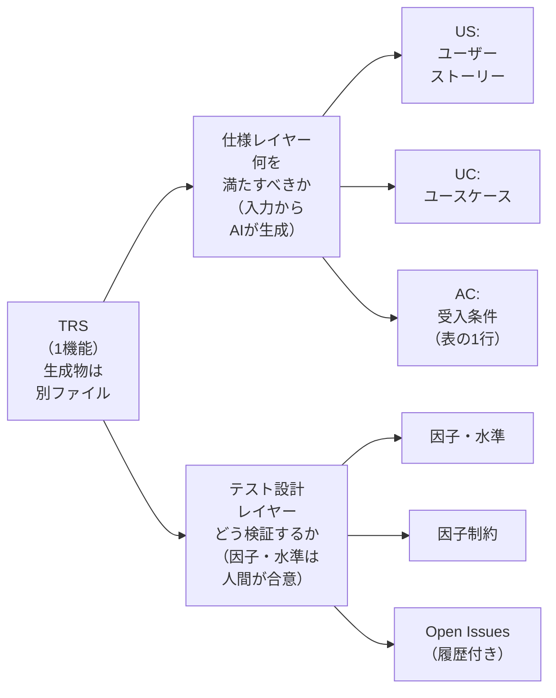
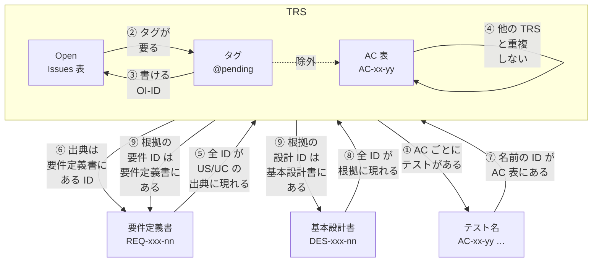
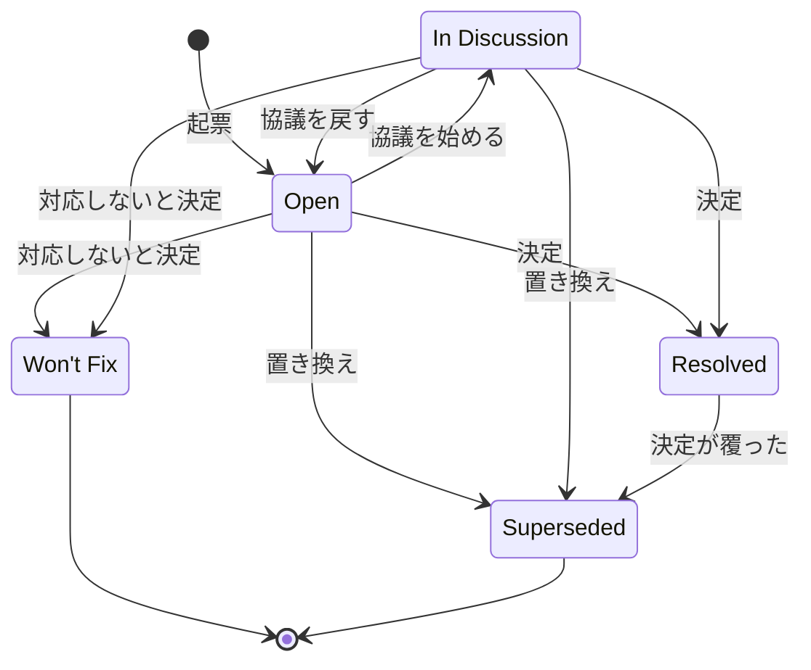

# 03. TRS（テスト要件仕様書）策定ガイドライン

**この文書で決めること**

- TRS の構造（2層）、AC の書き方、因子・水準・制約表からのテスト展開
- 期待値の出所（SSOT）と、要件定義書・基本設計書・AC・Open Issue をテストに結びつける機械検査の要約
- Open Issues の運用、レビュー項目

検査の細目は [03a](./03a-traceability-checks.md)、TRS の策定フロー（人の合意と生成物、生成の規則、生成物の編集）は [03b](./03b-generation-flow.md) で定める。

| 項目 | 内容 |
|---|---|
| 文書ID | TEST-03 |
| 目的 | TRS（Test Requirement Specification）の構造・記述ルール・運用を定め、AIが生成するテストの「期待値の正」を人間の合意した仕様に固定する |
| テンプレート | [trs/_template.md](./trs/_template.md) / 生成の入力にする[要件定義書](./templates/requirements.md)と[基本設計書](./templates/basic-design.md) |
| 関連 | [01 基本方針書](./01-test-policy.md)（W字モデル） / [03a トレーサビリティ検査の詳細](./03a-traceability-checks.md)（検査の失敗条件の全体と書式） / [03b TRS 生成フロー](./03b-generation-flow.md)（策定フロー、生成の規則、生成物の編集） / [05 導入手順書](./05-adoption-guide.md)（既存プロジェクトへの導入。レガシーへの適用は 05 §6 の補足。特性化テストは本書 §3.3） |

---

## 1. TRS とは

TRS は、**1機能（1ユースケース群）につき1つの TRS ファイル**である。「何を満たせば合格か（仕様）」と「どう検証するか（テスト設計）」を一体で保持する。W字モデルに従い、要件定義と基本設計の段階で生成を始め、実装・運用を通じて更新し続ける。節の多くは、要件定義書と基本設計書から AI が生成する（03b §1）。

- 配置: 導入先プロジェクトの TRS ディレクトリに、`<機能ID>-<機能名>.md` として置く。ディレクトリの例はテンプレートと同じ `docs/testing/trs/`、ファイル名の例は `CNL-001-order-cancel.md` である。
- 生成の入力は、2 文書とする。要件定義書（[templates/requirements.md](./templates/requirements.md)）と、基本設計書（[templates/basic-design.md](./templates/basic-design.md)）である。
- 入力の置き場所は導入先が決める。詳細は 03b §2。
- 例外として、節の区分が「生成物」の節は、別ファイルに置く。置き場と名前は 03b §4 に従う。
- 仕様の経緯（Open Issues、変更履歴）を複数ファイルに分散させない。経緯は TRS ファイルに集約する。

## 2. 2層構造ルール

TRS は必ず次の2層で構成する。**層の混在を禁止する**（仕様レイヤーにテスト手法の詳細を書かない／テスト設計レイヤーで仕様を新規決定しない）。



### 2.1 仕様レイヤー

| 要素 | 内容 | ID 形式 |
|---|---|---|
| US | 誰が・何を・なぜ（`〜として、〜したい。なぜなら〜`）。出典（要件 ID） | `US-xx` |
| UC | アクター、事前条件、基本フロー、代替フロー、事後条件。出典（要件 ID） | `UC-xx` |
| AC | UC に紐づく受入条件。形は本書 §2.1.2、書き方は本書 §2.1.3 に従う | `AC-xx-yy` |

#### 2.1.1 出典（要件 ID）の記述ルール

1. US と UC に、出典として要件定義書の要件 ID を必ず書く。複数あるときはカンマで区切る。
2. 要件定義書に無い範囲の US/UC を足すときは、人間が先に要件定義書へ要件として足し、その要件 ID を出典にする。W字モデルが、要件定義と TRS 生成の往復を定めるためである（01 §2）。Open Issue の決定で範囲が増えるときも同じである。
3. 要件の中の曖昧さは、AC 単位の Open Issue と `@pending` で扱う（03a §2 の ② ③）。
4. 要件定義書の要件は、TRS に写さない。出典で指すだけにする。同じ要求を 2 か所に書くと乖離するためである。
5. 要件 ID と出典の書式は 03a §3、書けない値と検査は 03a §4 で定める。
6. 基本設計書の項目は、US と UC の出典に書かない。AC と因子制約の根拠に、設計 ID（`DES-<略号>-<番号>`）で指す。

#### 2.1.2 AC の形

| 形 | 使う場面 | 書き方 |
|---|---|---|
| 流れの AC | 複数の操作や画面にまたがる UC の流れを、端から端まで通す AC | 表にも 1 行置き、振る舞いは Gherkin（Given/When/Then）で書く |
| 表の AC | 流れの AC 以外のすべて | 表の 1 行に、検証する振る舞いを 1 文で書く。期待値の詳細は書き写さない。根拠は本書 §2.1.3 の 8 に従い、因子制約表（テンプレート §5.2）の行に結べるときは `C-xx` で指す |
| 期待値が未決の AC | Blocking の Open Issue に依存する AC | 表の AC として行を置き、Gherkin のタグ行に `@pending:<OI-ID>` を付ける。期待値は書かない |

- Gherkin にするのは、流れの AC と、期待値が未決（`@pending`）の AC だけである。
- 流れの AC は、因子制約表の行に還元できないものに限る。還元できるものを Gherkin で重ねて書くと、期待値が二重になるためである。

流れの AC の例を示す。

```gherkin
@AC-01-03 @layer:2 @e2e:happy-path
Scenario: 購入者が画面からキャンセルを完了できる
  Given 購入者が未発送の注文の詳細画面を開いている
  When  「キャンセル」ボタンを押して確認ダイアログで承諾する
  Then  画面に「キャンセル済み」と表示される
```

#### 2.1.3 AC の記述ルール

1. 1 AC = 1 つの検証可能な振る舞い。流れの AC の `When` は 1 つに絞り、先行する操作は `Given` に書く。
2. 観測可能な結果のみを書く（内部実装・関数名・DB カラム名を書かない）。
3. 曖昧語（「適切に」「速やかに」「正しく」）を禁止し、具体値・条件で記述する。
4. 例外・異常系は独立した AC とする。
5. 流れの AC で具体値を伴うものは、`Scenario Outline` + `Examples` を使ってよい。
6. 各 AC に**テストレベル**（受入・結合・単体）を付ける。レベルは何を確かめるかで決める（本書 §2.1.4、01 §2）。
7. 各 AC に**検証層**（層1/層2/層3）の想定を付記する（01 の使い分け基準に従う）。レベルから層は一意に決まらない。
   - 層2 は Integration と E2E で区別する。Gherkin では `@integration` / `@e2e` のタグで示す（例: `@layer:2 @integration`）。
   - E2E は、表の検証層に許可領域を書く。例は `層2（E2E: happy-path）` である。
   - Gherkin では、`@e2e` の代わりに `@e2e:<領域>` を付ける。
   - 許可領域は 02c §5.1 の領域で、`display` / `communication` / `happy-path` / `browser-operation` である。
   - 同じ AC を複数の層で検証してよい。表の検証層は読点で並べる。例は `層1、層2（Integration）` である。Gherkin では `@layer:1 @layer:2` とする。
8. 各 AC に**根拠**を書く。`C-xx`（因子制約表の行に結べるとき）、要件 ID、設計 ID、OI のどれかを 1 つ以上書く。空にしない。
9. 期待値が未決の AC は、本書 §2.1.2 に従う。

#### 2.1.4 テストレベルと根拠

| テストレベル | 確かめること（01 §2） | 根拠の主 |
|---|---|---|
| 受入 | 要件ごとの代表ケース | 要件 ID |
| 結合 | 基本設計書の画面、入力項目とデータ、状態と操作、外部インタフェース | 設計 ID |
| 単体 | 因子・水準の境界値と組合せ | `C-xx` |

- 根拠の主は目安である。1 つの AC が、複数の種類の根拠を持ってよい。
- 根拠を持てない AC は、要件・設計・因子制約・OI の決定のどれにも結べない期待値である。仕様に無い期待値の混入として扱い（§3.2）、AC にしない。

### 2.2 テスト設計レイヤー

AC を網羅的なテストケースへ展開するための設計情報。人が合意する節は、03b §1 に従う。

| 要素 | 内容 |
|---|---|
| **因子（Factor）** | 結果に影響する入力・条件・状態の軸（例: 注文ステータス、支払方法、ユーザー権限） |
| **水準（Level）** | 因子が取りうる値の代表（同値分割・境界値に基づく）。無効水準も明示する |
| **因子制約** | 組合せとして**成立しない／禁止される**水準の組合せ、および組合せ時の期待結果 |
| **Open Issues** | 仕様が未確定・曖昧な点の追跡表。解決後も履歴を残す（§4） |

- 因子・水準は表形式で記述する。AI はこれを入力に、テストケース（組合せ網羅／ペアワイズ／直交表）を機械的に生成する。
- 因子制約は「禁止組合せ」と「組合せ別の期待結果」を明示する。AI が成立しない組合せのテストを生成せず、期待結果を推測しないようにするため。
- 型で表現可能な制約（型で排除される組合せ）は、禁止組合せ（テンプレート §5.1）として記載する。扱いに「型で排除」と付記し、テスト生成の対象外とする（02a §1）。例えば、状態を閉じた型（sealed 型など）で表し、不正な組合せを作れなくしたものがある。
- ケースを生成しない判断は、人が合意する禁止組合せ（テンプレート §5.1）にだけ書ける。組合せ別の期待結果（テンプレート §5.2）の行は、すべてケースになる。生成物では、この判断を書けない（検査は 03a §3）。
- 期待値が未決の組合せは、テンプレート §5.2 に行を置かない。Blocking の OI を起こし、その組合せを検証する AC に `@pending:<OI-ID>` を付ける（03a §2 の ② ③）。AC が `@pending` になる変化は、人のレビューの対象になる（03b §1）。決定後に、再生成で行を足す。
- 既存の `C-xx` の行に、あとから Blocking の疑義が出たときは、その行を消して OI を起票する。その行を根拠にしていた AC には、`@pending:<OI-ID>` を付ける。決定後に新しい制約 ID で足すときは、AC の根拠も書き換える。
- PBT で扱う連続・大規模な値域の水準には `PBT` と付記し、ジェネレータの制約として使う。

### 2.3 因子・水準・制約表からデータ駆動テストへの展開

TRS の表をテストへ展開する標準形を、次のとおり定める。展開の解釈を AI や開発者に任せない。表中の「テンプレート §x」は、本書の節ではなく、[TRS テンプレート](./trs/_template.md)の節番号である。

| TRS の要素 | テストコードでの扱い |
|---|---|
| 因子制約表（テンプレート §5.2）の1行 | データ駆動テストの**1ケース**。ケース名の先頭に制約 ID（`C-xx`）を置く。行を置いたら、ケースから外せない（本書 §2.2） |
| 因子・水準表（テンプレート §4）の水準 | 制約表の「条件」列に現れる水準を、ケースの入力に使う。連続値（`PBT` と付記した水準）は Property に任せ、ここでは境界値だけを行にする |
| 禁止組合せ（テンプレート §5.1）・型で排除する制約 | **ケースを生成しない**（テスト対象外。行を作らない）。この判断を書ける場所はテンプレート §5.1 だけである（本書 §2.2） |
| 組合せ別の期待結果 | 制約表の値をそのまま期待値にする。**実装の挙動から逆生成しない** |
| AC | データ駆動テストを包む**コンテナ名の先頭**に AC ID を置く（03a §1）。表の AC は根拠の列の `C-xx` で制約行を指す。複数の制約行が同じ AC を検証してよい |

データ駆動テストに使う機能は、導入先が1つに決めて標準とする。機能には、例えば次のものがある（Kotest `withData`、JUnit `@ParameterizedTest`、pytest `parametrize`）。

## 3. Single Source of Truth（SSOT）

### 3.1 期待値の正

テストの期待値の正（Source of Truth）は、次の順で優先する**人間が合意した成果物**とする。

1. 承認済みの仕様書（要件定義書、基本設計書、03b §1 の「人が合意する」TRS の節）。TRS の AC と期待結果は、これらから生成した展開である
2. 承認済みのデザイン（Figma 等の UI 仕様）
3. （上記に定めがない場合）Open Issue として起票し、人間が決定する

### 3.2 禁止事項

| 禁止 | 理由 |
|---|---|
| **既存コードの挙動から期待値を逆生成する** | バグを仕様として固定化し、AI が現状追認のテストを大量に生む |
| 失敗したテストに合わせて期待値を書き換える | テストが検証の意味を失う |
| 仕様に書かれていない挙動を、AI の推測でテストの期待値にする | 無根拠な仕様が混入する |
| TRS と矛盾する期待値をテストコードにハードコードする | 二重管理になり乖離する |

### 3.3 例外：特性化テスト（Characterization Test）

仕様書が存在しないレガシーコードに限り、**現状把握のための特性化テスト**を作成してよい。ただし次を守る。

- ファイル名・タグで `characterization` と明示し、通常のテストと区別する。
- 「仕様」ではなく「現状」であることをコメントに明記する。
- 疑わしい挙動は Open Issue として起票し、人間が正誤を判断する。確定後は、入力の文書か、人が合意する節（03b §1）に反映して TRS を再生成し、AC に昇格させる。

### 3.4 トレーサビリティ

TRS の AC・`@pending`・Open Issues とテストの対応を、CI のトレーサビリティ検査が機械的に検査する。要件定義書の要件 ID と US/UC の出典の対応、基本設計書の設計 ID と根拠の対応、根拠の値の実在も、同じ検査で調べる（03a §4）。要件定義書と基本設計書の目次と用語も調べる（03a §5）。検査の実装は導入先が選び、ここでは何を**失敗**にするかを定める。

**検査の単位**: 検査は、TRS ファイルと、同じ名前の生成物のファイル（03b §4）を合わせて、1 つの TRS として読む。以降の「TRS」は、この対を合わせたものを指す。

| 失敗にする条件 | 理由 |
|---|---|
| 対になる TRS ファイルが無い生成物のファイルがある | 人が合意する節と運用情報の無い生成物を、検査の外に置かないため |
| 対になる生成物のファイルが無い TRS ファイルがある | 生成物のファイルの読み落としで、AC が検査の外に出るのを防ぐため |
| TRS ファイルに、US の表の行、UC の節、AC の表（テンプレート §3）の行がある | US・UC・AC は、生成物のファイルに置くため（03b §4） |
| 生成物のファイルに、US の行、UC、AC の表の行が、それぞれ 1 つ以上ない | 読み取りの空振りで素通りさせないため（03a §3） |
| 生成物のファイルに、Open Issues の表、因子・水準、禁止組合せのいずれかがある（見分ける書式は 03a §3） | 再生成で置き換わる生成物に置くと、Open Issues の履歴と合意した内容が、検査の外で消えるため（03b §4） |
| 生成物のファイルに、03a §3 の 3 種のどれにも当たらない行がある | 03b §4 |
| 組合せ別の期待結果（テンプレート §5.2）の期待結果に、ケースを生成しない文言か、期待値が未決の文言がある。ほか 03a §3 の判定の表に当たる | ケースの外し方を、本書 §2.2 の規則に限るため |
| トレーサビリティ表（テンプレート §7）と Open Issues の関連列の AC ID が、生成物のファイルの AC の表に無い。読めない範囲表記（03a §3）も同じ。行の区分と状態は問わない | 消えた AC を指したままにせず、AC が黙って検査から外れる経路をふさぐため |

トレーサビリティ表と Open Issues の関連列にある AC ID は、TRS ファイルにあってよい。上の表の「AC の表の行がある」の条件には入れない。

上の表の AC ID の照合から外すものは、次のとおりである。

- 外すもの: 未解決でない行の反映先の列に、`AC-xx-yy 削除` と書いた AC。未解決でない行は、状態が `Resolved`、`Superseded`、`Won't Fix` の行である。書式は 03a §3 で定める。
- 外さないもの: 未解決（`Open`、`In Discussion`）の行の反映先に `削除` があっても、その AC を照合から外さない。
- 外す理由: Open Issues の行は、削除も上書きもできない（§4.3 の 5）。外す手段が無いと、未解決でない行が指す AC を、正当な理由があっても消せなくなる。
- 入力の変更で AC が消え、その AC を未解決でない行が指しているときの手順は、03b §4 の 5 で定める。



| # | 検査 | 失敗にする条件 |
|---|---|---|
| ① | AC に対応するテストの検査（01 の G5） | `@pending` でない AC に、対応するテストが無い |
| ② | 未解決の Blocking な Open Issue の検査（01 の G5） | 未解決の Blocking が指す AC に、その OI-ID の `@pending` が無い |
| ③ | `@pending` に書けるもの（許容範囲） | 未解決の Blocking な OI-ID 以外を書いた。その OI の関連列に無い AC に付けた |
| ④ | `AC-xx-yy` は TRS 間で重複させない | 同じ ID が複数の TRS にある |
| ⑤ | 要件 ID の網羅の検査（01 の G5） | 要件定義書の要件 ID が、どの US/UC の出典にも現れない |
| ⑥ | 出典の実在の検査（01 の G5） | US/UC の出典の値が、実在する要件 ID でない（空欄・`—`・OI-ID を含む）。同じ要件 ID が、全要件定義書で複数の行にある |
| ⑦ | テスト名の `AC-xx-yy` の実在の検査（01 の G5） | テスト名の先頭の `AC-xx-yy` が、どの TRS の AC の表にも無い |
| ⑧ | 設計 ID の網羅の検査（01 の G5） | 基本設計書の節 2〜9 の設計 ID が、どの TRS の根拠にも現れない |
| ⑨ | 根拠の実在の検査（01 の G5） | TRS の根拠の値（制約 ID・要件 ID・設計 ID・OI-ID）が、実在しない、どの形にも当たらない、書けない表にある（5.2 の根拠の制約 ID）、空欄である。同じ設計 ID が、全基本設計書で複数の行にある |
| ⑩ | 目次の検査（01 の G5） | 要件定義書か基本設計書の節が、03b §2 の目次と、番号・名前・順序・数のどれかが違う |
| ⑪ | 用語の言い換えの検査（01 の G5） | 要件定義書の「使わない言い換え」の語が、同じ機能の要件定義書・基本設計書・TRS に現れる |

この表は要約である。検査の単位による失敗は、本節の冒頭で定める。①〜④ と ⑦ の失敗条件の全体は 03a §2、⑤ ⑥ ⑧ ⑨ は 03a §4、⑩ ⑪ は 03a §5、表の書式による失敗は 03a §3 で定める。⑩ ⑪ は ID の対応を調べる検査ではないので、図には描かない。⑨ の制約 ID と OI-ID は、同じ TRS の中の対応なので、図には描かない。

「**未解決の Blocking**」は、TRS の「6. Open Issues」表の行（OI）のうち、次を満たすものを指す。区分が `Blocking` で、状態が `Open` または `In Discussion` である。Resolved・Superseded・Won't Fix と Non-blocking は含まない。

## 4. Open Issues の履歴化

### 4.1 原則

- 仕様の曖昧点・判断保留は **Open Issues 表に起票**する。コード内の TODO や口頭合意にしない。
- **解決しても行を削除しない。** ステータスを `Resolved` にし、決定内容・決定者・決定日・根拠を記録して**同一 TRS ファイル内に永続化**する。

### 4.2 ステータス

| ステータス | 意味 |
|---|---|
| `Open` | 未解決。人間の判断待ち |
| `In Discussion` | 関係者と協議中 |
| `Resolved` | 決定済み。AC／因子制約へ反映済み |
| `Superseded` | 後続の決定で置き換えられた（置換先 Issue ID を記載） |
| `Won't Fix` | 対応しないと決定（理由必須） |

`Open` と `In Discussion` を未解決と呼ぶ。状態は次のとおり遷移する。



- `Open` と `In Discussion` は相互に行き来できる。
- `Open` と `In Discussion` からは、`Resolved` / `Won't Fix` / `Superseded` のどれへも移れる。
- `Resolved` からは `Superseded` へ移れる。
- `Won't Fix` と `Superseded` は終端で、他の状態へは移らない。その決定を覆すときは、元の行を変えず、新しい OI を起票する。

### 4.3 運用ルール

1. 起票者は AI でも人間でもよい。**解決（`Resolved` への遷移）は人間のみ**が行う。
2. `Resolved` にするときは、**反映先**（どの AC／因子制約を変更したか）を必ず記載する。AC を削除したときの書き方は、03a §3 に従う。
3. Blocking 区分の Open Issue が未解決の AC に対するテストは、期待値を確定させず `pending` とする。AI が推測で埋めてはならない。
4. 後から決定が覆った場合は、元の行を `Superseded` にして新規行を追加する（上書きしない）。`Won't Fix` と `Superseded` の行は終端なので、覆すときは行を変えず、新規行を追加する（§4.2）。
5. 追記は時系列（ID 昇順）とし、行の並べ替え・削除を行わない。

### 4.4 記述例

列はテンプレート（[trs/_template.md](./trs/_template.md) §6）と同じ12列とする。

| ID | 起票日 | 起票者 | 区分 | 関連 | 内容 | 状態 | 決定内容 | 決定者 | 決定日 | 根拠 | 反映先 |
|---|---|---|---|---|---|---|---|---|---|---|---|
| OI-001 | 2026-10-10 | AI | Blocking | F1-L2 | 発送準備中の注文はキャンセル可能か | Resolved | 発送準備中は可。ただしキャンセル手数料なし | 担当PO | 2026-10-12 | 担当PO の決定（要件定義書 Q-01） | AC-01-03, 制約C-02 |
| OI-002 | 2026-10-11 | AI | Non-blocking | AC-01-01 | キャンセル完了メールの文言 | Open | | | | | |

## 5. レビューチェックリスト

- [ ] 1機能につき TRS ファイルが 1 つで、仕様レイヤーとテスト設計レイヤーが分離されている。生成物のファイルの名前は、03b §4 に従っている
- [ ] US/UC の出典が実在する要件 ID で、要件定義書の全要件 ID がどれかの出典に現れる（03a §4 の ⑤ ⑥）
- [ ] 根拠の値（制約 ID、要件 ID、設計 ID、OI-ID）に空欄が無く、実在し、基本設計書の節 2〜9 の全設計 ID がどれかの根拠に現れる（03a §4 の ⑧ ⑨）
- [ ] 要件定義書と基本設計書の目次が、03b §2 のとおりで、用語の「使わない言い換え」が現れない（03a §5 の ⑩ ⑪）
- [ ] 全 AC が表の 1 行で、観測可能な結果のみを記述している。Gherkin は流れの AC と `@pending` の AC だけである
- [ ] 各 AC にテストレベルと検証層が付記されている
- [ ] 生成物の節が手で編集されていない（03b §4）
- [ ] 生成物のファイルに、03a §3 の 3 種に当たらない行が無い（03a §3）
- [ ] 生成物の、既存の ID に結び付く記述の変化（消える、中身が変わる、AC が `@pending` になる）を、人が確かめた（03b §1）
- [ ] AC と US/UC が、要件定義書の目的、前提と制約、業務フロー（節 1〜4）と矛盾しない（03b §5）
- [ ] 異常系・境界が AC または因子水準として表現されている
- [ ] 因子制約に、禁止組合せと組合せ別の期待結果がある
- [ ] 期待値の根拠が仕様・デザインであり、既存コード由来ではない
- [ ] Open Issues が履歴を保持している
- [ ] 未解決の Blocking が指す AC が `@pending:<OI-ID>` で明示されている（`@pending` の許容範囲は 03a §2 の ③）
- [ ] `@pending` の AC を除く全 AC にテストが紐づいている（トレーサビリティ）
