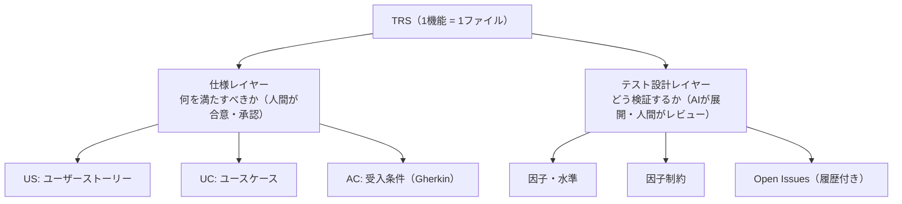
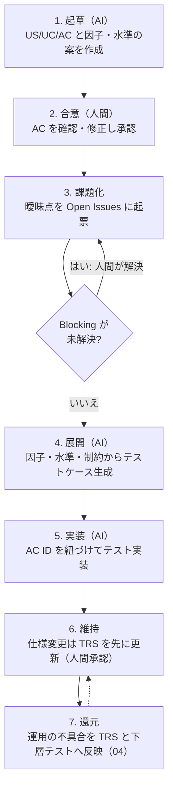

# 03. TRS（テスト要件仕様書）策定ガイドライン

| 項目 | 内容 |
|---|---|
| 文書ID | TEST-03 |
| 目的 | TRS（Test Requirement Specification）の構造・記述ルール・運用を定め、AIが生成するテストの「期待値の正」を人間の合意した仕様に固定する |
| テンプレート | [trs/_template.md](./trs/_template.md) |
| 関連 | [01 基本方針書](./01-test-policy.md)（W字モデル） / [05 導入手順書](./05-adoption-guide.md)（既存プロジェクトへの導入。レガシーへの適用は 05 §6 の補足。特性化テストは本書 §3.3） |

---

## 1. TRS とは

TRS は、**1機能（1ユースケース群）につき1ファイル**で、「何を満たせば合格か（仕様）」と「どう検証するか（テスト設計）」を一体で保持する文書である。W字モデルに従い、要件定義の段階で起草を開始し、実装・運用を通じて更新し続ける。

- 配置: `docs/testing/trs/<機能ID>-<機能名>.md`（例: `ORD-001-order-cancel.md`）
- 1機能 = 1ファイル。仕様の経緯を複数ファイルに分散させない。

## 2. 2層構造ルール

TRS は必ず次の2層で構成する。**層の混在を禁止する**（仕様レイヤーにテスト手法の詳細を書かない／テスト設計レイヤーで仕様を新規決定しない）。



### 2.1 仕様レイヤー

| 要素 | 内容 | ID 形式 |
|---|---|---|
| US | 誰が・何を・なぜ（`〜として、〜したい。なぜなら〜`） | `US-xx` |
| UC | アクター、事前条件、基本フロー、代替フロー、事後条件 | `UC-xx` |
| AC | UC に紐づく受入条件。**Gherkin 形式**（Given/When/Then） | `AC-xx-yy` |

**AC の記述ルール**

1. 1 AC = 1 つの検証可能な振る舞い。`When` は1つに絞る。
2. 観測可能な結果のみを `Then` に書く（内部実装・関数名・DB カラム名を書かない）。
3. 曖昧語（「適切に」「速やかに」「正しく」）を禁止し、具体値・条件で記述する。
4. 例外・異常系は独立した AC とする。
5. 具体値を伴う AC は `Scenario Outline` + `Examples` を使ってよい。
6. 各 AC に**検証層**（層1/層2/層3）の想定を付記する（01 の使い分け基準に従う）。層2 は `@integration` / `@e2e` で区別する（例: `@layer:2 @integration`）。同じ AC を複数の層で検証してよい（`@layer:1 @layer:2`）。
7. 期待値が未決で Blocking の Open Issue に依存する AC は、`@pending:<OI-ID>` を付け、シナリオ本文に期待値を書かない。

```gherkin
@AC-01-02 @layer:1
Scenario: 発送済みの注文はキャンセルできない
  Given 注文のステータスが「発送済」である
  When  購入者がキャンセルを要求する
  Then  キャンセルは拒否される
  And   エラーコード "ORDER_ALREADY_SHIPPED" が返る
```

### 2.2 テスト設計レイヤー

AC を網羅的なテストケースへ展開するための設計情報。

| 要素 | 内容 |
|---|---|
| **因子（Factor）** | 結果に影響する入力・条件・状態の軸（例: 注文ステータス、支払方法、ユーザー権限） |
| **水準（Level）** | 因子が取りうる値の代表（同値分割・境界値に基づく）。無効水準も明示する |
| **因子制約** | 組合せとして**成立しない／禁止される**水準の組合せ、および組合せ時の期待結果 |
| **Open Issues** | 仕様が未確定・曖昧な点の追跡表。解決後も履歴を残す（§4） |

**運用**

- 因子・水準は表形式で記述し、AI はこれを入力としてテストケース（組合せ網羅／ペアワイズ／直交表）を機械的に生成する。
- 因子制約は「禁止組合せ」と「組合せ別の期待結果」を明示し、AI が成立しない組合せのテストを生成しない／期待結果を推測しないようにする。
- 型で表現可能な制約（sealed 型で排除される組合せ）は、制約として記載したうえで「型で排除」と付記し、テスト生成の対象外とする（02 §1）。
- 水準には、PBT で扱う連続・大規模な値域の場合 `PBT` と付記し、ジェネレータの制約として使う。

### 2.3 因子・水準・制約表からデータ駆動テストへの展開

TRS の表を機械的にテストへ展開するときの標準形を、次のとおり定める。展開の解釈を AI や開発者に任せない。

| TRS の要素 | テストコードでの扱い |
|---|---|
| 因子制約表（§5.2）の1行 | データ駆動テストの**1ケース**。ケース名の先頭に制約 ID（`C-xx`）を置く |
| 因子・水準表（§4）の水準 | 制約表の「条件」列に現れる水準を、ケースの入力に使う。連続値（`PBT` と付記した水準）は Property に任せ、ここでは境界値だけを行にする |
| 禁止組合せ（§5.1）・型で排除する制約 | **ケースを生成しない**（テスト対象外。行を作らない） |
| 組合せ別の期待結果 | 制約表の値をそのまま期待値にする。**実装の挙動から逆生成しない** |
| AC | データ駆動テストを包む**コンテナ名の先頭**に AC ID を置く（§3.4）。複数の制約行が同じ AC を検証してよい |

標準は Kotest の `withData` とする。JUnit5 `@ParameterizedTest` は採用しない。このリポジトリのテストは Kotest に統一されており、`@ParameterizedTest` には `junit-jupiter-params` の追加が必要で、実際に動かして検証できない例を書くことになるため。

```kotlin
class PaymentTransitionTableTest : FunSpec({
    // 制約表の「条件」列（F1 × F2）。期待結果は制約表の値（C-22 は INVALID_TRANSITION で拒否）
    context("AC-02-06 終端状態からはどの操作でも遷移できない（C-22）") {
        withData(
            nameFn = { "${it.id} ${it.state::class.simpleName} × ${it.operation}" },
            ts = listOf(PaymentState.Captured(at), PaymentState.Failed(FailureReason.TIMEOUT)).flatMap { state ->
                listOf(authorize, capture, fail).map { op -> case("C-22", state, op) }
            },
        ) { it.apply(it.state) shouldBe rejected }
    }
})
```

全体は `src/test/kotlin/com/example/payment/domain/PaymentTransitionTableTest.kt`（TRS PAY-001 の制約表 C-20〜C-22 に対応）。Kotest 6.2.5 での実測で分かった点は次のとおり。

- `withData` は `io.kotest.datatest.withData`。`kotest-runner-junit5` が持ち込む `kotest-framework-engine` に含まれ、追加の依存は要らない。
- `StringSpec` の `"名前" { }` の中に `withData` を置くと、「Nested withData is not supported inside StringSpec test bodies」で非推奨になる（`allWarningsAsErrors` によりビルドエラー）。AC 名のコンテナの下に置くには `FunSpec` の `context(...)` などを使う。
- 位置引数だけで呼ぶと `withData` のオーバーロードが曖昧になるため、`nameFn` / `ts` を名前付きで渡す。
- コンテナ名の先頭の AC ID は `TraceabilityTest` が文字列リテラルとして拾うので、検査側の変更は不要。

## 3. Single Source of Truth（SSOT）

### 3.1 期待値の正

テストの期待値の正（Source of Truth）は、次の順で優先する**人間が合意した成果物**とする。

1. 承認済みの仕様書（TRS の AC、要件定義、業務ルール文書）
2. 承認済みのデザイン（Figma 等の UI 仕様）
3. （上記に定めがない場合）Open Issue として起票し、人間が決定する

### 3.2 禁止事項

| 禁止 | 理由 |
|---|---|
| **既存コードの挙動から期待値を逆生成する** | バグを仕様として固定化し、AI が現状追認のテストを大量に生む |
| 失敗したテストに合わせて期待値を書き換える | テストが検証の意味を失う |
| 仕様に書かれていない挙動を、AI の推測でテストの期待値にする | 無根拠な仕様が混入する |
| TRS と矛盾する期待値をテストコードにハードコードする | 二重管理になり乖離する |

### 3.3 例外：特性化テスト（Characterization Test）

仕様書が存在しないレガシーコードに限り、**現状把握のための特性化テスト**を作成してよい。ただし次を守る。

- ファイル名・タグで `characterization` と明示し、通常のテストと区別する。
- 「仕様」ではなく「現状」であることをコメントに明記する。
- 疑わしい挙動は Open Issue として起票し、人間が正誤を判断する。確定後に TRS の AC へ昇格させる。

### 3.4 トレーサビリティ

- すべてのテストは、対応する AC の ID を**テスト名の先頭に `AC-xx-yy` を置き、続けて空白と説明を書く形で**付ける（例: `AC-01-02 範囲外の整数は拒否される`）。Kotest の文字列名・JUnit のバッククォート名のどちらでも書け、grep で機械的に辿れる。JVM のバッククォート名は `[` `]` `:` `.` を使えないため、括弧やコロンで囲まない（ORD-001 の検証で判明）。複数の AC を検証するテストは `AC-01-04 AC-01-05 …` と空白区切りで並べる。TRS のトレーサビリティ表には `テストクラス::テスト名` を書く。
- AC に対応するテストが存在しない場合、CI のトレーサビリティチェックで警告する（01 の G5）。**実装済み**: `TraceabilityTest`（Konsist、`./gradlew test` で実行）が、TRS の AC 表から `AC-xx-yy` を抽出し、`src/test` と `src/integrationTest` にその ID で始まるテスト名があるかを照合して、無ければ**失敗**させる。Gherkin のタグに `@pending:<OI-ID>` を付けた AC は除外する（Blocking の Open Issue が未解決の AC）。警告ではなく失敗にしたのは、除外の手段が `@pending` に一本化されており、それを TRS 側で明示させられるため。`@pending` の追加は TRS の変更として人間のレビューを受ける。
- **`AC-xx-yy` は TRS 間で重複させない。** `TraceabilityTest` は全 TRS の AC を、`src/test` と `src/integrationTest` 全体のテスト名と照合する。別の TRS と同じ ID があると、別機能のテストで AC が満たされたように見え、検査が弱くなる。`xx` は UC の番号と対応させ、**TRS ごとに異なる番号**を割り当てる（例: ORD-001 は `01`、PAY-001 は `02`、PAY-002 は `03`）。新しい TRS は、既存の TRS が使っていない最小の番号から採番する。重複は `TraceabilityTest` が検出して失敗させる。
- AC に紐づかないテストは、技術的な不変条件（PBT 等）であることを明記する。

## 4. Open Issues の履歴化

### 4.1 原則

- 仕様の曖昧点・判断保留は **Open Issues 表に起票**する。コード内の TODO や口頭合意にしない。
- **解決しても行を削除しない。** ステータスを `Resolved` にし、決定内容・決定者・決定日・根拠を記録して**同一 TRS ファイル内に永続化**する。
- これにより「なぜこの仕様になったか」という決定の文脈が、1ファイルで追跡できる。

### 4.2 ステータス

| ステータス | 意味 |
|---|---|
| `Open` | 未解決。人間の判断待ち |
| `In Discussion` | 関係者と協議中 |
| `Resolved` | 決定済み。AC／因子制約へ反映済み |
| `Superseded` | 後続の決定で置き換えられた（置換先 Issue ID を記載） |
| `Won't Fix` | 対応しないと決定（理由必須） |

### 4.3 運用ルール

1. 起票者は AI でも人間でもよい。**解決（`Resolved` への遷移）は人間のみ**が行う。
2. `Resolved` にするときは、**反映先**（どの AC／因子制約を変更したか）を必ず記載する。
3. Blocking 区分の Open Issue が未解決の AC に対するテストは、期待値を確定させず `pending` とする。AI が推測で埋めてはならない。
4. 後から決定が覆った場合は、元の行を `Superseded` にして新規行を追加する（上書きしない）。
5. 追記は時系列（ID 昇順）とし、行の並べ替え・削除を行わない。

### 4.4 記述例

列はテンプレート（[trs/_template.md](./trs/_template.md) §6）と同じ12列とする。実例は [ORD-001](./trs/ORD-001-add-item.md) を参照。

| ID | 起票日 | 起票者 | 区分 | 関連 | 内容 | 状態 | 決定内容 | 決定者 | 決定日 | 根拠 | 反映先 |
|---|---|---|---|---|---|---|---|---|---|---|---|
| OI-001 | 2026-10-10 | AI | Blocking | F1-L2 | 発送準備中の注文はキャンセル可能か | Resolved | 発送準備中は可。ただしキャンセル手数料なし | 担当PO | 2026-10-12 | 要件定義書 §3.2 | AC-01-03, 制約C-02 |
| OI-002 | 2026-10-11 | AI | Non-blocking | AC-01-01 | キャンセル完了メールの文言 | Open | | | | | |

## 5. 策定フロー



**仕様変更の原則**: 変更は常に **TRS → テスト → 実装** の順。実装先行で TRS を後付けしない。

## 6. レビューチェックリスト

- [ ] 1機能1ファイルで、仕様レイヤーとテスト設計レイヤーが分離されている
- [ ] 全 AC が Gherkin 形式で、観測可能な結果のみを記述している
- [ ] 各 AC に検証層が付記されている
- [ ] 異常系・境界が AC または因子水準として表現されている
- [ ] 因子制約に、禁止組合せと組合せ別の期待結果がある
- [ ] 期待値の根拠が仕様・デザインであり、既存コード由来ではない
- [ ] Open Issues が履歴を保持し、Blocking の未解決が残っていない
- [ ] 全 AC にテストが紐づいている（トレーサビリティ）
