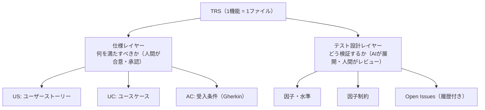
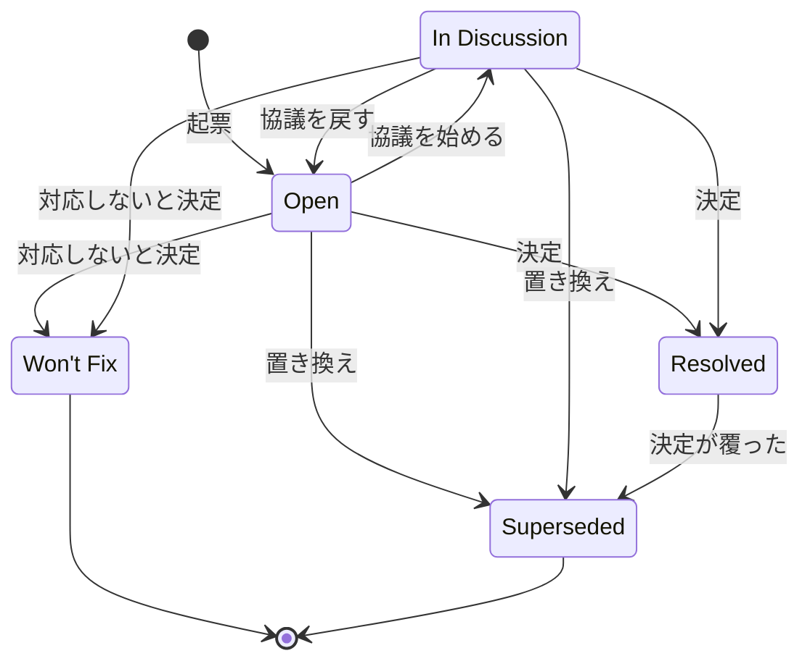
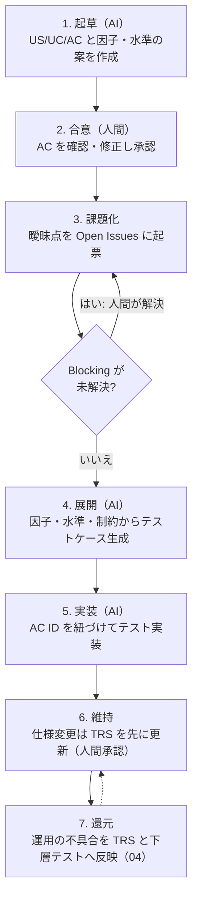

# 03. TRS（テスト要件仕様書）策定ガイドライン

**この文書で決めること**

- TRS の構造（2層）、AC の書き方、因子・水準・制約表からのテスト展開
- 期待値の出所（SSOT）と、AC・Open Issue をテストに結びつける機械検査
- Open Issues の運用、TRS の策定フロー、レビュー項目

| 項目 | 内容 |
|---|---|
| 文書ID | TEST-03 |
| 目的 | TRS（Test Requirement Specification）の構造・記述ルール・運用を定め、AIが生成するテストの「期待値の正」を人間の合意した仕様に固定する |
| テンプレート | [trs/_template.md](./trs/_template.md) |
| 関連 | [01 基本方針書](./01-test-policy.md)（W字モデル） / [05 導入手順書](./05-adoption-guide.md)（既存プロジェクトへの導入。レガシーへの適用は 05 §6 の補足。特性化テストは本書 §3.3） |

---

## 1. TRS とは

TRS は、**1機能（1ユースケース群）につき1ファイル**で、「何を満たせば合格か（仕様）」と「どう検証するか（テスト設計）」を一体で保持する文書である。W字モデルに従い、要件定義の段階で起草を開始し、実装・運用を通じて更新し続ける。

- 配置: 導入先プロジェクトの TRS ディレクトリ（例: テンプレートと同じ `docs/testing/trs/`）に `<機能ID>-<機能名>.md` として置く（例: `CNL-001-order-cancel.md`）。
- 仕様の経緯を複数ファイルに分散させない。

## 2. 2層構造ルール

TRS は必ず次の2層で構成する。**層の混在を禁止する**（仕様レイヤーにテスト手法の詳細を書かない／テスト設計レイヤーで仕様を新規決定しない）。



### 2.1 仕様レイヤー

| 要素 | 内容 | ID 形式 |
|---|---|---|
| US | 誰が・何を・なぜ（`〜として、〜したい。なぜなら〜`） | `US-xx` |
| UC | アクター、事前条件、基本フロー、代替フロー、事後条件 | `UC-xx` |
| AC | UC に紐づく受入条件。**Gherkin 形式**（Given/When/Then） | `AC-xx-yy` |

**AC の記述ルール**

1. 1 AC = 1 つの検証可能な振る舞い。`When` は1つに絞る。
2. 観測可能な結果のみを `Then` に書く（内部実装・関数名・DB カラム名を書かない）。
3. 曖昧語（「適切に」「速やかに」「正しく」）を禁止し、具体値・条件で記述する。
4. 例外・異常系は独立した AC とする。
5. 具体値を伴う AC は `Scenario Outline` + `Examples` を使ってよい。
6. 各 AC に**検証層**（層1/層2/層3）の想定を付記する（01 の使い分け基準に従う）。
   - 層2 は `@integration` / `@e2e` で区別する（例: `@layer:2 @integration`）。
   - E2E は `@e2e` の代わりに `@e2e:<領域>` を付け、02c §5.1 の許可領域を示す。領域は `display` / `communication` / `happy-path` / `browser-operation` である。
   - 同じ AC を複数の層で検証してよい（`@layer:1 @layer:2`）。
7. 期待値が未決で Blocking の Open Issue に依存する AC は、`@pending:<OI-ID>` を付け、シナリオ本文に期待値を書かない。

```gherkin
@AC-01-02 @layer:1
Scenario: 発送済みの注文はキャンセルできない
  Given 注文のステータスが「発送済」である
  When  購入者がキャンセルを要求する
  Then  キャンセルは拒否される
  And   エラーコード "ORDER_ALREADY_SHIPPED" が返る
```

### 2.2 テスト設計レイヤー

AC を網羅的なテストケースへ展開するための設計情報。

| 要素 | 内容 |
|---|---|
| **因子（Factor）** | 結果に影響する入力・条件・状態の軸（例: 注文ステータス、支払方法、ユーザー権限） |
| **水準（Level）** | 因子が取りうる値の代表（同値分割・境界値に基づく）。無効水準も明示する |
| **因子制約** | 組合せとして**成立しない／禁止される**水準の組合せ、および組合せ時の期待結果 |
| **Open Issues** | 仕様が未確定・曖昧な点の追跡表。解決後も履歴を残す（§4） |

- 因子・水準は表形式で記述する。AI はこれを入力に、テストケース（組合せ網羅／ペアワイズ／直交表）を機械的に生成する。
- 因子制約は「禁止組合せ」と「組合せ別の期待結果」を明示する。AI が成立しない組合せのテストを生成せず、期待結果を推測しないようにするため。
- 型で表現可能な制約（型で排除される組合せ。例: 状態を閉じた型〔sealed 型など〕で表し、不正な組合せを作れなくしたもの）は、制約として記載したうえで「型で排除」と付記し、テスト生成の対象外とする（02a §1）。
- PBT で扱う連続・大規模な値域の水準には `PBT` と付記し、ジェネレータの制約として使う。

### 2.3 因子・水準・制約表からデータ駆動テストへの展開

TRS の表をテストへ展開する標準形を、次のとおり定める。展開の解釈を AI や開発者に任せない。表中の `§4`・`§5.1`・`§5.2` は、本書の節ではなく、[TRS テンプレート](./trs/_template.md)の節番号である（§4 因子・水準、§5.1 禁止（成立しない）組合せ、§5.2 組合せ別の期待結果）。

| TRS の要素 | テストコードでの扱い |
|---|---|
| 因子制約表（テンプレート §5.2）の1行 | データ駆動テストの**1ケース**。ケース名の先頭に制約 ID（`C-xx`）を置く |
| 因子・水準表（テンプレート §4）の水準 | 制約表の「条件」列に現れる水準を、ケースの入力に使う。連続値（`PBT` と付記した水準）は Property に任せ、ここでは境界値だけを行にする |
| 禁止組合せ（テンプレート §5.1）・型で排除する制約 | **ケースを生成しない**（テスト対象外。行を作らない） |
| 組合せ別の期待結果 | 制約表の値をそのまま期待値にする。**実装の挙動から逆生成しない** |
| AC | データ駆動テストを包む**コンテナ名の先頭**に AC ID を置く（§3.4）。複数の制約行が同じ AC を検証してよい |

データ駆動テストに使う機能は、導入先が1つに決めて標準とする（例: Kotest `withData`、JUnit `@ParameterizedTest`、pytest `parametrize`）。

## 3. Single Source of Truth（SSOT）

### 3.1 期待値の正

テストの期待値の正（Source of Truth）は、次の順で優先する**人間が合意した成果物**とする。

1. 承認済みの仕様書（TRS の AC、要件定義、業務ルール文書）
2. 承認済みのデザイン（Figma 等の UI 仕様）
3. （上記に定めがない場合）Open Issue として起票し、人間が決定する

### 3.2 禁止事項

| 禁止 | 理由 |
|---|---|
| **既存コードの挙動から期待値を逆生成する** | バグを仕様として固定化し、AI が現状追認のテストを大量に生む |
| 失敗したテストに合わせて期待値を書き換える | テストが検証の意味を失う |
| 仕様に書かれていない挙動を、AI の推測でテストの期待値にする | 無根拠な仕様が混入する |
| TRS と矛盾する期待値をテストコードにハードコードする | 二重管理になり乖離する |

### 3.3 例外：特性化テスト（Characterization Test）

仕様書が存在しないレガシーコードに限り、**現状把握のための特性化テスト**を作成してよい。ただし次を守る。

- ファイル名・タグで `characterization` と明示し、通常のテストと区別する。
- 「仕様」ではなく「現状」であることをコメントに明記する。
- 疑わしい挙動は Open Issue として起票し、人間が正誤を判断する。確定後に TRS の AC へ昇格させる。

### 3.4 トレーサビリティ

`@pending` の AC を除く全 AC にテストを紐づけ、CI のトレーサビリティ検査が機械的に検査する。検査の実装は導入先が選ぶ。ここでは、検査が何を**失敗**にするかを定める。

- **テスト名の付け方。** テスト名の先頭に `AC-xx-yy`、続けて空白と説明を置く（例: `AC-01-02 範囲外の整数は拒否される`）。
  - テスト名の先頭を grep などで機械的に辿れる。
  - `AC-xx-yy` は括弧やコロンで囲まない。テスト名に使える文字はフレームワークごとに異なるため、どの環境でも使える表記にそろえる。
  - 複数の AC を検証するテストは `AC-01-04 AC-01-05 …` と空白区切りで並べる。
  - TRS のトレーサビリティ表には、テストの所在（ファイルまたはクラス）とテスト名を `::` でつないで書く（例: `<テストファイル>::<テスト名>`）。
  - AC に紐づかないテストは、技術的な不変条件（PBT 等）であることを明記する。
- **AC に対応するテストの検査（01 の G5）。** トレーサビリティ検査は、TRS の AC 表から `AC-xx-yy` を抽出し、導入先の層1・層2（Integration・E2E）のテスト全体から、その ID で始まるテスト名を探す。AC に対応するテストが存在しなければ**失敗**させる。
  - Gherkin のタグに `@pending:<OI-ID>` を付けた AC は除外する（Blocking の Open Issue が未解決の AC。許容範囲は下記）。
  - 失敗にするのは、除外の手段が `@pending` に一本化されており、それを TRS 側で明示させられるため。
  - `@pending` の追加は TRS の変更として人間のレビューを受ける。
- **未解決の Blocking な Open Issue の検査（01 の G5）。** TRS の「6. Open Issues」表の、区分が `Blocking` で状態が `Open` または `In Discussion` の行を未解決として扱う。その行の関連列にある AC のタグ行に、その行の OI-ID と同じ `@pending:<OI-ID>` が無ければ**失敗**させる。Resolved・Superseded・Won't Fix の行と Non-blocking の行は対象外。検査が前提とする書式は次のとおり。
  - 区分は `Blocking` / `Non-blocking`、状態は §4.2 の5値（`Superseded` と `Won't Fix` は `（置換先・理由）` の接尾辞可）。分類できない値（`open`、`**Blocking**` など）は失敗とする。
  - 表には1行以上が必要。見出し（`ID` / `区分` / `関連` / `状態`）が読めない、行が1つも無い、列数が合わない TRS も失敗とする（読み取りの空振りで素通りさせない）。列の名前を変えるときは検査も同時に直す。
  - 関連列の AC の範囲表記は `AC-xx-yy〜zz` と `AC-xx-yy〜AC-xx-zz`（`〜` は `～` `~` も可）だけで、同じ `xx` の昇順に限る。
  - 次の3つは、**未解決の Blocking の行だけ**を対象に失敗とする。Resolved・Superseded・Won't Fix の行と Non-blocking の行は、関連列が因子・水準や UC だけを指していても、AC 表に無い AC を指していても失敗にしない。
    - 関連列に AC が無い行（因子・水準や UC だけを指す行）。指す AC を決められないため。未解決の Blocking を起票するときは、関連列に AC を書き、その AC に `@pending:<OI-ID>` を付ける。
    - 範囲として読めない `〜` が残る行（上の範囲表記に当てはまらない書き方、逆順を含む）。
    - 関連列の AC が、その TRS の AC 表に無い行。綴りの誤りなどで存在しない AC を指したままにしないため。
  - AC を新しく足すかどうか自体が Blocking な論点のときは、仮の AC を `@pending:<OI-ID>` 付きで先に置き（期待値は書かない）、関連列でその AC を指す。
- **`@pending` に書けるもの（許容範囲）。** `@pending:<ID>` の `<ID>` は、**その TRS の Open Issues 表にある、未解決（`Open` / `In Discussion`）の `Blocking` な OI-ID** に限る。逆向きの検査として、次は**失敗**させる。対象は、行内で `@AC-xx-yy` より後ろにある `@pending:`（AC を紐づけ検査から除外する判定と同じ範囲。Gherkin のタグ行のほか、表や引用の中も含む）。`@AC-xx-yy` を伴わない説明文や変更履歴の行の `@pending:` は AC を除外しないので対象外。
  - `OI-<数字>` の形でない値。`@pending:ISSUE-33` のような Issue 番号の参照も含む。実装待ちの AC は `@pending` で除外せず、Issue / PR で管理する（実装と同じ PR でテストを足す）。
  - Open Issues 表に無い OI-ID（綴りの誤り、削除）。他の TRS の OI-ID は、この TRS の表に同じ番号が無ければ失敗とする（番号は TRS ごとに振るため、同じ番号があれば区別できない）。
  - 未解決の Blocking でない OI-ID（`Resolved` / `Superseded` / `Won't Fix` の行、`Non-blocking` の行）。OI を解決・置換したら、同じ変更で `@pending` を外し、期待値とテストを確定する。
  - その OI の関連列（範囲は展開する）に含まれない AC に付けた `@pending:<OI-ID>`。無関係な AC を紐づけ検査から外す抜け道を塞ぐ。関連列が読めない（範囲表記の誤り・逆順）OI と、関連列に AC が無い OI は、上の「未解決の Blocking な Open Issue の検査」がすでに失敗とするので、二重に数えない。
  - 理由: `@pending` は期待値が人間の決定待ちの AC だけを除外する手段である（§4.3 の 3）。実装待ちや解決済みの OI を許すと、除外の抜け道になる。
- **`AC-xx-yy` は TRS 間で重複させない。** 全 TRS の AC を、導入先のテスト全体のテスト名と照合するため、別の TRS と同じ ID があると、別機能のテストで AC が満たされたように見える。重複は失敗させる。
  - `xx` は UC の番号と対応させ、**TRS ごとに異なる番号**を割り当てる（例: 最初の TRS は `01`、次の TRS は `02`、その次は `03`）。
  - 新しい TRS は、既存の TRS が使っていない最小の番号から採番する。

## 4. Open Issues の履歴化

### 4.1 原則

- 仕様の曖昧点・判断保留は **Open Issues 表に起票**する。コード内の TODO や口頭合意にしない。
- **解決しても行を削除しない。** ステータスを `Resolved` にし、決定内容・決定者・決定日・根拠を記録して**同一 TRS ファイル内に永続化**する。

### 4.2 ステータス

| ステータス | 意味 |
|---|---|
| `Open` | 未解決。人間の判断待ち |
| `In Discussion` | 関係者と協議中 |
| `Resolved` | 決定済み。AC／因子制約へ反映済み |
| `Superseded` | 後続の決定で置き換えられた（置換先 Issue ID を記載） |
| `Won't Fix` | 対応しないと決定（理由必須） |

`Open` と `In Discussion` を未解決と呼ぶ。状態は次のとおり遷移する。



- `Open` と `In Discussion` は相互に行き来できる。
- 未解決（`Open` / `In Discussion`）からは、`Resolved` / `Won't Fix` / `Superseded` のどれへも移れる。
- `Resolved` からは `Superseded` へ移れる。
- `Won't Fix` と `Superseded` は終端で、他の状態へは移らない。その決定を覆すときは、元の行を変えず、新しい OI を起票する。

### 4.3 運用ルール

1. 起票者は AI でも人間でもよい。**解決（`Resolved` への遷移）は人間のみ**が行う。
2. `Resolved` にするときは、**反映先**（どの AC／因子制約を変更したか）を必ず記載する。
3. Blocking 区分の Open Issue が未解決の AC に対するテストは、期待値を確定させず `pending` とする。AI が推測で埋めてはならない。
4. 後から決定が覆った場合は、元の行を `Superseded` にして新規行を追加する（上書きしない）。`Won't Fix` と `Superseded` の行は終端なので、覆すときは行を変えず、新規行を追加する（§4.2）。
5. 追記は時系列（ID 昇順）とし、行の並べ替え・削除を行わない。

### 4.4 記述例

列はテンプレート（[trs/_template.md](./trs/_template.md) §6）と同じ12列とする。

| ID | 起票日 | 起票者 | 区分 | 関連 | 内容 | 状態 | 決定内容 | 決定者 | 決定日 | 根拠 | 反映先 |
|---|---|---|---|---|---|---|---|---|---|---|---|
| OI-001 | 2026-10-10 | AI | Blocking | F1-L2 | 発送準備中の注文はキャンセル可能か | Resolved | 発送準備中は可。ただしキャンセル手数料なし | 担当PO | 2026-10-12 | 要件定義書 §3.2 | AC-01-03, 制約C-02 |
| OI-002 | 2026-10-11 | AI | Non-blocking | AC-01-01 | キャンセル完了メールの文言 | Open | | | | | |

## 5. 策定フロー

**仕様変更の原則**: 変更は常に **TRS → テスト → 実装** の順。実装先行で TRS を後付けしない。



## 6. レビューチェックリスト

- [ ] 1機能1ファイルで、仕様レイヤーとテスト設計レイヤーが分離されている
- [ ] 全 AC が Gherkin 形式で、観測可能な結果のみを記述している
- [ ] 各 AC に検証層が付記されている
- [ ] 異常系・境界が AC または因子水準として表現されている
- [ ] 因子制約に、禁止組合せと組合せ別の期待結果がある
- [ ] 期待値の根拠が仕様・デザインであり、既存コード由来ではない
- [ ] Open Issues が履歴を保持し、未解決の Blocking が指す AC が `@pending:<OI-ID>` で明示されている（`@pending` の許容範囲は §3.4）
- [ ] `@pending` の AC を除く全 AC にテストが紐づいている（トレーサビリティ）
