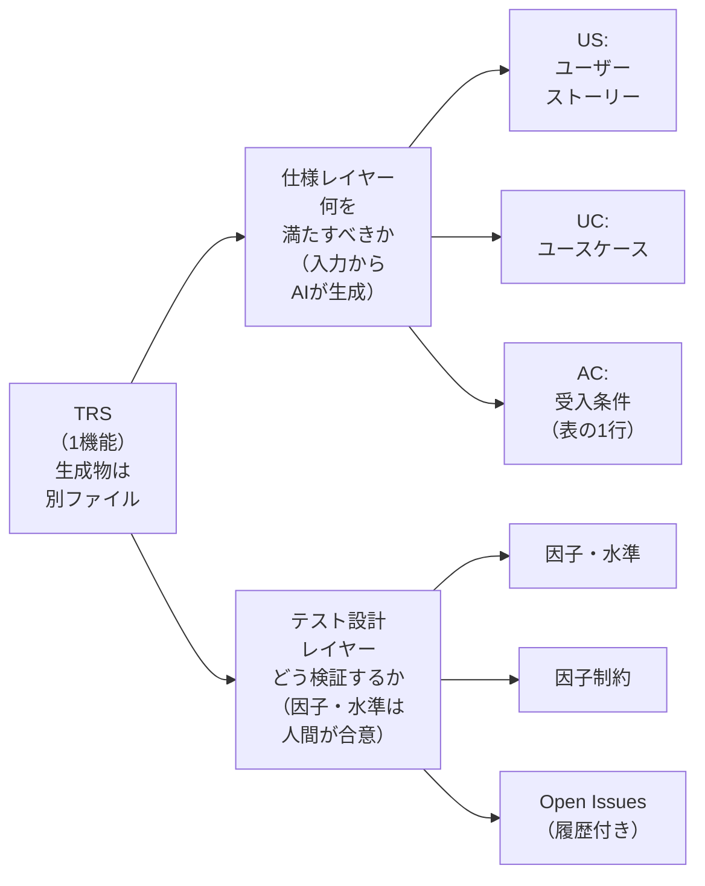
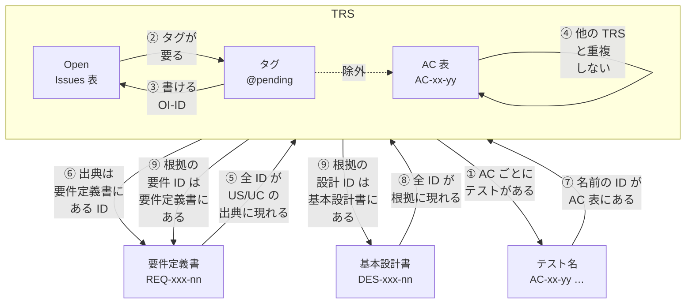
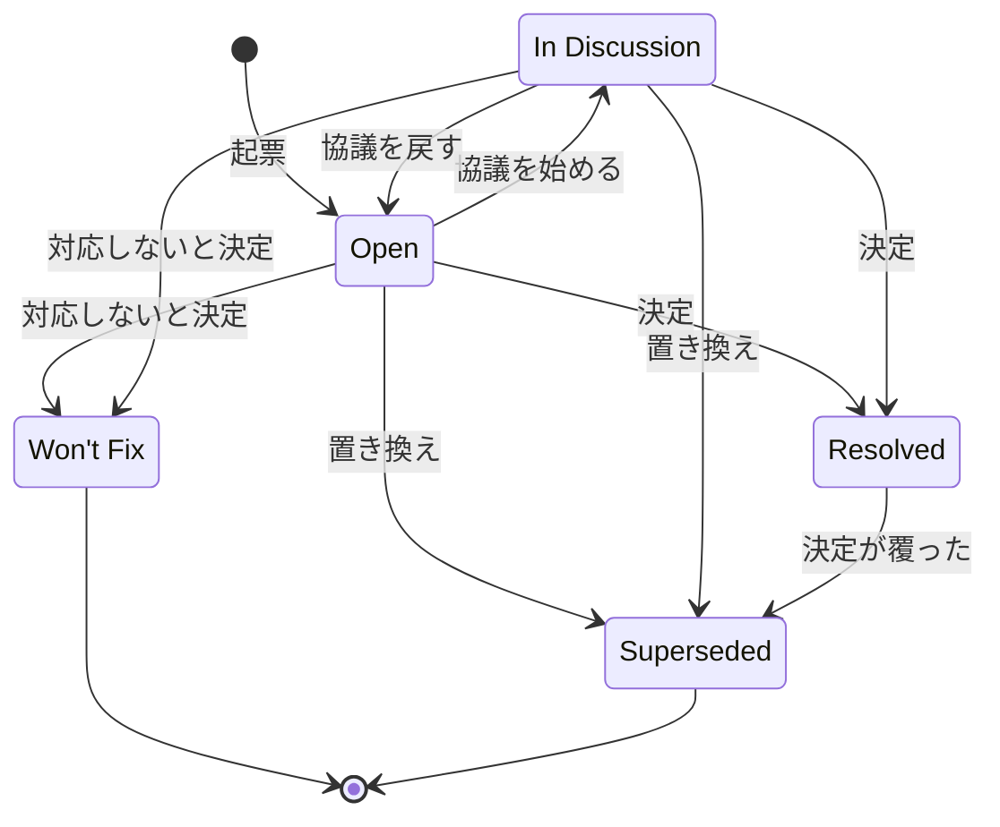
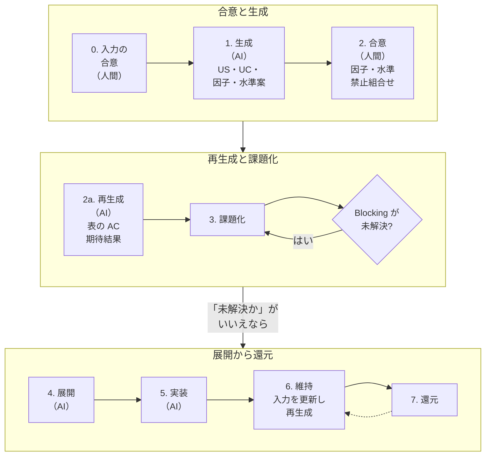

# 03. TRS（テスト要件仕様書）策定ガイドライン

**この文書で決めること**

- TRS の構造（2層）、AC の書き方、因子・水準・制約表からのテスト展開
- 期待値の出所（SSOT）と、要件定義書・基本設計書・AC・Open Issue をテストに結びつける機械検査
- Open Issues の運用、TRS の策定フロー（人の合意と生成物、生成の規則、生成物の編集）、レビュー項目

| 項目 | 内容 |
|---|---|
| 文書ID | TEST-03 |
| 目的 | TRS（Test Requirement Specification）の構造・記述ルール・運用を定め、AIが生成するテストの「期待値の正」を人間の合意した仕様に固定する |
| テンプレート | [trs/_template.md](./trs/_template.md) / 生成の入力にする[要件定義書](./templates/requirements.md)と[基本設計書](./templates/basic-design.md) |
| 関連 | [01 基本方針書](./01-test-policy.md)（W字モデル） / [05 導入手順書](./05-adoption-guide.md)（既存プロジェクトへの導入。レガシーへの適用は 05 §6 の補足。特性化テストは本書 §3.3） |

---

## 1. TRS とは

TRS は、**1機能（1ユースケース群）につき1つの TRS ファイル**である。「何を満たせば合格か（仕様）」と「どう検証するか（テスト設計）」を一体で保持する。W字モデルに従い、要件定義と基本設計の段階で生成を始め、実装・運用を通じて更新し続ける。節の多くは、要件定義書と基本設計書から AI が生成する（本書 §5.1）。

- 配置: 導入先プロジェクトの TRS ディレクトリに、`<機能ID>-<機能名>.md` として置く。ディレクトリの例はテンプレートと同じ `docs/testing/trs/`、ファイル名の例は `CNL-001-order-cancel.md` である。
- 生成の入力は、2 文書とする。要件定義書（[templates/requirements.md](./templates/requirements.md)）と、基本設計書（[templates/basic-design.md](./templates/basic-design.md)）である。
- 入力の置き場所は導入先が決める。詳細は本書 §5.2。
- 例外として、節の区分が「生成物」の節は、別ファイルに置く。置き場と名前は本書 §5.4 に従う。
- 仕様の経緯（Open Issues、変更履歴）を複数ファイルに分散させない。経緯は TRS ファイルに集約する。

## 2. 2層構造ルール

TRS は必ず次の2層で構成する。**層の混在を禁止する**（仕様レイヤーにテスト手法の詳細を書かない／テスト設計レイヤーで仕様を新規決定しない）。



### 2.1 仕様レイヤー

| 要素 | 内容 | ID 形式 |
|---|---|---|
| US | 誰が・何を・なぜ（`〜として、〜したい。なぜなら〜`）。出典（要件 ID） | `US-xx` |
| UC | アクター、事前条件、基本フロー、代替フロー、事後条件。出典（要件 ID） | `UC-xx` |
| AC | UC に紐づく受入条件。形は本書 §2.1.2、書き方は本書 §2.1.3 に従う | `AC-xx-yy` |

#### 2.1.1 出典（要件 ID）の記述ルール

1. US と UC に、出典として要件定義書の要件 ID を必ず書く。複数あるときはカンマで区切る。
2. 要件定義書に無い範囲の US/UC を足すときは、人間が先に要件定義書へ要件として足し、その要件 ID を出典にする。W字モデルが、要件定義と TRS 生成の往復を定めるためである（01 §2）。Open Issue の決定で範囲が増えるときも同じである。
3. 要件の中の曖昧さは、AC 単位の Open Issue と `@pending` で扱う（§3.4.2 の ② ③）。
4. 要件定義書の要件は、TRS に写さない。出典で指すだけにする。同じ要求を 2 か所に書くと乖離するためである。
5. 要件 ID と出典の書式は §3.4.3、書けない値と検査は §3.4.4 で定める。
6. 基本設計書の項目は、US と UC の出典に書かない。AC と因子制約の根拠に、設計 ID（`DES-<略号>-<番号>`）で指す。

#### 2.1.2 AC の形

| 形 | 使う場面 | 書き方 |
|---|---|---|
| 流れの AC | 複数の操作や画面にまたがる UC の流れを、端から端まで通す AC | 表にも 1 行置き、振る舞いは Gherkin（Given/When/Then）で書く |
| 表の AC | 流れの AC 以外のすべて | 表の 1 行に、検証する振る舞いを 1 文で書く。期待値の詳細は書き写さない。根拠は本書 §2.1.3 の 8 に従い、因子制約表（テンプレート §5.2）の行に結べるときは `C-xx` で指す |
| 期待値が未決の AC | Blocking の Open Issue に依存する AC | 表の AC として行を置き、Gherkin のタグ行に `@pending:<OI-ID>` を付ける。期待値は書かない |

- Gherkin にするのは、流れの AC と、期待値が未決（`@pending`）の AC だけである。
- 流れの AC は、因子制約表の行に還元できないものに限る。還元できるものを Gherkin で重ねて書くと、期待値が二重になるためである。

流れの AC の例を示す。

```gherkin
@AC-01-03 @layer:2 @e2e:happy-path
Scenario: 購入者が画面からキャンセルを完了できる
  Given 購入者が未発送の注文の詳細画面を開いている
  When  「キャンセル」ボタンを押して確認ダイアログで承諾する
  Then  画面に「キャンセル済み」と表示される
```

#### 2.1.3 AC の記述ルール

1. 1 AC = 1 つの検証可能な振る舞い。流れの AC の `When` は 1 つに絞り、先行する操作は `Given` に書く。
2. 観測可能な結果のみを書く（内部実装・関数名・DB カラム名を書かない）。
3. 曖昧語（「適切に」「速やかに」「正しく」）を禁止し、具体値・条件で記述する。
4. 例外・異常系は独立した AC とする。
5. 流れの AC で具体値を伴うものは、`Scenario Outline` + `Examples` を使ってよい。
6. 各 AC に**テストレベル**（受入・結合・単体）を付ける。レベルは何を確かめるかで決める（本書 §2.1.4、01 §2）。
7. 各 AC に**検証層**（層1/層2/層3）の想定を付記する（01 の使い分け基準に従う）。レベルから層は一意に決まらない。
   - 層2 は Integration と E2E で区別する。Gherkin では `@integration` / `@e2e` のタグで示す（例: `@layer:2 @integration`）。
   - E2E は、表の検証層に許可領域を書く。例は `層2（E2E: happy-path）` である。
   - Gherkin では、`@e2e` の代わりに `@e2e:<領域>` を付ける。
   - 許可領域は 02c §5.1 の領域で、`display` / `communication` / `happy-path` / `browser-operation` である。
   - 同じ AC を複数の層で検証してよい。表の検証層は読点で並べる。例は `層1、層2（Integration）` である。Gherkin では `@layer:1 @layer:2` とする。
8. 各 AC に**根拠**を書く。`C-xx`（因子制約表の行に結べるとき）、要件 ID、設計 ID、OI のどれかを 1 つ以上書く。空にしない。
9. 期待値が未決の AC は、本書 §2.1.2 に従う。

#### 2.1.4 テストレベルと根拠

| テストレベル | 確かめること（01 §2） | 根拠の主 |
|---|---|---|
| 受入 | 要件ごとの代表ケース | 要件 ID |
| 結合 | 基本設計書の画面、入力項目とデータ、状態と操作、外部インタフェース | 設計 ID |
| 単体 | 因子・水準の境界値と組合せ | `C-xx` |

- 根拠の主は目安である。1 つの AC が、複数の種類の根拠を持ってよい。
- 根拠を持てない AC は、要件・設計・因子制約・OI の決定のどれにも結べない期待値である。仕様に無い期待値の混入として扱い（§3.2）、AC にしない。

### 2.2 テスト設計レイヤー

AC を網羅的なテストケースへ展開するための設計情報。人が合意する節は、本書 §5.1 に従う。

| 要素 | 内容 |
|---|---|
| **因子（Factor）** | 結果に影響する入力・条件・状態の軸（例: 注文ステータス、支払方法、ユーザー権限） |
| **水準（Level）** | 因子が取りうる値の代表（同値分割・境界値に基づく）。無効水準も明示する |
| **因子制約** | 組合せとして**成立しない／禁止される**水準の組合せ、および組合せ時の期待結果 |
| **Open Issues** | 仕様が未確定・曖昧な点の追跡表。解決後も履歴を残す（§4） |

- 因子・水準は表形式で記述する。AI はこれを入力に、テストケース（組合せ網羅／ペアワイズ／直交表）を機械的に生成する。
- 因子制約は「禁止組合せ」と「組合せ別の期待結果」を明示する。AI が成立しない組合せのテストを生成せず、期待結果を推測しないようにするため。
- 型で表現可能な制約（型で排除される組合せ）は、禁止組合せ（テンプレート §5.1）として記載する。扱いに「型で排除」と付記し、テスト生成の対象外とする（02a §1）。例えば、状態を閉じた型（sealed 型など）で表し、不正な組合せを作れなくしたものがある。
- ケースを生成しない判断は、人が合意する禁止組合せ（テンプレート §5.1）にだけ書ける。組合せ別の期待結果（テンプレート §5.2）の行は、すべてケースになる。生成物では、この判断を書けない（検査は §3.4.3）。
- 期待値が未決の組合せは、テンプレート §5.2 に行を置かない。Blocking の OI を起こし、その組合せを検証する AC に `@pending:<OI-ID>` を付ける（§3.4.2 の ② ③）。AC が `@pending` になる変化は、人のレビューの対象になる（本書 §5.1）。決定後に、再生成で行を足す。
- 既存の `C-xx` の行に、あとから Blocking の疑義が出たときは、その行を消して OI を起票する。その行を根拠にしていた AC には、`@pending:<OI-ID>` を付ける。決定後に新しい制約 ID で足すときは、AC の根拠も書き換える。
- PBT で扱う連続・大規模な値域の水準には `PBT` と付記し、ジェネレータの制約として使う。

### 2.3 因子・水準・制約表からデータ駆動テストへの展開

TRS の表をテストへ展開する標準形を、次のとおり定める。展開の解釈を AI や開発者に任せない。表中の `§4`・`§5.1`・`§5.2` は、本書の節ではなく、[TRS テンプレート](./trs/_template.md)の節番号である。§4 は因子・水準、§5.1 は禁止（成立しない）組合せ、§5.2 は組合せ別の期待結果を指す。

| TRS の要素 | テストコードでの扱い |
|---|---|
| 因子制約表（テンプレート §5.2）の1行 | データ駆動テストの**1ケース**。ケース名の先頭に制約 ID（`C-xx`）を置く。行を置いたら、ケースから外せない（本書 §2.2） |
| 因子・水準表（テンプレート §4）の水準 | 制約表の「条件」列に現れる水準を、ケースの入力に使う。連続値（`PBT` と付記した水準）は Property に任せ、ここでは境界値だけを行にする |
| 禁止組合せ（テンプレート §5.1）・型で排除する制約 | **ケースを生成しない**（テスト対象外。行を作らない）。この判断を書ける場所は §5.1 だけである（本書 §2.2） |
| 組合せ別の期待結果 | 制約表の値をそのまま期待値にする。**実装の挙動から逆生成しない** |
| AC | データ駆動テストを包む**コンテナ名の先頭**に AC ID を置く（§3.4.1）。表の AC は根拠の列の `C-xx` で制約行を指す。複数の制約行が同じ AC を検証してよい |

データ駆動テストに使う機能は、導入先が1つに決めて標準とする。機能には、例えば次のものがある（Kotest `withData`、JUnit `@ParameterizedTest`、pytest `parametrize`）。

## 3. Single Source of Truth（SSOT）

### 3.1 期待値の正

テストの期待値の正（Source of Truth）は、次の順で優先する**人間が合意した成果物**とする。

1. 承認済みの仕様書（要件定義書、基本設計書、本書 §5.1 の「人が合意する」TRS の節）。TRS の AC と期待結果は、これらから生成した展開である
2. 承認済みのデザイン（Figma 等の UI 仕様）
3. （上記に定めがない場合）Open Issue として起票し、人間が決定する

### 3.2 禁止事項

| 禁止 | 理由 |
|---|---|
| **既存コードの挙動から期待値を逆生成する** | バグを仕様として固定化し、AI が現状追認のテストを大量に生む |
| 失敗したテストに合わせて期待値を書き換える | テストが検証の意味を失う |
| 仕様に書かれていない挙動を、AI の推測でテストの期待値にする | 無根拠な仕様が混入する |
| TRS と矛盾する期待値をテストコードにハードコードする | 二重管理になり乖離する |

### 3.3 例外：特性化テスト（Characterization Test）

仕様書が存在しないレガシーコードに限り、**現状把握のための特性化テスト**を作成してよい。ただし次を守る。

- ファイル名・タグで `characterization` と明示し、通常のテストと区別する。
- 「仕様」ではなく「現状」であることをコメントに明記する。
- 疑わしい挙動は Open Issue として起票し、人間が正誤を判断する。確定後は、入力の文書か、人が合意する節（本書 §5.1）に反映して TRS を再生成し、AC に昇格させる。

### 3.4 トレーサビリティ

TRS の AC・`@pending`・Open Issues とテストの対応を、CI のトレーサビリティ検査が機械的に検査する。要件定義書の要件 ID と US/UC の出典の対応、基本設計書の設計 ID と根拠の対応、根拠の値の実在も、同じ検査で調べる（§3.4.4）。要件定義書と基本設計書の目次と用語も調べる（§3.4.5）。検査の実装は導入先が選び、ここでは何を**失敗**にするかを定める。

**検査の単位**: 検査は、TRS ファイルと、同じ名前の生成物のファイル（本書 §5.4）を合わせて、1 つの TRS として読む。以降の「TRS」は、この対を合わせたものを指す。

| 失敗にする条件 | 理由 |
|---|---|
| 対になる TRS ファイルが無い生成物のファイルがある | 人が合意する節と運用情報の無い生成物を、検査の外に置かないため |
| 対になる生成物のファイルが無い TRS ファイルがある | 生成物のファイルの読み落としで、AC が検査の外に出るのを防ぐため |
| TRS ファイルに、US の表の行、UC の節、AC の表（テンプレート §3）の行がある | US・UC・AC は、生成物のファイルに置くため（本書 §5.4） |
| 生成物のファイルに、US の行、UC、AC の表の行が、それぞれ 1 つ以上ない | 読み取りの空振りで素通りさせないため（§3.4.3） |
| 生成物のファイルに、Open Issues の表、因子・水準、禁止組合せのいずれかがある（見分ける書式は §3.4.3） | 再生成で置き換わる生成物に置くと、Open Issues の履歴と合意した内容が、検査の外で消えるため（本書 §5.4） |
| 生成物のファイルに、§3.4.3 の 3 種のどれにも当たらない行がある | 本書 §5.4 |
| 組合せ別の期待結果（テンプレート §5.2）の期待結果に、ケースを生成しない文言か、期待値が未決の文言がある。ほか §3.4.3 の判定の表に当たる | ケースの外し方を、本書 §2.2 の規則に限るため |
| トレーサビリティ表（テンプレート §7）と Open Issues の関連列の AC ID が、生成物のファイルの AC の表に無い。読めない範囲表記（§3.4.3）も同じ。行の区分と状態は問わない | 消えた AC を指したままにせず、AC が黙って検査から外れる経路をふさぐため |

トレーサビリティ表と Open Issues の関連列にある AC ID は、TRS ファイルにあってよい。上の表の「AC の表の行がある」の条件には入れない。

上の表の AC ID の照合から外すものは、次のとおりである。

- 外すもの: 未解決でない行の反映先の列に、`AC-xx-yy 削除` と書いた AC。未解決でない行は、状態が `Resolved`、`Superseded`、`Won't Fix` の行である。書式は §3.4.3 で定める。
- 外さないもの: 未解決（`Open`、`In Discussion`）の行の反映先に `削除` があっても、その AC を照合から外さない。
- 外す理由: Open Issues の行は、削除も上書きもできない（§4.3 の 5）。外す手段が無いと、未解決でない行が指す AC を、正当な理由があっても消せなくなる。
- 入力の変更で AC が消え、その AC を未解決でない行が指しているときの手順は、本書 §5.4 の 5 で定める。



| # | 検査 | 失敗にする条件 |
|---|---|---|
| ① | AC に対応するテストの検査（01 の G5） | `@pending` でない AC に、対応するテストが無い |
| ② | 未解決の Blocking な Open Issue の検査（01 の G5） | 未解決の Blocking が指す AC に、その OI-ID の `@pending` が無い |
| ③ | `@pending` に書けるもの（許容範囲） | 未解決の Blocking な OI-ID 以外を書いた。その OI の関連列に無い AC に付けた |
| ④ | `AC-xx-yy` は TRS 間で重複させない | 同じ ID が複数の TRS にある |
| ⑤ | 要件 ID の網羅の検査（01 の G5） | 要件定義書の要件 ID が、どの US/UC の出典にも現れない |
| ⑥ | 出典の実在の検査（01 の G5） | US/UC の出典の値が、実在する要件 ID でない（空欄・`—`・OI-ID を含む）。同じ要件 ID が、全要件定義書で複数の行にある |
| ⑦ | テスト名の `AC-xx-yy` の実在の検査（01 の G5） | テスト名の先頭の `AC-xx-yy` が、どの TRS の AC の表にも無い |
| ⑧ | 設計 ID の網羅の検査（01 の G5） | 基本設計書の節 2〜9 の設計 ID が、どの TRS の根拠にも現れない |
| ⑨ | 根拠の実在の検査（01 の G5） | TRS の根拠の値（制約 ID・要件 ID・設計 ID・OI-ID）が、実在しない、どの形にも当たらない、書けない表にある（5.2 の根拠の制約 ID）、空欄である。同じ設計 ID が、全基本設計書で複数の行にある |
| ⑩ | 目次の検査（01 の G5） | 要件定義書か基本設計書の節が、本書 §5.2 の目次と、番号・名前・順序・数のどれかが違う |
| ⑪ | 用語の言い換えの検査（01 の G5） | 要件定義書の「使わない言い換え」の語が、同じ機能の要件定義書・基本設計書・TRS に現れる |

この表は要約である。検査の単位による失敗は、本節の冒頭で定める。①〜④ と ⑦ の失敗条件の全体は §3.4.2、⑤ ⑥ ⑧ ⑨ は §3.4.4、⑩ ⑪ は §3.4.5、表の書式による失敗は §3.4.3 で定める。⑩ ⑪ は ID の対応を調べる検査ではないので、図には描かない。⑨ の制約 ID と OI-ID は、同じ TRS の中の対応なので、図には描かない。

「**未解決の Blocking**」は、TRS の「6. Open Issues」表の行（OI）のうち、次を満たすものを指す。区分が `Blocking` で、状態が `Open` または `In Discussion` である。Resolved・Superseded・Won't Fix と Non-blocking は含まない。

#### 3.4.1 テスト名の付け方

- テスト名の先頭に `AC-xx-yy`、続けて空白と説明を置く（例: `AC-01-02 範囲外の整数は拒否される`）。先頭を grep などで機械的に辿れるためである。
- `AC-xx-yy` は括弧やコロンで囲まない。テスト名に使える文字はフレームワークごとに異なるため、どの環境でも使える表記にそろえる。
- 複数の AC を検証するテストは、`AC-01-04 AC-01-05 …` と空白区切りで並べる。
- TRS のトレーサビリティ表には、テストの所在（ファイルまたはクラス）とテスト名を `::` でつないで書く（例: `<テストファイル>::<テスト名>`）。
- AC に紐づかないテストは、名前の先頭に `AC-xx-yy` を付けず、技術的な不変条件（PBT 等）であることを明記する。名前の先頭に付けた AC は、⑦ で調べる。

#### 3.4.2 各検査の詳細

##### ① AC に対応するテストの検査（01 の G5）

- AC の表（書式は §3.4.3 の ① ④ の項）から `AC-xx-yy` を抽出する。導入先の層1・層2（Integration・E2E）のテスト全体から、その ID で始まるテスト名を探す。無い AC があれば**失敗**にする。
- `@pending:<OI-ID>` を付けた AC は除外する。除外するのは、Blocking の Open Issue が未解決の AC である。付けてよい範囲は §3.4.2 の ③ で定める。
- 理由: 除外の手段を `@pending` に一本化し、TRS 側で明示させるため。
- `@pending` は AC を検査から外す手段なので、人が確かめる。確かめるのは、Open Issues の表の行（未解決の Blocking の起票と、関連列の AC）である。生成物の変化のうち、人がレビューするものは、本書 §5.1 の例外に従う。

##### ② 未解決の Blocking な Open Issue の検査（01 の G5）

- 未解決の Blocking の行ごとに、関連列の AC のタグ行を調べる。その OI-ID の `@pending:<OI-ID>` が無ければ**失敗**にする。
- 関連列に AC が無い（因子・水準や UC だけを指す）ときは、未解決の Blocking の行だけを**失敗**にする。それ以外の行は、これに当たっても失敗にしない。指す AC を決められないためである。起票するときは、関連列に AC を書き、その AC に `@pending:<OI-ID>` を付ける。
- 関連列に範囲として読めない `〜` が残るときと、関連列の AC が AC 表に無いときの失敗は、本書 §3.4 の検査の単位で定める。照合から外すものも、そこで定める。
- AC を足すかどうか自体が Blocking なときは、仮の AC を `@pending:<OI-ID>` 付きで先に置く。期待値は書かない。関連列では、その仮の AC を指す。

##### ③ `@pending` に書けるもの（許容範囲）

- `@pending:<ID>` の `<ID>` は、その TRS の未解決の Blocking な OI-ID に限る。付けてよい AC も、その OI の関連列にあるものだけである。次は**失敗**にする。
  - `OI-<数字>` の形でない値。`@pending:ISSUE-33` のような Issue 番号の参照も含む。実装待ちの AC は `@pending` で除外せず、Issue / PR で管理する。実装と同じ PR でテストを足す。
  - Open Issues 表に無い OI-ID（綴りの誤り、削除）。他の TRS の OI-ID も、この TRS の表に同じ番号が無ければ失敗にする。番号は TRS ごとに振るため、同じ番号があれば区別できない。
  - 未解決の Blocking でない OI-ID。OI を解決・置換したら、同じ変更で `@pending` を外し、期待値とテストを確定する。
  - その OI の関連列（範囲は展開する）に含まれない AC に付けた `@pending:<OI-ID>`。無関係な AC を除外する抜け道を塞ぐためである。関連列が読めない OI と、関連列に AC が無い OI は、② と本書 §3.4 の検査の単位が、すでに失敗にするので、③ では二重に数えない。
- 検査の対象は、行内で `@AC-xx-yy` より後ろにある `@pending:` である。① で AC を紐づけ検査から除外する判定と同じ範囲で、Gherkin のタグ行のほか、表や引用の中も含む。`@AC-xx-yy` を伴わない説明文や変更履歴の行は、AC を除外しないので対象外である。
- 理由: `@pending` は、期待値が人間の決定待ちの AC だけを除外する手段である（§4.3 の 3）。実装待ちや解決済みの OI を許すと、除外の抜け道になる。

##### ④ `AC-xx-yy` は TRS 間で重複させない

- 全 TRS の AC を、導入先のテスト全体のテスト名と照合する。別の TRS と同じ ID があると、別機能のテストで AC が満たされたように見えるため、重複は**失敗**にする。
- `xx` は UC の番号と対応させ、**TRS ごとに異なる番号**を割り当てる。例: 最初の TRS は `01`、次の TRS は `02`、その次は `03`。
- 新しい TRS は、既存の TRS が使っていない最小の番号から採番する。

##### ⑦ テスト名の `AC-xx-yy` の実在の検査（01 の G5）

- 導入先の層1・層2（Integration・E2E）のテスト全体から、名前の先頭が `AC-xx-yy` の形のテストを探す。書き方は §3.4.1 に従い、空白区切りで並ぶ ID は、すべて調べる。その AC が、どの TRS の AC の表にも無いときは、**失敗**にする。
- 理由: ① と対になる検査である。① は AC からテストへ、⑦ はテストから AC へ調べる。削除した AC ID を別の内容で使い回すと、残った古いテストが、新しい AC を満たしたように見えるため（本書 §5.4 の 2）。
- AC を消すときのテストの扱いは、本書 §5.4 の 6 に従う。名前の先頭が `AC-xx-yy` の形でないテストは、対象外である。

#### 3.4.3 検査が前提とする書式

##### ② ③ の書式（Open Issues の表）

- 区分は `Blocking` / `Non-blocking`、状態は §4.2 の 5 値にする。`Superseded` と `Won't Fix` には、`（置換先・理由）` の接尾辞を付けてもよい。分類できない値（`open`、`**Blocking**` など）は、未解決かどうかに関わらず全行で失敗にする。
- 表には 1 行以上が必要である。見出し（`ID` / `区分` / `関連` / `状態` / `反映先`）が読めない、行が無い、列数が合わない TRS も、TRS 単位で失敗にする。読み取りの空振りで素通りさせないためである。列の名前を変えるときは、検査も同時に直す。
- 関連列の AC の範囲表記は、`AC-xx-yy〜zz` と `AC-xx-yy〜AC-xx-zz`（`〜` は `～` `~` も可）だけにする。同じ `xx` の昇順に限る。外れたときの扱いは、§3.4 の検査の単位で定める。

##### 照合から外す記録の書式（反映先の列）

- 未解決でない行（`Resolved`、`Superseded`、`Won't Fix`）の反映先のセルに、AC ID、半角の空白、`削除` の順に書く。例は `AC-01-08 削除` である。
- 複数あるときは、カンマと半角の空白で区切って並べる。範囲表記は使わない。
- 未解決の行（`Open`、`In Discussion`）の記録は、読まない。

##### 生成物のファイルに混ぜてはならない表

見出しの列名で見分ける。制約 ID の `C-xx` は禁止組合せと組合せ別の期待結果で共通なので、ID の形では見分けられない。

| 混ぜてはならないもの | 見出しに含む列名 |
|---|---|
| Open Issues の表 | `ID`、`区分`、`関連`、`状態` |
| 因子・水準の表 | `因子ID` または `水準ID` |
| 禁止組合せの表 | `制約ID`、`組合せ`、`扱い` |

列の名前は、テンプレート（§4、§5.1、§6）の見出しと同じにする。名前を変えるときは、検査も同時に直す。

##### 生成物のファイルに置ける行

生成物のファイルの行は、空行を除き、次の 3 種のどれかに当たらなければ、失敗にする。3 種の定義は、この節だけで定める。

| 種類 | 当たる行 |
|---|---|
| ID に結び付く記述 | 表の ID の行、UC の節（中の行は下の規則で限る）、`@AC-xx-yy` を持つ Gherkin のシナリオ |
| ID に結び付かない Gherkin | `Feature` の 1 行、`Background` とその手順 |
| テンプレートの定型文 | 正規化した行が、テンプレートの定型文の行と一致するもの |

「ID に結び付く記述」の範囲は、次のとおりである。

| 対象 | 範囲 |
|---|---|
| 表の ID の行 | US、AC、組合せ別の期待結果（テンプレート §5.2）の表の行で、先頭列が `US-<数字>`、`AC-xx-yy`、`C-xx` の形のもの |
| UC の節 | 見出しが `UC-<数字>:` で始まり、深さがテンプレートの UC の見出しと同じ（`####`）の節。次の同じ深さ以上の見出しの手前まで |
| Gherkin のシナリオ | `gherkin` のコードブロックの中の、`Scenario`、`Scenario Outline`、`Scenario Template`、`Example`。中の手順と、`Scenario Outline` の `Examples` とその下の表の行を含む |

- 表の ID の行と、UC の節の中の行（対象の行）は、次の 3 つを守る。守らない行は、失敗にする。
  - インラインのコード（`` ` `` で囲んだ部分）の外に、`[`、`]`、`<`、`&` を置かない。
  - `\` を置かない。
  - バッククォートは、1 個ずつの連なりだけにする。連続する 2 個以上は置けない。
- インラインのコードは、バッククォートの 1 個目と 2 個目、3 個目と 4 個目、のように対にして決める。表の行ではセルごとに、ほかの行では行の中で対にする。個数が奇数なら、失敗にする。
- 生成物のファイルの表（コードブロックの外）のデータ行は、セルの数を、その表の見出し行と同じにする。セルは、`\|` を除く縦線で区切って数える。
- シナリオの直前の行は、`@AC-xx-yy` を持つタグ行である。空行は挟まない。タグ行は、この 1 行だけである。
- `UC-<数字>:` の見出しの形と深さは、この節の行の分類にだけ使う。ほかの深さの `UC-<数字>:` の見出しは、UC の節にならない。
- 本書 §3.4 の「TRS ファイルに UC の節がある」などの判定と、本書 §5.1 の人のレビューの範囲は、この限定で狭めない。そこでの UC の節は、`UC-<数字>` で始まる見出しの節である。

###### UC の節の中の行

UC の節の中の行は、空行を除き、次の表のどれかに当たらなければ、失敗にする。3 種のほかの判定は、この中の行には使わない。書式の元は、テンプレートの UC の節である。

| 行 | 当たるもの |
|---|---|
| UC の見出し | 節の最初の行 |
| 項目の表 | 見出し行、区切り行、先頭のセルがテンプレートの UC の節の項目名の行 |
| 太字のラベル | テンプレートの UC の節の太字のラベルだけの行 |
| 手順 | `<数字>.` と半角の空白に続く本文が、文字で始まる行。文字は、Unicode の文字の分類 L（かな・漢字・英字など）である |
| 代替フローの表 | 見出し行、区切り行、先頭のセル全体が `UC-<数字>-A<数字>` の行 |

- 表の見出し行は、リンクを外さず、空白の正規化だけで、テンプレートの行と比べる。空白の正規化は、前後の空白を除き、連続する空白を 1 つにすることである。全角の空白を含む。区切り行は、定型文の判定と同じ比べ方にする。
- 地の文、引用、記号のリスト、続きの行、入れ子の見出しなど、表に無い行は置けない。コードブロックも置けない。
- テンプレートの手順の `` `<…>` `` は、書き換える空欄である。手順の本文の規則は、生成物のファイルの行に当てる。
- 手順の本文の始まりを、文字で許す形で決める理由は、本書 §5.4 で定める。

###### どこにも置けない行とコードブロック

HTML コメントと、リンク参照の定義の行は、UC の節の中を含め、どこにも置けない。

- リンク参照の定義の行は、`[ラベル]: リンク先` の形である。`[//]: # (…)` を含む。
- 置けない理由は、どちらも表示されず、人のレビューから漏れるためである。

次の細目は、UC の節の外の行に適用する。

- コードブロックは、`gherkin` だけを置ける。
- `gherkin` のコードブロックに置けない要素は、次のとおりである。
  - `Feature` の説明文、`Rule`、タグ行の無いシナリオ。
  - 手順の表、docstring。
  - `#` で始まる行。`# language` も含む。
- `Examples` の下の表の行は、置ける。
- 置けない要素は、ID に結び付かず、自由に書けるためである。

###### 定型文の判定

「テンプレートの定型文」の判定は、次のとおりである。

| 項目 | 規則 |
|---|---|
| 取る行 | テンプレートの、見出し行、引用行（`>` で始まる）、表の見出し行と区切り行、`---` の行 |
| 取る範囲 | 第 1 部と第 2 部の見出しと引用、節 1・2・3・5 と 5.2 の下の行、「生成物のファイルの冒頭」の節の `markdown` のコードブロック |
| 正規化 | 前後の空白を除き、連続する空白を 1 つにする。空白は、全角の空白を含む。`[文字](リンク先)` は `文字` にする |
| 空欄 | テンプレートの、`` ` `` の外にある `<…>` は、空でない任意の文字列に一致する |
| 一致 | 正規化した行が、取った行のどれかと、全体で一致する。語の追加や削除は、一致しない |

- コードブロックの中は、取らない。ただし、「生成物のファイルの冒頭」の `markdown` のコードブロックは、全行を取る。
- 5.1 の下の行は、取らない。
- 表の区切り行は、空白をすべて除いて比べる。区切り行は、縦線を含み、縦線、ハイフン、コロンだけでできた行である。
- リンクを外すのは、リンク先の相対パスが、導入先で違うためである。
- 文字が空か空白だけのリンク（`[](リンク先)` など）は、定型文の行に置けない。
- 定型文の行のリンク先は、実在する `.md` のファイルへの相対パスに限る。正規化しても、文字列が変わらないものに限る。正規化は、`.` と途中の `..` を解決し、連続する `/` をまとめることである。`#アンカー` を付けるときは、リンク先のファイルに実在する見出しのアンカーに限る。title を付けた形は置けない。
- 空欄を含む定型文は、題の行だけである。ほかの行に、`` ` `` の外の空欄は無い。
- 題の行は、ファイルの 1 行目に、1 回だけ置く。題の `<機能ID>` と `<機能名>` は、組の TRS ファイルのメタ情報の「TRS ID」と「機能名」と、同じ値にする。値を `` ` `` で囲んであるときは、囲みを除いて比べる。

##### 組合せ別の期待結果（テンプレート §5.2）の書式

- 表の見出しは、`制約ID`、`条件`、`期待結果`、`根拠（要件 ID / 設計 ID / OI）` とする。この表は、生成物のファイルに置く。
- 次の表のどれかに当たる行は、失敗にする。
- 語は、部分一致で判定する。例えば `型で排除済み`、`テスト対象外扱い`、`未決事項` も当たる。
- 例外の語の一部として現れるときは、当たらない。例外は `未決済`、`未定義` である。
- 括弧は、全角と半角の丸括弧に限る。「全体が丸括弧」の判定では、「」と `` ` `` で囲んだ部分を除いて見る。

| 当たるもの | 判定 |
|---|---|
| 期待結果: ケースを生成しない文言 | `テスト対象外`、`テストの対象外`、`テスト不要`、`テストしない`、`型で排除`、`ケースを生成しない` のどれかを含む |
| 期待結果: 期待値が未決の文言 | `未決`、`未決定`、`未定`、`決定後`、`決定待ち`、`後で決める`、`要確認`、`TBD` のどれかを含む |
| 期待結果: 具体的な期待結果が無い | 空、`—` か `-` だけ、または全体が丸括弧で囲まれている |
| 期待結果: OI を書いている | `OI-<数字>` の形の文字列を含む。OI への言及は、根拠の列に書く |
| 根拠: 未決の OI に依存している | 未解決の Blocking な OI-ID（§3.4 の冒頭の定義）を含む |

- 根拠の列の判定は、期待値が未決の組合せが、推測の値のまま検査を通らないようにするためである。
- ケースを生成しない文言は、禁止組合せの表の「扱い」に書く類の語である。
- 期待値が未決の組合せの表し方は、本書 §2.2 で定める。
- 語の一覧と例外は、最小である。導入先は、語を足してよい。例外を足すときと、自分の用語とぶつかる語を一覧から外すときは、人が合意する。
- 一覧に無い言い換えは、機械では防げないので、生成後の AI のレビューが確かめる（本書 §5.5）。

##### ① ④ の書式（AC の表）

- 生成物のファイルには、AC の表の行が 1 つ以上必要である。無いファイルは、ファイル単位で失敗にする。読み取りの空振りで素通りさせないためである。
- 「AC の行」は、AC の表（テンプレート §3）の行に限る。トレーサビリティ表（テンプレート §7）の行と、Open Issues の関連列の AC ID は、数えない。
- 見出し（`AC ID` など）が読めない表、または先頭列が `AC-xx-yy` の形でない行（見出し行と区切り行を除く）があれば、失敗にする。
- Gherkin に `@AC-xx-yy` があるのに、AC の表に行が無い AC も、失敗にする。流れの AC も、表に 1 行置く。

##### ⑤ ⑥ の書式（要件 ID と出典）

- 要件 ID は `REQ-<略号>-<番号>` とする。略号は英大文字 2〜6 字、番号は 2 桁以上の数字である。例は `REQ-CNL-01`。
- 要件定義書で要件として読むのは、見出しに「機能要件」「業務ルール」「非機能要件」を含む節の表だけとする。先頭列を ID 列にし、先頭列が要件 ID の形でない行（見出し行と区切り行を除く）は、失敗にする。
- 要件として読む表の外に、要件 ID の形の文字列があるときも、失敗にする。未決事項の表も外である。未決事項の ID は `Q-<番号>` とし、要件 ID と区別する。要件が読み取りから漏れるのを防ぐためである。
- 要件定義書があるのに、要件が 1 件も読めないときは、失敗にする。読み取りの空振りで素通りさせないためである。
- 生成物のファイルには、US の行と UC が 1 つ以上必要である。無いファイルは、ファイル単位で失敗にする。読み取りの空振りで素通りさせないためである。
- US の表には見出し `出典（要件 ID）` の列を、UC の表には項目名 `出典（要件 ID）` の行を置く。見出しや項目名が読めない US/UC がある TRS は、TRS 単位で失敗にする。

##### ⑧ ⑨ の書式（設計 ID と根拠）

- 設計 ID は `DES-<略号>-<番号>` とする。略号と番号の書式は、要件 ID と同じである。例は `DES-CNL-06`。
- 基本設計書で設計 ID として読むのは、節 2〜9 の表の先頭列だけとする。節は番号で見分ける。先頭列が設計 ID の形でない行（見出し行と区切り行を除く）は、失敗にする。
- 節に項目が無いときは、表を置かず「該当なし」と書く。節 1 と節 10 の表は、設計 ID として読まない。
- 設計 ID の形の文字列が、節 2〜9 の表の外（節 1、節 10、メタ情報、地の文）にあるときも、失敗にする。項目が読み取りから漏れるのを防ぐためである。未決事項の ID は `Q-<番号>` とし、設計 ID と区別する。
- 基本設計書があるのに、設計 ID が 1 件も読めないときは、失敗にする。読み取りの空振りで素通りさせないためである。
- 根拠の列は、AC の表と、組合せ別の期待結果（テンプレート §5.2）にある。値は、半角のカンマで区切る。
- 値の種類・形・書ける表は、次の表のとおりである。

| 種類 | 形 | 書ける表 |
|---|---|---|
| 制約 ID | `C-` と 2 桁の数字。例は `C-10` | AC の表だけ |
| 要件 ID | `REQ-<略号>-<番号>`（本節の「⑤ ⑥ の書式」） | AC の表と 5.2 |
| 設計 ID | `DES-<略号>-<番号>` | AC の表と 5.2 |
| OI-ID | `OI-` と 1 桁以上の数字。例は `OI-001` | AC の表と 5.2 |

- 制約 ID を AC の表だけにするのは、5.2 の行を指す ID だからである。

##### ⑩ ⑪ の書式（目次と用語）

- 節は、文書の題（`#`）の直下の見出し（`##`）のうち、番号で始まるものを読む。番号の無い見出し（メタ情報、レビューチェックリスト）は、節として読まず、あってよい。
- 用語は、要件定義書の節 2 の小見出しのうち、見出しに「用語」を含むものの表から読む。表の見出しは `用語`、`意味`、`使わない言い換え` とする。
- 「使わない言い換え」の列は、空にしない。言い換えが無いときは「該当なし」と書く。語が複数あるときは、読点（、）か半角のカンマで区切る。
- 用語の小見出しか表の見出しが読めない要件定義書は、失敗にする。読み取りの空振りで素通りさせないためである。列の名前を変えるときは、検査も同時に直す。

#### 3.4.4 要件・設計との対応の検査

##### ⑤ 要件 ID の網羅の検査（01 の G5）

- 全要件定義書から要件 ID を抽出し、全 TRS の US/UC の出典から抽出した要件 ID と突き合わせる。どの出典にも現れない要件 ID があれば**失敗**にする。
- 理由: 要求が TRS に落ちないまま、黙って抜けるのを上流で止めるため（01 の基本理念 1）。
- 除外の手段は設けない。要件定義書に書く範囲は本書 §5.2 で定める。

##### ⑥ 出典の実在の検査（01 の G5）

- US/UC の出典を、カンマで区切った値ごとに調べる。実在する要件 ID でない値は**失敗**にする。
  - 綴りの誤り、要件の削除、OI-ID、文書名や節番号などが当てはまる。
  - 空欄と `—` も、出典が無いので失敗にする。
- 同じ要件 ID が、全要件定義書で複数の行にあるときも**失敗**にする。出典がどの要件を指すか定まらないためである。
- 理由: 根拠の無い仕様が、TRS に混ざるのを防ぐため（§3.1・§3.2）。

##### ⑧ 設計 ID の網羅の検査（01 の G5）

- 全基本設計書から設計 ID を抽出し、全 TRS の根拠の列から抽出した設計 ID と突き合わせる。どの根拠にも現れない設計 ID があれば**失敗**にする。
- 根拠の列は §3.4.3 で定める。`@pending` の AC の根拠も数える。
- 理由: 基本設計が TRS に落ちないまま、黙って抜けるのを止めるため（01 の基本理念 1）。⑤ と対になる検査である。
- 除外の手段は設けない。テストで確かめられない項目は、基本設計書に書かない（本書 §5.2）。

##### ⑨ 根拠の実在の検査（01 の G5）

- AC の表と組合せ別の期待結果（テンプレート §5.2）の根拠の列を、カンマで区切った値ごとに調べる。`@pending` の AC の根拠も調べる。次は**失敗**にする。
  - 実在しない値。実在の意味は、次の表で定める。綴りの誤りと、項目の削除が当てはまる。
  - どの種類の形にも当たらない値。綴りの誤りで、実在の検査をすり抜けさせないためである。
  - その表に書けない値（§3.4.3 の表）。5.2 の根拠に書いた制約 ID が当てはまる。
  - 空欄。根拠の無い AC と期待結果を、通さないためである。
- 同じ設計 ID が、全基本設計書で複数の行にあるときも**失敗**にする。根拠がどの項目を指すか定まらないためである。
- 理由: 根拠の無い期待値が、TRS に混ざるのを防ぐため（§3.1・§3.2）。⑥ と対になる検査である。
- 根拠の列の値と期待値の意味の一致は、機械では検査できない。生成後の AI のレビューが確かめる（本書 §5.5）。

| 種類 | 実在とする条件 |
|---|---|
| 制約 ID | 同じ TRS の組合せ別の期待結果（5.2）の制約 ID にある。禁止組合せの表は含めない |
| 要件 ID | 要件定義書の要件 ID にある（⑥ と同じ判定） |
| 設計 ID | 基本設計書の節 2〜9 の設計 ID にある |
| OI-ID | 同じ TRS の Open Issues の表の ID にある。状態は問わない |

#### 3.4.5 入力の文書の検査

##### ⑩ 目次の検査（01 の G5）

- 要件定義書と基本設計書の節を、本書 §5.2 の目次と照合する。節の番号、名前、順序、数のどれかが違えば**失敗**にする。
- 小見出しは照合しない。§5.2 が固定するのは、第 1 階層の節だけである。
- 理由: 設計 ID は節の番号で、要件は節の名前で読む（§3.4.3）。節が欠けたり入れ替わったりすると、ID が黙って読み取りから外れるため。

##### ⑪ 用語の言い換えの検査（01 の G5）

- 要件定義書の用語の表で「使わない言い換え」に挙げた語が、次の文書の本文に現れたら**失敗**にする。対象は、要件定義書と同じ名前（`<機能ID>-<機能名>.md`）の文書である。
  - 同じ要件定義書
  - 基本設計書
  - TRS ファイルと、生成物のファイル
- 基本設計書か TRS ファイルに、同じ名前の要件定義書が無いときも、失敗にする。用語を確かめられず、素通りするためである。
- 理由: 同じものを別の語で呼ぶと、要件・設計・AC の対応が人にも AI にも読めなくなる。生成物を人が個別に読まないので（本書 §5.1）、機械で止める。

判定の規則は、次のとおりである。

| 項目 | 規則 |
|---|---|
| 一致 | 部分一致で判定する。日本語には語の切れ目が無いためである。英字は、大文字と小文字を区別しない |
| 先に取り除く語 | 用語の表の「用語」の列の語のうち、その言い換えの語を含むものだけを、本文から先に取り除いてから、その言い換えを探す。用語の一部として現れる言い換えを、誤検知にしないためである。例は、用語が「期限」、言い換えが「期限日」のとき、「期限」は取り除かず、「期限日」は検出する |
| 対象の範囲 | 本文全体。Gherkin のシナリオと、コードブロック、インラインコードも含む。画面の文言と流れの AC を、検査から外さないためである |

次の節は、検査しない。理由は、節ごとに異なる。

| 検査しない節 | 理由 |
|---|---|
| 要件定義書の用語の小見出し | 言い換えの一覧そのものであるため |
| 要件定義書の節 8 と基本設計書の節 10（どちらも未決事項） | 行を消さないので、あとで言い換えを足すと、過去の行を直せず、永久に失敗するため |
| TRS ファイルの節 6 Open Issues | 行を削除も上書きもできない（§4.3）ので、あとで言い換えを足すと、過去の行を直せず、永久に失敗するため |
| TRS ファイルの節 8 不具合還元履歴 | 行を削除できない（テンプレートの節 8）ので、あとで言い換えを足すと、過去の行を直せず、永久に失敗するため |
| TRS ファイルの節 9 変更履歴 | 過去の版の記録であるため |
| TRS ファイルの節 7 トレーサビリティ | テストの実装で更新する表で、テスト名はコードの識別子であるため。文書の語の検査の対象にしない |

- TRS ファイルの節は、テンプレートの節の番号と名前の両方が一致するものだけを除く。題や UC 名に同じ語が出ても、除外が広がらないようにするためである。
- TRS ファイルのそれ以外の節（因子・水準、禁止組合せなど）は検査する。

誤検知のときは、検査を弱めない。その語が正当に現れるなら、「使わない言い換え」の列から外す。外すのは入力の文書の変更なので、人が合意する。

##### 検査しないこと

- 要件定義書の目的、前提と制約、業務フローと、基本設計書の全体構成は、ID が無く、テストと 1 対 1 に対応しない。整合は意味の判断なので、機械では検査しない。生成後の AI のレビューが確かめる（本書 §5.5）。
- 各節に値か、未決事項の Q か、「該当なし」が書かれているかも、機械では検査しない。人が、テンプレートのレビューチェックリストで確かめる。

## 4. Open Issues の履歴化

### 4.1 原則

- 仕様の曖昧点・判断保留は **Open Issues 表に起票**する。コード内の TODO や口頭合意にしない。
- **解決しても行を削除しない。** ステータスを `Resolved` にし、決定内容・決定者・決定日・根拠を記録して**同一 TRS ファイル内に永続化**する。

### 4.2 ステータス

| ステータス | 意味 |
|---|---|
| `Open` | 未解決。人間の判断待ち |
| `In Discussion` | 関係者と協議中 |
| `Resolved` | 決定済み。AC／因子制約へ反映済み |
| `Superseded` | 後続の決定で置き換えられた（置換先 Issue ID を記載） |
| `Won't Fix` | 対応しないと決定（理由必須） |

`Open` と `In Discussion` を未解決と呼ぶ。状態は次のとおり遷移する。



- `Open` と `In Discussion` は相互に行き来できる。
- `Open` と `In Discussion` からは、`Resolved` / `Won't Fix` / `Superseded` のどれへも移れる。
- `Resolved` からは `Superseded` へ移れる。
- `Won't Fix` と `Superseded` は終端で、他の状態へは移らない。その決定を覆すときは、元の行を変えず、新しい OI を起票する。

### 4.3 運用ルール

1. 起票者は AI でも人間でもよい。**解決（`Resolved` への遷移）は人間のみ**が行う。
2. `Resolved` にするときは、**反映先**（どの AC／因子制約を変更したか）を必ず記載する。AC を削除したときの書き方は、§3.4.3 に従う。
3. Blocking 区分の Open Issue が未解決の AC に対するテストは、期待値を確定させず `pending` とする。AI が推測で埋めてはならない。
4. 後から決定が覆った場合は、元の行を `Superseded` にして新規行を追加する（上書きしない）。`Won't Fix` と `Superseded` の行は終端なので、覆すときは行を変えず、新規行を追加する（§4.2）。
5. 追記は時系列（ID 昇順）とし、行の並べ替え・削除を行わない。

### 4.4 記述例

列はテンプレート（[trs/_template.md](./trs/_template.md) §6）と同じ12列とする。

| ID | 起票日 | 起票者 | 区分 | 関連 | 内容 | 状態 | 決定内容 | 決定者 | 決定日 | 根拠 | 反映先 |
|---|---|---|---|---|---|---|---|---|---|---|---|
| OI-001 | 2026-10-10 | AI | Blocking | F1-L2 | 発送準備中の注文はキャンセル可能か | Resolved | 発送準備中は可。ただしキャンセル手数料なし | 担当PO | 2026-10-12 | 担当PO の決定（要件定義書 Q-01） | AC-01-03, 制約C-02 |
| OI-002 | 2026-10-11 | AI | Non-blocking | AC-01-01 | キャンセル完了メールの文言 | Open | | | | | |

## 5. 策定フロー

**仕様変更の原則**: 変更は常に **入力（本書 §5.1 の「人が合意する」もの）→ TRS（生成）→ テスト → 実装** の順。実装先行で TRS を後付けしない。



各手順の内容は次のとおり。

| 手順 | 内容 |
|---|---|
| 0. 入力の合意（人間） | 要件定義書と基本設計書を決めて合意する（本書 §5.2） |
| 1. 生成（AI） | 要件定義書から US/UC と流れの AC を、基本設計書から因子・水準の案を作る。US/UC の出典に要件 ID を書く |
| 2. 合意（人間） | 因子・水準と禁止組合せの案を確認・修正し承認。AC と期待結果は個別に合意しない（本書 §5.1） |
| 2a. 再生成（AI） | 合意した因子・水準から、表の AC と組合せ別の期待結果を生成する。生成の規則（本書 §5.3）に従い、AC の根拠に `C-xx`・要件 ID・設計 ID・OI を書く |
| 3. 課題化 | 曖昧点を Open Issues に起票。要件定義書・基本設計書の不足・矛盾と、要件定義や基本設計の段階で決まらなかった未決事項も起票する。生成後の AI のレビュー（本書 §5.5）で見つけた点も起票する |
| 判定: Blocking が未解決か | 未解決なら、人間が解決して 3 に戻る。未解決でなければ 4 へ進む |
| 4. 展開（AI） | 因子・水準・制約からテストケース生成 |
| 5. 実装（AI） | AC ID を紐づけてテスト実装 |
| 6. 維持 | 仕様変更は入力を先に更新（人間承認）し、TRS を再生成する（本書 §5.4） |
| 7. 還元 | 運用の不具合を、入力の文書か、人が合意する節（本書 §5.1）に反映して再生成し、下層テストへ反映する（04） |

### 5.1 人の合意と生成物

人が合意するものを入力に絞り、残りを生成物にする。

| 区分 | 内容 | 担当 |
|---|---|---|
| 人が合意する | 要件定義書、基本設計書、TRS の因子・水準と禁止組合せ（テンプレート §4、§5.1）、Open Issues の決定 | 人間 |
| 生成物 | US、UC、AC、組合せ別の期待結果（テンプレート §5.2） | AI |
| 運用情報 | トレーサビリティ、不具合還元履歴、変更履歴 | テストの実装と運用で更新 |

#### 本則

- 生成物は、人が個別に合意する対象にしない。AC の最終確定は、「人が合意する」ものへの合意で行う（01 §4）。新しい ID の行を足す変化は、人がレビューしない。
- 理由は、AI は大量の変更を生み、人のレビュー速度に依存した品質保証は成立しないためである（01 §1）。代わりに、漏れと矛盾を、生成の規則（本書 §5.3）、機械検査（§3.4）、AI のレビュー（本書 §5.5）で止める。

#### 例外

- 既存の ID に結び付く記述の変化は、意図した変化かどうかを、人がレビューする。期待値への合意は求めない。
  - 既存の ID は、一度でも使った ID である。削除した ID も含む。
  - 結び付く記述は、§3.4.3 の「ID に結び付く記述」である。UC の節は、見出しの形と深さを問わず、`UC-<数字>` で始まる見出しの節とする。
  - 変化は、行が消える、中身が変わる、AC が `@pending` になる、のすべてを含む。
  - §3.4.3 の「ID に結び付かない Gherkin」の変化も、同じくレビューする。
- 理由は、ID は再生成しても変えず、使い回しも禁じるためである（本書 §5.4 の 2）。AC を消したときに古いテストが残るのは、⑦（§3.4.2）が防ぐ。そのため、消した ID を後で別の内容に使っても、古いテストで ① を通ることはない。また、既存の ID の記述が変わったか消えたかは、機械で列挙できる。検査から外す変化は、既存の記述を変えるか消すことでしか起きない。
- 費用は、入力の文書を変えたときに、変わった行を人が見ることである。

#### 生成物のファイルの全体

- 変化は、ID に結び付く記述と ID に結び付かない Gherkin を人が、テンプレートの定型文を機械が確かめる（§3.4.3、本書 §5.4）。

#### 列挙と承認

- 導入先は、差分から、変わった、または消えた、既存の ID を、機械で列挙して人に示すとよい。base との差分だけでは、過去に消した ID は列挙できない。履歴か、削除の記録（§3.4 の反映先の `AC-xx-yy 削除`）から列挙する。列挙の実装は導入先が選ぶ。
- TRS のステータス `Approved` は、「人が合意する」ものへの合意がそろったことを表す。

### 5.2 入力の文書

要件定義書と基本設計書の内容は、人間が決めて合意する（責務は 01 §4）。どちらも、作り方（聞き出し方など）は標準の範囲外である。

| 入力 | 生成するもの | テストレベル |
|---|---|---|
| 要件定義書 | US、UC、流れの AC | 受入 |
| 基本設計書 | 因子・水準の案、組合せ別の期待結果 | 結合 |
| 因子・水準と制約（TRS） | 期待結果の制約行を根拠にした、表の AC | 単体 |

目次は、次のとおり固定する。固定するのは第 1 階層の節（名前と順序）で、小見出しは任意である。

要件定義書（テンプレートは [templates/requirements.md](./templates/requirements.md)）の節は、すべて必須である。

1. 目的と範囲
2. 利用者と用語
3. 前提と制約
4. 業務フロー
5. 機能要件
6. 業務ルール
7. 非機能要件
8. 未決事項

基本設計書（テンプレートは [templates/basic-design.md](./templates/basic-design.md)）の節も、すべて必須である。

1. 全体構成
2. 画面
3. 帳票
4. 入力項目とデータ
5. 状態と操作
6. バッチ
7. 外部インタフェース
8. メッセージ
9. 非機能の実現方式
10. 未決事項

各節には、値か、未決事項の Q か、「該当なし」のどれかを書く。TRS で扱わない要求は書かない。不足は AI が推測で埋めない（手順 3）。

目次・設計 ID・用語は、§3.4.3〜§3.4.5 で検査する。

### 5.3 生成の規則

AI が TRS を生成するとき、次の規則に従う。01 の品質ゲート G0〜G5 と区別するため、接頭辞を GR とする。

| 規則 | 内容 |
|---|---|
| GR1 往復 | 保存や取得を伴う振る舞いには、層1 の AC に加えて、通信や保存先（API の境界、DB など）を通した往復を確かめる AC を層2（Integration）に置く。取得の応答の中身も、この往復に含める |
| GR2 副作用 | 拒否と失敗の組合せでは、期待結果と AC に、状態が変わらないことを書く。状態を変える操作が成功する組合せでは、操作の対象外の属性と対象外のデータが変わらないことを書く |
| GR3 拒否の水準 | 拒否に至る水準ごとに、層2 の AC か、層2 で実行する制約行を最低 1 つ置く。例の値は因子・水準の表から取る |
| GR4 観測できる要素 | 期待結果と、流れの AC の Then には、観測できる要素をすべて書く。既定で決まる値、表示に現れる値、読み戻した状態を含める |
| GR5 E2E の選び方 | 層2（E2E）の AC は、02c §5 の規則に従って選ぶ。許可領域の書き方は、本書 §2.1.3 の 7 に従う。許可領域に当たらないものは E2E にせず、下の層に置く |

- この規則は、限られた試行で見つけた欠けの類型を一般形にしたものである。導入先で効果を確かめ、必要なら調整する。
- 規則は生成の入力に渡す。守られているかは、生成後の AI のレビューが確かめる（本書 §5.5）。

### 5.4 生成物の置き場と編集

| 対象 | 置き場 |
|---|---|
| 入力の文書（要件定義書・基本設計書） | TRS の置き場の外。導入先が決める |
| 人が合意する節と運用情報 | §1 の TRS ファイル |
| 生成物（節の区分が「生成物」の節） | TRS の置き場の下のサブフォルダに、別ファイルとして置く |

#### 生成物のファイルに置くもの

- 生成物のファイルには、US・UC・AC・組合せ別の期待結果を置く。因子・水準、禁止組合せ、Open Issues、運用情報は TRS ファイルに残す。
- 生成物のファイルの行は、§3.4.3 の 3 種に限る。それ以外の文章は出さない。出すと、トレーサビリティ検査が失敗にする（本書 §3.4）。
- 3 種に限る理由は、入力の値を ID を外して写した文が、人のレビューにも、既存の ID の変化の列挙にも掛からないためである。入力にある値は、写さず、出典の ID で指す。
- US・UC・AC を TRS ファイルに置くと、トレーサビリティ検査が失敗にする。生成物のファイルに因子・水準、禁止組合せ、Open Issues を置いても、失敗にする（本書 §3.4）。

##### 置ける行の細目の理由

§3.4.3 の細目ごとの理由は、次のとおりである。

| 細目 | 理由 |
|---|---|
| 定型文を照合する | 地の文に期待値があるかを、判定しなくてよくするため。機械が照合できるのは、定型文との一致だけである |
| アンカーを実在する見出しに限る | アンカーは画面に出ず、任意の文字列を許すと値を隠せるため |
| UC の節の行をテンプレートの書式に限る | 新しい UC の節は人のレビューから外れる（本書 §5.1）。置ける行を決めないと、表示されない行を形ごとに禁じ続けることになるため |
| 対象の行に `[`、`]`、`<`、`&` を置かない | リンク先と title、画像の代替テキスト、HTML の属性、文字参照は画面に出ないため |
| `\` を置かず、バッククォートを 1 個ずつに限る | インラインのコードの範囲を、単純な対の取り方と GitHub の描画で一致させるため |
| 文字が空のリンクを置かない | 正規化でリンクを外すと、語の間の空のリンクが消え、定型文に一致するため |
| セルの数を見出し行と同じにする | GFM は、見出しより多いセルを描画しないため |
| リンク先を正規化しても変わらない形に限る | `値/..` のように、画面に出ない区間を挟めるため |
| 手順の本文を文字で始める | `[`、`>`、`-`、数字などで始まると、リストの中に引用、入れ子のリスト、リンク参照の定義が作れるため |

#### ファイルの名前とテンプレート

- 生成物のファイルの名前は、TRS ファイルと同じ `<機能ID>-<機能名>.md` にする。サブフォルダの名前は導入先が決める。
- 別ファイルにする理由は、生成物が再生成で丸ごと置き換わるためである。人が合意する節と Open Issues の履歴を、同じファイルに置かない。
- トレーサビリティ検査は、生成物のファイルも読む。読まれない AC は、紐づけ検査から外れるためである（§3.4）。
- テンプレートは、見通しのため全節を 1 ファイルで示す。節の区分が「生成物」の節は、導入先で別ファイルに置く。
- テンプレートは、番号を付けた各節の冒頭に「節の区分:」の行を書く。区分は、生成物、人が合意する、運用情報である。
- テンプレートは、生成物のファイルの冒頭の定型文も定める。生成物のファイルは、この文面をそのまま使う。
- 導入先が定型文を変えるときは、テンプレートを直し、生成物のファイルを再生成する。

#### 生成物の編集

生成物は手で編集しない。

1. 生成物を人が直接直さない。入力の誤りや不足は、入力の文書か、人が合意する節（本書 §5.1）を直して再生成する。生成の誤りは、そのまま再生成する。
2. 再生成しても、既存の AC ID と制約 ID は変えない。削除した ID を別の内容に使い回さない。
3. 再生成で、人が合意する節を書き換えない。Open Issues の行は、削除も上書きもしない（§4.3）。
4. 基本設計書が変わったときは、AI が因子・水準の更新案を出す。人が合意してから、再生成する。
5. 入力の変更で AC が消え、その AC を未解決でない行が指しているときは、削除を記録する OI を起票する。その OI を解決し、反映先に `AC-xx-yy 削除` を書く（本書 §3.4）。
6. AC を消すときは、その AC のテストも、同じ変更で消すか、名前を変える（§3.4.2 の ⑦）。

### 5.5 生成後の AI のレビュー

生成物は人が個別に合意しないので（本書 §5.1）、AI が生成の直後に次を確かめる。要件定義書の節 1〜4 のうち、目的・前提と制約・業務フローと、基本設計書の節 1 には ID を付けない。テストと 1 対 1 に対応しないため、整合は機械で検査せず、AI が確かめる。

矛盾を見つけたときは、原因で分ける。

- 入力の不足や矛盾: Open Issues に起票する（§4）。
- 生成の誤り（入力は正しく、生成物が入力に反する）: 生成物を直さず、再生成する。

| 確認項目 | 確かめること |
|---|---|
| 目的との整合 | US・UC・AC が、要件定義書の節 1 の目的と範囲に反せず、範囲外を含まない |
| 前提と制約との整合 | AC が、節 3 の前提と制約に反しない |
| 業務フローとの整合 | UC の流れと流れの AC が、節 4 の業務フローに反しない。節 4 の主要な流れを、流れの AC が通す |
| 全体構成との整合 | 因子・水準が、基本設計書の節 1 の全体構成に反しない |
| 根拠の整合 | AC と期待結果の根拠が、実在する ID を指し、期待値が根拠の内容と一致する |
| 生成の規則 | 本書 §5.3 の規則を満たす |
| ケースの外し方 | 組合せ別の期待結果の行が、ケースを外す書き換えと、期待値を未決にする書き換えをしていない。ケースの外し方は、本書 §2.2 の規則に従う |

## 6. レビューチェックリスト

- [ ] 1機能につき TRS ファイルが 1 つで、仕様レイヤーとテスト設計レイヤーが分離されている。生成物のファイルの名前は、本書 §5.4 に従っている
- [ ] US/UC の出典が実在する要件 ID で、要件定義書の全要件 ID がどれかの出典に現れる（§3.4.4 の ⑤ ⑥）
- [ ] 根拠の値（制約 ID、要件 ID、設計 ID、OI-ID）に空欄が無く、実在し、基本設計書の節 2〜9 の全設計 ID がどれかの根拠に現れる（§3.4.4 の ⑧ ⑨）
- [ ] 要件定義書と基本設計書の目次が、本書 §5.2 のとおりで、用語の「使わない言い換え」が現れない（§3.4.5 の ⑩ ⑪）
- [ ] 全 AC が表の 1 行で、観測可能な結果のみを記述している。Gherkin は流れの AC と `@pending` の AC だけである
- [ ] 各 AC にテストレベルと検証層が付記されている
- [ ] 生成物の節が手で編集されていない（本書 §5.4）
- [ ] 生成物のファイルに、§3.4.3 の 3 種に当たらない行が無い（本書 §3.4.3）
- [ ] 生成物の、既存の ID に結び付く記述の変化（消える、中身が変わる、AC が `@pending` になる）を、人が確かめた（本書 §5.1）
- [ ] AC と US/UC が、要件定義書の目的、前提と制約、業務フロー（節 1〜4）と矛盾しない（本書 §5.5）
- [ ] 異常系・境界が AC または因子水準として表現されている
- [ ] 因子制約に、禁止組合せと組合せ別の期待結果がある
- [ ] 期待値の根拠が仕様・デザインであり、既存コード由来ではない
- [ ] Open Issues が履歴を保持している
- [ ] 未解決の Blocking が指す AC が `@pending:<OI-ID>` で明示されている（`@pending` の許容範囲は §3.4.2 の ③）
- [ ] `@pending` の AC を除く全 AC にテストが紐づいている（トレーサビリティ）
