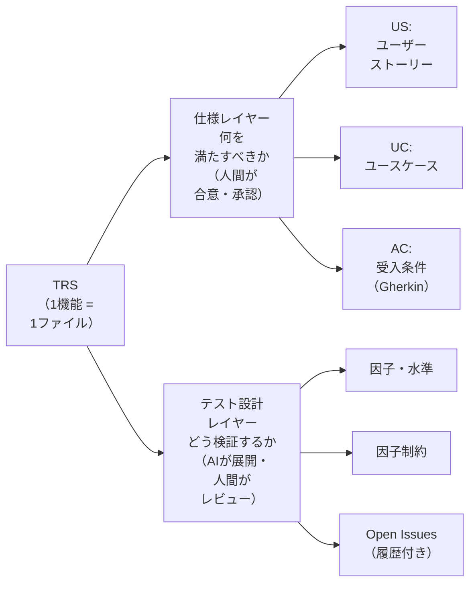
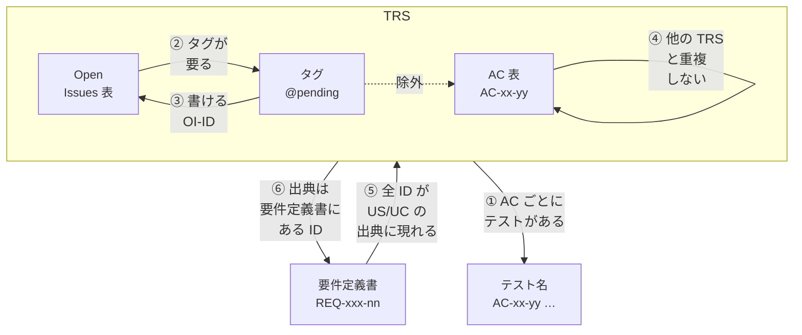
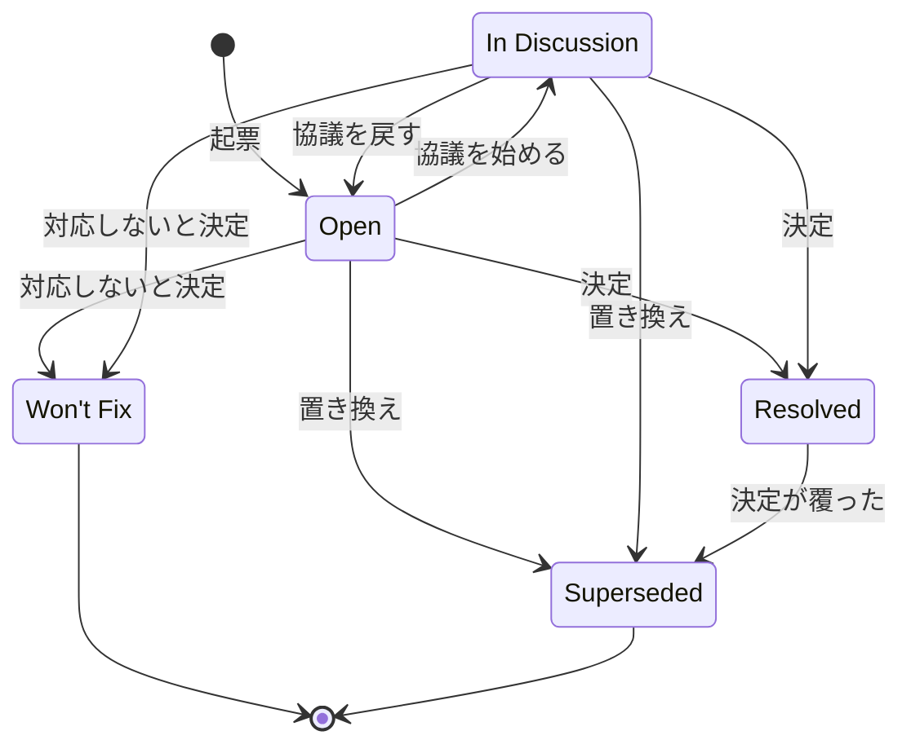
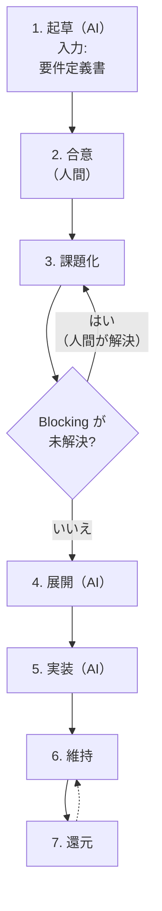

# 03. TRS（テスト要件仕様書）策定ガイドライン

**この文書で決めること**

- TRS の構造（2層）、AC の書き方、因子・水準・制約表からのテスト展開
- 期待値の出所（SSOT）と、要件定義書・AC・Open Issue をテストに結びつける機械検査
- Open Issues の運用、TRS の策定フロー、レビュー項目

| 項目 | 内容 |
|---|---|
| 文書ID | TEST-03 |
| 目的 | TRS（Test Requirement Specification）の構造・記述ルール・運用を定め、AIが生成するテストの「期待値の正」を人間の合意した仕様に固定する |
| テンプレート | [trs/_template.md](./trs/_template.md) / 起草の入力にする[要件定義書](./templates/requirements.md) |
| 関連 | [01 基本方針書](./01-test-policy.md)（W字モデル） / [05 導入手順書](./05-adoption-guide.md)（既存プロジェクトへの導入。レガシーへの適用は 05 §6 の補足。特性化テストは本書 §3.3） |

---

## 1. TRS とは

TRS は、**1機能（1ユースケース群）につき1ファイル**で、「何を満たせば合格か（仕様）」と「どう検証するか（テスト設計）」を一体で保持する文書である。W字モデルに従い、要件定義の段階で起草を開始し、実装・運用を通じて更新し続ける。

- 配置: 導入先プロジェクトの TRS ディレクトリに、`<機能ID>-<機能名>.md` として置く。ディレクトリの例はテンプレートと同じ `docs/testing/trs/`、ファイル名の例は `CNL-001-order-cancel.md` である。
- 起草の入力は、要件定義書（[templates/requirements.md](./templates/requirements.md)）とする（§5）。要件定義書の置き場所は導入先が決める。
- 仕様の経緯を複数ファイルに分散させない。

## 2. 2層構造ルール

TRS は必ず次の2層で構成する。**層の混在を禁止する**（仕様レイヤーにテスト手法の詳細を書かない／テスト設計レイヤーで仕様を新規決定しない）。



### 2.1 仕様レイヤー

| 要素 | 内容 | ID 形式 |
|---|---|---|
| US | 誰が・何を・なぜ（`〜として、〜したい。なぜなら〜`）。出典（要件 ID） | `US-xx` |
| UC | アクター、事前条件、基本フロー、代替フロー、事後条件。出典（要件 ID） | `UC-xx` |
| AC | UC に紐づく受入条件。**Gherkin 形式**（Given/When/Then） | `AC-xx-yy` |

**出典（要件 ID）の記述ルール**

1. US と UC に、出典として要件定義書の要件 ID を必ず書く。複数あるときはカンマで区切る。
2. 要件定義書に無い範囲の US/UC を足すときは、人間が先に要件定義書へ要件として足し、その要件 ID を出典にする。W字モデルが、要件定義と TRS 起草の往復を定めるためである（01 §2）。Open Issue の決定で範囲が増えるときも同じである。
3. 要件の中の曖昧さは、AC 単位の Open Issue と `@pending` で扱う（§3.4.2 の ② ③）。
4. 要件定義書の要件は、TRS に写さない。出典で指すだけにする。同じ要求を 2 か所に書くと乖離するためである。
5. 要件 ID と出典の書式は §3.4.3、書けない値と検査は §3.4.4 で定める。

**AC の記述ルール**

1. 1 AC = 1 つの検証可能な振る舞い。`When` は1つに絞る。
2. 観測可能な結果のみを `Then` に書く（内部実装・関数名・DB カラム名を書かない）。
3. 曖昧語（「適切に」「速やかに」「正しく」）を禁止し、具体値・条件で記述する。
4. 例外・異常系は独立した AC とする。
5. 具体値を伴う AC は `Scenario Outline` + `Examples` を使ってよい。
6. 各 AC に**検証層**（層1/層2/層3）の想定を付記する（01 の使い分け基準に従う）。
   - 層2 は `@integration` / `@e2e` で区別する（例: `@layer:2 @integration`）。
   - E2E は `@e2e` の代わりに `@e2e:<領域>` を付け、02c §5.1 の許可領域を示す。領域は `display` / `communication` / `happy-path` / `browser-operation` である。
   - 同じ AC を複数の層で検証してよい（`@layer:1 @layer:2`）。
7. 期待値が未決で Blocking の Open Issue に依存する AC は、`@pending:<OI-ID>` を付け、シナリオ本文に期待値を書かない。

```gherkin
@AC-01-02 @layer:1
Scenario: 発送済みの注文はキャンセルできない
  Given 注文のステータスが「発送済」である
  When  購入者がキャンセルを要求する
  Then  キャンセルは拒否される
  And   エラーコード "ORDER_ALREADY_SHIPPED" が返る
```

### 2.2 テスト設計レイヤー

AC を網羅的なテストケースへ展開するための設計情報。

| 要素 | 内容 |
|---|---|
| **因子（Factor）** | 結果に影響する入力・条件・状態の軸（例: 注文ステータス、支払方法、ユーザー権限） |
| **水準（Level）** | 因子が取りうる値の代表（同値分割・境界値に基づく）。無効水準も明示する |
| **因子制約** | 組合せとして**成立しない／禁止される**水準の組合せ、および組合せ時の期待結果 |
| **Open Issues** | 仕様が未確定・曖昧な点の追跡表。解決後も履歴を残す（§4） |

- 因子・水準は表形式で記述する。AI はこれを入力に、テストケース（組合せ網羅／ペアワイズ／直交表）を機械的に生成する。
- 因子制約は「禁止組合せ」と「組合せ別の期待結果」を明示する。AI が成立しない組合せのテストを生成せず、期待結果を推測しないようにするため。
- 型で表現可能な制約（型で排除される組合せ）は、制約として記載したうえで「型で排除」と付記し、テスト生成の対象外とする（02a §1）。例えば、状態を閉じた型（sealed 型など）で表し、不正な組合せを作れなくしたものがある。
- PBT で扱う連続・大規模な値域の水準には `PBT` と付記し、ジェネレータの制約として使う。

### 2.3 因子・水準・制約表からデータ駆動テストへの展開

TRS の表をテストへ展開する標準形を、次のとおり定める。展開の解釈を AI や開発者に任せない。表中の `§4`・`§5.1`・`§5.2` は、本書の節ではなく、[TRS テンプレート](./trs/_template.md)の節番号である。§4 は因子・水準、§5.1 は禁止（成立しない）組合せ、§5.2 は組合せ別の期待結果を指す。

| TRS の要素 | テストコードでの扱い |
|---|---|
| 因子制約表（テンプレート §5.2）の1行 | データ駆動テストの**1ケース**。ケース名の先頭に制約 ID（`C-xx`）を置く |
| 因子・水準表（テンプレート §4）の水準 | 制約表の「条件」列に現れる水準を、ケースの入力に使う。連続値（`PBT` と付記した水準）は Property に任せ、ここでは境界値だけを行にする |
| 禁止組合せ（テンプレート §5.1）・型で排除する制約 | **ケースを生成しない**（テスト対象外。行を作らない） |
| 組合せ別の期待結果 | 制約表の値をそのまま期待値にする。**実装の挙動から逆生成しない** |
| AC | データ駆動テストを包む**コンテナ名の先頭**に AC ID を置く（§3.4.1）。複数の制約行が同じ AC を検証してよい |

データ駆動テストに使う機能は、導入先が1つに決めて標準とする。機能には、例えば次のものがある（Kotest `withData`、JUnit `@ParameterizedTest`、pytest `parametrize`）。

## 3. Single Source of Truth（SSOT）

### 3.1 期待値の正

テストの期待値の正（Source of Truth）は、次の順で優先する**人間が合意した成果物**とする。

1. 承認済みの仕様書（TRS の AC、要件定義書、業務ルール文書）
2. 承認済みのデザイン（Figma 等の UI 仕様）
3. （上記に定めがない場合）Open Issue として起票し、人間が決定する

### 3.2 禁止事項

| 禁止 | 理由 |
|---|---|
| **既存コードの挙動から期待値を逆生成する** | バグを仕様として固定化し、AI が現状追認のテストを大量に生む |
| 失敗したテストに合わせて期待値を書き換える | テストが検証の意味を失う |
| 仕様に書かれていない挙動を、AI の推測でテストの期待値にする | 無根拠な仕様が混入する |
| TRS と矛盾する期待値をテストコードにハードコードする | 二重管理になり乖離する |

### 3.3 例外：特性化テスト（Characterization Test）

仕様書が存在しないレガシーコードに限り、**現状把握のための特性化テスト**を作成してよい。ただし次を守る。

- ファイル名・タグで `characterization` と明示し、通常のテストと区別する。
- 「仕様」ではなく「現状」であることをコメントに明記する。
- 疑わしい挙動は Open Issue として起票し、人間が正誤を判断する。確定後に TRS の AC へ昇格させる。

### 3.4 トレーサビリティ

TRS の AC・`@pending`・Open Issues とテストの対応を、CI のトレーサビリティ検査が機械的に検査する。要件定義書の要件 ID と US/UC の出典の対応も、同じ検査で調べる（§3.4.4）。検査の実装は導入先が選び、ここでは何を**失敗**にするかを定める。



| # | 検査 | 失敗にする条件 |
|---|---|---|
| ① | AC に対応するテストの検査（01 の G5） | `@pending` でない AC に、対応するテストが無い |
| ② | 未解決の Blocking な Open Issue の検査（01 の G5） | 未解決の Blocking が指す AC に、その OI-ID の `@pending` が無い |
| ③ | `@pending` に書けるもの（許容範囲） | 未解決の Blocking な OI-ID 以外を書いた。その OI の関連列に無い AC に付けた |
| ④ | `AC-xx-yy` は TRS 間で重複させない | 同じ ID が複数の TRS にある |
| ⑤ | 要件 ID の網羅の検査（01 の G5） | 要件定義書の要件 ID が、どの US/UC の出典にも現れない |
| ⑥ | 出典の実在の検査（01 の G5） | US/UC の出典の値が、実在する要件 ID でない（空欄・`—`・OI-ID を含む）。同じ要件 ID が、全要件定義書で複数の行にある |

この表は要約である。①〜④ の失敗条件の全体は §3.4.2、⑤ ⑥ は §3.4.4、表の書式による失敗は §3.4.3 で定める。

「**未解決の Blocking**」は、TRS の「6. Open Issues」表の行（OI）のうち、次を満たすものを指す。区分が `Blocking` で、状態が `Open` または `In Discussion` である。Resolved・Superseded・Won't Fix と Non-blocking は含まない。

#### 3.4.1 テスト名の付け方

- テスト名の先頭に `AC-xx-yy`、続けて空白と説明を置く（例: `AC-01-02 範囲外の整数は拒否される`）。先頭を grep などで機械的に辿れるためである。
- `AC-xx-yy` は括弧やコロンで囲まない。テスト名に使える文字はフレームワークごとに異なるため、どの環境でも使える表記にそろえる。
- 複数の AC を検証するテストは、`AC-01-04 AC-01-05 …` と空白区切りで並べる。
- TRS のトレーサビリティ表には、テストの所在（ファイルまたはクラス）とテスト名を `::` でつないで書く（例: `<テストファイル>::<テスト名>`）。
- AC に紐づかないテストは、技術的な不変条件（PBT 等）であることを明記する。

#### 3.4.2 各検査の詳細

**① AC に対応するテストの検査（01 の G5）**

- TRS の AC 表から `AC-xx-yy` を抽出する。導入先の層1・層2（Integration・E2E）のテスト全体から、その ID で始まるテスト名を探す。無い AC があれば**失敗**にする。
- `@pending:<OI-ID>` を付けた AC は除外する。除外するのは、Blocking の Open Issue が未解決の AC である。付けてよい範囲は §3.4.2 の ③ で定める。
- 理由: 除外の手段を `@pending` に一本化し、TRS 側で明示させるため。
- `@pending` の追加は、TRS の変更として人間のレビューを受ける。

**② 未解決の Blocking な Open Issue の検査（01 の G5）**

- 未解決の Blocking の行ごとに、関連列の AC のタグ行を調べる。その OI-ID の `@pending:<OI-ID>` が無ければ**失敗**にする。
- 次の 3 つは、未解決の Blocking の行だけを**失敗**にする。それ以外の行は、これらに当たっても失敗にしない。
  - 関連列に AC が無い（因子・水準や UC だけを指す）。指す AC を決められないためである。起票するときは、関連列に AC を書き、その AC に `@pending:<OI-ID>` を付ける。
  - 範囲として読めない `〜` が残る。§3.4.3 の範囲表記に当てはまらない書き方と、逆順を含む。
  - 関連列の AC が、その TRS の AC 表に無い。綴りの誤りなどで、存在しない AC を指したままにしないためである。
- AC を足すかどうか自体が Blocking なときは、仮の AC を `@pending:<OI-ID>` 付きで先に置く。期待値は書かない。関連列では、その仮の AC を指す。

**③ `@pending` に書けるもの（許容範囲）**

- `@pending:<ID>` の `<ID>` は、その TRS の未解決の Blocking な OI-ID に限る。付けてよい AC も、その OI の関連列にあるものだけである。次は**失敗**にする。
  - `OI-<数字>` の形でない値。`@pending:ISSUE-33` のような Issue 番号の参照も含む。実装待ちの AC は `@pending` で除外せず、Issue / PR で管理する。実装と同じ PR でテストを足す。
  - Open Issues 表に無い OI-ID（綴りの誤り、削除）。他の TRS の OI-ID も、この TRS の表に同じ番号が無ければ失敗にする。番号は TRS ごとに振るため、同じ番号があれば区別できない。
  - 未解決の Blocking でない OI-ID。OI を解決・置換したら、同じ変更で `@pending` を外し、期待値とテストを確定する。
  - その OI の関連列（範囲は展開する）に含まれない AC に付けた `@pending:<OI-ID>`。無関係な AC を除外する抜け道を塞ぐためである。関連列が読めない OI と、関連列に AC が無い OI は、② がすでに失敗にするので、③ では二重に数えない。
- 検査の対象は、行内で `@AC-xx-yy` より後ろにある `@pending:` である。① で AC を紐づけ検査から除外する判定と同じ範囲で、Gherkin のタグ行のほか、表や引用の中も含む。`@AC-xx-yy` を伴わない説明文や変更履歴の行は、AC を除外しないので対象外である。
- 理由: `@pending` は、期待値が人間の決定待ちの AC だけを除外する手段である（§4.3 の 3）。実装待ちや解決済みの OI を許すと、除外の抜け道になる。

**④ `AC-xx-yy` は TRS 間で重複させない**

- 全 TRS の AC を、導入先のテスト全体のテスト名と照合する。別の TRS と同じ ID があると、別機能のテストで AC が満たされたように見えるため、重複は**失敗**にする。
- `xx` は UC の番号と対応させ、**TRS ごとに異なる番号**を割り当てる。例: 最初の TRS は `01`、次の TRS は `02`、その次は `03`。
- 新しい TRS は、既存の TRS が使っていない最小の番号から採番する。

#### 3.4.3 検査が前提とする書式

② ③ は、Open Issues 表が次の書式であることを前提とする。

- 区分は `Blocking` / `Non-blocking`、状態は §4.2 の 5 値にする。`Superseded` と `Won't Fix` には、`（置換先・理由）` の接尾辞を付けてもよい。分類できない値（`open`、`**Blocking**` など）は、未解決かどうかに関わらず全行で失敗にする。
- 表には 1 行以上が必要である。見出し（`ID` / `区分` / `関連` / `状態`）が読めない、行が無い、列数が合わない TRS も、TRS 単位で失敗にする。読み取りの空振りで素通りさせないためである。列の名前を変えるときは、検査も同時に直す。
- 関連列の AC の範囲表記は、`AC-xx-yy〜zz` と `AC-xx-yy〜AC-xx-zz`（`〜` は `～` `~` も可）だけにする。同じ `xx` の昇順に限る。外れたときの扱いは §3.4.2 の ② で定める。

⑤ ⑥ は、要件定義書と TRS の出典が次の書式であることを前提とする。

- 要件 ID は `REQ-<略号>-<番号>` とする。略号は英大文字 2〜6 字、番号は 2 桁以上の数字である。例は `REQ-CNL-01`。
- 要件定義書で要件として読むのは、見出しに「機能要件」「業務ルール」「非機能要件」を含む節の表だけとする。先頭列を ID 列にし、先頭列が要件 ID の形でない行（見出し行と区切り行を除く）は、失敗にする。
- 要件として読む表の外に、要件 ID の形の文字列があるときも、失敗にする。未決事項の表も外である。未決事項の ID は `Q-<番号>` とし、要件 ID と区別する。要件が読み取りから漏れるのを防ぐためである。
- 要件定義書があるのに、要件が 1 件も読めないときは、失敗にする。読み取りの空振りで素通りさせないためである。
- TRS には、US の行と UC が 1 つ以上必要である。無い TRS は、TRS 単位で失敗にする。読み取りの空振りで素通りさせないためである。
- US の表には見出し `出典（要件 ID）` の列を、UC の表には項目名 `出典（要件 ID）` の行を置く。見出しや項目名が読めない US/UC がある TRS は、TRS 単位で失敗にする。

#### 3.4.4 要件との対応の検査

**⑤ 要件 ID の網羅の検査（01 の G5）**

- 全要件定義書から要件 ID を抽出し、全 TRS の US/UC の出典から抽出した要件 ID と突き合わせる。どの出典にも現れない要件 ID があれば**失敗**にする。
- 理由: 要求が TRS に落ちないまま、黙って抜けるのを上流で止めるため（01 の基本理念 1）。
- 除外の手段は設けない。要件定義書に書く範囲は §5 で定める。

**⑥ 出典の実在の検査（01 の G5）**

- US/UC の出典を、カンマで区切った値ごとに調べる。実在する要件 ID でない値は**失敗**にする。
  - 綴りの誤り、要件の削除、OI-ID、文書名や節番号などが当てはまる。
  - 空欄と `—` も、出典が無いので失敗にする。
- 同じ要件 ID が、全要件定義書で複数の行にあるときも**失敗**にする。出典がどの要件を指すか定まらないためである。
- 理由: 根拠の無い仕様が、TRS に混ざるのを防ぐため（§3.1・§3.2）。

## 4. Open Issues の履歴化

### 4.1 原則

- 仕様の曖昧点・判断保留は **Open Issues 表に起票**する。コード内の TODO や口頭合意にしない。
- **解決しても行を削除しない。** ステータスを `Resolved` にし、決定内容・決定者・決定日・根拠を記録して**同一 TRS ファイル内に永続化**する。

### 4.2 ステータス

| ステータス | 意味 |
|---|---|
| `Open` | 未解決。人間の判断待ち |
| `In Discussion` | 関係者と協議中 |
| `Resolved` | 決定済み。AC／因子制約へ反映済み |
| `Superseded` | 後続の決定で置き換えられた（置換先 Issue ID を記載） |
| `Won't Fix` | 対応しないと決定（理由必須） |

`Open` と `In Discussion` を未解決と呼ぶ。状態は次のとおり遷移する。



- `Open` と `In Discussion` は相互に行き来できる。
- `Open` と `In Discussion` からは、`Resolved` / `Won't Fix` / `Superseded` のどれへも移れる。
- `Resolved` からは `Superseded` へ移れる。
- `Won't Fix` と `Superseded` は終端で、他の状態へは移らない。その決定を覆すときは、元の行を変えず、新しい OI を起票する。

### 4.3 運用ルール

1. 起票者は AI でも人間でもよい。**解決（`Resolved` への遷移）は人間のみ**が行う。
2. `Resolved` にするときは、**反映先**（どの AC／因子制約を変更したか）を必ず記載する。
3. Blocking 区分の Open Issue が未解決の AC に対するテストは、期待値を確定させず `pending` とする。AI が推測で埋めてはならない。
4. 後から決定が覆った場合は、元の行を `Superseded` にして新規行を追加する（上書きしない）。`Won't Fix` と `Superseded` の行は終端なので、覆すときは行を変えず、新規行を追加する（§4.2）。
5. 追記は時系列（ID 昇順）とし、行の並べ替え・削除を行わない。

### 4.4 記述例

列はテンプレート（[trs/_template.md](./trs/_template.md) §6）と同じ12列とする。

| ID | 起票日 | 起票者 | 区分 | 関連 | 内容 | 状態 | 決定内容 | 決定者 | 決定日 | 根拠 | 反映先 |
|---|---|---|---|---|---|---|---|---|---|---|---|
| OI-001 | 2026-10-10 | AI | Blocking | F1-L2 | 発送準備中の注文はキャンセル可能か | Resolved | 発送準備中は可。ただしキャンセル手数料なし | 担当PO | 2026-10-12 | 担当PO の決定（要件定義書 Q-01） | AC-01-03, 制約C-02 |
| OI-002 | 2026-10-11 | AI | Non-blocking | AC-01-01 | キャンセル完了メールの文言 | Open | | | | | |

## 5. 策定フロー

**仕様変更の原則**: 変更は常に **TRS → テスト → 実装** の順。実装先行で TRS を後付けしない。



各手順の内容は次のとおり。

| 手順 | 内容 |
|---|---|
| 1. 起草（AI） | 入力は要件定義書（[templates/requirements.md](./templates/requirements.md)）。US/UC/AC と因子・水準の案を作成し、US/UC の出典に要件 ID を書く |
| 2. 合意（人間） | AC を確認・修正し承認 |
| 3. 課題化 | 曖昧点を Open Issues に起票。要件定義書の不足・矛盾と、その未決事項も起票する |
| 判定: Blocking が未解決か | 未解決なら、人間が解決して 3 に戻る。未解決でなければ 4 へ進む |
| 4. 展開（AI） | 因子・水準・制約からテストケース生成 |
| 5. 実装（AI） | AC ID を紐づけてテスト実装 |
| 6. 維持 | 仕様変更は TRS を先に更新（人間承認） |
| 7. 還元 | 運用の不具合を TRS と下層テストへ反映（04） |

要件定義書の内容は、人間が決めて合意する（責務は 01 §4）。要件定義書の作り方（聞き出し方など）は、標準の範囲外である。要件定義書には、TRS の起草に要る最小限の要求だけを書き、TRS で扱わない要求は書かない。不足は AI が推測で埋めない（手順 3）。

## 6. レビューチェックリスト

- [ ] 1機能1ファイルで、仕様レイヤーとテスト設計レイヤーが分離されている
- [ ] US/UC の出典が実在する要件 ID で、要件定義書の全要件 ID がどれかの出典に現れる（§3.4.4 の ⑤ ⑥）
- [ ] 全 AC が Gherkin 形式で、観測可能な結果のみを記述している
- [ ] 各 AC に検証層が付記されている
- [ ] 異常系・境界が AC または因子水準として表現されている
- [ ] 因子制約に、禁止組合せと組合せ別の期待結果がある
- [ ] 期待値の根拠が仕様・デザインであり、既存コード由来ではない
- [ ] Open Issues が履歴を保持している
- [ ] 未解決の Blocking が指す AC が `@pending:<OI-ID>` で明示されている（`@pending` の許容範囲は §3.4.2 の ③）
- [ ] `@pending` の AC を除く全 AC にテストが紐づいている（トレーサビリティ）
