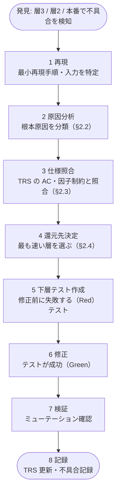
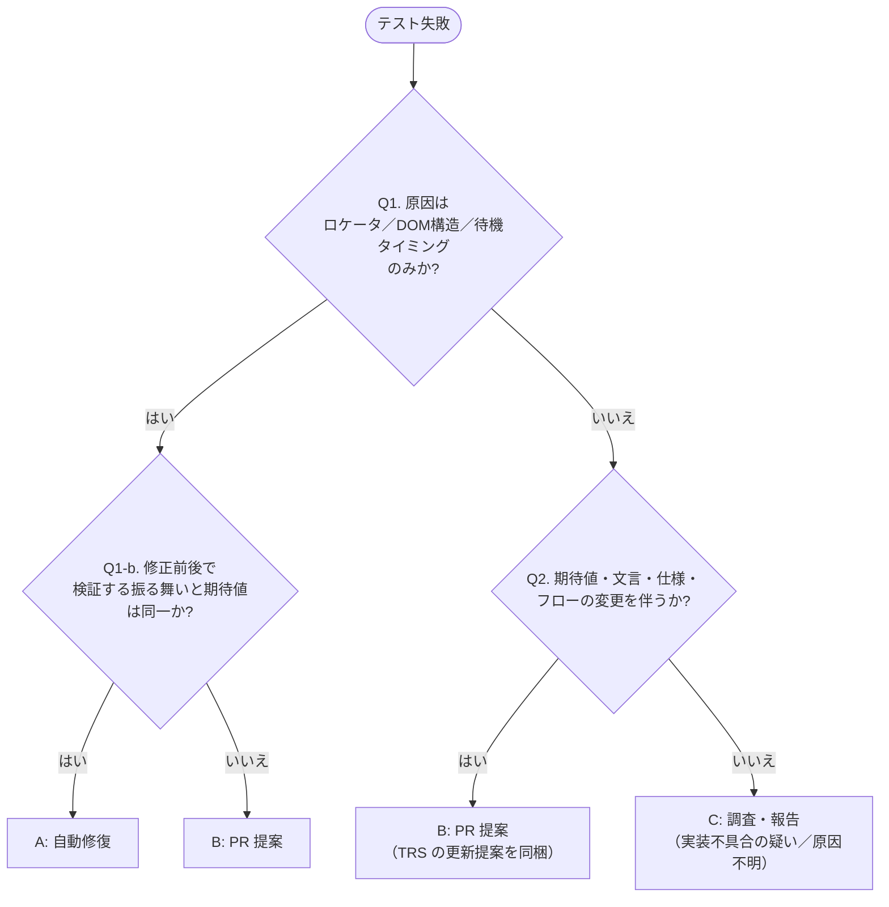
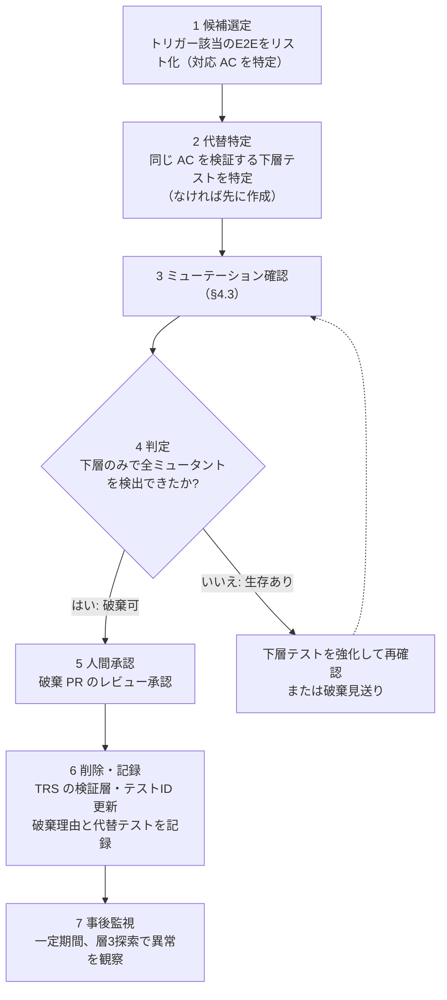

# 04. リグレッション＆AIヒーリング運用規程

**この文書で決めること**

- 不具合を最速の層へ還元する手順と完了条件（§2）
- AI が自動修復してよい範囲と、してはならないこと（§3）
- E2E の破棄基準（§4）と、運用の周期・指標（§5）

| 項目 | 内容 |
|---|---|
| 文書ID | TEST-04 |
| 目的 | 不具合の再発防止（下層化）、AIによるテスト自動修復の安全な適用範囲、重いE2Eの破棄手順を定める |
| 関連 | [01 基本方針書](./01-test-policy.md) / [02a 型設計とPBT](./02a-types-and-pbt.md) / [02b 層1の実行境界とミューテーション](./02b-execution-and-mutation.md) / [02c E2E 最小化原則](./02c-e2e.md) / [03 TRSガイドライン](./03-trs-guideline.md) / [05 導入手順書](./05-adoption-guide.md) |

---

## 1. 基本姿勢

- リグレッションテストは「増やす」ものではなく**「速く・下に」寄せていく**もの。同じ不具合は、より速い層で二度と起こさせない。
- AIは修復を高速化するが、**何が正しいかを決める権限は持たない。** 修復の範囲を機械的に区切る。

---

## 2. 不具合還元プロトコル（Shift-Left Protocol）

E2E・探索テスト（層2・層3）、または本番で発見された不具合を、**最速・確定層（型 / 静的解析 / Unit / PBT）へ昇華・還元**する手順。

### 2.1 フロー



### 2.2 原因分類

| 分類 | 例 | 主な還元先 |
|---|---|---|
| 型で防げた不正状態 | 取り違え、矛盾した状態の組合せ、null 混入 | **型の強化**（ドメイン型化、sealed 型、網羅的 `when`） |
| ロジック／境界の誤り | 境界値、丸め、条件の反転 | Unit（反例を固定）＋ PBT（不変条件） |
| 入力空間の想定漏れ | 特殊文字、極端な値、組合せ | PBT（ジェネレータ拡張） |
| 禁止パターンの混入 | 禁止 API の呼び出し、根拠のないキャスト、アーキテクチャ違反 | **静的解析**（detekt / Konsist のルール化。02b §6） |
| 状態遷移の抜け | 不正な遷移、順序依存 | sealed 型の状態機械＋ PBT（操作列） |
| 契約・配線の不整合 | API スキーマ差異、DB 制約 | Integration（契約テスト） |
| 実ブラウザ固有 | レイアウト崩れ、IME、ブラウザ差 | E2E（02c §5 の許可領域のみ） |
| 仕様の欠落・曖昧 | 誰も決めていなかった挙動 | **TRS の Open Issue**（人間の決定後に AC 化） |

### 2.3 仕様照合（TRS への反映）

| 状況 | 対応 |
|---|---|
| AC に定めがあり、実装が違反 | 実装の不具合。AC に紐づくテストの不足を補う |
| AC に定めがなく、あるべき挙動が自明でない | Open Issue を起票。**人間が決定するまでテストの期待値を確定しない** |
| AC 自体が誤り | 人間の承認を得て TRS を更新し、旧 Issue/AC の履歴を残す（03 §4） |

### 2.4 還元先の選定基準（上から順に検討）

1. **型で書けなくできるか** → できるなら型を強化（テスト不要になる場合もある）
2. **静的解析（detekt / ktlint / Konsist）で書けなくできるか** → 禁止パターンの混入ならルール化する（02b §6）
3. **Unit で決定的に検出できるか** → 反例を Example として固定
4. **PBT で一般化できるか** → 反例を含む不変条件に昇華（反例の固定も併せて残す）
5. **Integration で検出できるか** → 契約・配線の問題に限る
6. **上記いずれも不可の場合のみ E2E**（02c §5 の4領域に該当する場合に限る）

静的解析で検出できるのは構文・構造に限る。ロジックの誤り（境界値・丸め・条件の反転など）は Unit / PBT に還元する。

**例（架空。実際の不具合ではない）**: 「デバッグ用に残した `println` が本番で個人情報をログ出力した」。原因は「禁止パターンの混入」で、型では防げないため、第2段（静的解析）を選ぶ。本リポジトリの `config/detekt/detekt.yml` には、`println` / `print` を禁止する `ForbiddenMethodCall` が既にあるため、新しいルールは足さず、違反例（`println` を含むコード）でこのルールが失敗することを確認して再発を防ぐ。

### 2.5 完了条件（Definition of Done）

- [ ] 修正前に失敗するテストが、選定した最速層に存在する（静的解析の場合は、違反例でルールが失敗すること）
- [ ] ミューテーション確認で、修正箇所の破壊を検出できる（静的解析の場合は該当なし。ルールは pitest の対象外）
- [ ] 元のE2E／探索で見つかった事象は、**下層で代替できた場合に元のE2Eを追加しない**（既存なら §4 で見直す）
- [ ] TRS（AC／因子制約／Open Issues）が更新されている
- [ ] 還元先の層と理由を PR に記載している

[バグ修正用の PR テンプレート](../../.github/PULL_REQUEST_TEMPLATE/bug_fix.md)の完了条件は、PR の文脈に合わせた言い換えを含む。項目の有無と条件は、本節が正である。

### 2.6 不具合記録テンプレート

```markdown
### BUG-xxx <タイトル>
- 発見層: 層3 探索 / 層2 E2E / 本番
- 再現手順: ...
- 根本原因: （分類）...
- 関連 TRS: <ファイル> AC-xx-yy / OI-zzz
- 還元先: 型 / 静的解析 / Unit / PBT / Integration / E2E（選定理由）
- 追加したテスト: <パス>
- ミューテーション確認: 実施済（スコア xx% → yy%） / 該当なし（静的解析）
```

この定義が正である。バグの入口で使う GitHub のテンプレートは本節に従う参照で、項目を変えるときは両方を更新する。

- 発見時の項目（発見層・再現手順・関連 TRS）は [Issue Form](../../.github/ISSUE_TEMPLATE/bug_report.yml) で必須にする。根本原因・還元先・追加テスト・ミューテーション確認は調査と修正の後に分かるため、Issue では任意とする。
- 還元先の強制は [バグ修正用の PR テンプレート](../../.github/PULL_REQUEST_TEMPLATE/bug_fix.md) の完了条件（§2.5）で行う。
- 仕組みでは強制できない経路がある（`gh issue create --body` や API からの起票、PR のチェックボックスを外したままのマージ）。強制力はレビューと CODEOWNERS に依存する。

---

## 3. AIヒーリング（自動修復）適用基準

テスト失敗時にAIが原因を分析し、自動修復を試みる運用の安全規程。**判断軸は「何が変わったか」**である。

**導入時の免除**

- 既存プロジェクトへの導入時は、この規程の運用の仕組み化（履歴レビューの定例化、機械検証の実装など）を、導入の作業として起票しなくてよい。
- 免除できるのは、規程が破られた実績も機械検証の手段も無い間に限る。
- 免除するときは、[05 の据置の記録](./05-adoption-guide.md#据置の記録)と同じ形式（対象・理由・再評価のトリガー）で記録を残す。
- 再評価のトリガーは「初めて破られた」または「検証手段を導入した」とする。破られた後は、不起票を続けない。
- 免除の範囲は、運用の仕組み化の起票に限る。AI ヒーリングを行う場合の §3.1〜§3.5（§3.4 の絶対禁止事項を含む）の適用は、導入初日から免除しない。

### 3.1 3区分

| 区分 | 修復の扱い | 該当例 |
|---|---|---|
| **A: 自動修復を許可** | AI が修正し、通常の PR（CI 通過・事後レビュー）で反映できる | UIセレクタの追従（ID／class／DOM 構造／ロール属性の変更）、ロケータの安定化、待機条件の調整（固定 sleep → 条件待機）、テストデータ生成の軽微な不整合、import／パスの変更追従 |
| **B: 人間への PR 提案に限る** | AI は**修正案の PR を作るのみ**。人間の承認なしにマージしない | 仕様・文言・ビジネスルールの変更、期待値（アサーション値）の変更、画面遷移・フローの変更、権限／状態遷移の変更、TRS／AC の変更、新規 E2E の追加、テストの削除・スキップ |
| **C: 修復禁止（調査・報告のみ）** | AI は修復せず、原因分析を報告して人間に引き渡す | 実装の不具合が疑われる失敗、セキュリティ／課金／個人情報に関わる失敗、原因が特定できない flaky、複数テストの同時大量失敗 |

### 3.2 判定フロー



### 3.3 自動修復（区分A）の追加制約

1. **期待値・アサーションに触れない。** 変更は「対象要素をどう特定するか」「いつ待つか」に限る。
2. **アクセシビリティ属性（role / label / `data-testid`）を優先**したセレクタに修正する。位置依存（`nth-child`、絶対 XPath）に退化させない。
3. 修復は**1失敗につき最小差分**とし、無関係なリファクタを混ぜない。
4. 修復後、同一テストを**複数回**実行して安定性を確認する（例: 10回連続成功）。
5. 修復内容は PR 説明に**修復前後のセレクタ／待機条件**を記載し、事後レビュー可能にする。
6. 1 PR あたりの自動修復件数に上限（例: 10件）を設け、超過時は大規模な UI 変更として区分Bへ昇格する。
7. 自動修復の履歴（日時・対象・差分・分類）をログとして保管する。

### 3.4 絶対禁止事項（全区分共通）

AI は、いかなる場合も次を**単独で行ってはならない**。

- テストを通すための期待値・文言・仕様の書き換え
- 失敗テストのスキップ（`skip` / `xfail`）、削除、アサーションの削除・弱体化（例: 厳密一致 → 部分一致）
- スナップショットの一括更新
- リトライ回数・タイムアウトを延ばすことによる flaky の隠蔽
- TRS・期待値ファイル・本規程の無承認変更

#### 3.4.1 テストの意図的な無効化（例外手順）

無効化は原則禁止で、CI の `TestProtectionTest`（Konsist）が `@Disabled` / `@Ignore`、Kotest の `xdescribe` 系・`!` 接頭辞・`enabled = false` を検出して失敗させる。やむを得ず無効化する場合は次を満たす。

1. 理由（原因 Issue の番号）と再有効化の期限を PR 本文とコードのコメントに書く。
2. 人間が PR で承認する。AI が単独で承認・追加してはならない。
3. 承認された対象を `TestProtectionTest` の `allowed` に追加する（`src/test/.../architecture/` は CODEOWNERS の対象）。

「テスト数・アサーション数が減った」ことの自動警告は導入しない。正当なリファクタリングや重複テストの統合でも減るため過検知が多く、警告が常態化して無視されるコストが検出の利益を上回るためである。削除・弱体化はレビューで確認する（PR の差分で `-` 行のアサーションを見る）。

### 3.5 区分Bの PR 提案テンプレート

```markdown
## AI提案: <概要>
- 失敗テスト: <テスト名 / AC ID>
- 検知した変更: （例）ボタン文言「購入する」→「注文を確定する」
- 変更の種類: 仕様／文言（区分B）
- 提案内容: テスト期待値および TRS AC-xx-yy の更新
- 根拠: 参照した仕様書／デザイン（リンク）※コードの現状ではなく仕様に基づくこと
- 影響範囲: 他の AC／テストへの波及
- **要確認**: この変更は意図したものか（人間の承認が必要）
```

---

## 4. E2E 破棄基準

実行時間が増大した、不安定になった、あるいは下層で担保できるようになったE2Eは破棄する。ただし**検証能力を失わないこと**をミューテーションで確認してから削除する。

### 4.1 見直しトリガー

| トリガー | 例 |
|---|---|
| 実行時間予算の超過 | E2E 総時間が上限（02c §5.4）を超過 |
| 不安定 | 直近30日で flaky 判定が一定回数（例: 3回）以上 |
| 重複 | 同じ AC を層1／Integration も検証している |
| 許可領域外 | 02c §5.1 の4領域に該当しない |
| 保守コスト | 修復（ヒーリング）頻度が高い |

### 4.2 破棄手順



### 4.3 ミューテーション確認の手順

目的: 「E2E を削除しても、そのE2Eが守っていた不具合を下層が検出できる」ことの実証。

1. **E2E が守る振る舞いに対応する実装コード**を特定する（画面→ハンドラ→ドメイン関数 等のパス）。
2. 対象コードに対し、02b §4.2 に従って**ミュータントを生成**する（条件反転・境界・戻り値置換・ブロック削除 等）。
3. **E2E を除外し、下層テストのみ**で全ミュータントに対しテストを実行する。
4. **参考として E2E も実行**し、E2E のみが検出して下層が見逃したミュータント（= E2E 固有の価値）を抽出する。
5. 判定:

| 結果 | 判断 |
|---|---|
| 下層のみで全ミュータント Killed | E2E 破棄可 |
| E2E のみが検出したミュータントがある | その箇所に対し下層テストを追加し、**再度**確認。追加不能（実ブラウザ依存等）なら E2E を保持 |
| E2E 固有の検出が「表示」「通信」「実ブラウザ操作」に該当 | 許可領域として保持（破棄対象外） |

結果（ミュータント数、Killed 数、E2E 固有検出の有無）を破棄 PR に添付する。

### 4.4 破棄の禁止事項

- ミューテーション確認なしの削除、または「重いから」という理由のみでの削除
- 代替テストが存在しない状態での削除
- AI の単独判断による削除（必ず人間の承認を経る）

---

## 5. 運用リズムと指標

既存プロジェクトへの導入時は、この節のうち機械検証の手段が無い項目（ヒーリング履歴のレビュー、指標のレビューなど）に限り、起票せずに据え置いてよい。次の項目は対象外である。

- PR ごとの不具合還元 PR の DoD 確認
- ヒーリング PR の区分確認（AI ヒーリングを行う場合）
- 全体ミューテーション（G3。頻度は 02b §4.1 の導入期の例外による）

条件、記録の形式、再評価のトリガーは [§3](#3-aiヒーリング自動修復適用基準) の冒頭と同じである。

| 周期 | 実施事項 |
|---|---|
| PR ごと | 不具合還元 PR の DoD 確認、ヒーリング PR の区分確認 |
| 夜間 | 層3 AI探索の実行、PBT 増量、全体ミューテーション |
| 週次 | flaky の棚卸し、ヒーリング履歴レビュー |
| 月次 | E2E 見直し（§4.1）、指標レビュー |

| 指標 | 目標の方向 |
|---|---|
| 不具合の発見層分布（層3・本番の割合） | 低下 |
| 不具合還元率（還元済み／全不具合） | 100% を維持 |
| E2E 件数・総実行時間 | 予算内で横ばい／減少 |
| Mutation Score（層1） | 閾値以上で維持・上昇 |
| 区分B・C に昇格したヒーリング件数 | 傾向を監視（急増は大規模変更の兆候） |
| flaky 率 | 低下 |

## 6. 改訂

本規程の改訂は人間のレビュー承認を必須とする。AI が単独で変更してはならない。
