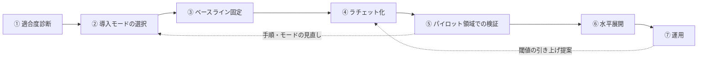
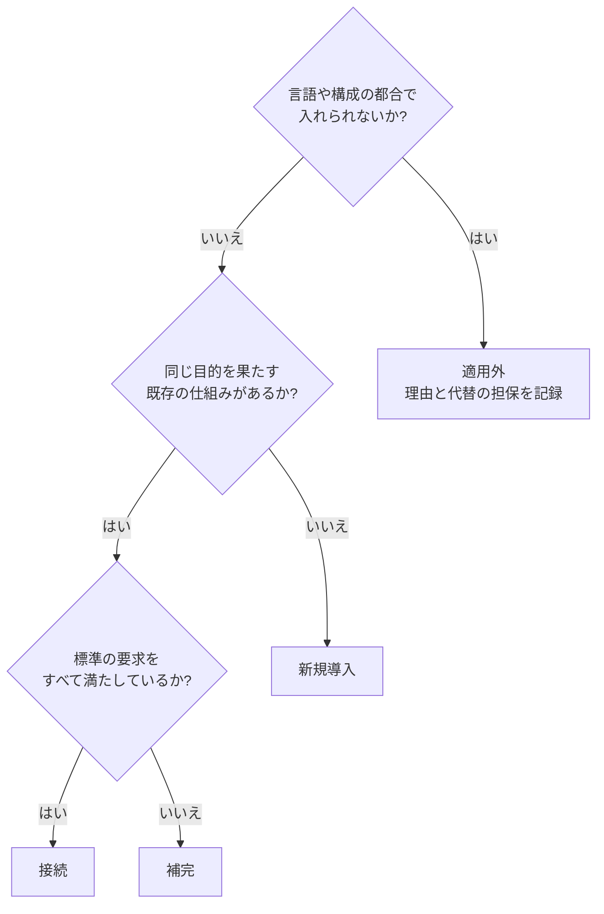

# 05. 既存プロジェクトへの導入手順書

| 項目 | 内容 |
|---|---|
| 文書ID | TEST-05 |
| 目的 | 既存のプロジェクトに本標準（01〜04）を、既存の運用を止めずに段階的に取り込む手順を定める |
| 対象 | すでにテスト・静的解析・CI を持つプロジェクト。新規プロジェクトは 01〜04 をそのまま適用すればよい |
| 関連 | [01 基本方針書](./01-test-policy.md) / [02 アーキテクチャ標準](./02-test-architecture.md) / [03 TRSガイドライン](./03-trs-guideline.md) / [04 リグレッション運用規程](./04-regression-governance.md) |

> 本書は、机上で書いた骨子に、最初の適用対象（非公開のプロジェクト）でパイロットを終えた結果を反映したものである。各節の「実例」は、その1件の適用で起きたことの要約であり、標準の要求ではない。数値は桁感の概数で、非公開側の Issue 番号・リンク・内部構成は載せていない。実例を反映した箇所と、骨子を直した箇所の対応は [§9](#9-実例の追記) にまとめる。

---

## 1. 導入の原則

既存プロジェクトでは、標準の一部がすでに別の形で入っていることが多い。設定をそのままコピーすると、重複や衝突が起き、既存の運用も止まる。次の4原則に従う。

1. **既存の仕組みに接続する。** 同じ目的を果たす仕組みがあれば置き換えず、標準のゲート（01 §5 の G0〜G5）の1つとして位置づけ直す。
2. **導入時に赤くしない。** 現状値をベースラインとして固定し、「悪化のみ禁止」にする。標準の閾値（02 §4.1 の 80% など）を、導入の初日から課さない。
3. **閾値は実測から始めて、段階的に上げる。** 引き上げの手順は [§7](#7-閾値の引き上げ) に従う。
4. **強制力が弱い環境では、フック・ラチェットで担保する。** 必須チェックを設定できない、CI の整備が途中、などの環境では、Git フック（pre-commit、pre-push など）やローカルで実行できるラチェット（悪化を検出して失敗させる仕組み）で代替する。強制の経路が弱い箇所は、レビューと責任者の指定（01 §5.1）で補う。代替の担保手段は、[§3 ④](#3-手順と完了条件) の一覧に書き出す。

AI は導入の各段階で、診断の下書き・ベースラインの実測・引き上げの提案を担える。ただし、導入モードの決定とベースラインの確定は人間が承認する（[§3](#3-手順と完了条件) ②③の完了条件）。閾値の変更も人間が承認する（[§7](#7-閾値の引き上げ) の「承認」）。

## 2. 導入の流れ

①〜④は、プロジェクト全体の「現状を壊さない土台」を作る段階である。⑤で小さい領域に標準を一周通して実態に合うかを確かめ、⑥で広げ、⑦で運用に乗せる。

## 3. 手順と完了条件

### ① 適合度診断

[§5 のテンプレート](#5-適合度診断テンプレート)を使い、標準の各項目について、現状と差分を書く。

- 完了条件: 診断表の全行が埋まっている。各行の差分欄に、仮の導入モード（[§4](#4-導入モード)）が書かれている。標準を導入すること自体が、既存の検査（文書のサイズ上限を測るラチェットなど）を赤くしないか確認している。人間がレビューしている。

実例: 既存の設計書にバイト数の上限を検査するラチェットがあり、標準への準拠宣言を1行足しただけで赤くなることが、診断で分かった。診断に、導入先の既存ラチェットとの衝突確認を含めるとよい。記入例は [§5](#5-適合度診断テンプレート) にある。

### ② 導入モードの選択

診断の各行について、導入モードを確定する。

- 完了条件: 全行の導入モードが確定している。「接続」の行には、既存の仕組みと標準のゲートの対応が書かれている。「適用外」の行には、理由と代替の担保が書かれている。次の判断事項が、作業を Issue などに起票する前にオーナーへ確認され、結果が記録されている。人間が承認している。
  - 新しい依存の追加の可否
  - 検査ツールの採否
  - TRS の置き場所
  - ミューテーションテストの実行頻度

判断事項は、診断の直後・起票の前に確認する。モードを選んだ実例は [§4](#4-導入モード) にある。

新しい依存（ミューテーションテストのツールなど）は、いきなり本導入せず、スパイクを挟む。

1. 本導入に進む基準（実行時間など）を先に置き、スパイクとして小さい範囲で動かすことだけを承認する。
2. スパイクの結果（実行時間、無料枠の消費など）を実測して添える。
3. その実測を見て、本導入を人間が改めて承認する。

実測が基準を超えた実例は、[§4](#4-導入モード) にある。

### ③ ベースライン固定

[§6](#6-ベースライン固定の対象) の4種について、現状値を実測し、固定先に記録する。

- 完了条件: 4種（該当しないものは「適用外」と理由）の現状値が固定先に記録されている。固定した時点で、既存のビルド・CI が赤くならない（CI が実行するのと同じタスクで実行して確認している）。固定値は1つの値につき1か所に置く（[§6](#6-ベースライン固定の対象) の実例）。

### ④ ラチェット化

固定値からの悪化を、CI または Git フックで検出して失敗させる。

- 完了条件: 悪化を検出すると失敗することを、意図的に悪化させた変更で一度確認している（確認用の変更はマージしない）。固定値を変更する手順（誰が提案し、誰が承認するか）が記録されている。必須チェックを設定できない環境では、強制力の担保手段が一覧に書かれている。

必須チェックを設定できない環境（例: ブランチ保護が使えないプラン）では、強制力の担保手段を手順書に一覧しておく。実例では、次の3つで担保した。

| 担保手段（実例） | 何を強制するか（本書の補足） | 限界（本書の補足） |
|---|---|---|
| プッシュ前フック | ローカルで悪化を検出し、プッシュを止める | 設定は利用者の環境ごとに要り、迂回できる |
| ラチェット | 固定値からの悪化を、テストの失敗として検出する | 必須チェックが無い環境では、CI が赤でもマージを止められない |
| PR テンプレート（不具合還元の DoD） | 不具合還元の完了条件の欄を、PR の作成時に示す | 欄を埋めたかどうかは、人間が確認する |

### ⑤ パイロット領域での検証

小さい領域（1つの機能や1つのパッケージ程度）を選び、標準を一周通す。TRS の起草、AC の確定、テストの紐づけ、ミューテーションによる確認まで行う。

- 完了条件: パイロット領域の TRS が人間の承認を得ており、G5（TRS 整合）を通っている。誤検知・実行時間・既存運用との摩擦が記録されている。検証は、CI が実行するのと同じタスクで行っている。必要なら、② に戻って導入モードを見直し、その結果が診断表に反映されている。

領域の選び方の実例: 権限と状態遷移がコメントで明示された集約を1つ選んだ。業務ルールが設計書の番号で参照でき、既存のテストもあるため、AC の出典を決めやすかった。

検証で分かった摩擦の実例:

1. **テスト基盤の版の食い違い。** 依存管理の下で、テスト実行基盤の launcher だけが古い版に固定され、ミューテーションツールの子プロセスが落ちた。`force` では直らず、依存の解決戦略で engine の版に揃えた。この変更は他のテストタスクの classpath にも効く。
2. **ローカルで回したタスクと、CI が回すタスクの差。** 上の版揃えを、単体・統合テストの classpath にだけ入れ、E2E の classpath に入れ忘れた。ローカルは `clean build` だけで、CI が別に回す E2E を含めておらず、CI で初めて落ちた。この教訓は、③⑤ の完了条件にした。
3. **ミューテーションツールの設定。** テスト対象クラスの指定と、テストのタグを子プロセスに渡す設定が要る。未指定だと、本体クラスをテストとして実行したり、統合テストまで拾ったりする。
4. **紐づけ検査の自己参照。** 紐づけ検査のラチェットが、文書に書いた例示を自分で拾って赤くなる。文書に例を書くときの外し方を、エラーメッセージとドキュメントに書いた。

### ⑥ 水平展開

パイロットの結果を踏まえ、対象領域を広げる。広げる単位（パッケージ、モジュール、機能など）はプロジェクトが決める。

- 完了条件: 展開した領域ごとに、ベースラインが固定され、ラチェットが有効になっている。展開の完了を宣言する単位と日付が記録されている。展開しない領域・機能（据置）がある場合は、[§4](#4-導入モード) の「据置の記録」に従い、対象・理由・再評価のトリガーが記録されている。

実例（型ガードレールの水平展開）:

1. **単位と順序。** 方針（ADR）、パイロット集約、残りの集約の順に、1段を1つの PR として進めた。差分の大きい集約は、着手前に ADR で範囲と据置を決めた。
2. **変換位置の先行固定。** 型を境界の外に出さない変換位置を、先に2か所（永続化の境界と、表示の境界）に固定した。外部契約（API・DB スキーマ・JSON）は変わらなかった。
3. **コンパイルが通るのに壊れる箇所。** 文字列補間（型の `toString` が出る）、テストの等価比較（型を取り違えても実行時にしか外れない）、ログ引数（`Any?` なので型が漏れてもコンパイルが通り、テストにも出ない）の3つがあった。後ろの2つは、型検査では見つからないので、全数確認が要る。
4. **据置。** 運用していない機能や、表示用の派生値は据置にした。据置は ADR に書き、Issue のチェックリストにも「見送り」の行を残した。
5. **チケットの切り方。** 子チケットの数は「守る性質の数」で決め、PR の数は「段」として自由に増やした。段はチェックリストで管理し、段ごとに新しい Issue は立てない。分割は1回だけ使った。
6. **AI への委譲。** 指示書に、範囲外を書き換えないことを明記する必要があった。永続化層の値（素の整数）を、ドメインの型と取り違えて書き換えた例があり、統合テストが1件落ちて検出した。

### ⑦ 運用

引き上げの提案、不具合還元（04 §2）、診断表の更新を、定常の運用にする。

- 完了条件: 閾値の引き上げを提案する契機と担当（AI または CI）、承認者（人間）が決まっている。診断表を見直す周期が決まっている。これは継続する運用であり、完了条件は「運用の仕組みが動いている」ことである。引き上げの契機の実例は [§7](#7-閾値の引き上げ) にある。

## 4. 導入モード

診断の各項目に、次の4つのうち1つを割り当てる。

| モード | 状況 | 対応 |
|---|---|---|
| 新規導入 | 該当する仕組みが無い | 標準のものを入れる。ただし閾値は §1 の原則2・3に従う |
| 接続 | 既存の仕組みが同じ目的を果たしている | 置き換えない。標準のゲート（G0〜G5）の1つとして位置づけ直し、対応を記録する |
| 補完 | 既存の仕組みが部分的に満たしている | 足りない部分だけを足す |
| 適用外 | 言語や構成の都合で入れない | 理由を記録し、代替の担保を決める |

「接続」と「補完」では、既存の検査を黙って弱めたり置き換えたりしない。既存の検査が標準より厳しい箇所は、そのまま維持する。

### 据置の記録

導入モードとは別に、展開の範囲（領域・機能）のうち、「今回は入れない」と決めたもの（据置）がある。ここでの据置は「導入範囲に入れない」意味で、02 §4.1 の「据え置き」（閾値を変えない）とは別である。標準の要素そのものを外すときは、据置ではなく §4 の「適用外」の手順によるか、オーナーの判断を得る。実例では、運用していない機能や表示用の派生値を据置にした。据置は「適用外」（入れない理由が言語や構成の都合）とは違うので、次の3点を記録する。

1. 対象: 何を入れないか。
2. 理由: なぜ今は入れないか。
3. 再評価のトリガー: 何が起きたら見直すか。

### 実例: 導入モードの選択（パイロット）

- 「導入時に赤くしない」は最初から選んだ。標準の閾値（ミューテーション 80% など）を最初から課す案は、導入時に赤くなり既存の運用を止めるため、起票の時点で却下した。
- 途中で変えたのは、ミューテーションの**評価軸**である。

| | 当初の案 | 見直し後 |
|---|---|---|
| PR | 全体を回し、殺傷率の悪化を禁止する | 差分実行で、テストの強度（カバー済みの変異のうち殺せた割合）だけを評価する |
| 週次 | （当初の案には無い） | 全体実行で、殺傷率を評価する |

- 変えた決め手は2つある。CI の runner での全体実行が、事前に置いた基準（数分以内）を超えた。さらに差分実行では、テストの無いクラスの変異が殺傷率に混ざり、触ったクラスの評価として不適切だった。
- 限界: テストの無い新規クラスは、差分では通る。その検出は、週次の全体実行に任せる。
- 迷った点: 「実行頻度」と「評価軸」は別の判断だった。頻度を落とす前に、評価軸が目的に合っているかを確認した方がよい、というのがパイロットの所感である。
- 上はパイロットでの運用の実例であり、標準（02 §4.1: PR は変更ファイルの差分ミューテーションで Mutation Score ≥ 80%、夜間は全体で 70%）は変えていない。

## 5. 適合度診断テンプレート

次の表を診断結果の置き場にコピーして埋める。「標準の要求」欄は、本標準の参照先であり、書き換えない。「差分と導入モード」欄には、標準との差分と、[§4](#4-導入モード) の導入モード（新規導入 / 接続 / 補完 / 適用外）を書く。

| 項目 | 標準の要求（参照先） | 現状 | 差分と導入モード |
|---|---|---|---|
| G0 Markdown 検査 | 全 `.md` の lint と Mermaid のレンダリング（01 §5） |  |  |
| G1 静的検査 | 型チェック・Lint がエラー 0（01 §5、02 §6） |  |  |
| G2 層1テスト | Unit・PBT 全件成功（01 §5、02 §2・§3） |  |  |
| G3 ミューテーション | 変更ファイルの Mutation Score が閾値以上（01 §5、02 §4） |  |  |
| G4 層2テスト | Integration・E2E 全件成功。層1と実行境界を分ける（01 §5、02 §3.2） |  |  |
| G5 TRS 整合 | AC に紐づくテストが存在し、未解決の Blocking な Open Issue がない（01 §5、03 §3.4） |  |  |
| 型ガードレール | プリミティブ型の排除、コンストラクタ防御、sealed 型と網羅的 `when`（02 §1） |  |  |
| アーキテクチャ検査 | 層の依存方向・禁止パターンの機械的な検査（02 §6） |  |  |
| テスト保護 | テストの無効化を検出して失敗させる。意図的な無効化は例外手順（02 §6、04 §3.4.1） |  |  |
| 不具合還元 | 還元先の選定と完了条件を、不具合の記録と PR で強制する（04 §2） |  |  |

記入の注意:

- 「現状」には、ツール名・設定ファイル・実行コマンド・現在の結果を書く。推測で埋めず、実際に実行して確認した事実を書く。
- 「標準の要求」を満たしているかどうかは、名前の一致ではなく、検出できるものの一致で判断する（同じ名前の仕組みでも、検査の範囲が狭いことがある）。
- G0〜G5 の「実装状況」は、本リポジトリの実装（01 §5.1）とプロジェクトの環境で異なってよい。診断の対象は標準の要求であり、本リポジトリのツール選定ではない。
- 標準を入れること自体が、既存の検査（文書のサイズ上限を測るラチェットなど）を赤くしないか、診断の段階で確認する（§3 ①）。

### 記入例（パイロット）

非公開のバックエンド（Kotlin / Spring Boot、テストは Kotest と MockK、統合テストは Testcontainers）に適用した診断の要約である。導入前から、ビルドに Lint と層別のカバレッジ閾値があり、設計書のバイト数や層の境界を検査する自前のラチェットが十数本あった。つまり、ラチェット文化のある既存プロジェクトへの導入である。この診断では、文書検査（G0）を対象にしなかった。要約のため、下の表はテンプレートの列（標準の要求・現状・差分と導入モード）の形ではなく、診断と取り込み方針の2列にし、導入モード名は省略した。

| 要素 | 診断 | 取り込み方針 |
|---|---|---|
| G1 静的検査 | 充足。ただし網羅 `when` の検査は無効で、`else ->` が十数件ある | 件数をベースラインに固定し、悪化のみ禁止 |
| G2 層1テスト | 単体・統合・層別カバレッジは充足。PBT は無い | プロパティテストの依存を追加 |
| G3 ミューテーション | 無い | ドメイン層だけに限定して導入。まずスパイク |
| G4 層2テスト | 充足（標準より先行） | 変更なし |
| G5 TRS 整合 | 無い | 1集約でパイロットし、紐づけ検査を足す |
| 型ガードレール | 検証付きの型が1つだけ。金額・残高は素の整数 | 集約単位で段階導入 |
| アーキテクチャ検査 | 自前のトークン走査ラチェットが同等の機能を持つ | 既存を拡張。新しいツールは入れない |
| テスト保護・不具合還元 | 規則も検査も無い。テストの無効化は 0 件 | ラチェットで 0 を固定し、PR テンプレートに完了条件を置く |

## 6. ベースライン固定の対象

導入時に現状値を固定し、悪化のみを禁止する対象は次の4種である。ツール名は例示であり、プロジェクトが使っているものを使う。各ツールの設定方法・出力形式は、それぞれの公式ドキュメントで確認する。

| 種類 | 測り方 | 固定先 | 悪化の定義 |
|---|---|---|---|
| 静的解析の既存違反件数 | 静的解析ツール（例: detekt、ktlint）の出力から、ルール別または全体の違反件数を数える。アーキテクチャ検査・テスト保護（例: Konsist）の既存違反も、この行に含める | ツールのベースライン機能（あれば）、または件数を記録したファイルをリポジトリに置く | 次のどちらかを、プロジェクトが選んで記録する。(1) 固定済みの既存分を除く新規の違反が出る（ツールのベースライン機能を使う場合はこちら）。(2) 件数が固定値を超える。両者は別の基準で、(2) は既存の違反を直して件数に余裕ができると、その分だけ新規の違反を許す |
| カバレッジ | カバレッジ計測（例: JaCoCo）で、行またはブランチのカバレッジ率を測る。全体か変更ファイル単位かはプロジェクトが決める | CI の検証ルールの設定値、または率を記録したファイル | 固定値を下回る |
| ミューテーションスコア | ミューテーションテスト（例: PIT）の Mutation Score を測る。導入直後は全体の夜間実行で実測し、PR では変更ファイルのみを対象にする（02 §4.1）。パイロットでの評価軸と実行頻度の実例は [§4](#4-導入モード) にある | CI の閾値設定、または実測値を記録したファイル | 固定値を下回る |
| TRS に紐づかない AC・テストの数 | 次の2つを別々に数える。(a) 紐づくテストが無い AC の数。03 §3.4 の検査（`TraceabilityTest` 相当）が測るのはこの (a) だけである。`TraceabilityTest` 相当をそのまま入れる場合、(a) の固定値は 0 になる。0 以外で固定するなら、件数で比べる検査を別に用意する。(b) AC に紐づかず、かつ技術的な不変条件（PBT 等）とも、特性化テスト（03 §3.3、`characterization` と明示したテスト）とも明記されていないテストの数。テスト名の先頭が AC の ID でも、技術的な不変条件の明記でも、`characterization` の明示でもないテストを数える。(b) は別途、測る手段を用意する | 件数を記録したファイル。`@pending` を付けられるのは、03 §3.4 のとおり Blocking な Open Issue が未解決の AC に限る。ベースラインの除外には使わない | (a)・(b) のどちらかが固定値を超える。導入後に新規に追加する AC は紐づくテストを必須とし、新規のテストは AC の ID を付けるか、技術的な不変条件であることを明記するか、特性化テストであることを `characterization` で明示する（03 §3.3、§3.4） |

補足:

- 既存のテストには AC が無い。既存の挙動から期待値を逆生成して AC にしてはならない（03 §3.2）。仕様が不明なレガシーは、特性化テスト（03 §3.3）で現状を把握し、疑わしい挙動を Open Issue として起票する。特性化テストは (b) に数えない。特性化テストの件数を別に数えて AC への昇格を追うかどうかは、プロジェクトが選ぶ。
- ミューテーションスコアは、導入直後に実測すると低く出ることが多い。低い値をそのまま固定する（標準の閾値で赤くしない）。
- 固定値は、実測した時点の値であり、目標ではない。目標への引き上げは [§7](#7-閾値の引き上げ) に従う。

### 実例: 固定先と固定値の選び方（パイロット）

1. **固定先は、1つの値につき1か所にした。** ミューテーションの閾値はビルド設定の1か所、違反件数はラチェットのテストの定数、設計書のバイト数もラチェットのテストの定数に置いた。設計書に数値を書く案は、設計書が上限ちょうどで二重管理になるため却下した。方針（ADR）には数値を置かない。
2. **件数の基準値は、スラックなしにして、増えても減っても赤にした。** 減っても赤くなるので、改善した PR は基準値の更新を伴う（[§7](#7-閾値の引き上げ) の実例）。
3. **ミューテーションの全体スコアは、テストの有無に支配された。** テストの無いクラスの変異が分母に入り、全体は低く出る。実測は七割前後で、カバー済みのコードだけなら九割台だった。標準の 80% を最初から課すと、テストの空白地帯が閾値違反として現れる。
4. **整数の閾値は、実測値を切り捨てた値にした。** 実測が小数のとき、四捨五入した値を閾値にすると、初日から赤くなりうる。さらに1ポイントの余裕を置くと、タイムアウトの判定が1〜2件ぶれても赤にならない。

## 7. 閾値の引き上げ

固定値や閾値は、悪化を禁止するだけでは改善されない。実測に合わせて、段階的に引き上げる。

| 項目 | ルール |
|---|---|
| 提案 | AI または CI が行う（実測値と根拠を添えた PR や通知） |
| 承認 | 人間が行う。本書の規則として、閾値の変更は人間が承認する。01 §4 の責務分離（AI は提案し、人間が承認する）の考え方を閾値にも当てはめる。本リポジトリでは閾値の設定ファイルが CODEOWNERS の対象である。導入先では §1 原則 4 に従い、責任者を指定する。AI が単独で閾値を引き上げて確定させてはならない |
| 契機 | 実測が閾値を一定期間上回り続けたとき。または、対象領域の水平展開（§3 ⑥）が完了したとき |
| 引き上げ幅・期間 | 本書では固定しない。プロジェクトごとに決めて記録する（02 §4.1 の初期値も実測で見直す前提の値である） |
| 引き下げ | 原則禁止。やむを得ない場合は、04 §3.4.1 に準じる（理由、原因 Issue の番号、見直しの期限を PR と設定のコメントに書き、人間が PR で承認する。AI が単独で承認・変更してはならない） |

本書は手順を述べるだけで、閾値そのものを変更しない。

### 実例: 引き上げを提案する契機（パイロット）

契機の実例は、発生したものと、していないものを区別して書く。

| 項目 | 状況 | 内容 |
|---|---|---|
| 件数が減ったとき | 実例あり | 設計の改善で `else ->` の件数が実際に減ると、「減っても赤」のラチェット（§6 の実例）が止めた。改善した PR が、同じ PR で基準値を下げた。承認の手続きは追加していない |
| ミューテーションの閾値の引き上げ | 未発生 | 見込む契機は、テストを足した PR が殺傷率を押し上げたとき。上げるのはその PR 自身で、同じ PR で閾値を更新する |
| 週次の全体実行の結果 | 懸念であり、実例なし | 引き上げの契機として使える。ただし、週次の結果が誰にも見られなくなると、ベースラインが形骸化する |

## 8. やってはいけない例

| やってはいけない例 | 理由 | 代わりにやること |
|---|---|---|
| 導入時に標準の閾値（02 §4.1 の 80% など）を課す | 既存のビルド・CI が赤くなり、運用が止まる。赤いままの検査は無視される | 現状値をベースラインに固定し、悪化のみを禁止する（§6） |
| 既存の検査を黙って置き換える | 既存の検査にしかない検出能力が失われる。置き換えの影響を誰も確認していない | 接続または補完にする。置き換えるなら理由を記録し、人間が承認する（§4） |
| 設定を診断せずにコピーする | 既存の仕組みと重複・衝突する | 先に診断し、導入モードを決める（§3 ①②） |
| ベースラインを通すために固定値を緩める | 悪化の隠蔽になる | 引き下げは 04 §3.4.1 に準じる（§7） |
| 既存の挙動から AC の期待値を作る | 期待値の正は仕様である（03 §3.2） | 特性化テストと Open Issue で扱い、人間が正誤を判断してから AC に昇格する（03 §3.3） |
| ベースライン違反を一括で抑制する（`@Suppress` の一括追加など） | 新規の違反と区別できなくなる | ツールのベースライン機能か、件数の固定で既存分を区別する |
| 全領域に一度に展開する | 問題が出たとき、原因の切り分けと巻き戻しが難しい | パイロットを経て、領域ごとに広げる（§3 ⑤⑥） |
| 導入の検証を、ローカルで回したタスクだけで済ませる | CI が別に回すタスク（E2E など）で初めて落ち、導入後に赤くなる | §3 ③⑤ の完了条件に従う |
| 失敗するテストを無効化してラチェットを通す | 検査の弱体化である（04 §3.4） | 原因を直す。やむを得ない場合は 04 §3.4.1 の例外手順に従う |

## 9. 実例の追記

本書の実例は、最初の適用対象（非公開のバックエンド）でパイロットを終えた結果を、必要最小限の要約にしたものである。非公開側の Issue 番号・リンク・内部構成・正確な実測値は載せない（数値は概数）。

パイロットの前提: 導入前から、ビルドに Lint と層別のカバレッジ閾値があり、自前のラチェットが十数本あった（ラチェット文化のある既存プロジェクト）。ブランチ保護が使えないプラン（無料・非公開）だったため、強制力はプッシュ前フック・ラチェット・PR テンプレートで担保した。範囲は、診断、TRS のパイロット、PBT、ミューテーションテスト、型ガードレールである。

反映状況:

- [x] 適合度診断の記入例（§5。既存ラチェットとの衝突確認は §3 ①）
- [x] 導入モードの選択の実例と、迷った点（§4。判断事項の事前確認とスパイクは §3 ②）
- [x] ベースライン固定の実測値の傾向と、固定先の選び方（§6）
- [x] パイロット領域の選び方と、検証で分かった摩擦（§3 ⑤）
- [x] 水平展開の単位と順序（§3 ⑥）
- [x] 閾値の引き上げを提案する契機の実例（§7）。ただし、実例があるのは「件数が減った」場合だけである。ミューテーションの閾値の引き上げは未発生で、週次結果の形骸化は懸念であり実例がない。この2点は、発生した時点で別途追記する
- [x] 本書の手順・完了条件の修正点（下の表）

骨子を直した箇所:

| 箇所 | 直した内容 | パイロットでの実態 |
|---|---|---|
| §3 ② 完了条件 | 起票の前に、新しい依存・検査ツール・TRS の置き場所・ミューテーションの実行頻度をオーナーに確認する条件を足した | これらを起票の前に決める運用にした |
| §3 ② | スパイクの手順（スパイクのみ承認し、実測を添えて本導入を再確認する）を足した | 新しい依存はその手順で扱った。全体実行の時間が事前の基準（数分以内）を超えた |
| §3 ① 完了条件、§5 の注意 | 標準の導入が既存のラチェットを赤くしないかの確認を、診断に含めた | 準拠宣言を1行足しただけで、設計書のサイズ上限のラチェットが赤くなった |
| §3 ③⑤、§8 | 導入の検証を CI が実行するのと同じタスクで行う条件にした | ローカルは一部のタスクだけで、CI が別に回す E2E で初めて落ちた |
| §3 ④、§1 原則 4 | ブランチ保護が使えない環境の、強制力の担保手段の一覧を足した | 必須チェックが使えず、プッシュ前フック・ラチェット・PR テンプレートで担保した |
| §3 ⑥、§4 | 据置の記録（対象・理由・再評価のトリガー）を足した | 据置の根拠を、このかたちで残した |
| §6 | 実例として追記した（固定先は1値1か所、件数はスラックなしで増減どちらも赤、全体スコアの傾向、整数閾値は切り捨て）。§4 にミューテーションの評価軸の実例を書いた | 全体実行が時間の基準を超え、差分実行ではテストの無いクラスの変異が混ざった |
| §7 | 実例として追記した（件数が減った契機は実例あり。ミューテーション閾値の引き上げは未発生、週次結果の形骸化は懸念のみ） | 引き上げの実例は、件数が減った場合だけだった |

## 10. 改訂

本書の改訂は PR で行い、人間のレビュー承認を必須とする。AI が単独で本ドキュメントを変更してはならない。
