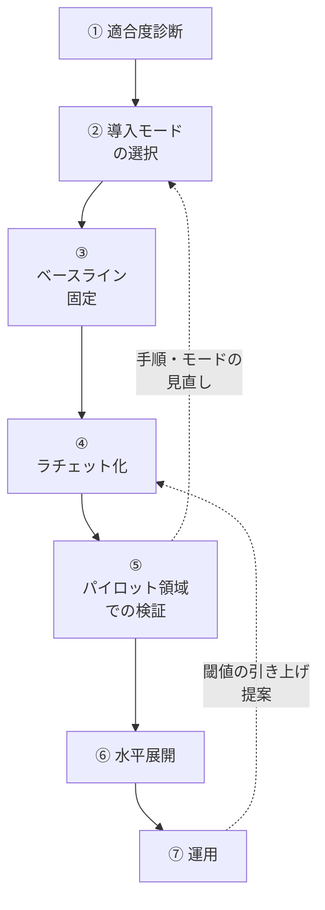
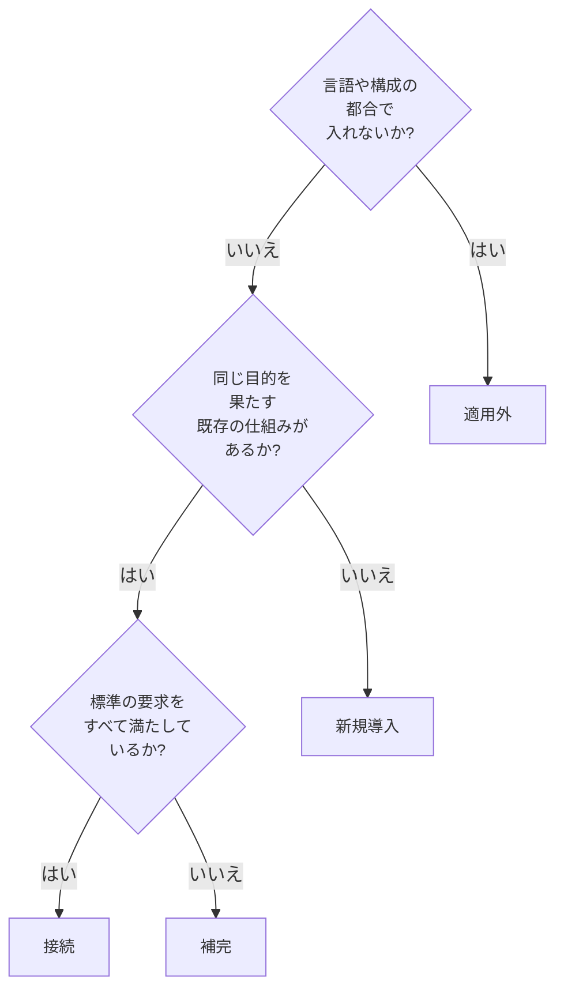

# 05. 既存プロジェクトへの導入手順書

**この文書で決めること**

- 既存プロジェクトへ、既存の運用を止めずに標準を取り込む原則と手順（§1〜§3）
- 導入モードと導入時の例外（適用外・保留・猶予）、見送り、診断テンプレート、ベースライン固定、閾値の引き上げ（§4〜§7）
- やってはいけない例（§8）と、本書の改訂の手順（§9）

| 項目 | 内容 |
|---|---|
| 文書ID | TEST-05 |
| 目的 | 既存のプロジェクトに本標準（01〜04）を、既存の運用を止めずに段階的に取り込む手順を定める |
| 対象 | すでにテスト・静的解析・CI を持つプロジェクト。新規プロジェクトは 01〜04 をそのまま適用すればよい |
| 関連 | [01 基本方針書](./01-test-policy.md) / [02-1 型設計とPBT](./02-1-types-and-pbt.md) / [02-2 実行境界とミューテーション](./02-2-execution-and-mutation.md) / [02-3 E2E 最小化原則](./02-3-e2e.md) / [03 TRSガイドライン](./03-trs-guideline.md) / [03-1 トレーサビリティ検査の詳細](./03-1-traceability-checks.md) / [03-2 TRS 生成フロー](./03-2-generation-flow.md) / [04 リグレッション運用規程](./04-regression-governance.md) |

本書の語（TRS、AC、Open Issue、`@pending`、特性化テスト、Approved など）は、[01 §6 の用語表](./01-test-policy.md#6-用語)で引ける。

> 本書で「（仮）」を付けた例は、説明のための仮の例で、標準の要求ではない。

## 1. 導入の原則

標準の一部はすでに別の形で入っていることが多く、設定をそのままコピーすると重複・衝突して既存の運用も止まる。次の4原則に従う。

1. **既存の仕組みに接続する。** 同じ目的を果たす仕組みがあれば置き換えず、標準のゲート（01 §5 の G0〜G5）の1つとして位置づけ直す。
2. **導入時に赤くしない。** 現状値をベースラインとして固定し、「悪化のみ禁止」にする。標準の閾値（02-2 §2.1 の 80% など）を、導入の初日から課さない。
3. **閾値は実測から始めて、段階的に上げる。** 引き上げの手順は [§7](#7-閾値の引き上げ) に従う。
4. **強制力が弱い環境では、フック・ラチェットで担保する。** 必須チェックを設定できない、CI の整備が途中、などの環境が対象である。
   - Git フック（pre-commit、pre-push など）や、ローカルで実行できるラチェットで代替する。ラチェットとは、悪化を検出して失敗させる仕組みをいう。
   - 強制の経路が弱い箇所は、レビューと責任者の指定（01 §5.1）で補う。
   - 代替の担保手段は、[§3 ④](#3-手順と完了条件) の一覧に書き出す。

AI は導入の各段階で、診断の下書き・ベースラインの実測・引き上げの提案を担える。ただし、次は人間が承認する。

- 導入モードの決定とベースラインの確定（[§3](#3-手順と完了条件) ②③の完了条件）
- 閾値の変更（[§7](#7-閾値の引き上げ) の「承認」）

## 2. 導入の流れ

①〜④で「現状を壊さない土台」を作り、⑤で小さい領域に標準を一周通して実態に合うかを確かめ、⑥で広げ、⑦で運用に乗せる。

## 3. 手順と完了条件

§2 の①〜⑦ごとに、やることと完了条件を定める。

### ① 適合度診断

[§5 のテンプレート](#5-適合度診断テンプレート)を使い、標準の各項目について、現状と差分を書く。

- 完了条件: 診断表の全行が埋まっている。各行の差分欄に、仮の導入モード（[§4.1](#41-導入モード)）が書かれている。人間がレビューしている。

### ② 導入モードの選択

診断の各行について、導入モードを確定する。

- 完了条件: 全行の導入モードが確定している。「接続」の行には、既存の仕組みと標準のゲートの対応が書かれている。「適用外」の行には、[§4.2](#42-導入時の例外) の記録と代替の担保が書かれている。標準の要素を見送る行には、[§4.5](#45-見送り) の記録が書かれている。次の判断事項が、作業を Issue などに起票する前にオーナーへ確認され、結果が記録されている。人間が承認している。
  - 新しい依存の追加の可否
  - 検査ツールの採否
  - TRS（テスト要件仕様書）の置き場所
  - ミューテーションテストの実行頻度

判断事項は、診断の直後に確認する。

新しい依存（ミューテーションテストのツールなど）は、いきなり本導入せず、スパイクを挟む。

1. スパイクとして、小さい範囲で動かすことだけを承認する。
2. スパイクの結果（実行時間、無料枠の消費など）を実測して添える。
3. その実測を見て、本導入を人間が改めて承認する。

### ③ ベースライン固定

[§6](#6-ベースライン固定の対象) の4種について、現状値を実測し、固定先に記録する。

- 完了条件: 4種（該当しないものは「適用外」とし、[§4.2](#42-導入時の例外) の記録を残す）の現状値が固定先に記録されている。固定した時点で、既存のビルド・CI が赤くならない（CI が実行するのと同じタスクで実行して確認している）。人間が承認している。

### ④ ラチェット化

固定値からの悪化を、CI または Git フックで検出して失敗させる。

- 完了条件: 悪化を検出すると失敗することを、意図的に悪化させた変更で一度確認している（確認用の変更はマージしない）。固定値を変更する手順（誰が提案し、誰が承認するか）が記録されている。必須チェックを設定できない環境では、強制力の担保手段が導入先の手順書の一覧に書かれている。

ブランチ保護が使えないなど、必須チェックを設定できない環境では、例えば次の3つで担保する。

| 担保手段（例） | 何を強制するか | 限界 |
|---|---|---|
| プッシュ前フック | ローカルで悪化を検出し、プッシュを止める | 設定は利用者の環境ごとに要り、迂回できる |
| ラチェット | 固定値からの悪化を、テストの失敗として検出する | 必須チェックが無い環境では、CI が赤でもマージを止められない |
| PR テンプレート（不具合還元の DoD） | 不具合還元の完了条件の欄を、PR の作成時に示す | 欄を埋めたかどうかは、人間が確認する |

### ⑤ パイロット領域での検証

小さい領域（1つの機能や1つのパッケージ程度）を選び、標準を一周通す。要件定義書と基本設計書の作成、TRS の生成、入力の合意による AC（受入条件）の確定、テストの紐づけ、ミューテーションによる確認まで行う。G5（TRS 整合）を [§4.1](#41-導入モード) で適用外にした構成では、TRS を生成する代わりに、§4.1 の 3 条件を満たす。G3（ミューテーション）を適用外にした構成では、ミューテーションによる確認の代わりに、② で記録した代替の担保を実施する。

- 完了条件: パイロット領域の TRS が Approved になっている。Approved は、「人が合意する」ものへの合意（03-2 §1）がそろったことを表す。G5（TRS 整合）を通っている。G5 を [§4.1](#41-導入モード) で適用外にした構成では、TRS の Approved と G5 の代わりに、§4.1 の 3 条件を満たしている。誤検知・実行時間・既存運用との摩擦が記録されている。検証は、CI が実行するのと同じタスクで行っている。必要なら、② に戻って導入モードを見直し、その結果が診断表に反映されている。

### ⑥ 水平展開

パイロットの結果を踏まえ、対象領域を広げる。広げる単位（パッケージ、モジュール、機能など）はプロジェクトが決める。

- 完了条件: 展開した領域ごとに、ベースラインが固定され、ラチェットが有効になっている。展開の完了を宣言する単位と日付が記録されている。展開しない領域・機能（保留）がある場合は、[§4.3](#43-保留) に従い、対象・理由・再評価のトリガーが記録されている。

### ⑦ 運用

引き上げの提案、不具合還元（04 §2）、診断表の更新を、定常の運用にする。

- 完了条件: 閾値の引き上げを提案する契機と担当（AI または CI）、承認者（人間）が決まっている。診断表を見直す周期が決まっている。これは継続する運用であり、完了条件は「運用の仕組みが動いている」ことである。

## 4. 導入モードと導入時の例外

### 4.1 導入モード

診断の各項目に、次の4つのうち1つを割り当てる。

| モード | 状況 | 対応 |
|---|---|---|
| 新規導入 | 該当する仕組みが無い | 標準のものを入れる。ただし閾値は §1 の原則2・3に従う |
| 接続 | 既存の仕組みが同じ目的を果たしている | 置き換えない。標準のゲート（G0〜G5）の1つとして位置づけ直し、対応を記録する |
| 補完 | 既存の仕組みが部分的に満たしている | 足りない部分だけを足す |
| 適用外 | 言語や構成の都合で入れない | 理由を記録し、代替の担保を決める（記録の形式は [§4.2](#42-導入時の例外)） |

「接続」と「補完」では、既存の検査を黙って弱めたり置き換えたりしない。既存の検査が標準より厳しい箇所は、そのまま維持する。

G0（文書検査）の対象範囲（01 §5 の「全 `.md`」）は、導入先では診断（§3 ①）で決める。G0 を対象にしないなら、上の「適用外」の手順（[§4.2](#42-導入時の例外) の記録と代替の担保）による。

受入条件が、テストとして実行される形式（例: Gherkin）の文書に、TRS の代わりに書かれている構成は、G5（TRS 整合）を「適用外」にする、構成の都合に当たる。受入条件を TRS に二重に起こしても、品質は上がらないためである。この場合に「適用外」と認めるのは、次の 3 つをすべて満たすときである。

1. 仕様と、受入条件を持つ文書の対応を、検査が確かめている。
2. [§4.2](#42-導入時の例外) の記録がある。
3. その形式のテストと、1 の検査を実行して、どちらも通る。

1 の検査は、受入条件ごとに対応する実行可能なテストがあることを、[03 §3.4](./03-trs-guideline.md#34-トレーサビリティ) の ① ⑦ に相当する失敗条件で確かめる。

### 4.2 導入時の例外

導入時の例外は、既存プロジェクトへの導入のときに、標準の全部を初日から課さないと決めたものである。種類は次の3つで、互いに重ならない。

| 種類 | 意味 | 手順 |
|---|---|---|
| 適用外 | 標準の要素を外す。入れない理由は、言語や構成の都合である | §4.1 の導入モード「適用外」 |
| 保留 | 展開の範囲（領域・機能）を、今回は入れない | [§4.3](#43-保留) |
| 猶予 | 標準の要素は入れるが、仕組み化・評価軸・頻度を一時的に緩める | [§4.4](#44-猶予) |

3種とも、次の3点を記録する。適用外は、これに加えて、§4.1 のとおり代替の担保を決めて記録する。

1. 対象: 何を外す、入れない、または緩めるか。
2. 理由: なぜ今はそうするか。
3. 再評価のトリガー: 何が起きたら見直すか。

### 4.3 保留

展開の範囲（領域・機能）のうち、「今回は入れない」と決めたものが保留である。

- 保留できるのは、展開の範囲だけである。標準の要素そのものを外すときは、保留ではなく §4.1 の「適用外」か [§4.5](#45-見送り) の「見送り」の手順によるか、オーナーの判断を得る。
- 例（仮）: 対象は管理画面の集計機能。理由は、利用実績が無く、今は仕様を確定できないこと。再評価のトリガーは、利用の開始が決まったとき。

### 4.4 猶予

標準の要素は入れたうえで、一時的に緩めてよいのは次の2つである。緩めたものは、§4.2 の3点で記録する。

- ミューテーションの PR の評価軸と、全体実行の頻度: [§4.4.1](#441-ミューテーションの評価軸と頻度)
- 運用の仕組み化の起票: [§4.4.2](#442-運用の仕組み化の起票)

#### 4.4.1 ミューテーションの評価軸と頻度

既存プロジェクトへの導入時に限り、次の2項目を、項目ごとに変えてよい。この猶予が変えるのは、この2項目だけである。

| 項目 | 通常（02-2 §2.1 冒頭の表） | 猶予 |
|---|---|---|
| PR の評価軸（差分実行） | Mutation Score | テストの強度 |
| 全体実行の頻度 | 夜間 | 週次 |

全体実行の評価軸は、週次にしても Mutation Score のままである。テストの強度は、カバー済みのミュータントのうち殺せた割合である。

PR の評価軸を猶予したときの、ベースラインの固定の仕方は [§6](#mutation-score-の固定と評価軸の猶予) による。

閾値の値は、この猶予の対象外である。導入時の閾値の値は、§1 の原則 2・3 と、02-2 §2.1 の「引き下げは人間の承認」による。

この猶予は、使う項目ごとに、次の表の条件を満たす場合に限る。2項目とも使うなら、すべての条件を満たす。

| 条件 | 評価軸を変える | 頻度を変える |
|---|---|---|
| 1. 補う手段 | 要る | 要らない |
| 2. 記録 | 要る | 要る |
| 3. 復帰の再評価のきっかけ | 全体実行の Mutation Score が安定する | 全体実行の所要時間・費用が夜間に収まる |

各条件の内容は次のとおり。

1. **補う手段**: テストの無い新規・変更クラスを PR で落とす手段を置く。テストの無いクラスのミュータントは、強度の評価に含まれないため、差分実行を通り抜ける。実装は導入先に任せる。頻度だけを変えるときに要らないのは、PR の評価軸が Mutation Score のままだからである。
2. **記録**: 猶予にした理由と再評価のトリガーを、§4.2 の形式（対象・理由・再評価のトリガー）で残す。再評価のトリガーの具体の値は、導入先がこの記録に書く。
3. **復帰の再評価**: きっかけが来たら、その項目を 02-2 §2.1 冒頭の表に戻すかを再評価する。頻度のきっかけを所要時間・費用にするのは、週次にする理由がそれだからである。

#### 4.4.2 運用の仕組み化の起票

既存プロジェクトへの導入時は、次の2つの運用の仕組み化を、導入の作業として起票しなくてよい。

- 04 §3 の AI ヒーリングの運用の仕組み化（履歴レビューの定例化、機械検証の実装など）
- 04 §5 の運用リズムと指標のうち、機械検証の手段が無い項目（ヒーリング履歴のレビュー、指標のレビューなど）

この猶予には、次の条件がある。

- 猶予できるのは、規程が破られた実績も機械検証の手段も無い間に限る。
- 再評価のトリガーは「初めて破られた」または「検証手段を導入した」とする。破られた後は、起票しない判断を続けない。
- 猶予の範囲は、運用の仕組み化の起票に限る。

次は猶予しない。

- AI ヒーリングを行う場合の 04 §3.1〜§3.5（§3.4 の絶対禁止事項を含む）の適用。導入初日から猶予しない。
- 04 §5 のうち、次の3項目。
  - PR ごとの不具合還元 PR の DoD 確認
  - ヒーリング PR の区分確認（AI ヒーリングを行う場合）
  - 全体ミューテーション（02-2 §2.1）。頻度の猶予は §4.4.1 による。

### 4.5 見送り

見送りは、標準の要素を、コストに見合わないと導入先が判断して入れないことである。見送りは導入時の例外（§4.2）ではない。見送った要素は、標準を満たしたことにならない。本節は、§4.4 の猶予を変えない。

見送ってよい理由は、コストとのトレードオフだけである。コストは、実行時間・維持の手間・偽陽性などである。

不具合の実例が無いことと、違反が 0 件であることは、見送りの理由にならない。予防の仕組みは、まだ起きていない失敗を落とすために置くからである。

標準の要素を入れない理由ごとの扱いは、次のとおりである。

| 入れない理由 | 扱い | 標準を満たすか |
|---|---|---|
| 言語や構成の都合 | 適用外（§4.1） | §4.2 の記録と代替の担保による |
| 別の形の既存の担保が、同じ失敗を落とす | 接続（§1 の原則 1、§4.1） | 下の条件 1・2 を満たせば、満たす |
| コストに見合わない | 見送り | 満たさない |
| 実例が無い、違反が 0 件 | 理由にならない | 満たさない |

標準の要素が求める仕組みの代わりに、別の形の既存の担保を挙げるときは、次の 2 つを満たすときだけ代わりにする。§4.1 の接続の一般の扱いは、この規則で変えない。

1. 同じ失敗を落とすことを、実測で示している。
2. その担保と、それを実行する経路が、リポジトリのファイルで定義されている。

条件 1 の細目は次のとおりである。

- 実測の例: その違反をわざと入れると、既存の検査が失敗する。確認用の変更の扱いは §3 ④ と同じである。
- 実測した違反の種類と置き場、失敗した検査を記録する。
- 代わりになるのは、記録した違反の種類と置き場の範囲だけである。

条件 2 の細目は次のとおりである。

- 実行する経路は、PR に対して走る検査の定義か、フックを自動で有効にする定義である。後者の例は、ビルドや依存の導入のときにフックの置き場を設定することである。
- 自動で有効になるフックは、CI の有無を問わず認める。
- 各自が手で入れるフックと、どこからも呼ばれない検査は、条件 2 を満たさない。

条件 1・2 のどちらかを満たさないときは、その担保を代わりにしない。要素を入れるか、見送りとして記録する。

見送りは、§4.2 の 3 点（対象・理由・再評価のトリガー）で記録する。理由には、比べたコストを書く。

## 5. 適合度診断テンプレート

次の表を診断結果の置き場にコピーして埋める。「標準の要求」欄は、本標準の参照先であり、書き換えない。「差分と導入モード」欄には、標準との差分と、[§4.1](#41-導入モード) の導入モード（新規導入 / 接続 / 補完 / 適用外）を書く。見送る行の「差分と導入モード」欄には、導入モードの代わりに「見送り」と書き、[§4.5](#45-見送り) の記録の置き場を書く。

| 項目 | 標準の要求（参照先） | 現状 | 差分と導入モード |
|---|---|---|---|
| G0 Markdown 検査 | 全 `.md` の lint と Mermaid のレンダリング。ただし対象範囲は診断で決める（01 §5） |  |  |
| G1 静的検査 | 型チェック・Lint がエラー 0（01 §5、02-2 §3） |  |  |
| G2 層1テスト | Unit・PBT 全件成功（01 §5、02-1 §3・02-2 §1） |  |  |
| G3 ミューテーション | 変更ファイルの Mutation Score が閾値以上（01 §5、02-2 §2） |  |  |
| G4 層2テスト | Integration・E2E 全件成功。層1と実行境界を分ける（01 §5、02-2 §1.2） |  |  |
| G5 TRS 整合 | 要件定義書・基本設計書・TRS・テストの対応が、[03 §3.4](./03-trs-guideline.md#34-トレーサビリティ)の検査を通る（01 §5） |  |  |
| 型ガードレール | プリミティブ型の排除、コンストラクタ防御、状態を閉じた型で表すことと分岐の網羅（02-1 §2） |  |  |
| アーキテクチャ検査 | 層の依存方向・禁止パターンの機械的な検査（02-2 §3） |  |  |
| テスト保護 | テストの無効化を検出して失敗させる。意図的な無効化は例外手順（02-2 §3、04 §3.4.1） |  |  |
| 不具合還元 | 還元先の選定と完了条件を、不具合の記録と PR で強制する（04 §2） |  |  |

記入の注意:

- 「現状」には、ツール名・設定ファイル・実行コマンド・現在の結果を書く。推測で埋めず、実際に実行して確認した事実を書く。
- 「標準の要求」を満たしているかどうかは、名前の一致ではなく、検出できるものの一致で判断する（同じ名前の仕組みでも、検査の範囲が狭いことがある）。
- G0〜G5 の「現状」は、01 §5.1 の実現例とプロジェクトの環境で異なってよい。診断の対象は標準の要求であり、ツール選定ではない。
- 標準を入れること自体が、既存の検査（文書のサイズ上限を測るラチェットなど）を赤くしないか、診断の段階で確認するとよい。

### 記入例（仮）

実在のプロジェクトのものではない、仮の記入例である。

| 項目 | 標準の要求（参照先） | 現状 | 差分と導入モード |
|---|---|---|---|
| G1 静的検査 | 型チェック・Lint がエラー 0（01 §5、02-2 §3） | 静的解析ツールを導入済み。違反が 40 件ある | 既存の違反が残る。補完（件数をベースラインに固定し、悪化のみ禁止する） |
| G3 ミューテーション | 変更ファイルの Mutation Score が閾値以上（01 §5、02-2 §2） | 無い | 仕組みが無い。新規導入（まずスパイクで実行時間を実測する） |

## 6. ベースライン固定の対象

導入時に現状値を固定し、悪化のみを禁止する対象は次の4種である。ツール名は例示であり、プロジェクトが使っているものを使う。各ツールの設定方法・出力形式は、それぞれの公式ドキュメントで確認する。

| 種類 | 測り方 | 固定先 | 悪化の定義 |
|---|---|---|---|
| 静的解析の既存違反件数 | 静的解析ツール（例: JS/TS の ESLint、Python の Ruff）の出力から、ルール別または全体の違反件数を数える。アーキテクチャ検査（例: JVM の ArchUnit、JS/TS の dependency-cruiser）・テスト保護の既存違反も含める | ツールのベースライン機能（あれば）、または件数を記録したファイルをリポジトリに置く | (1) か (2) をプロジェクトが選んで記録する（[下記](#静的解析の悪化の定義)） |
| カバレッジ | カバレッジ計測（例: JVM の JaCoCo、Python の coverage.py）で、行またはブランチのカバレッジ率を測る。全体か変更ファイル単位かはプロジェクトが決める | CI の検証ルールの設定値、または率を記録したファイル | 固定値を下回る |
| Mutation Score | ミューテーションテスト（例: JVM の PIT、JS/TS の Stryker）の Mutation Score を測る。導入直後は全体の夜間実行で実測し、PR では変更ファイルのみを対象にする（02-2 §2.1。評価軸と頻度の猶予は [§4.4.1](#441-ミューテーションの評価軸と頻度)） | CI の閾値設定、または実測値を記録したファイル | 固定値を下回る。評価軸を猶予したときの指標は[下記](#mutation-score-の固定と評価軸の猶予) |
| TRS に紐づかない AC・テストの数 | (a)・(b) を別々に数える（[下記](#trs-に紐づかない-acテストの数)） | 件数を記録したファイル | (a)・(b) のどちらかが固定値を超える |

### 静的解析の悪化の定義

次のどちらかを、プロジェクトが選んで記録する。

- (1) 固定済みの既存分を除く新規の違反が出たら、悪化とする。ツールのベースライン機能を使う場合は、こちらになる。
- (2) 件数が固定値を超えたら、悪化とする。

両者は別の基準である。(2) は、既存の違反を直して件数に余裕ができると、その分だけ新規の違反を許す。

### Mutation Score の固定と評価軸の猶予

PR の評価軸を猶予したとき（[§4.4.1](#441-ミューテーションの評価軸と頻度)）は、実行ごとに、評価に使う指標でベースラインを固定する。PR の評価軸を猶予しないときは、上の表のとおり Mutation Score で固定する。

| 実行 | 固定する指標 |
|---|---|
| PR の差分実行 | テストの強度 |
| 全体実行 | Mutation Score（§4.4.1 のとおり） |

- 悪化の定義は、どちらも固定値を下回ることである。2つの指標は別の値なので、別々に固定する。
- 理由は、固定する指標と評価に使う指標が一致し、食い違いが出ないことである。テストの強度だけを固定すると、全体実行の Mutation Score に悪化を止める基準が無くなる。

### TRS に紐づかない AC・テストの数

次の (a)・(b) を別々に数える。

- (a) 紐づくテストが無い AC の数。数え方は、03-1 §2 の ① に従う（`@pending` の AC は数えない）。03 §3.4 の紐づけ検査が測るのは、この (a) だけである。
- (b) 次のどれでもないテストの数。
  - AC に紐づく（テスト名に AC の ID を付ける。書式は 03-1 §1）。
  - 技術的な不変条件（PBT 等）であると明記している。
  - 特性化テスト（03 §3.3）であると、`characterization` で明示している。

(a) の固定値は、03 §3.4 の紐づけ検査をそのまま入れる場合は 0 になる。0 以外で固定するなら、件数で比べる検査を別に用意する。(b) は別途、測る手段を用意する。

導入後に追加するものには、次の規則を課す。

- 新規に追加する AC は、紐づくテストを必須とする（03 §3.4）。
- 新規のテストは、上の (b) の 3 つのどれかに当たるものにする（03 §3.3、§3.4）。

### 補足

- `@pending:<OI-ID>` は、ベースラインの除外には使わない。付けられるのは、期待値が人間の決定待ちの AC だけである。実装待ちの AC には付けない。書ける ID と付けてよい AC は、[03-1 §2 の ③](./03-1-traceability-checks.md#2-各検査の詳細)で定める。
- 既存のテストには AC が無い。
  - 既存の挙動から期待値を逆生成して AC にしてはならない（03 §3.2）。
  - 仕様が不明なレガシーは、特性化テスト（03 §3.3）で現状を把握し、疑わしい挙動を Open Issue として起票する。
  - 特性化テストの件数を別に数えて AC への昇格を追うかどうかは、プロジェクトが選ぶ。
- Mutation Score は、導入直後に実測すると低く出ることが多い。低い値をそのまま固定する（標準の閾値で赤くしない）。
- 固定値は、実測した時点の値であり、目標ではない。目標への引き上げは [§7](#7-閾値の引き上げ) に従う。

## 7. 閾値の引き上げ

固定値や閾値は、悪化を禁止するだけでは改善されない。実測に合わせて、段階的に引き上げる。

| 項目 | ルール |
|---|---|
| 提案 | AI または CI が行う（実測値と根拠を添えた PR や通知） |
| 承認 | 人間が行う。AI が単独で閾値を引き上げて確定させてはならない。AI の単独マージは不可 |
| 契機 | 実測が閾値を一定期間上回り続けたとき。または、対象領域の水平展開（§3 ⑥）が完了したとき |
| 引き上げ幅・期間 | 本書では固定しない。プロジェクトごとに決めて記録する（02-2 §2.1 の初期値は仮置きの値で、見直しは 04 §5.2 による） |
| 引き下げ | 原則禁止。やむを得ない場合は、04 §3.4.1 に準じる（理由、原因 Issue の番号、見直しの期限を PR と設定のコメントに書き、人間が PR で承認する。AI が単独で承認・変更してはならない） |

承認の補足は、次のとおりである。

- 承認を人間に限るのは本書の規則で、01 §4 の責務分離（AI は提案し、人間が承認する）の考え方を、閾値にも当てはめたものである。
- 導入先では、§1 原則 4 に従い、責任者を指定する。例は、閾値の設定ファイルを、コードオーナーの承認が要る対象にすることである。
- 厳格化側の更新（件数が減る、閾値が上がる）は、その変更を含む PR を人間が承認すれば足りる。

本書は手順を述べるだけで、閾値そのものを変更しない。

## 8. やってはいけない例

| やってはいけない例 | 理由 | 代わりにやること |
|---|---|---|
| 導入時に標準の閾値（02-2 §2.1 の 80% など）を課す | 既存のビルド・CI が赤くなり、運用が止まる。赤いままの検査は無視される | 現状値をベースラインに固定し、悪化のみを禁止する（§6） |
| 既存の検査を黙って置き換える | 既存の検査にしかない検出能力が失われる。置き換えの影響を誰も確認していない | 接続または補完にする。置き換えるなら理由を記録し、人間が承認する（§4） |
| 設定を診断せずにコピーする | 既存の仕組みと重複・衝突する | 先に診断し、導入モードを決める（§3 ①②） |
| ベースラインを通すために固定値を緩める | 悪化の隠蔽になる | 引き下げは 04 §3.4.1 に準じる（§7） |
| 既存の挙動から AC の期待値を作る | 期待値の正は仕様である（03 §3.2） | 特性化テストと Open Issue で扱い、人間が正誤を判断してから AC に昇格する（03 §3.3） |
| ベースライン違反を一括で抑制する（抑制の注釈やコメントの一括追加など） | 新規の違反と区別できなくなる | ツールのベースライン機能か、件数の固定で既存分を区別する |
| 全領域に一度に展開する | 問題が出たとき、原因の切り分けと巻き戻しが難しい | パイロットを経て、領域ごとに広げる（§3 ⑤⑥） |
| 導入の検証を、ローカルで回したタスクだけで済ませる | CI が別に回すタスク（E2E など）で初めて落ち、導入後に赤くなる | §3 ③⑤ の完了条件に従う |
| 失敗するテストを無効化してラチェットを通す | 検査の弱体化である（04 §3.4） | 原因を直す。やむを得ない場合は 04 §3.4.1 の例外手順に従う |

## 9. 改訂

本書の改訂は PR で行い、人間のレビュー承認を必須とする。AI が単独で本ドキュメントを変更してはならない。
