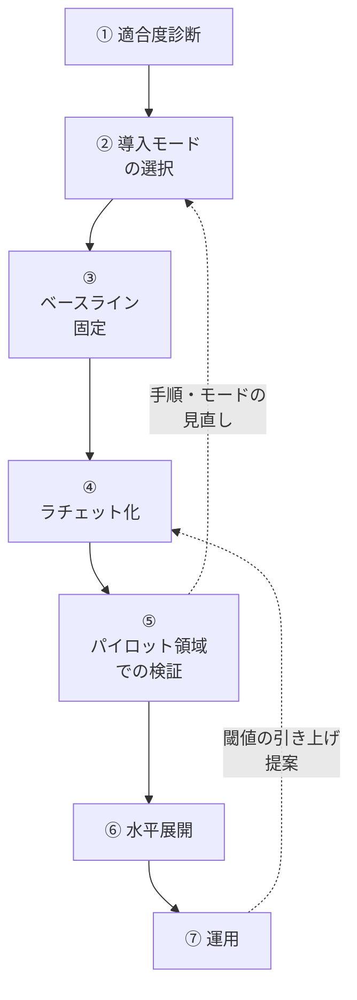
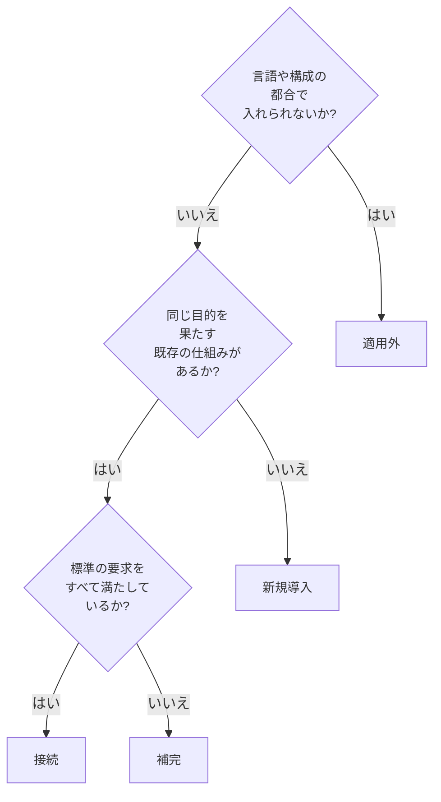

# 05. 既存プロジェクトへの導入手順書

**この文書で決めること**

- 既存プロジェクトへ、既存の運用を止めずに標準を取り込む原則と手順（§1〜§3）
- 導入モード、診断テンプレート、ベースライン固定、閾値の引き上げ（§4〜§7）
- やってはいけない例（§8）と、本書の改訂の手順（§9）

| 項目 | 内容 |
|---|---|
| 文書ID | TEST-05 |
| 目的 | 既存のプロジェクトに本標準（01〜04）を、既存の運用を止めずに段階的に取り込む手順を定める |
| 対象 | すでにテスト・静的解析・CI を持つプロジェクト。新規プロジェクトは 01〜04 をそのまま適用すればよい |
| 関連 | [01 基本方針書](./01-test-policy.md) / [02a 型設計とPBT](./02a-types-and-pbt.md) / [02b 層1の実行境界とミューテーション](./02b-execution-and-mutation.md) / [02c E2E 最小化原則](./02c-e2e.md) / [03 TRSガイドライン](./03-trs-guideline.md) / [04 リグレッション運用規程](./04-regression-governance.md) |

> 本書で「（仮）」を付けた例は、説明のための仮の例で、標準の要求ではない。

## 1. 導入の原則

標準の一部はすでに別の形で入っていることが多く、設定をそのままコピーすると重複・衝突して既存の運用も止まる。次の4原則に従う。

1. **既存の仕組みに接続する。** 同じ目的を果たす仕組みがあれば置き換えず、標準のゲート（01 §5 の G0〜G5）の1つとして位置づけ直す。
2. **導入時に赤くしない。** 現状値をベースラインとして固定し、「悪化のみ禁止」にする。標準の閾値（02b §4.1 の 80% など）を、導入の初日から課さない。
3. **閾値は実測から始めて、段階的に上げる。** 引き上げの手順は [§7](#7-閾値の引き上げ) に従う。
4. **強制力が弱い環境では、フック・ラチェットで担保する。** 必須チェックを設定できない、CI の整備が途中、などの環境では、Git フック（pre-commit、pre-push など）やローカルで実行できるラチェット（悪化を検出して失敗させる仕組み）で代替する。強制の経路が弱い箇所は、レビューと責任者の指定（01 §5.1）で補う。代替の担保手段は、[§3 ④](#3-手順と完了条件) の一覧に書き出す。

AI は導入の各段階で、診断の下書き・ベースラインの実測・引き上げの提案を担える。ただし、導入モードの決定とベースラインの確定は人間が承認する（[§3](#3-手順と完了条件) ②③の完了条件）。閾値の変更も人間が承認する（[§7](#7-閾値の引き上げ) の「承認」）。

## 2. 導入の流れ

①〜④で「現状を壊さない土台」を作り、⑤で小さい領域に標準を一周通して実態に合うかを確かめ、⑥で広げ、⑦で運用に乗せる。

## 3. 手順と完了条件

§2 の①〜⑦ごとに、やることと完了条件を定める。

### ① 適合度診断

[§5 のテンプレート](#5-適合度診断テンプレート)を使い、標準の各項目について、現状と差分を書く。

- 完了条件: 診断表の全行が埋まっている。各行の差分欄に、仮の導入モード（[§4](#4-導入モード)）が書かれている。人間がレビューしている。

### ② 導入モードの選択

診断の各行について、導入モードを確定する。

- 完了条件: 全行の導入モードが確定している。「接続」の行には、既存の仕組みと標準のゲートの対応が書かれている。「適用外」の行には、理由と代替の担保が書かれている。次の判断事項が、作業を Issue などに起票する前にオーナーへ確認され、結果が記録されている。人間が承認している。
  - 新しい依存の追加の可否
  - 検査ツールの採否
  - TRS（テスト要件仕様書）の置き場所
  - ミューテーションテストの実行頻度

判断事項は、診断の直後に確認する。

新しい依存（ミューテーションテストのツールなど）は、いきなり本導入せず、スパイクを挟む。

1. スパイクとして、小さい範囲で動かすことだけを承認する。
2. スパイクの結果（実行時間、無料枠の消費など）を実測して添える。
3. その実測を見て、本導入を人間が改めて承認する。

### ③ ベースライン固定

[§6](#6-ベースライン固定の対象) の4種について、現状値を実測し、固定先に記録する。

- 完了条件: 4種（該当しないものは「適用外」と理由）の現状値が固定先に記録されている。固定した時点で、既存のビルド・CI が赤くならない（CI が実行するのと同じタスクで実行して確認している）。人間が承認している。

### ④ ラチェット化

固定値からの悪化を、CI または Git フックで検出して失敗させる。

- 完了条件: 悪化を検出すると失敗することを、意図的に悪化させた変更で一度確認している（確認用の変更はマージしない）。固定値を変更する手順（誰が提案し、誰が承認するか）が記録されている。必須チェックを設定できない環境では、強制力の担保手段が導入先の手順書の一覧に書かれている。

ブランチ保護が使えないなど、必須チェックを設定できない環境では、例えば次の3つで担保する。

| 担保手段（例） | 何を強制するか | 限界 |
|---|---|---|
| プッシュ前フック | ローカルで悪化を検出し、プッシュを止める | 設定は利用者の環境ごとに要り、迂回できる |
| ラチェット | 固定値からの悪化を、テストの失敗として検出する | 必須チェックが無い環境では、CI が赤でもマージを止められない |
| PR テンプレート（不具合還元の DoD） | 不具合還元の完了条件の欄を、PR の作成時に示す | 欄を埋めたかどうかは、人間が確認する |

### ⑤ パイロット領域での検証

小さい領域（1つの機能や1つのパッケージ程度）を選び、標準を一周通す。TRS の起草、AC（受入条件）の確定、テストの紐づけ、ミューテーションによる確認まで行う。

- 完了条件: パイロット領域の TRS が人間の承認を得ており、G5（TRS 整合）を通っている。誤検知・実行時間・既存運用との摩擦が記録されている。検証は、CI が実行するのと同じタスクで行っている。必要なら、② に戻って導入モードを見直し、その結果が診断表に反映されている。

### ⑥ 水平展開

パイロットの結果を踏まえ、対象領域を広げる。広げる単位（パッケージ、モジュール、機能など）はプロジェクトが決める。

- 完了条件: 展開した領域ごとに、ベースラインが固定され、ラチェットが有効になっている。展開の完了を宣言する単位と日付が記録されている。展開しない領域・機能（据置）がある場合は、[§4](#4-導入モード) の「据置の記録」に従い、対象・理由・再評価のトリガーが記録されている。

### ⑦ 運用

引き上げの提案、不具合還元（04 §2）、診断表の更新を、定常の運用にする。

- 完了条件: 閾値の引き上げを提案する契機と担当（AI または CI）、承認者（人間）が決まっている。診断表を見直す周期が決まっている。これは継続する運用であり、完了条件は「運用の仕組みが動いている」ことである。

## 4. 導入モード

診断の各項目に、次の4つのうち1つを割り当てる。

| モード | 状況 | 対応 |
|---|---|---|
| 新規導入 | 該当する仕組みが無い | 標準のものを入れる。ただし閾値は §1 の原則2・3に従う |
| 接続 | 既存の仕組みが同じ目的を果たしている | 置き換えない。標準のゲート（G0〜G5）の1つとして位置づけ直し、対応を記録する |
| 補完 | 既存の仕組みが部分的に満たしている | 足りない部分だけを足す |
| 適用外 | 言語や構成の都合で入れない | 理由を記録し、代替の担保を決める |

「接続」と「補完」では、既存の検査を黙って弱めたり置き換えたりしない。既存の検査が標準より厳しい箇所は、そのまま維持する。

G0（文書検査）の対象範囲（01 §5 の「全 `.md`」）は、導入先では診断（§3 ①）で決める。G0 を対象にしないなら、上の「適用外」の手順（理由と代替の担保の記録）による。

導入期の評価軸の例外は、02b §4.1 の「導入期の例外（評価軸）」による。

### 据置の記録

展開の範囲（領域・機能）のうち、「今回は入れない」と決めたもの（据置）は、導入モードとは別に、次の3点を記録する。

1. 対象: 何を入れないか。
2. 理由: なぜ今は入れないか。
3. 再評価のトリガー: 何が起きたら見直すか。

- 据置は「導入範囲に入れない」意味で、02b §4.1 の「据え置き」（閾値を変えない）とは別である。
- 据置は「適用外」（入れない理由が言語や構成の都合）とも違う。標準の要素そのものを外すときは、据置ではなく §4 の「適用外」の手順によるか、オーナーの判断を得る。
- 例（仮）: 対象は管理画面の集計機能。理由は、利用実績が無く、今は仕様を確定できないこと。再評価のトリガーは、利用の開始が決まったとき。

運用フェーズの不起票は、据置そのものではない。運用フェーズとは、04 §3 の AI ヒーリングの運用の仕組み化（履歴レビューの定例化、機械検証の実装など）と、04 §5 の運用リズムと指標である。

- 破られた実績も機械検証の手段も無い間に限り、据置の記録と同じ形式の記録を条件に、運用の仕組み化を導入の作業として起票しない判断を許容する。
- 不起票は、04 §3・04 §5 が認める例外である。再評価のトリガーは「初めて破られた」または「検証手段を導入した」である。
- 免除の範囲は 04 §3・04 §5 に従う（AI ヒーリングを行う場合の 04 §3.1〜§3.5 は免除しない）。

## 5. 適合度診断テンプレート

次の表を診断結果の置き場にコピーして埋める。「標準の要求」欄は、本標準の参照先であり、書き換えない。「差分と導入モード」欄には、標準との差分と、[§4](#4-導入モード) の導入モード（新規導入 / 接続 / 補完 / 適用外）を書く。

| 項目 | 標準の要求（参照先） | 現状 | 差分と導入モード |
|---|---|---|---|
| G0 Markdown 検査 | 全 `.md` の lint と Mermaid のレンダリング。ただし対象範囲は診断で決める（01 §5） |  |  |
| G1 静的検査 | 型チェック・Lint がエラー 0（01 §5、02b §6） |  |  |
| G2 層1テスト | Unit・PBT 全件成功（01 §5、02a §2・02b §3） |  |  |
| G3 ミューテーション | 変更ファイルの Mutation Score が閾値以上（01 §5、02b §4） |  |  |
| G4 層2テスト | Integration・E2E 全件成功。層1と実行境界を分ける（01 §5、02b §3.2） |  |  |
| G5 TRS 整合 | AC に紐づくテストが存在し、未解決の Blocking な Open Issue が指す AC に `@pending:<OI-ID>` が付いている。書ける ID と付けてよい AC は [03 §3.4.2 の ③](./03-trs-guideline.md#342-各検査の詳細) で定める（01 §5） |  |  |
| 型ガードレール | プリミティブ型の排除、コンストラクタ防御、状態を閉じた型で表すことと分岐の網羅（02a §1） |  |  |
| アーキテクチャ検査 | 層の依存方向・禁止パターンの機械的な検査（02b §6） |  |  |
| テスト保護 | テストの無効化を検出して失敗させる。意図的な無効化は例外手順（02b §6、04 §3.4.1） |  |  |
| 不具合還元 | 還元先の選定と完了条件を、不具合の記録と PR で強制する（04 §2） |  |  |

記入の注意:

- 「現状」には、ツール名・設定ファイル・実行コマンド・現在の結果を書く。推測で埋めず、実際に実行して確認した事実を書く。
- 「標準の要求」を満たしているかどうかは、名前の一致ではなく、検出できるものの一致で判断する（同じ名前の仕組みでも、検査の範囲が狭いことがある）。
- G0〜G5 の「実装状況」は、01 §5.1 の実現例とプロジェクトの環境で異なってよい。診断の対象は標準の要求であり、ツール選定ではない。
- 標準を入れること自体が、既存の検査（文書のサイズ上限を測るラチェットなど）を赤くしないか、診断の段階で確認するとよい。

### 記入例（仮）

実在のプロジェクトのものではない、仮の記入例である。

| 項目 | 標準の要求（参照先） | 現状 | 差分と導入モード |
|---|---|---|---|
| G1 静的検査 | 型チェック・Lint がエラー 0（01 §5、02b §6） | 静的解析ツールを導入済み。違反が 40 件ある | 既存の違反が残る。補完（件数をベースラインに固定し、悪化のみ禁止する） |
| G3 ミューテーション | 変更ファイルの Mutation Score が閾値以上（01 §5、02b §4） | 無い | 仕組みが無い。新規導入（まずスパイクで実行時間を実測する） |

## 6. ベースライン固定の対象

導入時に現状値を固定し、悪化のみを禁止する対象は次の4種である。ツール名は例示であり、プロジェクトが使っているものを使う。各ツールの設定方法・出力形式は、それぞれの公式ドキュメントで確認する。

| 種類 | 測り方 | 固定先 | 悪化の定義 |
|---|---|---|---|
| 静的解析の既存違反件数 | 静的解析ツール（例: ESLint〔JS/TS〕、Ruff〔Python〕）の出力から、ルール別または全体の違反件数を数える。アーキテクチャ検査（例: ArchUnit〔JVM〕、dependency-cruiser〔JS/TS〕）・テスト保護の既存違反も含める | ツールのベースライン機能（あれば）、または件数を記録したファイルをリポジトリに置く | (1) か (2) をプロジェクトが選んで記録する（[下記](#静的解析の悪化の定義)） |
| カバレッジ | カバレッジ計測（例: JaCoCo〔JVM〕、coverage.py〔Python〕）で、行またはブランチのカバレッジ率を測る。全体か変更ファイル単位かはプロジェクトが決める | CI の検証ルールの設定値、または率を記録したファイル | 固定値を下回る |
| Mutation Score | ミューテーションテスト（例: PIT〔JVM〕、Stryker〔JS/TS〕）の Mutation Score を測る。導入直後は全体の夜間実行で実測し、PR では変更ファイルのみを対象にする（02b §4.1。頻度は導入期の例外も参照） | CI の閾値設定、または実測値を記録したファイル | 固定値を下回る |
| TRS に紐づかない AC・テストの数 | (a)・(b) を別々に数える（[下記](#trs-に紐づかない-acテストの数)） | 件数を記録したファイル | (a)・(b) のどちらかが固定値を超える |

### 静的解析の悪化の定義

次のどちらかを、プロジェクトが選んで記録する。

- (1) 固定済みの既存分を除く新規の違反が出たら、悪化とする。ツールのベースライン機能を使う場合は、こちらになる。
- (2) 件数が固定値を超えたら、悪化とする。

両者は別の基準である。(2) は、既存の違反を直して件数に余裕ができると、その分だけ新規の違反を許す。

### TRS に紐づかない AC・テストの数

次の (a)・(b) を別々に数える。

- (a) 紐づくテストが無い AC の数。03 §3.4 の紐づけ検査が測るのは、この (a) だけである。
- (b) 次のどれでもないテストの数。
  - AC に紐づく（テスト名の先頭が AC の ID である）。
  - 技術的な不変条件（PBT 等）であると明記している。
  - 特性化テスト（03 §3.3）であると、`characterization` で明示している。

(a) の固定値は、03 §3.4 の紐づけ検査をそのまま入れる場合は 0 になる。0 以外で固定するなら、件数で比べる検査を別に用意する。(b) は別途、測る手段を用意する。

導入後に追加するものには、次の規則を課す。

- 新規に追加する AC は、紐づくテストを必須とする（03 §3.4）。
- 新規のテストは、上の (b) の 3 つのどれかに当たるものにする（03 §3.3、§3.4）。

### 補足

- `@pending:<OI-ID>` は、ベースラインの除外には使わない。付けられるのは、期待値が人間の決定待ちの AC だけである。実装待ちの AC には付けない。書ける ID と付けてよい AC は、[03 §3.4.2 の ③](./03-trs-guideline.md#342-各検査の詳細)で定める。
- 既存のテストには AC が無い。
  - 既存の挙動から期待値を逆生成して AC にしてはならない（03 §3.2）。
  - 仕様が不明なレガシーは、特性化テスト（03 §3.3）で現状を把握し、疑わしい挙動を Open Issue として起票する。
  - 特性化テストの件数を別に数えて AC への昇格を追うかどうかは、プロジェクトが選ぶ。
- Mutation Score は、導入直後に実測すると低く出ることが多い。低い値をそのまま固定する（標準の閾値で赤くしない）。
- 固定値は、実測した時点の値であり、目標ではない。目標への引き上げは [§7](#7-閾値の引き上げ) に従う。

## 7. 閾値の引き上げ

固定値や閾値は、悪化を禁止するだけでは改善されない。実測に合わせて、段階的に引き上げる。

| 項目 | ルール |
|---|---|
| 提案 | AI または CI が行う（実測値と根拠を添えた PR や通知） |
| 承認 | 人間が行う（本書の規則。01 §4 の責務分離（AI は提案し、人間が承認する）の考え方を閾値にも当てはめる）。導入先では §1 原則 4 に従い、責任者を指定する（例: 閾値の設定ファイルを、コードオーナーの承認が要る対象にする）。AI が単独で閾値を引き上げて確定させてはならない。厳格化側の更新（件数が減る、閾値が上がる）は、その変更を含む PR を人間が承認すれば足りる。AI の単独マージは不可 |
| 契機 | 実測が閾値を一定期間上回り続けたとき。または、対象領域の水平展開（§3 ⑥）が完了したとき |
| 引き上げ幅・期間 | 本書では固定しない。プロジェクトごとに決めて記録する（02b §4.1 の初期値も実測で見直す前提の値である） |
| 引き下げ | 原則禁止。やむを得ない場合は、04 §3.4.1 に準じる（理由、原因 Issue の番号、見直しの期限を PR と設定のコメントに書き、人間が PR で承認する。AI が単独で承認・変更してはならない） |

本書は手順を述べるだけで、閾値そのものを変更しない。

## 8. やってはいけない例

| やってはいけない例 | 理由 | 代わりにやること |
|---|---|---|
| 導入時に標準の閾値（02b §4.1 の 80% など）を課す | 既存のビルド・CI が赤くなり、運用が止まる。赤いままの検査は無視される | 現状値をベースラインに固定し、悪化のみを禁止する（§6） |
| 既存の検査を黙って置き換える | 既存の検査にしかない検出能力が失われる。置き換えの影響を誰も確認していない | 接続または補完にする。置き換えるなら理由を記録し、人間が承認する（§4） |
| 設定を診断せずにコピーする | 既存の仕組みと重複・衝突する | 先に診断し、導入モードを決める（§3 ①②） |
| ベースラインを通すために固定値を緩める | 悪化の隠蔽になる | 引き下げは 04 §3.4.1 に準じる（§7） |
| 既存の挙動から AC の期待値を作る | 期待値の正は仕様である（03 §3.2） | 特性化テストと Open Issue で扱い、人間が正誤を判断してから AC に昇格する（03 §3.3） |
| ベースライン違反を一括で抑制する（抑制の注釈やコメントの一括追加など） | 新規の違反と区別できなくなる | ツールのベースライン機能か、件数の固定で既存分を区別する |
| 全領域に一度に展開する | 問題が出たとき、原因の切り分けと巻き戻しが難しい | パイロットを経て、領域ごとに広げる（§3 ⑤⑥） |
| 導入の検証を、ローカルで回したタスクだけで済ませる | CI が別に回すタスク（E2E など）で初めて落ち、導入後に赤くなる | §3 ③⑤ の完了条件に従う |
| 失敗するテストを無効化してラチェットを通す | 検査の弱体化である（04 §3.4） | 原因を直す。やむを得ない場合は 04 §3.4.1 の例外手順に従う |

## 9. 改訂

本書の改訂は PR で行い、人間のレビュー承認を必須とする。AI が単独で本ドキュメントを変更してはならない。
