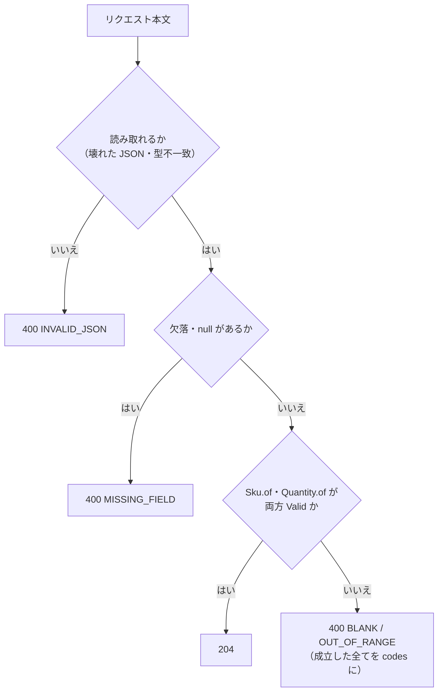

# 02a 型設計とPBT: Kotlin + Spring Boot のコード例

標準の [02a 型設計とPBT](../../../docs/testing/02a-types-and-pbt.md) は、言語・ライブラリに依存しない規範である。この文書は、その規範を Kotlin + Spring Boot 4.1.x で実装したコード例と、このサンプルで実測して分かった点を、規範と同じ節番号で並べたものである。

コード例は `examples/kotlin-spring/src/` に同一内容で置いてあり、`examples/kotlin-spring/` で `./gradlew test` を実行するとコンパイルとテストが走る（CI: `.github/workflows/kotlin-samples.yml`）。**コード例を変更するときは `src/` 側も同時に更新すること。**

コード例は **Kotlin + Spring Boot 4.1.x** で示す。原則そのものは言語非依存である。

## 0. 技術前提（コード例のベースライン）

コード例は下表の版を前提にする。表は系統（minor）で書いており、正確な版は `examples/kotlin-spring/build.gradle.kts` と Gradle wrapper（`examples/kotlin-spring/gradle/wrapper/gradle-wrapper.properties`）を正とする。

| 項目 | 前提 |
|---|---|
| Spring Boot | 4.1.x（Spring Framework 7.0.x、Jakarta EE 11） |
| Kotlin | 2.4 系（Spring Boot 4.1 の BOM は 2.3 系を基準とするが、2.4 系で動作確認済み。`kotlin-reflect` / `kotlin-stdlib` は Kotlin プラグインと同じ版に揃うことを依存解決で確認） |
| JDK | 21（`jvmToolchain(21)`。CI も 21） |
| ビルド | Gradle 9 系（Kotlin DSL） |
| JSON | Jackson 3（パッケージは `tools.jackson.*`。ただし `jackson-annotations` は `com.fasterxml.jackson.annotation` のまま） |
| テスト | JUnit Platform + Kotest（Property / Assertions）。Spring を起動するテスト（`@WebMvcTest`・`@SpringBootTest`・DB 統合）は `src/integrationTest`、実ブラウザで操作する E2E は `src/e2eTest`（[02b §3.2](../../../docs/testing/02b-execution-and-mutation.md#32-層1統合テストe2e-の実行境界)） |
| モック | `@MockitoBean` / `@MockitoSpyBean`（`org.springframework.test.context.bean.override.mockito`。Spring Boot 3 の `@MockBean` / `@SpyBean` は廃止済み） |

> Spring Boot 4 では自動構成とテスト支援が機能別モジュールに分割された。4.1.1 で次を実測確認済み（`src/integrationTest/.../adapter/web/OrderControllerHttpTest.kt`）。確認できていない API はコードに書かず、公式リファレンスで確認すること。
>
> | 用途 | 内容 |
> |---|---|
> | テスト用スターター | `org.springframework.boot:spring-boot-starter-webmvc-test` |
> | `@WebMvcTest` | `org.springframework.boot.webmvc.test.autoconfigure.WebMvcTest` |
> | `@AutoConfigureRestTestClient` | `org.springframework.boot.resttestclient.autoconfigure.AutoConfigureRestTestClient` |
> | `RestTestClient` | `org.springframework.test.web.servlet.client.RestTestClient`（Spring Framework 7） |
> | `@AutoConfigureMockMvc` | `org.springframework.boot.webmvc.test.autoconfigure.AutoConfigureMockMvc`（存在のみ確認。本リポジトリでは未使用） |
>
> コード例のドメイン層は Spring 非依存の純粋な Kotlin で、フレームワークの変更に影響されない。

```kotlin
// build.gradle.kts（抜粋。バージョンは例であり、実際の版は検証用プロジェクトのルートにある build.gradle.kts を正とする）
plugins {
    kotlin("jvm") version "2.4.21"             // BOM（2.3 系）より新しい。動作確認済み
    kotlin("plugin.spring") version "2.4.21"
    id("org.springframework.boot") version "4.1.1"   // 4.1.x の最新パッチを使う
}

kotlin {
    jvmToolchain(21)
    compilerOptions {
        allWarningsAsErrors.set(true)          // 警告（冗長な else 等）をエラー化
    }
}

dependencies {
    implementation(platform(org.springframework.boot.gradle.plugin.SpringBootPlugin.BOM_COORDINATES))
    implementation("org.springframework.boot:spring-boot-starter-webmvc")
    implementation("tools.jackson.module:jackson-module-kotlin")
    // 層1（src/test）は Spring・Docker を使わない。spring-boot-starter-test はここに書かない
    testImplementation("io.kotest:kotest-runner-junit5:6.2.5")
    testImplementation("io.kotest:kotest-assertions-core:6.2.5")
    testImplementation("io.kotest:kotest-property:6.2.5")
    testRuntimeOnly("org.junit.platform:junit-platform-launcher")
}

// Spring を起動するテストは、層1とは別のテストスイート（src/integrationTest・src/e2eTest）に置き、依存もそれぞれのスイートにだけ書く（ここでは integrationTest のみ示す）
testing {
    suites {
        register<JvmTestSuite>("integrationTest") {
            useJUnitJupiter()
            dependencies {
                implementation(project())
                implementation(platform(org.springframework.boot.gradle.plugin.SpringBootPlugin.BOM_COORDINATES))
                implementation("org.springframework.boot:spring-boot-starter-test")
                implementation("io.kotest:kotest-assertions-core:6.2.5")
            }
        }
    }
}

tasks.withType<Test> { useJUnitPlatform() }
```

上のコード例は抜粋で、プラグイン・`tasks.withType<Test>` の細部も省いている。実際の `build.gradle.kts` は、層1の依存に Konsist（アーキテクチャ検査）も持ち、`integrationTest` スイートに `spring-boot-starter-webmvc-test`・Testcontainers 等を、`e2eTest` スイートに Playwright 等を足している。層1に Spring を入れない方針は [02b §3.2](../../../docs/testing/02b-execution-and-mutation.md#32-層1統合テストe2e-の実行境界) のとおりである。

## 1. 「誤りを書けなくする」型設計

### 1.1 プリミティブ型の排除（ドメイン型 / Value Object 化）

Kotlin では `@JvmInline value class` を使うと、実行時のオブジェクト生成コストを抑えつつ、コンパイル時に型を区別できる。

```kotlin
package com.example.order.domain

// 異なる意味の String を取り違えられなくする（ブランド型相当）
@JvmInline
value class UserId private constructor(val value: String) {
    companion object {
        fun of(raw: String): Validated<UserId, IdError> =
            if (raw.isBlank()) Validated.Invalid(IdError.BLANK) else Validated.Valid(UserId(raw))
    }
}

@JvmInline
value class OrderId private constructor(val value: String) {
    companion object {
        fun of(raw: String): Validated<OrderId, IdError> =
            if (raw.isBlank()) Validated.Invalid(IdError.BLANK) else Validated.Valid(OrderId(raw))
    }
}

enum class IdError { BLANK }

fun cancelOrder(orderId: OrderId, by: UserId) { /* ... */ }
// cancelOrder(userId, orderId)  // ← コンパイルエラー（引数の取り違えを排除）
```

規範の規則との対応は次のとおり（規範は [02a §1.1](../../../docs/testing/02a-types-and-pbt.md#11-プリミティブ型の排除ドメイン型--value-object-化)）。

- 規則3: 生成は §1.2 のとおり `private constructor` + ファクトリ経由に限る。`as` による強制キャストで型を偽装してはならない。
- 規則4: `!!`（非 null アサーション）、根拠のない `as`、`@Suppress`、`lateinit` の乱用は静的解析（detekt）で禁止する。
- 規則5: `@RequestBody` 等で受ける DTO はプリミティブでよい。**DTO はアダプタ層に閉じ込め**、ユースケースへ渡す前にドメイン型へ変換する（例は §1.2）。

### 1.2 コンストラクタ防御

```kotlin
package com.example.order.domain

/** 検証結果。失敗を例外ではなく値として返し、呼び出し側に分岐を強制する。 */
sealed interface Validated<out T, out E> {
    data class Valid<out T>(val value: T) : Validated<T, Nothing>
    data class Invalid<out E>(val error: E) : Validated<Nothing, E>
}

enum class QuantityError { OUT_OF_RANGE }

@JvmInline
value class Quantity private constructor(val value: Int) {
    companion object {
        const val MIN = 1
        const val MAX = 999

        fun of(value: Int): Validated<Quantity, QuantityError> =
            if (value in MIN..MAX) Validated.Valid(Quantity(value))
            else Validated.Invalid(QuantityError.OUT_OF_RANGE)
    }
}
```

アダプタ層（Spring MVC）では、DTO を境界で一度だけドメイン型へ変換し、失敗は HTTP 400 に写像する。



```kotlin
package com.example.order.adapter.web

import com.example.order.domain.Quantity
import com.example.order.domain.Sku
import com.example.order.domain.Validated
import org.springframework.http.HttpStatus
import org.springframework.http.ProblemDetail
import org.springframework.http.ResponseEntity
import org.springframework.web.bind.annotation.PostMapping
import org.springframework.web.bind.annotation.RequestBody
import org.springframework.web.bind.annotation.RequestMapping
import org.springframework.web.bind.annotation.RestController

/**
 * 外部入力の形そのもの。ドメインの意味は持たず、アダプタ層から外へ出さない。
 * 欠落・null は Jackson に任せず、null として受けてコントローラーで MISSING_FIELD にする。
 */
data class AddItemRequest(val sku: String?, val quantity: Int?)

@RestController
@RequestMapping("/orders")
class OrderController(private val addItem: AddItemUseCase) {

    @PostMapping("/items")
    fun add(@RequestBody request: AddItemRequest): ResponseEntity<*> {
        if (request.sku == null || request.quantity == null) {
            val missing = problem(listOf(ErrorCode.MISSING_FIELD), "必須フィールドが指定されていません")
            return ResponseEntity.badRequest().body(missing)
        }
        val sku = Sku.of(request.sku)
        val quantity = Quantity.of(request.quantity)
        // 検証段階の失敗は、同時に成立していれば全て返す
        return if (sku is Validated.Valid && quantity is Validated.Valid) {
            addItem.execute(sku.value, quantity.value)
            ResponseEntity.noContent().build<Unit>()
        } else {
            val codes = listOfNotNull(
                ErrorCode.BLANK.takeIf { sku is Validated.Invalid },
                ErrorCode.OUT_OF_RANGE.takeIf { quantity is Validated.Invalid },
            )
            val detail = "sku は空にできず、quantity は ${Quantity.MIN}〜${Quantity.MAX} の範囲で指定してください"
            ResponseEntity.badRequest().body(problem(codes, detail))
        }
    }
}

enum class ErrorCode { OUT_OF_RANGE, BLANK, INVALID_JSON, MISSING_FIELD }

const val CODES_PROPERTY = "codes"

internal fun problem(codes: List<ErrorCode>, detail: String): ProblemDetail =
    ProblemDetail.forStatusAndDetail(HttpStatus.BAD_REQUEST, detail).also {
        it.setProperty(CODES_PROPERTY, codes.map(ErrorCode::name))
    }

fun interface AddItemUseCase {
    fun execute(sku: Sku, quantity: Quantity)
}
```

コントローラーに到達する前に Spring が落とす 400（壊れた JSON・型不一致）は `@RestControllerAdvice` で同じ `codes` 形式にそろえる。

```kotlin
@RestControllerAdvice
class ApiExceptionHandler {
    @ExceptionHandler(HttpMessageNotReadableException::class)
    fun onUnreadable(): ProblemDetail = problem(listOf(ErrorCode.INVALID_JSON), "リクエスト本文を読み取れません")
}
```

> 400 応答は `detail` の文言ではなく、機械可読な `codes`（集合として扱い、順序は仕様にしない）だけを契約とする（TRS [ORD-001](./trs/ORD-001-add-item.md) OI-003, OI-006）。
>
> `"3"` や `1.5` を `Int` に黙って変換しないよう、`application.properties` で次を指定している。
>
> - `spring.jackson.mapper.allow-coercion-of-scalars=false`
> - `spring.jackson.deserialization.accept-float-as-int=false`
>
> 指定しないと 204 になることを `OrderControllerHttpTest` で実測した。

規範の規則との対応は次のとおり（規範は [02a §1.2](../../../docs/testing/02a-types-and-pbt.md#12-コンストラクタ防御)）。

- 規則1: コンストラクタは `private` とし、検証付きファクトリ（`of` / `parse`）経由でのみ生成する。
- 規則3: 不変（immutable）を基本とし、状態変更は新しい値の生成で表現する（`val` のみ、`var` を避ける）。
- 規則4: 失敗は例外ではなく `Validated`（または `Result` 相当）で返し、呼び出し側に処理を強制する。Spring の `@Valid` / Bean Validation による検証は DTO の形式チェックに留め、**ドメインの不変条件はドメイン型のファクトリを正**とする。
- 規則5: value class を DTO に直接デシリアライズしない。**実測**（Spring Boot 4.1.1、Jackson 3 + jackson-module-kotlin）では、`private constructor` の `Quantity` を DTO のプロパティにすると `{"quantity":5000}` が `Quantity.of` の検証を素通りして生成された（`ValueClassDtoTest`）。不変条件が破られるため、DTO にドメイン型を直接使ってはならない。

### 1.3 sealed 型と網羅的 `when`（網羅性チェック）

状態・種別・イベントは `sealed interface`（または `sealed class`）で表現し、分岐の網羅性をコンパイラに検査させる。Kotlin では **`when` を式として使い、`else` を書かない**。

```kotlin
package com.example.payment.domain

import java.time.Instant

sealed interface PaymentState {
    data object Pending : PaymentState
    data class Authorized(val authorizedAt: Instant) : PaymentState
    data class Captured(val capturedAt: Instant) : PaymentState
    data class Failed(val reason: FailureReason) : PaymentState
}

enum class FailureReason { CARD_DECLINED, TIMEOUT }

// when を「式」として使い、else を置かない。
// PaymentState に状態を追加すると、この関数を含む全ての when がコンパイルエラーになる。
fun label(state: PaymentState): String =
    when (state) {
        PaymentState.Pending -> "保留"
        is PaymentState.Authorized -> "与信済"
        is PaymentState.Captured -> "確定"
        is PaymentState.Failed -> "失敗"
    }
```

遷移も同じ作りで書く。許可する遷移（TRS [PAY-001](./trs/PAY-001-payment-state-transition.md)）以外は、同じ状態への再実行を含めて全て `INVALID_TRANSITION` で拒否し、失敗は例外ではなく `Validated` で返す。

```kotlin
/** 遷移の拒否理由は1つだけ（TRS PAY-001 OI-004）。状態名は契約にしない。 */
enum class TransitionError { INVALID_TRANSITION, }

/** 与信。Pending だけが Authorized になれる。時刻は注入された Clock から取る（PAY-001 OI-001）。 */
fun PaymentState.authorize(clock: Clock): Validated<PaymentState, TransitionError> =
    when (this) {
        PaymentState.Pending -> Validated.Valid(PaymentState.Authorized(clock.instant()))
        is PaymentState.Authorized, is PaymentState.Captured, is PaymentState.Failed -> invalidTransition()
    }

/** 確定。Authorized だけが Captured になれる（与信を飛ばした確定は不可）。 */
fun PaymentState.capture(clock: Clock): Validated<PaymentState, TransitionError> =
    when (this) {
        is PaymentState.Authorized -> Validated.Valid(PaymentState.Captured(clock.instant()))
        PaymentState.Pending, is PaymentState.Captured, is PaymentState.Failed -> invalidTransition()
    }

private fun invalidTransition(): Validated<PaymentState, TransitionError> =
    Validated.Invalid(TransitionError.INVALID_TRANSITION)
```

上のコード例は `PaymentState.kt`（`TransitionError`）と `PaymentTransitions.kt` の抜粋で、package・import・ファイル冒頭のコメントと `fail` を省いている。

規範の規則との対応は次のとおり（規範は [02a §1.3](../../../docs/testing/02a-types-and-pbt.md#13-状態の型と網羅的な分岐網羅性チェック)）。

- 規則1: `status: String` と `Boolean` の組合せで状態を表現しない（`isPaid && isCancelled` のような**矛盾状態を表現可能にしない**）。
- 規則2: 状態ごとに必要なデータを各バリアントに持たせ、不正な組合せを型で排除する（`Captured` だけが `capturedAt` を持つ）。
- 規則3: `when` の `else` 分岐を禁止する（sealed / enum 対象）。`else` は将来の状態追加を黙って飲み込む。
- 規則4: sealed / enum を対象にした `when` は、式でも文でも非網羅だとコンパイルエラーになる（Kotlin 1.7 以降）。加えて `allWarningsAsErrors` を有効にし、冗長な `else` 等の警告も必ずビルドエラーにする（§0）。
- 規則5: 外部から来る文字列（DB・JSON）は、境界で enum / sealed 型へ変換する。未知の値は `Invalid` として扱い、`else` で握りつぶさない。

### 1.4 型ガードレールのチェックリスト（レビュー観点）

規範の [02a §1.4](../../../docs/testing/02a-types-and-pbt.md#14-型ガードレールのチェックリストレビュー観点) が参照する自動検査は、このサンプルでは Konsist（`src/test/kotlin/com/example/architecture/`）とコンパイラ設定（`allWarningsAsErrors`）で実装している。§1.1 規則4 は detekt で部分的に検出する。設定は [02b §6](../../../docs/testing/02b-execution-and-mutation.md#6-ai向けガードレール設定実装の拠り所) のとおり。

## 2. PBT（Property-Based Testing）標準

### 2.2 Property の型（定義基準）

Kotest Property（`io.kotest:kotest-property`）での記述例。

```kotlin
package com.example.order.domain

@JvmInline
value class Yen private constructor(val amount: Long) {
    operator fun plus(other: Yen): Yen = Yen(Math.addExact(amount, other.amount))

    companion object {
        const val MAX = 1_000_000_000L

        fun of(amount: Long): Validated<Yen, YenError> =
            if (amount in 0..MAX) Validated.Valid(Yen(amount)) else Validated.Invalid(YenError.OUT_OF_RANGE)
    }
}

enum class YenError { OUT_OF_RANGE }
```

```kotlin
package com.example.order.domain

import io.kotest.core.spec.style.StringSpec
import io.kotest.matchers.shouldBe
import io.kotest.matchers.types.shouldBeInstanceOf
import io.kotest.property.Arb
import io.kotest.property.arbitrary.long
import io.kotest.property.arbitrary.map
import io.kotest.property.checkAll

// ドメイン型ごとに Arb を 1 つ用意し、ファクトリの検証と同じ制約を満たす値だけを生成する
val arbYen: Arb<Yen> = Arb.long(0L..Yen.MAX / 2).map { (Yen.of(it) as Validated.Valid).value }

class YenPropertyTest : StringSpec({

    // 分類: 交換則・結合則
    "金額の加算は交換則を満たす" {
        checkAll(arbYen, arbYen) { a, b -> (a + b) shouldBe (b + a) }
    }

    "金額の加算は結合則を満たす" {
        checkAll(arbYen, arbYen, arbYen) { a, b, c -> ((a + b) + c) shouldBe (a + (b + c)) }
    }

    // 分類: オラクル（常に 0 を返す実装でも交換則・結合則は成り立つため、和そのものを検証する）
    "金額の加算は金額の和になる" {
        checkAll(arbYen, arbYen) { a, b -> (a + b).amount shouldBe (a.amount + b.amount) }
    }

    // 分類: 境界（ランダム入力では境界ちょうどの値に当たりにくいため、明示的に固定する）
    "境界値 0 と MAX は受理、-1 と MAX+1 は拒否" {
        listOf(0L, Yen.MAX).forEach { (Yen.of(it) as Validated.Valid).value.amount shouldBe it }
        listOf(-1L, Yen.MAX + 1).forEach { Yen.of(it) shouldBe Validated.Invalid(YenError.OUT_OF_RANGE) }
    }

    // 分類: 不変量（範囲外は必ず拒否される）
    "範囲外の金額は必ず Invalid になる" {
        checkAll(Arb.long().map { if (it in 0..Yen.MAX) -1L else it }) { n ->
            Yen.of(n).shouldBeInstanceOf<Validated.Invalid<*>>()
        }
    }
})
```

> `(Yen.of(it) as Validated.Valid).value` は **テストコード内のジェネレータに限り**許可する `as` の例外である（本番コードでは §1.1 のとおり禁止）。この例外は detekt の対象をテストソースから除外して実現する。

#### 操作列の PBT（状態遷移）

```kotlin
// 分類: 不変量（許可された遷移だけが状態を変え、拒否された操作は状態を変えない）
"AC-02-07 任意の操作列で、許可された遷移だけが状態を変え、拒否された操作は状態を変えない" {
    checkAll(opSequences) { sequence ->
        var state: PaymentState = PaymentState.Pending
        sequence.forEach { op ->
            val result = state.apply(op, clock)
            val expected = allowed[kindOf(state) to op.kind] // TRS の遷移表。表に無い組合せは拒否される
            if (expected == null) {
                result shouldBe rejected
            } else {
                kindOf(result.valid()) shouldBe expected
                state = result.valid()
            }
        }
    }
}

// 分類: 不変量（終端状態からは、以降どんな操作列でも遷移できない）
"AC-02-08 終端状態に達した後は、以降どんな操作列でも状態が変わらない" {
    checkAll(opSequences, opSequences) { before, after ->
        var state: PaymentState = PaymentState.Pending
        before.forEach { op -> (state.apply(op, clock) as? Validated.Valid)?.let { state = it.value } }
        if (kindOf(state) in terminalKinds) {
            val terminal = state
            after.forEach { op -> terminal.apply(op, clock) shouldBe rejected }
        }
    }
}
```

操作列のジェネレータは `Arb.bind` で操作の種類と失敗理由を独立に生成し、種類に応じて `Op` を組み立てる（`Arb.list(ops, 0..20)`）。時刻は生成せず、固定した `Clock`（`Clock.fixed(Instant.EPOCH, ZoneOffset.UTC)`）を `apply(op, clock)` に渡す。全体は `examples/kotlin-spring/src/test/kotlin/com/example/payment/domain/PaymentTransitionsTest.kt`。

### 2.3 PBT 実装ルール

規範の規則との対応は次のとおり（規範は [02a §2.3](../../../docs/testing/02a-types-and-pbt.md#23-pbt-実装ルール)）。

- 規則1: 各型に `arbXxx`（Kotest の `Arb`）を1つ用意し、ファクトリの検証と同じ制約を満たす値を生成する。
- 規則2: 「範囲外の入力は必ず `Validated.Invalid` を返す」を Property にする。
- 規則3: Kotest 6.2.5 は、失敗した Property のメッセージに `Repeat this test by using seed <値>` を**既定で出力する**（設定は不要）。そのシードを `PropTestConfig(seed = <値>)` に渡すと同じ失敗を再現できる（`PropTestConfig` は `@ExperimentalKotest` の opt-in が必要）。この挙動と出力の形式は `PropertyTestingConfigTest` が、わざと落ちる Property で検証している（Kotest の更新で変わったら落ちる）。
- 規則4: 実行回数の既定は 1000 回（`kotest.proptest.default.iteration.count`）。Gradle の `-D` はテスト JVM に渡らないため、`build.gradle.kts` が `-Pproptest.iterations=N` をこのシステムプロパティに転送している。夜間ジョブ（`.github/workflows/nightly-mutation.yml` の `pbt`）は `./gradlew test -Pproptest.iterations=10000` で実行する（全体テストが約 20 秒で完了することを実測した）。

#### 2.3.1 PBT が失敗したときの AI の手順

規範の [02a §2.3.1](../../../docs/testing/02a-types-and-pbt.md#231-pbt-が失敗したときの-ai-の手順) の各手順を、Kotest 6.2.5 で実施するときの具体を示す。シードを指定した再現は `PropTestConfig(seed = <値>)` で行う。

1. ログからシードと縮小後の反例を取り出す。Kotest 6.2.5 の失敗メッセージを、`Arb.int(0..1000)` に対し `check(it < 500)` で落ちる Property で実測した出力が下の例である。縮小後の反例は `Arg <引数番号>: <縮小後の値> (shrunk from <縮小前の値>)` の行に、シードは `Repeat this test by using seed <値>` の行にある。エッジケース（範囲の端や特別な値。`Arb.int(0..1000)` なら 0・1・1000 など）は、既定で約 2% の確率で混ざる。エッジケースで落ちると縮小されず、`(shrunk from …)` が付かない `Arg 0: 1000` の形式で出力される。どちらの形式でも、`Arg` の行の値がそのまま反例である。

      ```text
      Property failed after 1 attempts

          Arg 0: 500 (shrunk from 988)

      Repeat this test by using seed -2729266846478331732

      Caused by IllegalStateException: boom
      ```

2. `PropTestConfig(seed = <値>)` で同じ失敗が再現することを確認する（一時的。コミットしない）。
   - 保存済みシードの扱いの Kotest での具体は、下の [§2.3.2](#232-保存済みシードの扱い) のとおり。

#### 2.3.2 保存済みシードの扱い

規範の [02a §2.3.2](../../../docs/testing/02a-types-and-pbt.md#232-保存済みシードの扱い) の規則を、Kotest 6.2.5 で実施するときの具体を示す。規則は規範に従う。

- 保存機能: 保存は `PropertyTesting.writeFailedSeed` が制御し、既定で有効である。Kotest 6.2.5 で確認した挙動では、Property が失敗するとシードをローカルに保存する。
- 保存先: `$XDG_CACHE_HOME/.kotest/seeds` である。環境変数 `XDG_CACHE_HOME` が未設定か空白なら、`~/.kotest/seeds` になる。
- 再利用の条件: 保存したシードは、次の 2 つを満たす実行で再利用される。
  - (a) `PropTestConfig(seed = …)` を指定しない。
  - (b) テストパスが同じである。
- 消えるとき: 保存シードはそのテストが成功すると消える。わざと落とすテストでは成功しないため消えず、固定され続ける。
