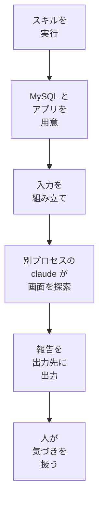

# 02b のサンプル実装（Kotlin + Spring Boot）

規範 [02b 層1の実行境界とミューテーション](../../../docs/testing/02b-execution-and-mutation.md) の各節を、このサンプルでどう実装しているかをまとめる。規範は言語・ツールに依存しない。ここには Kotlin + Spring Boot 4.1.x で実測した設定・コード例・実測結果を置く。

- 節番号は規範と同じにしてある（§3.1、§3.2、§3.3、§4.1、§4.4、§6）。サンプルのソース内の「02b §x」の参照は、この文書の同じ番号の節も指す。
- パス（`src/`・`build.gradle.kts`・`config/`）と `./gradlew` は、`examples/kotlin-spring/` を基準にする。
- コード例は `src/`・`build.gradle.kts` に対応する。変更するときは `src/` 側も同時に更新すること（型設計・PBT の同期は [02a のコード例](./02a.md) を参照）。
- 確認できていない API は書かない。Spring Boot 4 ではテストスライスのパッケージ名等が 3.x と異なるため、公式リファレンスで確認すること。

## 3.1 夜間の AI 探索（層3）

規範は [01 §3](../../../docs/testing/01-test-policy.md#3-3層アーキテクチャ) の層3 と、[02b §3.1](../../../docs/testing/02b-execution-and-mutation.md#31-実行順序) の夜間の AI 探索である。人の探索的テストは、このサンプルでは実演しない。人が見つけた不具合も、§3.1.5 と同じ扱いにする。

このサンプルは、**仕組みだけ置き、定期実行はしない**。AI の API キーを登録せず、CI でも動かさない。リポジトリのスキルを人が手元で実行したときだけ探索する。理由と規範との関係は §3.1.6 に書く。

### 3.1.1 置いたもの

| 置いたもの | パス | 内容 |
|---|---|---|
| 手順書 | この節 | 対象、入力、出力、人の扱い |
| スキル | `.claude/skills/ai-exploration/SKILL.md` | 実行の手順。自分では探索せず、スクリプトを動かして結果を示す |
| 実行スクリプト | `exploration/run-local.sh` | アプリの起動、探索の起動、後片付け |
| 指示と出力の型 | `exploration/prompt.md`、`exploration/report-schema.json` | エージェントへの指示と、報告の JSON スキーマ |
| 入力の組み立て | `exploration/build-prompt.sh` | 指示に TRS の UC と AC の一覧を連結する |
| 報告の整形 | `exploration/render-report.sh` | 結果を Markdown にする |

### 3.1.2 対象と入力

- 対象は、TODO のタスク管理画面（`static/index.html`）である。アプリは README と同じ手順で、MySQL とともにスクリプトが起動する。すでに動いているアプリの扱いは §3.1.8 に書く。
- 入力は、[TODO-001 の TRS](./trs/TODO-001-task-management.md) の UC（§2）と、AC の番号・題名の一覧（§3 の `Scenario`）である。
- 期待値の正は TRS の UC と AC に集約してある。そのため、要件定義書は渡さない。
- AC の本文は渡さない。Gherkin の例が大きく、入力が増えるためである。
- エージェントは期待値を決めず、観察した事実を報告する。
- TRS に書かれていない挙動は「TRS が定めていない」気づきとして報告させる。良し悪しの判断は人が行う。
- `@pending` の AC は期待値が未確定なので、食い違いの根拠にさせない。

探索は、スキルを動かす主セッションではなく、スクリプトが起動する別の `claude -p` が行う。主セッションの文脈を渡さないことで、入力を UC と AC の一覧に限る。この別プロセスには、次のものを読ませない。

| 読ませないもの | 止める方法 |
|---|---|
| リポジトリの `CLAUDE.md` と設定 | リポジトリの外の空のディレクトリで動かす。`--setting-sources local` |
| 利用者の設定（フック・プラグイン） | `--setting-sources local`。ユーザー設定を読まない |
| スキルとスラッシュコマンド | `--disable-slash-commands` |
| 自動メモリ | 環境変数 `CLAUDE_CODE_DISABLE_AUTO_MEMORY=1` |
| 組み込みのツール | `--tools ""` |

### 3.1.3 出力の形式

出力は、気づきの一覧と探索範囲の覚え書きである。形は `exploration/report-schema.json` が正で、気づき 1 件の項目は次のとおり。

| 項目 | 内容 |
|---|---|
| 題名 | 気づきを一言で表す |
| 分類 | `contradicts_ac`、`spec_gap`、`ux_concern` |
| 関連する AC・UC | 番号。無ければ空 |
| TRS の記述 | 食い違いを疑った引用。無ければ「なし」 |
| 再現手順 | 第三者が再現できる操作の列 |
| 観察した事実 | 事実だけ。推測は明記する |
| スクリーンショット | 保存したファイル名 |

- 期待値の欄は設けない。エージェントが期待値を書けない形にするためである。
- 項目は[バグ報告の雛形](../../../docs/testing/templates/bug-report.md)の必須項目に合わせてある。発見層は常に「層3 探索」である。
- 結果は、標準出力と出力先に出る。出力先は `build/exploration/<日時>/` で、バージョン管理の対象外である。`./gradlew clean` で消える。
- 出力先には、`report.md` と `claude-output.json` が入る。スクリーンショット、`claude-stderr.log`、`claude` の版も入る。`app.log` は、スクリプトがアプリを起動したときだけ入る。
- 残したい結果は、あとで `docs/records/` に記録する。写すのは `report.md` の要点だけで、ローカルのパスとセッション ID は除く。

### 3.1.4 実行の流れ



- 認証は、利用者の Claude Code のログインを使う。API キーは要らない。
- 環境変数の `ANTHROPIC_API_KEY`、`ANTHROPIC_AUTH_TOKEN`、`ANTHROPIC_BASE_URL`、`CLAUDE_CODE_USE_BEDROCK`、`CLAUDE_CODE_USE_VERTEX` は外して `claude` を起動する。残すと、ログインではなく、キーの課金や別の接続先に切り替わる。
- 入力の組み立ては `claude` を起動する前に済ませる。探索の `claude` は、組み立て済みの入力を標準入力から受け取る。
- 探索の `claude` に渡す道具は、Playwright の MCP サーバーだけである。ブラウザの接続先は `--allowed-origins` でアプリに絞る。これは接続先を限る設定で、安全の保証ではない。
- 気づきは自動で起票しない。
- 終了時に止めるのは、スクリプトが起動した MySQL・アプリ・`claude` とその子プロセス（MCP とブラウザ）だけである。もとから動いていたものは止めない。
- アプリの停止は、記録した待ち受けの PID のうち、いまも同じポートを待ち受けているものだけを対象にする。アプリの JVM は Gradle のデーモンが起動するので、PID は起動後に記録する。起動待ちの間に中断されたときは、中断時に記録する。
- Gradle のデーモンは止めない。起動前にポートが使用中で、サンプルアプリでなければ、起動せずに止まる。

上限は次の 2 つで抑える。

| 上限 | 設定 | 変えられるか |
|---|---|---|
| ターン数 | `--max-turns` | 環境変数 `MAX_TURNS` |
| 時間 | `claude` を秒数で止める | 環境変数 `TIMEOUT_SEC` |

環境変数の一覧と既定値は、スキルの `SKILL.md` の表を正とする。

- 費用の上限は設けない。API の課金ではなく、利用者のログインの利用枠で動く。`--max-budget-usd` は、ログイン認証で効くかを確かめていないので使わない。
- ターン数の上限に達すると、報告が返らずに終わる。そのため、指示の道具の呼び出し回数の目安を、既定のターン数の半分以下にしてある。
- 時間切れは、報告の `claude` の終了コードの欄に 124 と出る。macOS には `timeout` がないので、見張りのプロセスが `claude` とその子プロセスを止める。報告は、`claude` の出力が得られないので残らない。
- `claude` が正常に終わらなかったときは、報告と出力先を残したうえで、スクリプトの終了コードを 1 にする。

### 3.1.5 人の扱い

スキルは気づきを出すだけで、直さない。人が出力先を読み、再現できたものを次のように扱う。

| 分類 | 人の扱い |
|---|---|
| `contradicts_ac` | バグ報告の雛形で Issue にし、[04 §2](../../../docs/testing/04-regression-governance.md#2-不具合還元プロトコルshift-left-protocol) の手順で下の層へ還元する |
| `spec_gap` | 期待値を人が決める。[Open Issues](../../../docs/testing/03-trs-guideline.md#4-open-issues-の履歴化) に同じ点がないか確かめ、無ければ起票する |
| `ux_concern` | 人が仕様の変更に当たるかを判断する。不具合と確かめたら `contradicts_ac` と同じに、仕様の変更に当たるなら `spec_gap` と同じに扱う |

- 起票の前に、再現できなかったもの、既存の Issue や Open Issue と重なるものを除く。
- 期待値を決めるのは人である。AI の報告にある「あるべき姿」の記述を、そのまま AC にしない。
- 夜間の AI 探索の実行と、結果の確認の周期は [04 §5](../../../docs/testing/04-regression-governance.md#5-運用リズムと指標) に従う。

### 3.1.6 定期実行しない理由と、規範との関係

このサンプルは、01 §3・02b §3.1・04 §5 の夜間の自律実行を満たしていない。05 の免除・据置にも当たらない。AI の API キーを登録しない、このリポジトリのオーナーの決定（2026-11-01）による。

- 新規プロジェクトが定期実行を省く根拠にはならない。既存のプロジェクトは 05 に従う。
- CI で動かすには、AI の認証情報をリポジトリに登録する必要がある。定期実行にすると、気づきの有無によらず実行のたびに利用が積み上がる。
- 手順書とスキルがあれば、PR をブロックしない位置づけは実演できる。
- 上限、権限の最小化、後片付けは、手元の実行でも確かめられる。

### 3.1.7 使う AI の呼び出し方と、確認の根拠

呼び出しは、Claude Code の CLI（`claude -p`）に、Playwright の MCP サーバーを渡す形である。仕様の確認は公式ドキュメントと、確認した版の `claude --help` で行った。

| 使うもの | 確認の根拠 |
|---|---|
| `claude -p`、`--output-format json`、`--json-schema`、`--max-turns`、`--model`、`--tools ""`、`--strict-mcp-config`、`--mcp-config`、`--allowedTools`、`--permission-mode dontAsk` | Claude Code の公式ドキュメント（CLI リファレンスと、プログラムからの実行） |
| `--setting-sources`、`--disable-slash-commands`、`--no-session-persistence` | 版 2.1.316 の `claude --help` |
| 環境変数 `CLAUDE_CODE_DISABLE_AUTO_MEMORY=1` | 公式ドキュメントのメモリの節 |
| `mcp__playwright__*` で MCP の道具を許可する | 公式ドキュメントの権限の節 |
| 出力の `total_cost_usd`、`session_id`、`structured_output` | 公式ドキュメント。費用は推定で、ログイン認証では請求額と一致しない |
| `@playwright/mcp@0.0.84` と、`--headless`、`--browser`、`--isolated`、`--no-sandbox`、`--allowed-origins`、`--output-dir` | 版 0.0.84 の `--help`。版は 2026-11-01 の npm の最新。`--browser` の値は `chrome`、`firefox`、`webkit`、`msedge` |
| モデル ID `claude-sonnet-5-5` | Claude API のモデル一覧の最新の Sonnet。環境変数 `MODEL` で変えられる |

- `--bare` は使わない。API キー認証を強制し、ログインだけの環境で失敗するためである。代わりに、§3.1.2 の表の止め方で設定やメモリを読ませない。
- `--no-sandbox` は、root で動かす Linux のためのもので、既定では付けない。環境変数 `NO_SANDBOX=1` で付ける。
- 環境変数は `env -u` で外す。確認用に無効な `ANTHROPIC_API_KEY` だけを環境に置いたとき、`claude` の起動時の情報でキーの出所が「なし」になり、ログインで動いた。外さない対照では、出所が環境変数になり、無効なキーのエラーで失敗した。
- 無効な `ANTHROPIC_BASE_URL` と、`CLAUDE_CODE_USE_BEDROCK`、`CLAUDE_CODE_USE_VERTEX` を `ANTHROPIC_API_KEY` と合わせて置いた実行も、探索まで進んで終了コード 0 で終わった。これらの外し方の対照は取っていない。
- `--max-turns` は、版 2.1.316 の `claude --help` に出ない。公式の CLI リファレンスには載っている。この版が受理することと、上限に達したときに `error_max_turns` の JSON を返すことは、実行で確かめた。

次の点を、手元の実行で確かめた（2026-11-01、macOS、版 2.1.316、Google Chrome）。Claude Code の Bash ツールからスクリプトを実行する入れ子の形で確かめた。端末から直接の実行は確かめていない。

- 探索の `claude` の起動時の情報で、道具が Playwright の MCP のものだけであり、MCP サーバーが接続済みであること。
- 同じく、スキルとスラッシュコマンドが空で、自動メモリの場所が出ないこと。
- フックのイベントを出す指定でも、利用者の設定のフックが一つも動かないこと。
- 道具なしの問いで、`CLAUDE.md`（リポジトリのものと利用者のもの）とメモリが見えないという応答が返ること。
- `--max-turns 5` で、道具を使い、`error_max_turns` の JSON を返して終わること。
- 時間切れで終了コード 124 になり、起動した MySQL とアプリが止まること。
- 探索の途中で止めたときも、正常に終わったときも、MCP とヘッドレスのブラウザのプロセスが残らないこと。
- 正常に終わった探索を、時間切れ（124）と誤判定しないこと。
- アプリの起動待ちの間に終了のシグナルを送っても、アプリの JVM と MySQL が止まること。
- ターン数の既定のまま、道具を使った探索が報告（`structured_output`）まで進み、気づきが返ること。1 回の実行である。

次の点は未確認である。

- 報告の中身の品質。気づきが妥当かは、人が確かめる。
- Linux で `--browser chrome` が使えるか、`--no-sandbox` が要るか。
- Windows での実行。スクリプトは bash を前提にする。

### 3.1.8 実行の前提と、操作

- 手元に Docker、JDK 21、ブラウザ、`jq`、`curl`、`npx`、`lsof`、`pgrep`、`pkill` が要る。`claude` はログイン済みにする。
- ブラウザは、環境変数 `BROWSER` でローカルにあるものに合わせる。
- ポート 3306 と 8080 が使用中なら、`MYSQL_PORT` と `APP_PORT` を変える。
- アプリがすでに動いていると再利用し、終了時も止めない。探索の操作で、その DB のタスクが書き換わる。
- 並行実行は想定しない。MySQL のコンテナ名とポートが固定のためである。
- シークレットの登録は要らない。
- 実績の費用は、報告の `total_cost_usd` で確かめる。推定値で、ログイン認証では請求額と一致しない。

## 3.2 層1・統合テスト・E2E の実行境界

実 DB や実ブラウザのテストを足しても層1の速度要件（全体で数秒以内）を壊さないよう、Gradle の実行タスクとソースセットで境界を分ける。

| 項目 | 層1 | 統合テスト（Integration） | E2E |
|---|---|---|---|
| ソースセット | `src/test` | `src/integrationTest`（JVM Test Suite） | `src/e2eTest`（JVM Test Suite） |
| 実行 | `./gradlew test` | `./gradlew integrationTest` | `./gradlew e2eTest`（`test`・`integrationTest`・`check` には含まれない） |
| 置くもの | 型・Unit・PBT・Konsist 検査 | Spring コンテキストを起動するテスト（`@WebMvcTest`・`@SpringBootTest`）と、Testcontainers で実 DB を使うテスト | Spring を `RANDOM_PORT` で起動し、実ブラウザ（Playwright の Chromium）で操作するテスト。02c §5.1 の許可領域のみ |
| 必要なもの | JDK のみ（Spring・Docker 不要） | JDK と Docker（Testcontainers） | JDK、Docker（Testcontainers）、ブラウザ（`playwrightInstall` が取得する） |
| CI | `kotlin-samples.yml` の `test` ジョブ | 同 `integration` ジョブ | 同 `e2e` ジョブ（PR で実行。`timeout-minutes: 10` が 02c §5.4 の予算） |

- 次の配置は `ExecutionBoundaryTest`（Konsist）が検査する。違反例（層1に置いた Playwright を含む。`config/konsist-fixtures/boundary/`）で検出できることも確認している。
  - 層1のテストは、Spring のコンテキスト起動（`org.springframework.boot.*`・`org.springframework.test.*`・`org.springframework.context.*`・`org.springframework.beans.factory.annotation.*`）と `org.testcontainers.*` を使わない。
  - これらを使うテストは `src/integrationTest` と `src/e2eTest` にだけ置く。
  - 層1のファイルにアノテーション `@SpringBootTest`・`@WebMvcTest`・`@DataJdbcTest`・`@JdbcTest`・`@MybatisTest`・`@Testcontainers`・`@ServiceConnection` が書かれていると違反になる。
  - Spring・Testcontainers の検査は import の接頭辞とアノテーションの正規表現の 2 経路で行い、どちらかに当たれば違反とする。
  - `org.springframework.http` や `org.springframework.web` のような、型だけの利用は許可する。
  - ブラウザ操作（`com.microsoft.playwright.*`）は `src/e2eTest` にだけ置き、層1と `src/integrationTest` には入れない。
- テストが source set ごとのエンジンで実行されることを、`UnrunTestDetectionTest`（Konsist）が検査する。エンジンが無い書き方は、コンパイルが通れば黙って 0 件になる。違反例は `config/konsist-fixtures/unrun-tests/` で固定している。

  | source set | 実行エンジン | 実行されないもの |
  |---|---|---|
  | 層1（`src/test`） | Kotest のランナーだけ（`junit-jupiter-api` は推移的に入るが、Jupiter のエンジンは無い） | JUnit の `@Test` / `@RepeatedTest` / `@TestFactory` / `@TestTemplate`（現在の構成でコンパイルが通り、黙って実行されない） |
  | `src/integrationTest`・`src/e2eTest` | Jupiter だけ（Kotest は assertions のみでランナーは無い） | JUnit 4、Kotest の Spec |

  - 規則 1: 層1に JUnit のテスト注釈（`@Test`・`@ParameterizedTest`・`@TestFactory`・`@RepeatedTest`・`@TestTemplate`、JUnit 4 の `org.junit.*`）を置かない。層1では Kotest の AnnotationSpec も使わない（入れ子の `@Test` を区別しない）。
  - 規則 2: どの source set でも JUnit 4 を使わない。
  - 規則 3: `src/integrationTest`・`src/e2eTest` に Kotest の Spec を置かない。Kotest のランナーを足すなら見直す。
  - `@ParameterizedTest`・JUnit 4・統合テスト／E2E の Kotest の Spec は、現在の依存ではコンパイルが通らない。依存が後から足されて、黙って 0 件になるのを防ぐための規則である。
  - 検査は行単位で、コメント行を除く。ブロックコメントを閉じた同じ行の後ろの注釈と、`@[Test]` は検出できない。
- `TestProtectionTest`（@Disabled 検出）と `TraceabilityTest`（AC 紐づけ）は、`src/test`・`src/integrationTest`・`src/e2eTest` の全てを対象にする。`src/integrationTest` と `src/e2eTest` が検査から外れていないことは、それぞれのテストで確認している。
- AC に紐づく統合テスト・E2E のテスト名は、層1と同じく先頭に `AC-xx-yy` を置く（03 §3.4）。
- ミューテーション（`pitest`）の対象は層1の全対象（`src/main` の全パッケージ。`com.example.*`）で、実行するテストは層1（`src/test`）だけである。統合テストと E2E は混ざらない。
  - 規範（§4.1）の夜間の対象「層1の全対象」と一致している。
  - 層1のテストで覆えないクラス（`Application` の `main` など、Spring の起動が要るもの）は、ミュータントが `NO_COVERAGE` になる。除外せず、実測に含める（下の「仮置きの値の見直し」と §4.4）。
  - これとは別に、ドメイン層（`com.example.todo.domain.*`）だけを対象にし、ドメイン層のテストだけで実行する `pitest` を併走させる（全体の実行と、ドメイン層のクラスを含む差分実行のとき。§4.1・§4.4）。

## 3.3 DB を含む Integration のサンプル（Testcontainers）

実例は TRS `TODO-001`（タスクの登録・完了・一覧）の `TaskApiHttpTest` など（`src/integrationTest`）である。Controller → Service → MyBatis → MySQL の全体を、HTTP で通す。

Adapter は `todo.adapter.persistence` に置く。MyBatis のマッパー、`Task` ↔ 行の変換、Flyway のマイグレーションがある。ポートは `todo.domain.TaskRepository` に置く。Spring Boot 4.1.2 で次を実測確認済み。

| 用途 | 内容 |
|---|---|
| MyBatis | `org.mybatis.spring.boot:mybatis-spring-boot-starter:4.1.0`（Spring Boot 4.1.0 でビルドされた版。BOM の管理外なのでバージョンを明示する） |
| Flyway | `org.springframework.boot:spring-boot-starter-flyway` + `org.flywaydb:flyway-mysql`（バージョンは BOM が管理） |
| MySQL ドライバ | `com.mysql:mysql-connector-j`（BOM 管理、`runtimeOnly`） |
| Spring Boot のテスト連携 | `org.springframework.boot:spring-boot-testcontainers`（`org.springframework.boot.testcontainers.service.connection.ServiceConnection`） |
| Testcontainers（2.x、BOM 管理） | `org.testcontainers:testcontainers-junit-jupiter`、`org.testcontainers:testcontainers-mysql`（`org.testcontainers.mysql.MySQLContainer`） |

次のコード例は抜粋で、簡略化している。全体は `src/integrationTest` にある。

```kotlin
@TestConfiguration(proxyBeanMethods = false)
class MySqlContainerConfiguration {
    @Bean
    @ServiceConnection // DataSource（Flyway・MyBatis が使う）をこのコンテナへ自動接続する
    fun mysql(): MySQLContainer = MySQLContainer("mysql:8.4")
}

// 全体の配線を、MockMvc に束ねた RestTestClient で HTTP から通す（サーバーは起動しない）。実 DB は Testcontainers
@SpringBootTest
@AutoConfigureMockMvc
@AutoConfigureRestTestClient
@Import(MySqlContainerConfiguration::class, TestClockConfiguration::class)
abstract class TaskApiTestBase {
    @Autowired
    lateinit var client: RestTestClient
    // ...（各テストの前に、タスクと完了済みの表示の選択を消し、時計を既定の時刻に戻す。全体は TaskApiTestBase.kt）
}

class TaskApiHttpTest : TaskApiTestBase() {
    // 簡略化した例。実際の AC-01-15 のテストは、TRS の Examples の表の 8 行（タイトル・保存されるタイトル・期限）を繰り返す
    @Test
    fun `AC-01-15 登録したタスクは保存され、読み戻しても同じである`() {
        postRegister(registerBody("牛乳を買う", "2026-11-30")).expectStatus().is2xxSuccessful

        list().single().dueDate shouldBe "2026-11-30" // HTTP で一覧を取り直す = DB を通した読み戻し
    }
}
```

- 保存の確認は、HTTP で登録し、HTTP で一覧を取り直す形で行う。メモリだけの実装を通さない（TRS の検証層の選び方）。`@WebMvcTest` に偽のリポジトリを入れる形は、この条件を満たさない。
- 登録ごとに増える番号（`TaskId`）は、リポジトリが払い出す（`TaskRepository.nextId()`）。MySQL に `SEQUENCE` は無いので、採番専用の表 `task_id_sequence` の `AUTO_INCREMENT` を使う。`@Options(useGeneratedKeys = true)` で受け取った番号を返す。これで、`Task.register(id, …)` を本番の経路で使え、登録時刻が同じタスクの新旧を番号で決められる（TRS の OI-009）。
- 時刻は固定・進行できる時計を使う。本番の `Clock` の bean は `ClockConfiguration` にある。テストは、`@TestConfiguration` で別名の `@Primary` の bean（`MutableClock`）を入れて差し替える。Spring Boot は既定で bean の上書きを禁止しているので、同じ名前では上書きしない。
- 登録時刻は `DATETIME(6)` に UTC で保存する。マイクロ秒未満は切り捨てる。`LocalDateTime` へ明示的に変換するので、サーバーの既定のタイムゾーンに依存しない。期限は `DATE` と `LocalDate` で往復させる。
  - `0001-01-01` と `9999-12-31` を含む `DATE` の往復は、実測した MySQL 8.4 と Connector/J で、日付がずれずに通った（AC-01-15）。MySQL の `DATE` の保証範囲は `1000-01-01` 以降なので、`0001-01-01` は保証範囲の外の値で、この版の実測の結果である。
  - サーバーの既定のタイムゾーンを UTC・America/Los_Angeles・Asia/Tokyo に切り替えても、同じ日付で読み戻せる。
  - グレゴリオ暦の採用の境目（1582-10-04 と 10-15）も同じである（`TaskRepositoryIntegrationTest`）。
- タイトルの列は、長さの上限が無い `LONGTEXT`（文字集合は `utf8mb4`）にした。タイトルの上限は書記素で 50 字で、コードポイントの数には上限が無い（結合文字はいくつでも付けられる）。列の長さで有効なタイトルを拒否すると、仕様にない拒否になるためである。
- DB の制約（CHECK）で守る不変条件は、アプリを経由しない書き込みも拒否できる。迂回した行が読み込み時にも拒否されることは、CHECK を外した DB で別に検証する（`TaskRepositoryIntegrationTest`。TRS の AC に紐づかない技術的な検証）。
- 各テストの前に `DELETE FROM` でデータを消す。Flyway の `clean` / `migrate` は、スキーマを変えるテスト（CHECK を外すもの）だけに使う。選択の行が残ると、後のテストの一覧から完了済みが黙って消えるため、選択の行も消す。
- `@WebMvcTest` のスライスは DataSource を起動しないため、Docker は要らない。このサンプルでは、Jackson の実測（`ValueClassDtoTest`）だけが `@WebMvcTest` を使う。
- `@SpringBootTest` は DataSource・Flyway・MyBatis を含むので、コンテナ設定を `@Import` する。
- 静的リソース（`static/index.html`）の配信と、E2E が使う要素（`data-testid`）の存在は、`StaticTaskPageTest` が同じ構成で確かめる。ルートパス `/` は MockMvc 上で `index.html` への forward になり本文を取れないので、`/index.html` を取得する。

## 4.1 適用タイミングと閾値

### 導入期の例外の運用

このサンプルは、規範 §4.1 の導入期の例外を使わず、規範の表のとおりに運用する。記録は、05 の据置の記録と同じ形式（対象・理由・再評価のトリガー）で残す。

| 項目 | 内容 |
|---|---|
| 対象 | 導入期の例外（PR の評価軸をテストの強度にする、全体実行を週次にする） |
| 理由 | 規範は「既存プロジェクトへの導入期に限り」この例外を認める。このサンプルは新規で、Mutation Score の評価軸と夜間の全体実行で、最初から運用している |
| 再評価のトリガー | 導入前から存在する既存のコードに、このサンプルの仕組みを導入するとき |

評価軸を見直した実例（例外の条件をすべては満たしていない）が [パイロットの記録](../../../docs/records/05-pilot.md#3-導入モードの選択) にある。

### 仮置きの値の見直し

規範は、仮置きの値を実測で見直し、実測・判断（据え置き・見直し）・再評価のトリガーを記録することを定める。このサンプルの記録は次の表である。再評価したら、日付と判断をここに追記する。2026-11-01 にサンプルを旧の order / payment から TODO に置き換えた。旧サンプルの実測の行は履歴として残し、行の先頭に「旧サンプル」と書いた。旧サンプルのコードは、基点のコミット ea68177 にある。

**仮置きの値の見直し（2026-10-10 に作成。E2E の行は 2026-10-14 の測定で更新。PR 80% / 夜間 70% の行の判断は 2026-10-17 に更新。層1の全体への拡大後の実測は 2026-10-29 に追記。TODO のドメイン層の行は 2026-11-01 に追記し、同日に全体の行を足した）**

| 値 | 実測 | 判断 |
|---|---|---|
| 旧サンプル: PR 80% / 夜間 70% | ドメイン層 20 ミュータントで 95%（§4.4）。1 件の生存で約 5 ポイント動く | 据え置き。規模が小さい間は統計的な意味が薄いため、対象（ミュータント数）が増えたとき、または夜間の実測（`nightly-mutation.yml`）が 4 週分溜まったとき（いずれか早い方）に再評価する |
| TODO のドメイン層の PR 80% / 夜間 70%（2026-11-01 追記） | ドメイン層 52 ミュータントで 96%（50 / 52）。1 件の生存で約 2 ポイント動く。生存 2 件は等価ミュータントの候補で、除外していない（§4.4） | 据え置き。閾値の余裕は PR 80% に対して 16 ポイント、夜間 70% に対して 26 ポイントある。再評価のきっかけは次の 2 つ。永続化・HTTP・画面の実装後に、標準の `./gradlew pitest` で全体を取り直す。夜間の実測（`nightly-mutation.yml`）が 4 週分溜まる |
| TODO の全体の PR 80% / 夜間 70%（2026-11-01 追記。永続化・HTTP・画面の実装後に、標準の `./gradlew pitest` で取り直した） | ドメイン層だけ（`-Ppitest.domainOnly=true`）は 52 ミュータントで 96%（50 / 52）。1 件の生存で約 2 ポイント動く。層1の全対象（標準の `./gradlew pitest`、`com.example.*`）は 122 ミュータントで 91%（111 / 122）。1 件の生存で約 0.8 ポイント動く。生存 10 件は `Intrinsics.checkNotNull*` の除去で、等価ミュータントの候補である。`NO_COVERAGE` は 1 件（`ApplicationKt.main`）。いずれも除外していない（§4.4） | 据え置き。閾値の余裕は、全体が PR 80% に対して 11 ポイント、夜間 70% に対して 21 ポイント。ドメイン層だけは 16 ポイントと 26 ポイントである。全体の取り直しは、標準の手順で実施した。再評価のきっかけは、夜間の実測（`nightly-mutation.yml`）が 4 週分溜まることである |
| E2E 実行 10 分（[02c §5.4](../../../docs/testing/02c-e2e.md#54-e2e-予算)） | TODO の E2E は 10 本。ローカル（macOS arm64、MySQL イメージと Chromium は取得済み）のウォーム実行は、`./gradlew cleanE2eTest e2eTest` が 26 秒（2 回とも 26 秒）。テストクラスは 9.4 秒で、各テストは 0.12〜0.68 秒。固定費は Spring と MySQL コンテナの起動、ブラウザの起動である。旧サンプルの 3 本のときの CI の `e2e` ジョブ全体は 2 分 1 秒だった（測定日は 2026-10-14、ブラウザキャッシュなし） | 10 分は据え置く。ローカルの実測は予算の約 4% である。CI の `e2e` ジョブ全体は 1 分 30 秒で、予算の 15% である（2026-11-01、統合ブランチへの PR の CI。ブラウザのキャッシュの有無は確かめていない）。E2E が増えてから、傾向を見直す |
| 旧サンプル: 対象を層1の全体へ広げた後の PR 80% / 夜間 70%（2026-10-29 追記） | 対象は `com.example.*` で、ミュータント 82 件、Killed 71 件、87%（拡大前のドメイン層は 38 件で 89%）。`./gradlew pitest`（PR と main への push の全体実行と同じ）と `-Ppitest.threshold=70`（夜間）の結果は同じで、どちらも閾値を満たす。`pitest` タスク全体の所要は約 40 秒（拡大前は約 26 秒）。1 件の生存で約 1.2 ポイント動く。8 件はコンパイラ生成の `Intrinsics` 呼び出しの除去（等価ミュータントの候補。§4.2 の人間の判断を待つ）で、除外していない | 据え置き。対象が 20 → 38 → 82 件に増えたため、再評価の条件（対象が増えたとき）に該当した。82 件では 1 件の影響が約 1.2 ポイントに下がり、閾値の余裕は PR 80% に対して 7 ポイント、夜間 70% に対して 17 ポイントある。夜間の実測が 4 週分溜まった時点で、夜間の閾値を再評価する（もう一方の条件）。**閾値の希釈（2026-10-29 に決定済み）**: 閾値は対象全体に 1 つだけかかるため、対象を広げるとドメイン層に対する実効の要求が下がる。ドメイン層だけの実測は 89%（34 / 38）で、全体は 87%（71 / 82）。全体で PR 80% を満たすのに必要な、ドメイン層だけに換算した実効の閾値はおよそ 76%（全体で 66 / 82 件、ドメイン層が 31 / 38 件の 82% を満たしていた従来より下がる）、夜間 70% では約 55%（21 / 38 件相当）まで下がる。次の (b) を採った（#183）。(a) 規範の「層1の全対象」の代償として受け入れる、(c) 層ごとに閾値を分ける、(d) 対象の拡大をやめる、は採らない。**(b) 全体の実行に加えて、ドメイン層だけの実行を併走させる**。併走するのは全体の実行が走る契機すべて（PR の `ALL`・main への push・夜間）で、閾値は全体と同じ（PR / push 80%、夜間 70%）。ドメイン層の要求は従来（対象がドメイン層だけだった時点）と完全に同じになる。差分実行（変更クラスだけ）でも、変更クラスにドメイン層のクラスが含まれるときは、そのクラスだけをドメイン層のテストだけで実行する併走を行う（決定時は、差分実行は分母が変更クラスだけで希釈が起きないと見ていたが、差分実行の `targetTests` は層1の全テストで、アダプタ側のテストがドメイン層のミュータントを殺した分も数え、ドメインと他の層を同時に変えた PR では分母も合算になる。ドメイン層の要求を従来と同じにするため、差分実行にも併走を足した）。ドメイン層だけの実行は 38 件で 89%（34 / 38）、`./gradlew pitest -Ppitest.domainOnly=true` の所要は 21 秒（`./gradlew pitest -Ppitest.domainOnly=true` のビルド全体の所要。同じ測り方で全体の実行は 26〜28 秒。上の「約 40 秒」は測り方が異なる別の測定なので、数値を比べない）。規範（[02b §4.1](../../../docs/testing/02b-execution-and-mutation.md#41-適用タイミングと閾値)）には、対象を広げたことで要求が下がる層を別に評価してよい、という任意の注記が入っており、この併走はそれに沿う |
| ヒーリング 1 PR あたり 10 件（04 §3.3） | 自動修復の実績が無い | 実測不能のため据え置き。運用開始後に実績で見直す |

## 4.4 Gradle での実行例（PIT）

JVM/Kotlin では PIT（Pitest）を用いる。`src/` で実際に動かして確認した構成を示す（Gradle 9 系 / Kotlin 2.4 系 / Kotest 6.2.6 / `info.solidsoft.pitest` 1.19.0 / `pitest-junit5-plugin` 1.2.3）。正確な版は `examples/kotlin-spring/build.gradle.kts` と Gradle wrapper（`examples/kotlin-spring/gradle/wrapper/gradle-wrapper.properties`）を正とする。

```kotlin
// build.gradle.kts（抜粋）
plugins {
    id("info.solidsoft.pitest") version "1.19.0"
}

// ドメイン層だけの実行（-Ppitest.domainOnly=true）。層1の全対象（既定）に加えて併走させる
val pitestDomainOnly = providers.gradleProperty("pitest.domainOnly").map { it.toBoolean() }.orElse(false)
val domainPackages = listOf("com.example.todo.domain")

pitest {
    junit5PluginVersion.set("1.2.3")
    // 既定は層1の全対象（src/main の全パッケージ）。PR の差分実行では scripts/pitest-targets.sh の出力を -Ppitest.targetClasses=... で渡す
    targetClasses.set(
        pitestDomainOnly.flatMap { domainOnly ->
            val requested = providers.gradleProperty("pitest.targetClasses").map { it.split(",") }
            if (domainOnly) {
                requested
                    .map { classes ->
                        val outside = classes.filter { c -> domainPackages.none { c.startsWith("$it.") } }
                        require(outside.isEmpty()) { /* ... */ }
                        classes
                    }
                    .orElse(domainPackages.map { "$it.*" })
            } else {
                requested.orElse(listOf("com.example.*"))
            }
        },
    )
    // 未指定だと targetClasses と同じパターンが使われ、main 側のクラスをテストとして実行して失敗する。
    // ドメイン層だけの実行は、ドメイン層のテストだけで実行する
    targetTests.set(
        pitestDomainOnly.map { domainOnly ->
            if (domainOnly) domainPackages.map { "$it.*Test" } else listOf("com.example.*Test")
        },
    )
    // ドメイン層だけの実行は別ディレクトリに出す（同じ場所だと後の実行が先のレポートを上書きする）
    reportDir.set(
        pitestDomainOnly.flatMap { domainOnly ->
            layout.buildDirectory.dir(if (domainOnly) "reports/pitest-domain" else "reports/pitest")
        },
    )
    // アクセサ以外にメンバを持たない value class / data class だけをクラス単位で除外する（検証ロジックは companion 側）
    excludedClasses.set(listOf("com.example.todo.domain.TaskId", "com.example.todo.domain.TaskTitle"))
    mutationThreshold.set(providers.gradleProperty("pitest.threshold").map { it.toInt() }.orElse(80)) // §4.1。夜間は 70
    outputFormats.set(listOf("HTML", "XML"))
    timestampedReports.set(false)
}
```

```bash
./gradlew pitest                                            # 層1の全対象。結果: build/reports/pitest/index.html
./gradlew pitest -Ppitest.domainOnly=true                   # ドメイン層だけ（ドメイン層のテストだけで実行）。結果: build/reports/pitest-domain/index.html
./gradlew pitest -Ppitest.domainOnly=true -Ppitest.targetClasses="com.example.todo.domain.TaskStatus*"   # 差分実行の併走。ドメイン層のクラスだけを渡す
./gradlew pitest -Ppitest.targetClasses="$(../../scripts/pitest-targets.sh origin/main)"   # PR と同じ差分実行（examples/kotlin-spring/ で実行。ALL / NONE の扱いは下記）
```

**CI での実行**（`kotlin-samples.yml` / `nightly-mutation.yml`）

| 契機 | 対象 | 閾値 |
|---|---|---|
| PR | `scripts/pitest-targets.sh` が base との差分から変更クラスを決める（差分実行）。変更クラスにドメイン層のクラスが含まれるときは、それだけを対象にしたドメイン層だけの実行を併走させる。`ALL` にする 3 つ（下記）に当たるときは、全体とドメイン層だけの両方を実行する。それ以外の対象外の変更は `NONE`（スキップ）にする | 80%（全体・差分・ドメイン層だけとも） |
| main への push | 全体と、ドメイン層だけ | 80%（同上） |
| 夜間（毎日 03:00 JST） | 全体と、ドメイン層だけ。それぞれのスコアを Step Summary に出力し、両方のレポートを成果物として 90 日保管して推移を追う | 70%（全体・ドメイン層だけとも） |

- PR では、次の 3 つは `NONE` より優先して `ALL`（全体。層1の全対象）にする。
  - `build.gradle.kts`・`settings.gradle.kts`・`gradle/`・`config/`・`.editorconfig` の変更。Gradle の依存更新 PR を含む（Dependabot の github-actions と npm の PR は含まれず、`NONE` になる）。
  - 層1のテスト（`src/test/` 以下）が変わった場合。本番クラスの変更が同時にあっても `ALL` にする。テストの弱体化を、変更クラスだけの実行で見逃さないため。
  - `src/main/kotlin` の変更から対象クラスを決められない場合。削除されたファイル、`com.example` 配下でないパッケージ、Kotlin 以外のファイルが当たる。差分は `git diff --no-renames` で取り、リネームは旧パスの削除として扱うため、これも `ALL` になる。
- 上の 3 つに当たらず、`src/main/kotlin` の本番クラスが変わった場合は、変更ファイルの宣言（`class`・`interface`・`object`）とトップレベル関数のファサードクラスを対象のパターンにする。
- `src/integrationTest`・`src/e2eTest`・`src/main/resources`・`docs/` の変更は `NONE` である。PIT の実行（層1のテストと `src/main/kotlin` のクラス）に入らないため。

規範（§4.1）の「差分から対象を決められない変更（ビルド設定など）は全体を対象にする」は、このサンプルでは上の `ALL` として実装している。判定の細部は [`scripts/pitest-targets.sh`](../../../scripts/pitest-targets.sh) にある。

**ドメイン層だけの実行の併走**（#183）

閾値は対象の合算にかかる。対象を層1の全体へ広げると、ドメイン層に対する実効の要求が下がる（§4.1 の「仮置きの値の見直し」に数値がある）。差分実行も、ドメイン層と他の層を同時に変えた PR では分母が合算になり、ドメイン層のミュータントをアダプタ側のテストが殺した分も数える（差分実行の `targetTests` は層1の全テスト）。これを避けるため、全体の実行が走る契機（PR の `ALL`・main への push・夜間）のすべてと、変更クラスにドメイン層のクラスが含まれる差分実行で、ドメイン層（`com.example.todo.domain.*`）だけの実行を併走させ、閾値は他の実行と同じにする。

- 切り替えは `-Ppitest.domainOnly=true` である。`build.gradle.kts` の `pitest` ブロックの `targetClasses`・`targetTests`・`reportDir` を切り替える。ドメイン層のパッケージの定義は、`build.gradle.kts` の `domainPackages` と CI のシェルの正規表現の 2 箇所にあり、両方を揃える（片方だけを変えると、差分実行の併走が黙って起きなくなる）。`-Ppitest.targetClasses` を併用すると、それを対象にする（差分実行の併走）。併用しなければドメイン層の全体を対象にする。
- `-Ppitest.domainOnly=true` に渡す `targetClasses` は、ドメイン層のクラスだけである。絞り込みは 2 か所で行う。CI のシェルが、差分の対象からドメイン層のパターン（`com.example.todo.domain.` で始まるもの）だけを取り出し、無ければ併走しない。`build.gradle.kts` は、ドメイン層以外のクラスが渡されたら失敗させる（取り出しの間違いを黙って通さないため）。シェル側に置いたのは、併走するかどうかの判断も同じ場所で要るためである。
- 実行するテスト（`targetTests`）は、層1の全テストではなく、ドメイン層のテスト（`com.example.todo.domain.*Test`）だけにした。対象がドメイン層だけだった従来の設定と同じで、ドメイン層の変異を、ドメイン層自身のテストで検出できることを求める。層1の全テストにすると、他の層のテストがたまたま殺すミュータントを数えられて、従来より要求が緩む。
- 2 回目の実行がレポートを上書きしないよう、出力先を分ける。全体は `build/reports/pitest`、ドメイン層だけは `build/reports/pitest-domain` である（`timestampedReports` は `false` のため、同じディレクトリでは上書きされる）。
- 2 回目の実行が Gradle の up-to-date 判定で素通りしないことは、実測で確認した。`targetClasses`・`targetTests`・`reportDir` が異なる呼び出しは、`pitest` タスクが再実行される。全体 → ドメイン層だけ → ドメイン層だけ → 全体の順に実行すると、1・2・4 回目は実行され、3 回目（直前と設定が同じ）だけが `UP-TO-DATE` になった。`--info` のログでは、再実行の理由は「`targetClasses` と `targetTests` の値が変わった」だった。`reportDir` は出力のため、入力の変化には現れない。CI は同じジョブ、同じ作業ディレクトリで 2 回続けて呼ぶため、この判定に依存している。このリポジトリはビルドキャッシュを有効にしていない（`org.gradle.caching` の設定なし）。`setup-gradle` 側の既定と、キャッシュが有効なときの `pitest` タスクの挙動は未確認である。
- 全体の実行が閾値を下回っても、ドメイン層だけの実行は走らせる（CI は両方を実行してから、最後にまとめて失敗にする。夜間は後続のステップに `if: always()` を付ける）。夜間は両方のスコアを Step Summary に出力し、両方のレポートを成果物に含める。成果物の直下は `pitest/`（全体）と `pitest-domain/`（ドメイン層だけ）の 2 ディレクトリになる（従来は `index.html` が直下にあった）。
- 差分実行では、通常の差分実行（変更クラスすべて、層1の全テスト）に加えて、ドメイン層のクラスだけをドメイン層のテストだけで実行する。変更クラスにドメイン層のクラスが含まれないときは併走しない。どちらかが失敗しても、もう一方を走らせ、最後にまとめて失敗にする（`ALL` と同じ）。
- 差分実行の併走は、ドメイン層のクラスだけ、ドメイン層とアダプタ、アダプタだけの 3 通りで実測した（下の実測結果）。

**実際に踏んだ注意点**

| 事象 | 原因と対処 |
|---|---|
| `Coverage generation minion exited abnormally` | `targetTests` 未指定が原因（上のコードのコメントのとおり）。`*Test` で明示する |
| `NoSuchMethodError: SpecRef$Reference.<init>` | `kotest-extensions-pitest` 1.2.0 は Kotest 5.5.4 向けで、Kotest 6 と衝突する。**Kotest 6 では拡張なし**（`pitest-junit5-plugin` のみ）で動く |
| value class のゲッターが `NO_COVERAGE` | コンパイラ生成アクセサは呼ばれない。名前ベースの `excludedMethods` は全クラスに効き、将来ロジックを持つゲッターを黙って見逃すため使わない。アクセサ以外にメンバを持たないクラスだけを `excludedClasses` で除外する。TODO では `TaskId` と `TaskTitle` が該当する。`TaskTitle` の長さは、拡張関数 `length()` にしてクラスのメンバにしていない。`DueDate` は、`private constructor` にした後の実行で `getValue` が `NO_COVERAGE` にならなかったので、除外していない。旧サンプルでは、`plus` を持つ `Yen` のゲッターを除外せず、生存ミュータントとして残していた |
| 検証結果の `Validated.Invalid` のゲッターが `NO_COVERAGE` | テストが `shouldBe Validated.Invalid(...)` の等価比較だけで、`error` を読んでいなかった。失敗の理由を読む検証を `AC-01-03` のテストに足して殺した。data class のアクセサは除外しない |
| JSON の DTO（`TaskResponse`）のアクセサが `NO_COVERAGE` | Jackson が呼ぶアクセサは、Kotlin のテストが `data class` の等価比較だけで済ませると、読まれない。除外せず、層1のコントローラーのテストが各項目を読む |
| 旧サンプルで、`plus` が 0 を返すミュータントが生存 | 交換則・結合則は常に 0 を返す実装でも成立する。**和そのものを検証するオラクル Property** を追加して検出した（[02a §2.2](../../../docs/testing/02a-types-and-pbt.md#22-property-の型定義基準)） |
| 旧サンプルで、`0..MAX` の境界のミュータントが生存 | ランダム入力は境界ちょうどの値に当たりにくい。**境界値を Example で明示**して検出した（[02a §2.4](../../../docs/testing/02a-types-and-pbt.md#24-pbt-と-example-テストの使い分け)） |

**実測結果（TODO）**

| 段階 | 検出率（Killed / Generated） | 備考 |
|---|---|---|
| ドメイン層だけの初回の実行（2026-11-01、除外なし） | 91%（49 / 54） | 生存 2 件、`NO_COVERAGE` 3 件。生存は `DueDate.Companion.of` と `Task.Companion.register` の `Intrinsics.checkNotNullExpressionValue` 除去である。`NO_COVERAGE` は `Validated.Invalid.getError`・`TaskTitle.getValue`・`TaskId.getValue` である |
| `error` を読む検証を足し、`TaskTitle`・`TaskId` を除外した後（同日） | 96%（50 / 52） | 生存 2 件だけが残る。閾値 80% を満たす。`./gradlew pitest -Ppitest.domainOnly=true` |
| 層1の全対象（`com.example.*`）（同日。ドメイン層だけを実装した時点） | 94%（50 / 53） | 加わるのは `ApplicationKt.main` の `NO_COVERAGE` 1 件。標準の実行は、まだ実装していない層の AC のために `TraceabilityTest` などが失敗するので始まらない。そのため `targetTests` を `com.example.todo.*Test` に替えたビルドで測った。永続化・HTTP の実装後に、標準の `./gradlew pitest` で取り直す |
| 永続化・HTTP・画面を実装し、標準の `./gradlew pitest` で取り直した初回（同日） | 89%（108 / 121） | 生存 10 件（すべて `Intrinsics.checkNotNull*` の除去）、`NO_COVERAGE` 3 件。`NO_COVERAGE` は `TaskResponse.getId`・`getStatus`（JSON の DTO のアクセサ。Jackson が呼ぶので、層1のテストが読まないと検査に入らない）と `ApplicationKt.main` である |
| `TaskResponse` の各項目を読む検証を足した後（同日） | 91%（110 / 121） | 生存 10 件、`NO_COVERAGE` 1 件（`ApplicationKt.main`）。閾値 80% を満たす。ドメイン層だけ（`-Ppitest.domainOnly=true`）は 96%（50 / 52）のまま |
| OI-013 の型の変換を止める設定（`JacksonConfiguration`）を足した後（同日） | 90%（110 / 122）→ 91%（111 / 122） | 設定の bean のメソッドが `NO_COVERAGE` になったので、層1のテストが bean の customizer を通して設定するようにして殺した。生存 10 件、`NO_COVERAGE` 1 件（`ApplicationKt.main`）のまま。`pitest` タスク全体の所要は、全体が 36 秒、ドメイン層だけが 26 秒（ビルド全体） |

**旧サンプル（order / payment）の実測結果（履歴）。旧サンプルのコードは、基点のコミット ea68177 にある**

| 段階 | 検出率（Killed / Generated） | 備考 |
|---|---|---|
| 初回（Quantity・Yen・PaymentState のテストのみ） | 48%（15 / 31） | `Ids.kt` はテスト無し。`NO_COVERAGE` 14 件、生存 2 件 |
| テスト追加後 | 77%（24 / 31） | 閾値 80% を下回り `pitest` がビルド失敗（ゲートが機能することを確認） |
| 無意味な分岐の削除・アクセサ除外後 | 100%（18 / 18） | 閾値を満たす |
| `excludedMethods` を `excludedClasses` に置換（`Ids.kt` のテスト追加後） | 95%（19 / 20） | `Yen.getAmount` のみ生存。閾値を満たす |
| 対象を層1の全体へ広げる前（2026-10-29、ドメイン層のみ。決済の遷移を足した後） | 89%（34 / 38） | 生存 2 件（`PaymentTransitionsKt` の `Intrinsics.checkNotNullExpressionValue` 除去）、`NO_COVERAGE` 2 件（`Yen.getAmount`・`PaymentId.getValue`） |
| 対象を層1の全体（`com.example.*`）へ広げた直後 | 41%（34 / 82） | `NO_COVERAGE` 46 件。`OrderControllerTest` が JUnit の `@Test` で書かれていて層1で実行されておらず（Jupiter のエンジンがテスト実行時のクラスパスにない）、永続化アダプタの変換と Repository は層1のテストが無かった。閾値 80% を下回り `pitest` がビルド失敗 |
| `OrderControllerTest` を Kotest に書き換え、層1で実行されるようにした後 | 54%（44 / 82） | AC-01-04・05・08・11・12 のテストが初めて層1で実行された。残りは永続化アダプタ |
| 永続化アダプタの層1テストを追加した後（2026-10-29） | 87%（71 / 82） | 閾値 80% を満たす。下記の生存 8 件と `NO_COVERAGE` 3 件が残る |
| 同上、ドメイン層だけの実行（`-Ppitest.domainOnly=true`、ドメイン層のテストだけ。2026-10-29） | 89%（34 / 38） | 生存 2 件、`NO_COVERAGE` 2 件。拡大前のドメイン層の実測と同じで、閾値 80% を満たす。`-Ppitest.threshold=95` では「Mutation score of 89 is below threshold of 95」で失敗し、ドメイン層だけの実行にもゲートが効く |
| 差分実行の併走（2026-10-29、対象は `PaymentTransitionsKt*`・`PaymentState*`・`PaymentRowKt*` の例） | 差分実行（ドメイン 2 + アダプタ 1 のパターン）は 90%（38 / 42）。併走するドメイン層だけの実行（シェルが取り出した `PaymentTransitionsKt*`・`PaymentState*`）は 90%（18 / 20）。ドメイン層のクラスだけを指定した場合も 90%（18 / 20） | 非ドメインのクラスを渡すと、`範囲外: [com.example.payment.adapter.persistence.PaymentRowKt*]` で失敗する。アダプタだけの差分では、シェルがドメイン層のパターンを取り出せず、併走しない（シェルの部分は `gradlew` を差し替えてローカルで再現した） |

- Kotlin が生成するバイトコード（`when` の分岐、null チェック、インライン関数など）由来の**等価ミュータント**が出やすい。
  - TODO で生存したのは、`Intrinsics.checkNotNull*` の呼び出しを消すミュータント 10 件だけである。
  - null を返さない呼び出しの null チェックなので、挙動が変わらない。
  - 等価ミュータントと判断し、除外せず、生存を許す（オーナーの決定、2026-11-01）。除外はクラス単位で、対象のクラスはロジックを持つため、`excludedClasses` には足していない。
  - 内訳は次の表のとおり。

  | 区分 | 件数 | 対象 |
  |---|---|---|
  | ドメイン層 | 2 | `DueDate.Companion.of`、`Task.Companion.register` |
  | アダプタ | 7 | `TaskRowKt.toColumn`・`toInstant`、`TaskController.register`（2 件）・`respond`（2 件）、`ProblemsKt.problem` |
  | 設定 | 1 | `ClockConfiguration.clock` |

  - 層1の全対象では、`ApplicationKt.main`（`NO_COVERAGE`）が加わる。`main` は Spring を起動するため、Spring・Docker を使わない層1では実行できない。
  - Spring の配線は `src/integrationTest` の `ApplicationTest` が確認する。
- 旧サンプルの履歴: 旧サンプルで、生存または `NO_COVERAGE` のまま残っていたのは次の 11 件で、同じく §4.2 の承認を待っていた。除外は増やしていない。
  - `Intrinsics.checkNotNull*` の呼び出しを消すミュータント 8 件（`PaymentTransitionsKt.authorize`・`capture`、`PaymentRowKt.toColumn`・`toInstant`、`OrderController.add` の 3 件、`OrderControllerKt.problem`）。null を返さない呼び出しの null チェックなので、挙動が変わらない。
  - `Yen.getAmount`・`PaymentId.getValue` の戻り値の置き換え（`NO_COVERAGE`）。value class のゲッターは Kotlin からは呼ばれない。
  - `ApplicationKt.main`（`NO_COVERAGE`）。`main` は Spring を起動するため、Spring・Docker を使わない層1では実行できない。Spring の配線は `src/integrationTest` の `ApplicationTest` が確認するが、`main` 関数そのものは実行されない。
- 等価ミュータントは §4.2 の手順で人間が承認して除外する。`excludedClasses` の追加・変更も同様に人間の承認を要する（`build.gradle.kts` は CODEOWNERS の対象）。
- `PitestExclusionTest`（Konsist、`./gradlew test` で実行）が `build.gradle.kts` の `excludedClasses` を読み、次を検査する。
  - `excludedClasses` が 1 箇所の `listOf` に文字列リテラルで列挙されている。それ以外の書き方では検査が失敗する。
  - 列挙されたクラスが実在する。
  - 列挙されたクラスが、コンパイラ生成アクセサ以外のメンバを持たない。ロジックを持つクラスを除外に加えると失敗する。違反例（メンバの検査）は `config/konsist-fixtures/pitest-exclusion/` で固定している。メンバの例は次のとおり。
    - クラス自身: 関数、`init`、本体のプロパティ、副コンストラクタ、主コンストラクタ引数の既定値、スーパータイプ呼び出しの引数、インターフェース委譲（`by`）、ネストした型
    - companion: `init` ブロック、`@JvmStatic` 関数、`const` でないプロパティ
- Kotest / PIT の更新で壊れないかは、Dependabot による Gradle の更新 PR で検知する（`build.gradle.kts` や `gradle/` を変更するため `ALL` で `pitest` が走る）。

## 6. AI向けガードレール設定（実装の拠り所）

AI エージェントが従うべき機械的ルールを、リポジトリ設定として固定する。

| 領域 | 設定 |
|---|---|
| コンパイラ | `allWarningsAsErrors = true`。Kotlin の null 安全を維持し、Java 連携部は JSpecify の null 注解（Spring Boot 4 の標準）に従う |
| 静的解析 | detekt と ktlint。設定は `config/detekt/detekt.yml` と `.editorconfig`。コマンドは `./gradlew detekt ktlintCheck`（ローカルも CI も同一） |
| アーキテクチャ検査 | Konsist（`src/test/.../architecture/DomainArchitectureTest.kt`、`./gradlew test` で実行）。Kotlin 固有の検査が多いため ArchUnit ではなく Konsist を採用した |
| テスト保護 | テストの無効化（JUnit の `@Disabled`、Kotest の `xdescribe` / `!` 接頭辞・`enabled = false`）を `TestProtectionTest`（Konsist、`./gradlew test`）で検出して失敗させる。実行されない書き方（層1の JUnit の `@Test` 等）の検出は `UnrunTestDetectionTest`。意図的な無効化の手順は 04 §3.4.1。アサーション削除・スナップショット一括更新は機械検出せずレビューで確認する（スナップショットテストは現状未使用） |
| 変更制限 | `docs/testing/trs/`・`examples/kotlin-spring/docs/trs/` と期待値ファイルの変更は人間レビュー必須（CODEOWNERS） |
| エージェント指示 | リポジトリの `CLAUDE.md` 等に、本標準と 04 のヒーリング規程への参照を記載する |

- 静的解析
  - detekt のルールは `UnsafeCallOnNullableType`〔`!!`〕、`UnsafeCast`〔常に失敗するキャストのみ検出〕、`LateinitUsage`、`ForbiddenAnnotation`〔`@Suppress` 等〕、`ForbiddenMethodCall`〔`println` 等〕を使う。
  - 型解決が必要なルールがあるため `detektMain` で実行する。
  - テストの `as` 例外（[02a §2.2](../../../docs/testing/02a-types-and-pbt.md#22-property-の型定義基準)）のため、検査対象は本番ソースのみである。
  - 根拠のない `as` 全般は detekt の標準ルールでは検出できないため、レビュー（[02a §1.4](../../../docs/testing/02a-types-and-pbt.md#14-型ガードレールのチェックリストレビュー観点)）で補う。
- アーキテクチャ検査
  - ドメイン層（`..domain..`）でプリミティブ型のプロパティ・引数が露出していないことを検査する。
    - この検査の例外は2つで、いずれもテスト内にコメントで理由を残している。1つは value class が内部に保持する値と `const` 定数、もう1つは外部入力を一度だけパースする境界の `of` ファクトリである。
  - ドメイン層が Spring に依存していないことを検査する。
  - `when` に `else` がないことを、本番コード全体で検査する。
