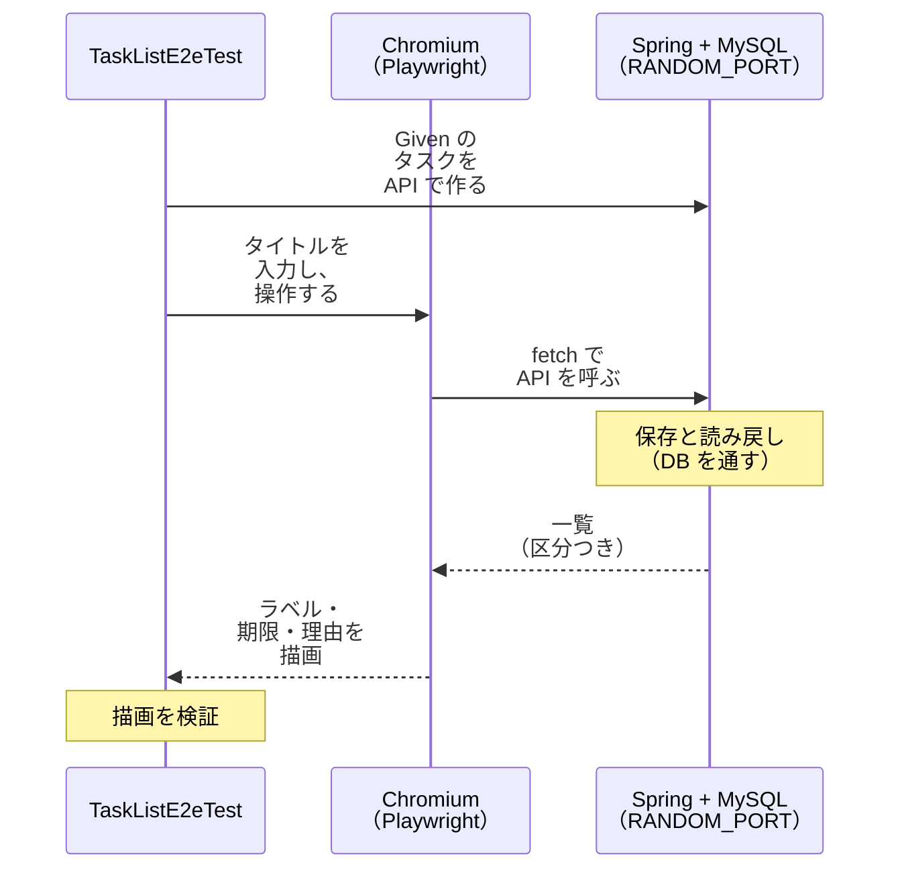

# 02c の実例: タスク管理画面の E2E

[02c E2E 最小化原則](../../../docs/testing/02c-e2e.md)を、このサンプル（Kotlin + Spring Boot）に当てはめた例である。規範は 02c の本文が正で、この文書は例にすぎない。

## 1. 下層の Integration の実例

HTTP の境界、エラー形式、JSON の変換、DB を通した保存の実例は、`src/integrationTest` の次のテストである。

- `TaskApiHttpTest`（登録）
- `TaskOperationHttpTest`（完了・未完了に戻す）
- `TaskListHttpTest`（一覧・並び順・表示の選択）

これらは E2E にしない（02c §5）。

- `@SpringBootTest` と `@AutoConfigureMockMvc`・`@AutoConfigureRestTestClient` を使う。サーバーを起動せずに、Controller から実 DB（Testcontainers の MySQL）までを通す。構成は [02b §3.3](./02b.md#33-db-を含む-integration-のサンプルtestcontainers) にある。
- 画面の静的リソースの配信と、E2E が使う要素（`data-testid`）の存在は、`StaticTaskPageTest` が確かめる。

## 2. E2E の実例

実例は `TaskListE2eTest`（`src/e2eTest`）で、02c §5.1 の4領域すべてに当たる 8 本がある。

| 項目 | 内容 |
|---|---|
| 対象 UI | `src/main/resources/static/index.html` のタスク管理画面 |
| 起動と操作 | Spring を `RANDOM_PORT` で起動し、Playwright の Chromium（ヘッドレス）で操作する |
| TRS | [`TODO-001`](./trs/TODO-001-task-management.md)。AC を決めるのは下層と同じ TRS である。E2E の領域と理由は、TRS の「検証層の選び方」にある |
| 実行 | `./gradlew e2eTest`。CI は `kotlin-samples.yml` の `e2e` ジョブ |
| セットアップ | 実装例の README の「[E2E のセットアップ](../README.md#e2e-のセットアップ)」 |

| テスト | 領域（TRS のタグ） | 対応する AC | 見ているもの |
|---|---|---|---|
| `AC-01-20 画面からタスクを登録できる` | 主要ハッピーパス（`@e2e:happy-path`） | AC-01-20 | タイトルを入力して登録すると、そのタイトルが一覧に描画される |
| `AC-02-05 画面からタスクを完了にできる` | 主要ハッピーパス（`@e2e:happy-path`） | AC-02-05 | 完了にすると、「完了」のラベルが表示される |
| `AC-03-07 画面からタスクを未完了に戻せる` | 主要ハッピーパス（`@e2e:happy-path`） | AC-03-07 | 未完了に戻すと、「未完了」のラベルが表示される |
| `AC-01-21 日付を選ぶ部品で期限を選んで登録できる` | 実ブラウザ操作（`@e2e:browser-operation`） | AC-01-21 | 日付を選ぶ部品の `value` が要求に載り、戻った値が `YYYY-MM-DD` で表示され、期限切れのラベルが付く。`fill` は `value` を直接設定する操作で、カレンダーのポップアップは操作しない |
| `AC-01-22 不正なタイトルの理由が画面に表示される` | 表示（`@e2e:display`） | AC-01-22 | 空のタイトルと 51 字のタイトルの理由が、決められた文言で表示される |
| `AC-01-23 画面から登録したタスクに、未完了のラベルが表示される` | 表示（`@e2e:display`） | AC-01-23 | 登録したタスクに「未完了」のラベルが表示される |
| `AC-04-05 一覧で、未完了と完了と期限切れを見分けられる` | 表示（`@e2e:display`） | AC-04-05 | 3 つの区分のラベルが、ブラウザのタイムゾーン（Asia/Tokyo と America/Los_Angeles）によらず表示される |
| `AC-06-05 画面で完了済みを隠すと、画面を開き直しても隠れたままである` | 通信（`@e2e:communication`） | AC-06-05 | 画面での選択がサーバーと DB を経て、再読み込み後の画面に戻る |

- E2E の 8 本は、TRS で層タグが `@e2e` だけの AC である。下層に同じ AC のテストを置いていない。
  - 同じ振る舞いの一部は下層も別の AC で確かめる。たとえば、完了にした状態の保存は Integration の AC-02-04、状態遷移の規則は層1の AC-02-01 である。
  - E2E は、ボタンの操作から描画までを通す部分だけを見る。同じ AC を E2E と下層の両方に置くと、04 §4.1 の重複の見直しの対象になる。このサンプルは、AC を重ねないことで、その見直しを避けている。
- 入力検証の網羅は層1、異常系は Integration に任せる（02c §5.2）。AC-01-22 は、理由の文言の代表 2 件だけを見る。`DUE_DATE_INVALID` の文言は、日付を選ぶ部品が不正な日付を作れないので、E2E では確かめない。
- Given のデータ（一覧に既にあるタスク）は、原則として API で作る。画面の操作は、その AC の When に当たる部分だけにする。例外は AC-06-05 で、Given が「持ち主が画面で完了済みを隠してある」と画面の操作を求めるので、画面で隠す。
- 成功のステータスは 2xx であることだけを確かめる。201 や 200 は実装の選択で、AC は定めない。
- 時計は実時間で動く。期限は「Asia/Tokyo の今日の 2 日前」のように相対で決める。2 日前にするのは、テストとサーバーの日付の計算の間で日が変わっても、期限切れの判定が変わらないようにするためである。
- 区分のラベルと期限の日付は、サーバーが返した値をそのまま表示する。ブラウザの `Date` で判定しないので、ブラウザのタイムゾーンに依存しない。AC-04-05 は、Playwright の `Browser.NewContextOptions().setTimezoneId(...)` でブラウザのタイムゾーンを切り替えて確かめる。
- 待機は固定の sleep を使わない。Playwright の auto-wait と、自動再試行する `assertThat(...)` で判定する。失敗をテストの再実行で隠さない。失敗したテストだけ、トレースとスクリーンショットを `build/e2e-artifacts` に保存する。
- 画面の要素は `data-testid` で特定する（04 §3.3 規則 2）。

### 期待値の出所

区分のラベル（「未完了」「完了」「期限切れ」）と期限の表示形式は TRS の OI-010、理由の文言は OI-007 の決定による。一方、`data-testid` の名前と画面の部品の配置は、TRS 上の出所が無い、画面の設計である。画面の設計を変えても AC が変わらないように、E2E は文言と値で判定し、見た目の細部（色・配置）は検査しない。

### PR の審査記載の見本

E2E を新規追加する PR には、02c §5.3 の 4 項目を記載する。各テストの KDoc にも同じ内容を書いている。想定実行時間は、ローカルの実測（[02b の記録](./02b.md#41-適用タイミングと閾値)）で、各テストが 0.13〜0.78 秒、クラス全体が 9〜10 秒である。

| 項目 | 内容 |
|---|---|
| 領域 | 主要ハッピーパス 3 本（AC-01-20・02-05・03-07）、実ブラウザ操作 1 本（AC-01-21）、表示 3 本（AC-01-22・01-23・04-05）、通信 1 本（AC-06-05） |
| 下層で代替できない理由 | 入力欄の値の取得、`fetch` による API の呼び出し、応答の描画、日付を選ぶ部品の値の受け渡し、ブラウザのタイムゾーンへの非依存、再読み込み後の画面の状態は、実ブラウザと実配線でしか通らない。日付を選ぶ部品は、`fill` が `value` を直接設定する（`input` と `change` のイベントは発火する）。そこで、部品の `value` が要求に載り、戻った値が表示される配線を見て、カレンダーのポップアップは操作しない。検証の規則と保存の内容は下層が確かめ済み |
| AC | 上の表のとおり |
| 想定実行時間と不安定要因の対策 | 各テスト 1 秒未満。待機は auto-wait と自動再試行する assertion のみ。外部ネットワークに依存しない。期限は相対の日付で、日をまたいでも判定が変わらない。テストごとに DB を消す |

## 3. E2E 予算の CI 設定

このサンプルは 02c §5.4 の上限に「PR パイプライン内で 10 分以内」を採り、CI の `e2e` ジョブの `timeout-minutes: 10` で上限にしている。失敗をリトライや `continue-on-error` で隠さない(ワークフローのコメントによる)。実測と予算の対比は、サンプルの 02b の記録(「仮置きの値の見直し」)に残している。
