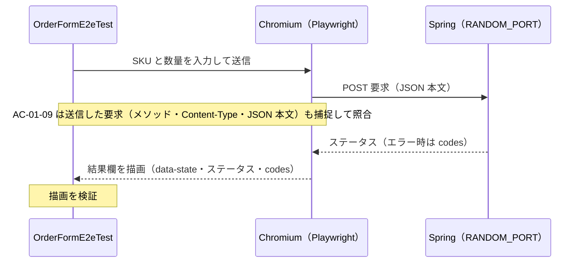

# 02c の実例: 注文追加フォームの E2E

[02c E2E 最小化原則](../../../docs/testing/02c-e2e.md)を、このサンプル（Kotlin + Spring Boot）に当てはめた例である。規範は 02c の本文が正で、この文書は例にすぎない。

## 1. 下層の Integration の実例

HTTP/JSON の境界、ステータス・エラー形式、JSON ⇔ DTO 変換の実例は `OrderControllerHttpTest`（`src/integrationTest`）である。これらは E2E にしない（02c §5）。このテストは `@WebMvcTest` + `RestTestClient` を使い、Web スライスのみ起動する。

## 2. E2E の実例

実例は `OrderFormE2eTest`（`src/e2eTest`）で、02c §5.1 の4領域のうち3領域に当たる3本がある。残る「実ブラウザ操作」に当たるテストはまだ無い。

| 項目 | 内容 |
|---|---|
| 対象 UI | `src/main/resources/static/index.html` の注文追加フォーム |
| 起動と操作 | Spring を `RANDOM_PORT` で起動し、Playwright の Chromium（ヘッドレス）で操作する |
| TRS | [`ORD-001`](./trs/ORD-001-add-item.md)。AC を決めるのは下層と同じ TRS である |
| 実行 | `./gradlew e2eTest`。CI は `kotlin-samples.yml` の `e2e` ジョブ |
| セットアップ | リポジトリ直下の README の「[E2E のセットアップ](../../../README.md#e2e-のセットアップ)」 |

| テスト | 領域（TRS のタグ） | 対応する AC | 見ているもの |
|---|---|---|---|
| `AC-01-04 有効な SKU と数量を送信すると、…HTTP 204 が表示される` | 主要ハッピーパス（`@e2e:happy-path`） | AC-01-04 | 入力して送信すると、結果欄の `data-state` が `success` になり、ステータス 204 が表示される |
| `AC-01-09 範囲外の数量を送信すると、…OUT_OF_RANGE が表示される` | 通信（`@e2e:communication`） | AC-01-09 | ブラウザが組み立てた POST 要求（メソッド・`Content-Type`・JSON 本文）がサーバーに届き、応答の `codes` が画面に戻る |
| `AC-01-12 SKU が空白で数量が範囲外のとき、…codes が 2 件描画される` | 表示（`@e2e:display`） | AC-01-12 | 複数の `codes` が 1 件ずつ別の項目として描画され、`data-state` が `error` になる |

- 同じ AC を下層でも検証している（AC-01-04 は層1と Integration、AC-01-09 は Integration、AC-01-12 は層1と Integration）。E2E は、下層で確かめられない部分（ブラウザでの入力値の取得、要求の組み立て、応答の描画）だけを見る。範囲外の数量や空白の `sku` の網羅は、02c §5.2 のとおり下層に任せている。
- 各テストの KDoc に 02c §5.3 の4項目を書いており、審査記載の見本になる。新しい E2E を足す PR は、この書き方に倣って PR 本文に記載する。

### 期待値の出所

HTTP ステータスと `codes` の値は ORD-001 の AC（OI-003・OI-005・OI-006 で人間が確定）による。一方、結果欄の状態（`data-state`）、`codes` の `<li>` 表示、ステータス表示は、TRS 上の出所が無い。現状は画面の設計を暫定の正とし、ORD-001 の OI-007 に起票している。画面の AC を足すかは人間が決める。

## 3. E2E 予算の CI 設定

このサンプルは 02c §5.4 の上限に「PR パイプライン内で 10 分以内」を採り、CI の `e2e` ジョブの `timeout-minutes: 10` で上限にしている。失敗をリトライや `continue-on-error` で隠さない(ワークフローのコメントによる)。実測と予算の対比は、サンプルの 02b の記録(「仮置きの値の見直し」)に残している。
