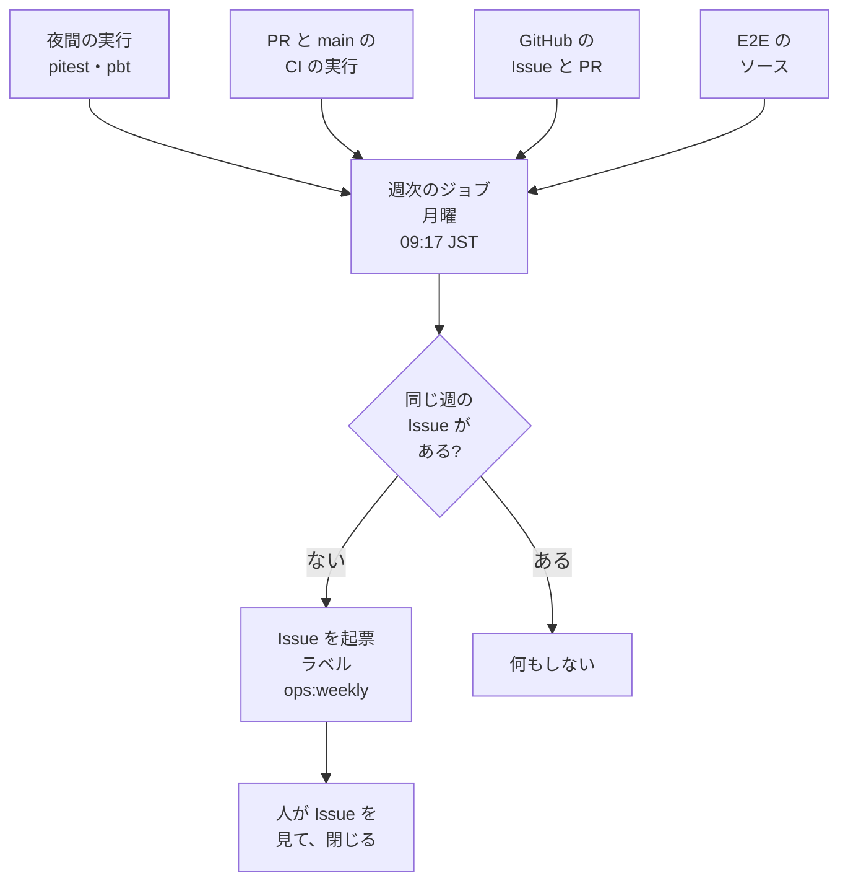

# 04 リグレッション運用規程のサンプルでの実装

[04 リグレッション＆AIヒーリング運用規程](../../../docs/testing/04-regression-governance.md)の規範を、このサンプル（Kotlin + Spring Boot）でどう実装しているかの記録です。規範そのものは 04 が正で、ここは導入の一例です。配布の対象ではありません。

## 1. 原因分類と還元先の具体例（04 §2.2・§2.4）

04 §2.2 の分類を、このサンプルの言語機能とツールに当てはめると次のようになります。

| 分類 | このサンプルでの還元先 |
|---|---|
| 型で防げた不正状態 | ドメイン型化、`sealed` 型、網羅的な `when`（`allWarningsAsErrors` により非網羅の `when` はビルドエラー。[02a](../../../docs/testing/02a-types-and-pbt.md)） |
| 禁止パターンの混入 | detekt のルールと Konsist による検査（[02b §6](../../../docs/testing/02b-execution-and-mutation.md)） |
| 状態遷移の抜け | `sealed` 型の状態機械＋ PBT（操作列）。実例は `PaymentTransitionsTest` |

静的解析の道具は、構文・スタイルの検査に detekt と ktlint、アーキテクチャ・テスト保護の検査に Konsist を使っています。

### 1.1 静的解析を選ぶ例（04 §2.4）

04 §2.4 の架空の例「デバッグ用に残した標準出力への出力が、本番で個人情報を出力した」を、このサンプルに当てはめます。

`config/detekt/detekt.yml` には、`println` / `print` を禁止する `ForbiddenMethodCall` が既にあります（理由は「ログは SLF4J を使う」）。そのため新しいルールは足さず、違反例（`println` を含むコード）でこのルールが失敗することを確認して再発を防ぎます。

### 1.2 ミューテーション確認が該当なしになる範囲（04 §2.5）

静的解析で還元した場合、ミューテーション確認は該当なしです。ルールは pitest の対象外です。

## 2. テストの意図的な無効化（04 §3.4.1）

テスト保護検査は `TestProtectionTest`（Konsist、`./gradlew test` で実行）です。次を検出して失敗させます。

- JUnit の `@Disabled`、`@Ignore` 系の注釈
- Kotest の `xdescribe` 系、テスト名先頭の `!`、`enabled = false`

04 §3.4.1 の手順 3（許可リストへの追加）は、`TestProtectionTest` の `allowed` に、ファイル名を理由・期限つきで追加することです。`src/test/kotlin/com/example/architecture/` は `.github/CODEOWNERS` の対象で、変更には人間の承認が要ります。現在の `allowed` は 0 件です。

## 3. 雛形の運用（04 §2.5・§2.6）

標準の雛形（`docs/testing/templates/`）を、このリポジトリでは GitHub の機能に次のように設定しています。雛形と中身は同じ項目にそろえますが、`.github/` はこのリポジトリの運用であり、配布の対象ではありません。

| 標準の雛形 | このリポジトリの設定 |
|---|---|
| [バグ報告の雛形](../../../docs/testing/templates/bug-report.md) | Issue Form（`.github/ISSUE_TEMPLATE/bug_report.yml`）。発見層・再現手順・関連 TRS を必須にする |
| [バグ修正 PR の雛形](../../../docs/testing/templates/bug-fix-pr.md) | PR テンプレート（`.github/PULL_REQUEST_TEMPLATE/bug_fix.md`）。`gh pr create --template bug_fix.md` で使う |

PR の本文の検査は、タイトルが `fix:` で始まる PR に対して、ワークフロー `pr-bug-fix-check.yml` が `scripts/check-bug-fix-pr.sh` を実行して行います。検査するのは次の 2 点です。

- 本文に「## 不具合還元」「## 完了条件」の見出しがあること
- 「## 完了条件」の下に、未チェックの項目が無いこと

雛形の見出しは、この検査が使うため変えません。コマンドラインや API からの起票は、Issue Form を経由しないため強制できません（04 §2.6）。

## 4. 検証コマンド

バグ修正 PR の「検証」欄（雛形では「プロジェクトの品質ゲートを通した」）に当たるコマンドは、このリポジトリでは次です。

```bash
npm run lint
cd examples/kotlin-spring && ./gradlew detekt ktlintCheck test pitest && ./gradlew pitest -Ppitest.domainOnly=true
```

## 5. 運用の指標の週次起票（04 §3・§5）

04 §5 の週次・月次の運用のうち、機械で集められる部分を実演します。04 §3 の運用の仕組み化は、判断と理由を記録します。

### 5.1 方針と根拠

夜間のジョブと週次のジョブが指標を集め、週に 1 度、1 つの Issue にまとめて起票します。人が見るのは、その Issue だけです。

| 標準の項目 | 状態 |
|---|---|
| 04 §5 の週次・月次の運用 | 実演する（機械で集める部分） |
| 04 §3 の AI ヒーリングの運用の仕組み化 | 判断と理由の記録 |

04 §5 は、指標の収集・提示と、その解釈・判断に分けられます。収集と提示は機械で繰り返せるので実演します。解釈と判断は人が行います。根拠は次の 3 か所です。

- E2E の破棄は人の承認を経る（04 §4.4）
- flaky の隔離後の修復か破棄の決定と、期限の延長は人が行う（02c §5.4）
- 原因分析の妥当性の確認は人が行う（01 §4 の「不具合修正」の行）

実演しない部分は、5.4 に書きます。層3 の AI 探索は定期実行しないので、週次の Issue には載せません。

04 §3 の運用の仕組み化は、次の記録のとおり、いまは実演しません。形式は 05 の据置の記録と同じです。

| 項目 | 内容 |
|---|---|
| 対象 | ヒーリング履歴の収集とレビュー（04 §3 の運用の仕組み化） |
| 理由 | AI ヒーリングの実績も履歴の記録も無く、集める対象が無い |
| 再評価のトリガー | 初めての AI ヒーリング PR ができたとき、または履歴の記録の規約ができたとき |

### 5.2 運用の形



| 段 | 何をするか |
|---|---|
| 夜間 | `nightly-mutation.yml` が、ミューテーションと PBT の増量を実行する。変えない |
| 週次 | `weekly-ops.yml` が、毎週月曜 09:17 JST に `scripts/weekly-ops-report.mjs` を実行する |
| 人 | 起票された Issue を読み、チェックリストを確かめて、Issue を閉じる |

週次のジョブは、直近 30 日の実行履歴を読み、直近の完了した週（月曜 0 時 JST から 7 日）の Issue を起票します。起票する月曜は、対象期間の翌日です。

月の最初の月曜（1〜7 日）に起票する Issue には、月次の項目を足します。月次の項目は、04 §4.1 の E2E 見直しと指標レビューです。

### 5.3 集める指標

| 04 §5 の項目 | 集め方 |
|---|---|
| Mutation Score（層1） | 夜間の `pitest` ジョブのログを、全体とドメイン層だけに分けて読む |
| 夜間の実行 | 夜間の各ジョブの結論 |
| flaky の棚卸し、flaky 率 | 再試行で「失敗 → 成功」になった同名のジョブを候補とする。PBT を含むジョブは別に出す |
| E2E の総実行時間 | `e2e` ジョブと `e2eTest` の手順の所要時間。`test`・`integration` も同じ形 |
| E2E の件数 | ソースの `@Test` の数と、領域タグ（`@e2e:<領域>`）の数 |
| 不具合の発見層の分布 | `bug` ラベルの Issue の本文の「発見層」 |
| 不具合還元率 | クローズした `bug` のうち、還元済みの割合 |
| 月次の E2E 見直し、指標レビュー | 直近 30 日の集計を載せる。判断は人 |

各指標の補足は次のとおりです。

- Mutation Score は、直近 30 日の最初・最新・最小・最大と、ミュータントの総数を出す。総数が変わった場合は印を付ける。
- 夜間の結果は、成果物ではなくジョブのログから読む。夜間のワークフローを変えずに済み、閾値も対象も変わらない。ログの保持期間は既定で 90 日で、30 日の窓に足りる。
- 実行時間は、予算（`e2e` ジョブの `timeout-minutes`）に達したジョブの件数と、最大の所要時間の予算に対する割合を出す。打ち切られたジョブは成功にならないため、成否を問わず所要時間で数える。
- E2E の領域タグと `@Test` の数が食い違うときは、審査の記載（02c §5.3）を確かめる印を付ける。
- 発見層は Issue Form（3 章）で構造化されている。層3・本番の割合も出す。
- 還元済みの定義は 5.7 に書く。

### 5.4 集めないもの

| 項目 | 集めない理由 |
|---|---|
| ヒーリングの件数と履歴（昇格件数を含む） | 5.1 の記録のとおり、対象が無い |
| テスト単位の flaky | テストごとの結果の履歴が無い |
| 解釈と判断 | 人が行う |

ヒーリング PR を機械で見分ける規約（ラベルなど）は、初めての AI ヒーリング PR ができた後に決めます。テスト単位の flaky は、ジョブ単位の候補までしか分かりません。

取得できなかったデータ源があっても、その節に「取得できず」と理由を書いて、残りの節で起票します。全体を失敗にしないのは、一部が欠けても残りの指標を人が見られるようにするためです。このとき、ワークフローは成功のままなので、人は本文の「取得できず」を確かめます。

### 5.5 Issue の書式

題は `週次運用レポート <週の鍵>` で、週の鍵は JST の ISO 週です。ラベルは `ops:weekly` です。同じ週の Issue があるかは、ラベルの付いた Issue の題が一致するかで判定します。検索 API は反映が遅れるため、使いません。

本文の骨格は次のとおりです。各節の数値は機械が埋めます。

```markdown
<!-- ops-weekly:2026-W44 -->
# 週次運用レポート 2026-W44

対象期間: 2026-10-26（月）〜 2026-11-01（日）（JST、7 日）。…

## 1. 夜間の実行（PBT 増量・全体ミューテーション）
（実行ごとの結論と Mutation Score の表、夜間の閾値）
### Mutation Score の推移（層1）
（直近 30 日の最初・最新・最小・最大、ミュータントの総数、閾値との差）
## 2. flaky の候補と再実行
（週と 30 日の再実行の回数・候補・候補率・反例の可能性、`e2e` ジョブの候補が例示の 3 回に達したか）
## 3. 実行時間
（`test`・`integration`・`e2e` の中央値と最大、E2E の予算に達したジョブの件数）
## 4. E2E の件数
（`@Test` の数、領域タグの数と内訳）
## 5. 不具合
（`bug` の起票・クローズ、`fix:` の PR、還元率、発見層の分布）
## 6. 集めていないもの
## 人が見ること
- [ ] 夜間の失敗と、Mutation Score の閾値との差
- [ ] flaky の候補の原因と、PBT の反例の可能性
- [ ] 実行時間が予算内か
- [ ] 層3・本番で見つかった不具合が増えていないか
- [ ] ヒーリング履歴のレビュー（履歴の記録ができたら）
### 月次（月の最初の月曜に起票するレポートだけ）
- [ ] E2E の見直し（04 §4.1）
- [ ] 指標のレビュー
```

### 5.6 権限と起動

週次のジョブの権限は、最小にします。

| 権限 | 理由 |
|---|---|
| `contents: read` | E2E のソースを数えるためにチェックアウトする |
| `actions: read` | 実行履歴、ジョブ、ログを読む |
| `pull-requests: read` | マージされた `fix:` の PR を読む |
| `issues: write` | Issue を起票する。これ以外には書き込まない |

- チェックアウトの認証情報は残さない（`persist-credentials: false`）。
- 起票には、ラベル `ops:weekly` があらかじめ存在している必要があります。無いときはスクリプトが理由を出して止まります。ジョブの中ではラベルを作りません。
- `schedule` と `workflow_dispatch` は、既定のブランチにあるワークフローだけが動きます。統合ブランチ上では起動できず、既定のブランチへ統合した後に確かめます。
- 手で起動するときの入力 `dry_run` を `true` にすると、起票せず、本文をジョブのサマリに出します。初回は `dry_run` で本文を確かめてから、`false` で起動します。
- 手元では `node scripts/weekly-ops-report.mjs` が、起票せずに本文を標準出力に出します。`--self-test` は、集計と本文の生成を固定のデータで確かめます。
- `concurrency` は、`schedule` と手動の起動が重なっても二重に起票しないための設定です。

### 5.7 標準から決まらず、この実現例で仮に決めたもの

標準は次の定義を決めていないため、この実現例で仮に決めました。運用の実績で見直します。

| 項目 | この実現例の定義 |
|---|---|
| flaky の候補 | 同じ実行の再試行で、前の試行に失敗し、最新の試行で成功した同名のジョブ |
| PBT を含むジョブ | `test`・`pbt`。候補とは分けて「反例の可能性」と出し、候補率の分子にも分母にも数えない |
| 候補率の分母 | 最新の試行で成功か失敗で終わった、PBT 以外のジョブの実行数 |
| 04 §4.1 の判定の線 | `e2e` ジョブの候補が直近 30 日で 3 回（標準の例示）に達したか |
| 月次の起票日 | 月の最初の月曜（1〜7 日） |
| Mutation Score の要確認の線 | 最新の全体スコアと夜間の閾値の差が 5 ポイント未満 |
| 還元済み | 完了条件の検査を通った `fix:` の PR が閉じた `bug` |
| 還元率の分母 | その期間にクローズした `bug`。未クローズの件数は別に出す |

- PBT を含むジョブの「失敗 → 再試行で成功」は、flaky より反例の可能性が高い。ログのシードで再現する（02a §2.3.1）。
- 04 §4.1 の「達した」は、判定そのものではない。見直しの要否は、月次に人が決める。
- 完了条件の検査は、`check-bug-fix-pr.sh` を実行するワークフロー `pr-bug-fix-check.yml` の成否で見る。
