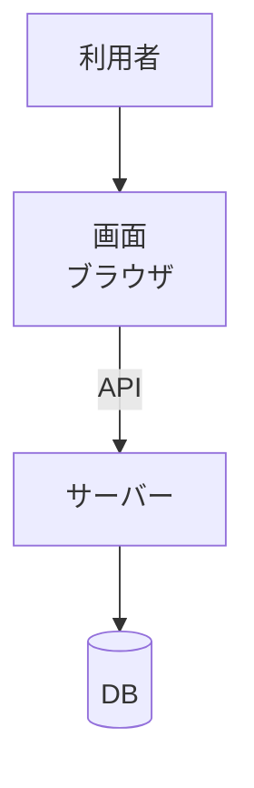

# 基本設計書: タスク管理（登録・完了・一覧と期限）

> この基本設計書は、標準の[基本設計書のテンプレート](../../../../docs/testing/templates/basic-design.md)に沿って書いた。[要件定義書](../requirements/TODO-001-task-management.md)を実現する方式を書き、TRS を生成するときの入力になる（[03 §5.2](../../../../docs/testing/03-trs-guideline.md#52-入力の文書)）。
> 用語は[要件定義書の用語](../requirements/TODO-001-task-management.md#22-用語)を使う。
> 書いた内容は、要件定義書の要件と、TRS の UC の基本フローから導いた。TRS の Open Issues（OI）の決定から来た値にだけ、OI を括弧で添えた。
> 実装にだけ値があり、仕様が無いものは、項目には値を書かず、節 10 の未決事項に挙げた。

## メタ情報

| 項目 | 内容 |
|---|---|
| 機能名 | タスク管理（登録・完了・一覧と期限） |
| 要件 ID の略号 | `TODO`（要件定義書と同じ） |
| 対応する要件定義書 | [TODO-001](../requirements/TODO-001-task-management.md) |
| 対応する TRS | [TODO-001](../trs/TODO-001-task-management.md) |
| 参照文書 | なし。根拠は、要件定義書と TRS の Open Issues に記録したオーナーの決定である |
| 基本設計の承認者 | リポジトリのオーナー |
| 状態 | 起草中（オーナーの承認前） |
| 作成日 / 最終更新日 | 2026-11-10 / 2026-11-10 |

## 1. 全体構成

> この節の行には ID を付けない。

このサンプルは、他のシステムと連携しない。画面、サーバー、DB で構成する。

| 構成要素 | 役割 |
|---|---|
| 画面（ブラウザ） | タイトルと期限の入力、一覧の表示、完了と未完了に戻す操作、完了済みの切り替えを受け、API を呼ぶ。区分は判定せず、サーバーが返した区分を表示する |
| サーバー（API） | 入力を検証し、タスクの登録、状態の変更、一覧の作成、完了済みの選択の保存を行う。区分の判定と並び替えは、ここで行う。拒否のときは理由コードを返す |
| DB | タスクと、完了済みの表示の選択を保存する |
| 外部システム | なし |

## 2. 画面

> 画面は「タスク管理」の 1 つだけである。部位ごとに行を分けた。

| ID | 画面 | 表示と操作 |
|---|---|---|
| DES-TODO-01 | タスク管理: 登録欄 | タイトルの入力欄、期限を選ぶ日付の部品、登録の操作を置く。登録に成功したら、タイトルと期限の入力欄を空に戻す（OI-014） |
| DES-TODO-02 | タスク管理: 理由の表示欄 | 登録が拒否されたとき、返された理由コードごとに、対応する文言を表示する（文言は節 8）。登録に成功したら、表示を消す（OI-014）。画面の操作では、複数の理由は同時に起きない。日付を選ぶ部品が不正な日付を作れず、空と 50 字超は両立しないためである |
| DES-TODO-03 | タスク管理: 完了済みの切り替え | 完了済みを隠すか表示するかを切り替える操作を置く。開いたとき、保存された選択を反映する |
| DES-TODO-04 | タスク管理: 一覧 | 各タスクのタイトル、期限、区分のラベルを表示する。期限は `YYYY-MM-DD`、ラベルは「未完了」「完了」「期限切れ」である（OI-010）。未完了と期限切れのタスクには完了にする操作を、完了のタスクには未完了に戻す操作を置く。並び順は、REQ-TODO-26 から 28 に従う |

## 3. 帳票

該当なし。

## 4. 入力項目とデータ

> 形式と検証の規則は、要件定義書の業務ルールを正とし、ここに書き写さない。

| ID | 区分 | 項目 | 形式と検証の規則 |
|---|---|---|---|
| DES-TODO-05 | 入力 | タイトル | 文字列で、必須である。API に項目が無いときは、空と同じに扱う（OI-001）。長さ・空白・表示されない文字の扱いは、REQ-TODO-15 から 17 と REQ-TODO-31 に従う |
| DES-TODO-06 | 入力 | 期限（入力の部品） | 任意である。日付を選ぶ部品で入力する |
| DES-TODO-07 | 入力 | 期限（形式と範囲） | `YYYY-MM-DD` の実在する暦日である（OI-005）。時刻は持たない（REQ-TODO-19）。下限は REQ-TODO-34 に従う。9999-12-31 も受け付ける（OI-011） |
| DES-TODO-08 | 入力 | 期限（空文字列・省略・null） | 空文字列は不正である。項目を省くか null のときは、期限なしである（OI-012） |
| DES-TODO-09 | 保存 | タスク | 番号、タイトル（REQ-TODO-17 で除いた後の値）、期限（無ければ無し）、状態（未完了か完了）、登録時刻を保存する。番号は、登録ごとに増え、登録時刻が同じタスクの新旧を決める（OI-009） |
| DES-TODO-10 | 保存 | 完了済みの表示の選択 | 「表示する」か「隠す」のどちらかである。利用者は 1 人なので、保存するのは 1 つだけである。保存された選択が無いときは、「表示する」として扱う |

## 5. 状態と操作

> 状態はタスクの状態（未完了・完了）と、完了済みの表示の選択である。区分は、状態と期限と今日の日付から決まる。

| ID | 状態 | 操作 | 結果 |
|---|---|---|---|
| DES-TODO-11 | まだ無い | 登録する。入力が正しい | 未完了のタスクとして保存する |
| DES-TODO-12 | まだ無い | 登録する。入力が不正 | 拒否する。保存しない。理由コードを返す（節 8） |
| DES-TODO-13 | 未完了 | 完了にする | 完了になる。タイトルと期限は変わらない |
| DES-TODO-14 | 完了 | 完了にする | 何も変えず、成功とする |
| DES-TODO-15 | 完了 | 未完了に戻す | 未完了になる。タイトルと期限は変わらない |
| DES-TODO-16 | 未完了 | 未完了に戻す | 何も変えず、成功とする |
| DES-TODO-17 | 存在しないタスク。識別子の形が正しくない場合を含む | 完了にする、未完了に戻す | 拒否する。何も変えない。404 と `TASK_NOT_FOUND` を返す（OI-006、OI-012） |
| DES-TODO-18 | 完了 | 一覧を開く | 区分は「完了」である。期限を過ぎていても同じである |
| DES-TODO-19 | 未完了。期限が無い、または期限の日が今日以後 | 一覧を開く | 区分は「未完了」である |
| DES-TODO-20 | 未完了。期限の日が今日より前 | 一覧を開く | 区分は「期限切れ」である |
| DES-TODO-21 | 選択が「表示する」。または、保存された選択が無い | 一覧を開く | 完了済みを含めて表示する |
| DES-TODO-22 | 選択が「隠す」 | 一覧を開く | 完了済みを除いて表示する |
| DES-TODO-23 | 選択が「表示する」 | 隠すに切り替える | 選択が「隠す」になり、保存される。一覧から完了済みが消える |
| DES-TODO-24 | 選択が「隠す」 | 表示するに切り替える | 選択が「表示する」になり、保存される。一覧に完了済みが現れる |

## 6. バッチ

該当なし。

## 7. 外部インタフェース

> このサンプルは他のシステムと連携しない。画面とサーバーの間の API を、サーバーから見た外部との境界として、この節に書いた。パスと HTTP メソッド、項目名と値は、仕様が無いので、節 10 の Q-01 から Q-03 に挙げた。

| ID | 連携先 | 方向と方式 | やり取りする内容 |
|---|---|---|---|
| DES-TODO-25 | 画面（登録） | 画面からサーバーへ。同期の要求と応答。成否は HTTP ステータスで判定し、成功は 2xx | タイトルと期限（任意）を受け、検証して未完了で保存する。拒否は 400 と理由コード（節 8）。JSON として読めない本文と、型や形が定義と違う本文は、400 と `MALFORMED_REQUEST`。定義にない項目は無視する（OI-001、OI-013） |
| DES-TODO-26 | 画面（完了にする） | 同上 | 対象のタスクを指して要求する。完了済みへの要求も成功とする。存在しないときは、404 と `TASK_NOT_FOUND`（OI-006） |
| DES-TODO-27 | 画面（未完了に戻す） | 同上 | 対象のタスクを指して要求する。未完了への要求も成功とする。存在しないときは、404 と `TASK_NOT_FOUND`（OI-006） |
| DES-TODO-28 | 画面（一覧） | 同上 | タスクを区分つきで返す。順序は、REQ-TODO-26 から 28 に従う。選択が「隠す」のときは、完了済みを除く |
| DES-TODO-29 | 画面（完了済みの選択） | 同上 | 選択の取得と変更ができる。値は「表示する」か「隠す」である。未知の値の変更は、選択を変えず、400 と `MALFORMED_REQUEST`（OI-013） |
| DES-TODO-30 | 画面（拒否の応答の形） | 同上 | 400 と 404 の本文は、ProblemDetail（RFC 9457）に、理由コードの配列 `codes` を足した形にする。`status` は HTTP ステータスと同じ値である。複数の理由があるときは、すべて入れる。順序は決めない（OI-001、OI-011、OI-018） |

## 8. メッセージ

> 画面に表示する文言は、理由コードごとに決めた（OI-007）。`MALFORMED_REQUEST` と `TASK_NOT_FOUND` の画面の文言は決まっていないので、節 10 の Q-05 に挙げた。

| ID | 契機 | 文言 | エラーコード |
|---|---|---|---|
| DES-TODO-31 | タイトルが、空、空白と表示されない文字だけ、または無いまま登録しようとした | タイトルを入力してください | `TITLE_BLANK` |
| DES-TODO-32 | タイトルが 50 字を超えるまま登録しようとした | タイトルは 50 文字以内で入力してください | `TITLE_TOO_LONG` |
| DES-TODO-33 | 期限が、日付として正しくない値で登録しようとした。`YYYY-MM-DD` として読めない、実在しない日、0001-01-01 より前、空文字列を含む | 期限の日付が正しくありません | `DUE_DATE_INVALID` |
| DES-TODO-34 | 本文が JSON として読めない、型や形が定義と違う、完了済みの選択に未知の値が来た | 未決（Q-05） | `MALFORMED_REQUEST` |
| DES-TODO-35 | 存在しない、または識別子の形が正しくないタスクを、完了にする、未完了に戻す | 未決（Q-05） | `TASK_NOT_FOUND` |

## 9. 非機能の実現方式

> 性能と可用性は、要件にしない（要件定義書の未決事項）。

| ID | 観点 | 実現方式 |
|---|---|---|
| DES-TODO-36 | 永続性（タスク） | 登録したタスクと、その完了の状態を、サーバー側の DB に保存する |
| DES-TODO-37 | 永続性（選択） | 完了済みの表示・非表示の選択を、サーバー側の DB に保存する |
| DES-TODO-38 | 日付の基準 | 区分の判定に使う今日の日付は、サーバーの現在時刻を Asia/Tokyo の日付にしたものとする。ブラウザの時刻や時間帯に依存しない |

## 10. 未決事項

> 実装にだけ値があり、要件定義書と TRS に仕様が無いものを、問いにして挙げた。値を仕様にするかは、オーナーが決める。
> 実装の値は、この表の下の表にまとめた。決める前の参考であり、期待値ではない。

| ID | 内容 | 担当 | OI-ID |
|---|---|---|---|
| Q-01 | 登録、一覧、完了済みの選択の API のパスと HTTP メソッドを、定めるか。完了と未完了に戻すのパスは、TRS の OI-012 の決定の例（`/tasks/abc/complete`、`/tasks/abc/reopen`）に現れる。この例を、仕様として採るか。未決 | オーナー | — |
| Q-02 | 成功の応答（登録、完了、未完了に戻す、完了済みの選択の取得と変更）の HTTP ステータスと本文を、定めるか。TRS の決定は 2xx だけである。OI-016 の文中の 201 は、観測した値で、決定ではない。未決 | オーナー | — |
| Q-03 | 要求の項目名と、完了済みの選択の値を、定めるか。TRS は、どちらも定めていない。未決 | オーナー | — |
| Q-04 | 画面の文言と表示の細目を、どこまで定めるか。TRS が決めたのは、区分のラベル、理由の文言、期限の表示形式だけである（OI-007、OI-010、AC-01-21）。未決 | オーナー | — |
| Q-05 | 文言が決まっていない理由コード（`MALFORMED_REQUEST`、`TASK_NOT_FOUND`）のとき、画面に何を表示するか。未決 | オーナー | — |
| Q-06 | 識別子の正しい形のうち、上限の値と 0 の扱いを、定めるか。水準 F8-L3 は、不正な形を挙げるが、上限と 0 は挙げていない。未決 | オーナー | — |
| Q-07 | 拒否の応答の `detail` の文言を、仕様にするか。TRS は、本文の `status` と `codes` だけを定めている。未決 | オーナー | — |

実装の値(参考)は、次のとおりである。

| Q-ID | 実装の値 |
|---|---|
| Q-01 | 登録が `POST /tasks`、一覧が `GET /tasks`、完了が `POST /tasks/{id}/complete`、未完了に戻すが `POST /tasks/{id}/reopen`、完了済みの選択の取得と変更が `GET`・`PUT /settings/completed-visibility` |
| Q-02 | 登録は 201、完了・未完了に戻す・選択の取得と変更は 200。登録・完了・未完了に戻すは、タスク 1 件（`id`・`title`・`dueDate`・`status`・`category`）を返す。`status` は `OPEN`・`DONE`、`category` は `OPEN`・`DONE`・`OVERDUE`。選択は `visibility` を返す |
| Q-03 | 登録は `title`・`dueDate`。選択は `visibility` で、値は `SHOW`・`HIDE` |
| Q-04 | 入力欄のラベルは「タイトル」「期限」。操作は「登録」「完了にする」「未完了に戻す」。切り替えは「完了済みを隠す」のチェックボックス。期限が無いタスクの期限欄は空 |
| Q-05 | 登録が拒否され、`codes` が無いか未知のコードのときは、「登録に失敗しました」を表示する。完了と未完了に戻す操作の失敗では、何も表示せず、一覧を取り直す |
| Q-06 | 先頭にゼロを置かない 10 進数字の並びで、0 を含み、64 ビット符号つき整数に収まるものを、正しい形とする |
| Q-07 | 日本語の文言を入れている |

---

## レビューチェックリスト

- [ ] すべての節に、値か、未決事項の Q か、「該当なし」が書かれている
- [ ] 節 2 から 9 のすべての項目に、`DES-<略号>-<番号>` の ID が付いている
- [ ] 項目 ID が、すべての基本設計書で重複していない
- [ ] 用語が、要件定義書の用語の節と食い違わず、重複して書かれていない
- [ ] 全体構成が、各節の項目と矛盾しない
- [ ] テストで確かめられない非機能の項目が、書かれていない
- [ ] 決まっていないことが、項目ではなく未決事項に書かれている
