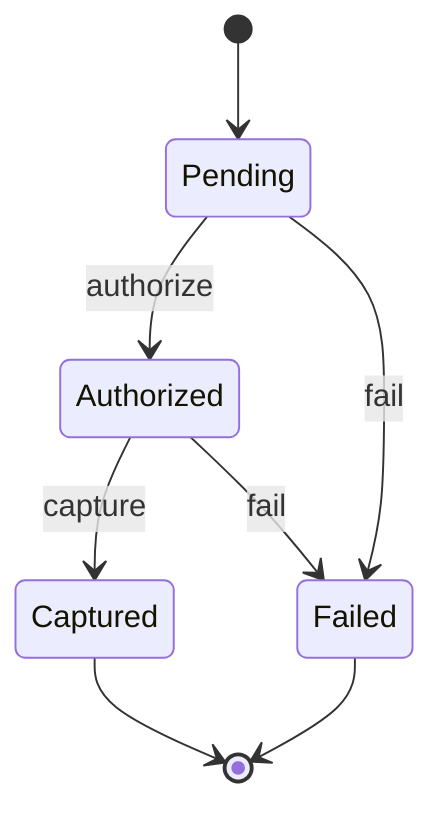

# TRS-PAY-001: 決済状態の遷移

> `PaymentState` の遷移ルールを定める TRS。実装とテストは #28 で行った。
> 遷移ルールは、人間（@toshio-shiratori）が OI-001〜004 で決定した。既存コードの挙動からの逆生成ではない
> （既存の `PaymentState` は状態の定義と `label` だけで、遷移関数は無い）。
> AC / UC の番号は、`TraceabilityTest` が全 TRS のテストを横断して照合するため、TRS 間で重複しないように採番する（ORD-001 が `01`、本 TRS が `02`）。
> **ステータスは Approved(2026-10-11、承認者 toshio-shiratori)。Approved にできるのは人間のみで、以後の変更も人間の承認を要する。**

## メタ情報

| 項目 | 内容 |
|---|---|
| TRS ID | `PAY-001` |
| 機能名 | 決済状態の遷移（与信・確定・失敗） |
| ステータス | Approved |
| 仕様の正（SSOT） | 独立した仕様書・デザインは無い。遷移ルールは本 TRS の OI-001〜004 で人間が確定した（`PaymentState` は [02a §1.3](../../../../docs/testing/02a-types-and-pbt.md) のサンプル） |
| 関連 TRS | なし |
| 作成日 / 最終更新日 | 2026-10-10 / 2026-10-11 |
| 仕様承認者 | toshio-shiratori(2026-10-11 承認) |

---

## 第1部：仕様レイヤー

### 1. ユーザーストーリー（US）

| ID | ストーリー |
|---|---|
| US-01 | 運営者として、決済が正しい順序でしか進まないようにしたい。なぜなら二重請求や、失敗した決済の確定を防ぎたいから |
| US-02 | 運営者として、終わった決済（確定・失敗）を後から書き換えられないようにしたい。なぜなら会計の記録を壊したくないから |

### 2. ユースケース（UC）

#### UC-02: 決済の状態を遷移させる

| 項目 | 内容 |
|---|---|
| 関連 US | US-01, US-02 |
| アクター | 決済処理（システム内部の呼び出し元） |
| 事前条件 | 決済が `Pending` / `Authorized` / `Captured` / `Failed` のいずれかの状態にある |
| 事後条件 | 許可された遷移なら新しい状態になる。許可されていない遷移なら状態は変わらず、理由 `INVALID_TRANSITION` で拒否される |

状態は4つ。`Captured` と `Failed` は終端で、そこからはどの操作でも遷移できない。操作は `authorize`（与信）・`capture`（確定）・`fail`（失敗。理由を伴う）の3つ。



**基本フロー**

1. 呼び出し元が、現在の状態に対して操作（`authorize` / `capture` / `fail`）を要求する
2. システムが、その状態でその操作が許可されているかを遷移表で判定する
3. 許可されていれば、システムが新しい状態を返す

**代替フロー／例外フロー**

| ID | 分岐点 | 内容 |
|---|---|---|
| UC-02-A1 | 手順2 | 許可されていない遷移（例: `Pending` への `capture`、`Authorized` への再度の `authorize`）は、状態を変えずに `INVALID_TRANSITION` で拒否する |
| UC-02-A2 | 手順2 | 終端状態（`Captured` / `Failed`）への操作は、どの操作でも状態を変えずに `INVALID_TRANSITION` で拒否する |

### 3. 受入条件（AC / Gherkin）

| AC ID | 関連 UC | 検証層 | 優先度 | 紐づくテスト |
|---|---|---|---|---|
| AC-02-01 | UC-02 | 層1 | Must | `PaymentTransitionsTest::AC-02-01 …` |
| AC-02-02 | UC-02 | 層1 | Must | `PaymentTransitionsTest::AC-02-02 …` |
| AC-02-03 | UC-02 | 層1 | Must | `PaymentTransitionsTest::AC-02-03 …` |
| AC-02-04 | UC-02 | 層1 | Must | `PaymentTransitionsTest::AC-02-04 …` |
| AC-02-05 | UC-02-A1 | 層1 | Must | `PaymentTransitionsTest::AC-02-05 …` |
| AC-02-06 | UC-02-A2 | 層1 | Must | `PaymentTransitionsTest::AC-02-06 …` |
| AC-02-07 | UC-02-A1, UC-02-A2 | 層1（PBT） | Must | `PaymentTransitionsTest::AC-02-07 …` |
| AC-02-08 | UC-02-A2 | 層1（PBT） | Must | `PaymentTransitionsTest::AC-02-08 …` |

```gherkin
Feature: 決済状態の遷移

  # AC-02-01〜08 は OI-002〜004 で期待値が確定し、#28 で実装した。

  @AC-02-01 @layer:1
  Scenario: Pending は authorize で Authorized になる
    Given 決済が Pending である
    When  authorize を要求する
    Then  決済は Authorized になる
    And   authorizedAt は注入された Clock の現在時刻である

  @AC-02-02 @layer:1
  Scenario Outline: Pending は fail で Failed になり、理由が保たれる
    Given 決済が Pending である
    When  理由 "<reason>" で fail を要求する
    Then  決済は理由 "<reason>" の Failed になる

    Examples:
      | reason        |
      | CARD_DECLINED |
      | TIMEOUT       |

  @AC-02-03 @layer:1
  Scenario: Authorized は capture で Captured になる
    Given 決済が Authorized である
    When  capture を要求する
    Then  決済は Captured になる
    And   capturedAt は注入された Clock の現在時刻である

  @AC-02-04 @layer:1
  Scenario Outline: Authorized は fail で Failed になり、理由が保たれる
    Given 決済が Authorized である
    When  理由 "<reason>" で fail を要求する
    Then  決済は理由 "<reason>" の Failed になる

    Examples:
      | reason        |
      | CARD_DECLINED |
      | TIMEOUT       |

  @AC-02-05 @layer:1
  Scenario Outline: 許可されていない遷移は INVALID_TRANSITION で拒否される
    Given 決済が <state> である
    When  <operation> を要求する
    Then  拒否され、理由は "INVALID_TRANSITION" である
    And   決済の状態は <state> のまま変わらない

    Examples:
      | state      | operation |
      | Pending    | capture   |
      | Authorized | authorize |

  @AC-02-06 @layer:1
  Scenario Outline: 終端状態からはどの操作でも遷移できない
    Given 決済が <state> である
    When  <operation> を要求する
    Then  拒否され、理由は "INVALID_TRANSITION" である
    And   決済の状態は <state> のまま変わらない

    Examples:
      | state    | operation |
      | Captured | authorize |
      | Captured | capture   |
      | Captured | fail      |
      | Failed   | authorize |
      | Failed   | capture   |
      | Failed   | fail      |

  @AC-02-07 @layer:1
  Scenario: 任意の操作列で、許可された遷移だけが状態を変える
    Given 初期状態が Pending である
    When  任意の長さの操作列を順に要求する
    Then  各操作は、遷移表で許可されていれば新しい状態になり、許可されていなければ INVALID_TRANSITION で拒否される
    And   拒否された操作の前後で状態は変わらない

  @AC-02-08 @layer:1
  Scenario: 終端状態に達した後は、以降どんな操作列でも状態が変わらない
    Given 任意の操作列の途中で決済が Captured または Failed になった
    When  以降の任意の操作列を順に要求する
    Then  全ての操作が INVALID_TRANSITION で拒否される
    And   決済の状態は終端状態のまま変わらない
```

---

## 第2部：テスト設計レイヤー

### 4. 因子・水準

| 因子ID | 因子 | 水準ID | 水準 | 区分 | 備考 |
|---|---|---|---|---|---|
| F1 | 現在の状態 | F1-L1 | `Pending` | 有効（非終端） | |
| | | F1-L2 | `Authorized` | 有効（非終端） | |
| | | F1-L3 | `Captured` | 有効（終端） | |
| | | F1-L4 | `Failed` | 有効（終端） | |
| F2 | 操作 | F2-L1 | `authorize` | 有効 | |
| | | F2-L2 | `capture` | 有効 | |
| | | F2-L3 | `fail` | 有効 | 理由（`CARD_DECLINED` / `TIMEOUT`）を伴い、遷移後の `Failed` に保たれる |

**組合せ生成方針**: F1 × F2 の全 12 組合せを、遷移表（§5.2）で1件ずつ検証する（層1）。順序依存の抜けは、操作列を生成する PBT（AC-02-07, AC-02-08）で検証する。因子が2つで水準も少ないため、組合せの絞り込み（ペアワイズ等）はしない。

### 5. 因子制約ルール

#### 5.1 禁止（成立しない）組合せ

該当なし。F1 と F2 の全組合せが表現でき、成立しない組合せは無い（許可されない組合せは「拒否」として §5.2 に期待結果を定める）。

#### 5.2 組合せ別の期待結果

| 制約ID | 条件 | 期待結果 | 根拠（AC / OI） |
|---|---|---|---|
| C-10 | F1-L1 × F2-L1 | `Authorized` になる | AC-02-01, OI-003 |
| C-11 | F1-L1 × F2-L3 | `Failed`（渡した理由）になる | AC-02-02, OI-003 |
| C-12 | F1-L2 × F2-L2 | `Captured` になる | AC-02-03, OI-003 |
| C-13 | F1-L2 × F2-L3 | `Failed`（渡した理由）になる | AC-02-04, OI-003 |
| C-20 | F1-L1 × F2-L2 | `INVALID_TRANSITION` で拒否、状態は不変 | AC-02-05, OI-003 |
| C-21 | F1-L2 × F2-L1 | `INVALID_TRANSITION` で拒否、状態は不変（同じ状態への再実行も拒否） | AC-02-05, OI-002 |
| C-22 | F1-L3 または F1-L4 × F2 の任意 | `INVALID_TRANSITION` で拒否、状態は不変 | AC-02-06, AC-02-08, OI-003 |

### 6. Open Issues

| ID | 起票日 | 起票者 | 区分 | 関連 | 内容（疑問・論点） | 状態 | 決定内容 | 決定者 | 決定日 | 根拠 | 反映先 |
|---|---|---|---|---|---|---|---|---|---|---|---|
| OI-001 | 2026-10-10 | AI | Non-blocking | UC-02, AC-02-01, AC-02-03 | `Authorized` / `Captured` が持つ時刻（`authorizedAt` / `capturedAt`）に何を入れるか。取得元は呼び出し元か `Clock` か | Resolved | `Clock` を注入し、遷移時にその現在時刻（`clock.instant()`）を入れる。呼び出し元が時刻を渡す方式は採らない | toshio-shiratori | 2026-10-11 | 時刻の取得を一箇所（`Clock`）に集約し、テストでは `Clock.fixed` で時刻を固定できるため | AC-02-01, AC-02-03（時刻の期待値を追加）、`authorize` / `capture` のシグネチャ |
| OI-002 | 2026-10-10 | AI | Non-blocking | C-21 | すでにその状態にあるときの同じ操作（例: `Authorized` への再度の `authorize`）は拒否か、冪等な成功か | Resolved | 拒否する。許可する遷移以外は、同じ状態への再実行を含めてすべて拒否する。外部からのリトライの冪等性は呼び出し元の責務とする | toshio-shiratori | 2026-10-10 | ルールを「遷移表にある遷移だけ」に保ち、不変条件を単純にするため | C-21, AC-02-05, UC-02-A1 |
| OI-003 | 2026-10-10 | AI | Blocking | UC-02, C-10〜C-13, C-20, C-22 | 許可する遷移の範囲。`Pending→Captured`（与信を飛ばした確定）や、`Authorized→Failed`（確定の失敗）は許可するか | Resolved | 許可するのは `Pending→Authorized`、`Pending→Failed`、`Authorized→Captured`、`Authorized→Failed` の4つ。`Pending→Captured` は不可。`Captured` と `Failed` は終端 | toshio-shiratori | 2026-10-10 | 与信を経ない確定を許さず、与信後の失敗（タイムアウト等）は表現できるようにするため | 状態遷移図, AC-02-01〜08, C-10〜C-13, C-20, C-22 |
| OI-004 | 2026-10-10 | AI | Non-blocking | UC-02-A1, UC-02-A2 | 拒否するとき、何を契約として返すか（理由の粒度） | Resolved | 理由は `INVALID_TRANSITION` の1つだけ。元の状態は変えない。終端状態からの遷移も同じコード。`from` / `to` は返さない | toshio-shiratori | 2026-10-10 | 契約を小さく保つため。状態名を契約にすると、状態の追加のたびに仕様変更（人間承認）になる | AC-02-05, AC-02-06, UC-02-A1, UC-02-A2 |

---

## 第3部：運用情報

### 7. トレーサビリティ

| AC ID | 層1（型/Unit/PBT） | 層2（Integration/E2E） | 層3（探索） | 状態 |
|---|---|---|---|---|
| AC-02-01 | `PaymentTransitionsTest` | — | — | 実装済 |
| AC-02-02 | `PaymentTransitionsTest` | — | — | 実装済 |
| AC-02-03 | `PaymentTransitionsTest` | — | — | 実装済 |
| AC-02-04 | `PaymentTransitionsTest` | — | — | 実装済 |
| AC-02-05 | `PaymentTransitionsTest` | — | — | 実装済 |
| AC-02-06 | `PaymentTransitionsTest` | — | — | 実装済 |
| AC-02-07 | `PaymentTransitionsTest`（PBT） | — | — | 実装済 |
| AC-02-08 | `PaymentTransitionsTest`（PBT） | — | — | 実装済 |

### 8. 不具合還元履歴

| BUG ID | 発見日 | 発見層 | 根本原因の分類 | 還元先 | 追加テスト | 反映した TRS 項目 |
|---|---|---|---|---|---|---|
| — | — | — | — | — | — | — |

### 9. 変更履歴

| 日付 | 版 | 変更者 | 変更内容 | 承認者 |
|---|---|---|---|---|
| 2026-10-10 | 0.1 | AI | 初版作成。人間の決定（遷移ルール）に基づき OI-002〜004 を Resolved にした。OI-001（時刻の取得元）は Open（#37） | 未承認 |
| 2026-10-11 | 0.2 | AI | #28 の実装に合わせ、AC-02-01〜08 の `@pending` を外し、紐づくテストとトレーサビリティを記入した | 未承認 |
| 2026-10-11 | 0.3 | AI | OI-001 を人間の決定に基づき Resolved にした（時刻は注入された `Clock` から取る）。AC-02-01・03 に時刻の期待値を追加した。実装を `Clock` 注入に変更した | 未承認 |
| 2026-10-11 | 1.0 | AI | 仕様承認者の承認を受け、ステータスを Draft から Approved にした(承認者の明示的な指示による。AI の判断ではない) | toshio-shiratori |

---

## レビューチェックリスト

- [x] 仕様レイヤーとテスト設計レイヤーが分離されている
- [x] 全 AC が Gherkin 形式で、検証層タグがある
- [x] 期待値の根拠が仕様／デザインであり、既存コード由来ではない（OI-003 で人間が確定した）
- [x] 因子の無効水準と、型で排除できる制約が明記されている（無効水準は無く、許可されない組合せは拒否として定義）
- [x] 因子制約に、禁止組合せと組合せ別の期待結果がある
- [x] Blocking の Open Issue が未解決のまま実装に進んでいない（OI-003 は Resolved）
- [x] Open Issues の履歴（解決済みを含む）が残っている
- [x] 全 AC にテストが紐づいている（AC-02-01〜08 は #28 で実装済み）
